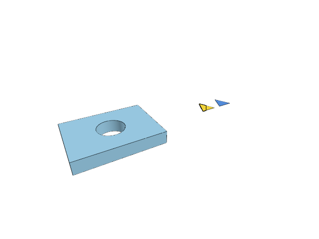
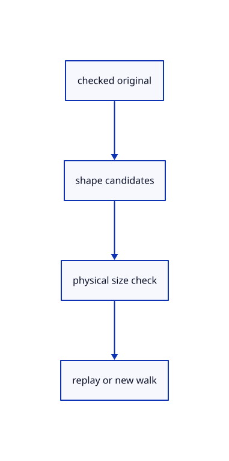

# 13.1.21 · Guard reusable walks with source validity and size

**Chapter 13 · Shared definitions and drawing sheets · Section 13.1 · Shared CAD definitions** · [Contents](contents.md)

**Typing: 11–21 minutes.** [Estimate](typing-load.md).

Refuse malformed source data and nonrigid size matches before replay. Walk changed or mirrored shapes independently.

## Type

Continue from [Replay sampled geometry in the new rigid frame](69ab-replay-sampled-geometry-in-the-new-rigid-frame.md). [Save or recover your work](recovery.md).

### 1. `src/cad_shape_cache.rs`

Validate original sources and physical size before reusing a display walk.

<details>
<summary>Locate the existing block</summary>

```rust
    }
}
```

</details>

After that block, type:

```rust
--8<-- "journey/code/69ac-guard-reusable-walks-with-source-validity-and-size-01.rs" skip=8
```

<details>
<summary>Supplied validation fixture</summary>

Copy this supplied authoring fixture once. Continue with the browser build below; the course does not require running native tests.

### 2. `src/cad_shape_cache.rs`

Copy congruent-source, chord/normal, shape-refusal and scoped-release regressions.

<details>
<summary>Locate the existing block</summary>

```text
    pub fn recordings(&self)->usize {self.records.values().map(Vec::len).sum()}
}
```

</details>

After that block, append this supplied code:

```text
--8<-- "journey/code/69ac-guard-reusable-walks-with-source-validity-and-size-02.rs" skip=82
```

</details>

## Run and check

Run this from `session_viewer` to select the fixed dependency versions and install supplied binary assets. It updates Cargo.lock and preserves the previous lock. It does not write implementation code:

```sh
npm --prefix ../session_tests run course -- dependencies 13.1.21
```

In your project:

```sh
cd workspace/journey
REGEN_PROTO=0 cargo build --lib --locked --target wasm32-unknown-unknown -j1
REGEN_PROTO=0 CARGO_BUILD_JOBS=1 trunk serve --port 8780
```

Open `http://127.0.0.1:8780/`. Keep an existing Trunk server running; saving rebuilds it.


### Recorded visual result

**Previous native render — current verification pending.**

Independent yellow and blue shared-definition placements remain visible beside original CAD borders.



*This recorded image predates a source or checker change. Rebuild this checkpoint before using it as current evidence; browser controls require separate acceptance.*

This reference image is shared with [13.1.14 · Inspect and exercise original definition instances](69n-inspect-and-exercise-original-definition-instances.md). It does not demonstrate a new feature by itself.

<details>
<summary>Code explanation and diagram</summary>


checked original → shape candidates → physical size check → replay or new walk.



Why must physical size be checked separately?

Normalized coordinates can match uniformly scaled geometry. A rigid replay has no scale and would otherwise display the wrong-sized solid.

Study estimate, including typing and experiments: 0.5–1 hours.

</details>

<details>
<summary>Optional experiment</summary>

Inspect moved/turned equivalence, scale/mirror/changed-hole refusal, invalid-source and cache-release fixtures.

</details>

<details>
<summary>Check and save your work</summary>

Restore experimental edits, then run from `session_viewer`:

```sh
npm --prefix ../session_tests run course -- check 13.1.21
npm --prefix ../session_tests run course -- save 13.1.21
```

Source comparison leaves your project untouched. [Save and recovery instructions](recovery.md).

</details>

<details>
<summary>Viewer coverage and verification</summary>


The inherited instance acceptance remains authored and unrun. The final congruent-CAD exercise inspects one walk/one replay, original identities, Save/Open, Delete/Undo/Redo and Close; actual browser execution remains required.

[Full validation scope](release.md).

To reproduce the scripted acceptance of the reference checkpoint, run from `session_viewer` with the [course bundle server](release.md#reproduce) running on port 8781:

```sh
npm --prefix ../session_tests run course -- capture 13.1.21
```

This uses the verified reference bundle; it does not check or change your typed project.

</details>
