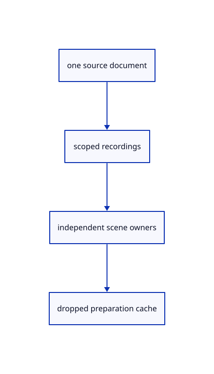

# 13.1.22 · Share recordings only during document preparation

**Chapter 13 · Shared definitions and drawing sheets · Section 13.1 · Shared CAD definitions** · [Contents](contents.md)

**Typing: 17–34 minutes.** [Estimate](typing-load.md).

Create one cache while preparing ordinary originals and definitions. Adoption retains scene sources while the temporary recordings are released.

## Type

Continue from [Guard reusable walks with source validity and size](69ac-guard-reusable-walks-with-source-validity-and-size.md). [Save or recover your work](recovery.md).

### 1. `src/scene.rs`

Reuse scoped CAD recordings across original objects and definition templates.

Edit these blocks from bottom to top. Keep the surrounding lines unchanged.

<details>
<summary>Locate this block</summary>

```rust
    }

    pub fn clear(&mut self) {
        self.instances.clear();
        self.created=None;
        self.ids=Default::default();
        self.view=Default::default();
```

</details>

Replace it with:

```rust
    }

    pub fn clear(&mut self) {
        self.cad_walks=[0;2];self.instances.clear();
        self.created=None;
        self.ids=Default::default();
        self.view=Default::default();
```

<details>
<summary>Locate this block</summary>

```rust
    }

    pub fn insert_cad(&mut self,source:Rc<session_rust::BRep>)->Result<ObjectId,&'static str> {
        let (prepared,mesh)=crate::cad_display::prepare(source)?;let prepared=Rc::new(prepared);let id=self.insert(mesh)?;self.objects.iter_mut().find(|row|row.id==id).unwrap().cad=Some(prepared);Ok(id)
    }

    pub fn insert_surface(&mut self,source:Rc<session_rust::NurbsSurface>)->Result<ObjectId,&'static str> {
```

</details>

Replace it with:

```rust
    }

    pub fn insert_cad(&mut self,source:Rc<session_rust::BRep>)->Result<ObjectId,&'static str> {
        self.insert_prepared_cad(crate::cad_display::prepare(source)?)
    }

    pub(crate) fn insert_prepared_cad(&mut self,(prepared,mesh):(crate::cad_display::Prepared,crate::prepared::PreparedMesh))->Result<ObjectId,&'static str> {
        let prepared=Rc::new(prepared);let id=self.insert(mesh)?;self.objects.iter_mut().find(|row|row.id==id).unwrap().cad=Some(prepared);Ok(id)
    }

    pub fn insert_surface(&mut self,source:Rc<session_rust::NurbsSurface>)->Result<ObjectId,&'static str> {
```

<details>
<summary>Locate this block</summary>

```rust
    }

    pub fn empty()->Self {
        Self {instances:Default::default(),created:None,ids:Default::default(),view:Default::default(),forest:Default::default(),streamed:Vec::new(),clouds:Vec::new(),texts:Vec::new(),objects:Vec::new(),points:Vec::new(),paths:Vec::new(),lines:Vec::new(),next_id:1,extra:None}
    }

    pub fn demo() -> Self {
```

</details>

Replace it with:

```rust
    }

    pub fn empty()->Self {
        Self {cad_walks:[0;2],instances:Default::default(),created:None,ids:Default::default(),view:Default::default(),forest:Default::default(),streamed:Vec::new(),clouds:Vec::new(),texts:Vec::new(),objects:Vec::new(),points:Vec::new(),paths:Vec::new(),lines:Vec::new(),next_id:1,extra:None}
    }

    pub fn demo() -> Self {
```

<details>
<summary>Locate this block</summary>

```rust

#[derive(Clone)]
pub struct Scene {
    pub(crate) instances:std::collections::HashMap<ObjectId,crate::instance_plan::Owner>,
    pub(crate) created:Option<u32>,
    ids:Rc<std::collections::HashSet<ObjectId>>,
```

</details>

Replace it with:

```rust

#[derive(Clone)]
pub struct Scene {
    pub cad_walks:[usize;2],
    pub(crate) instances:std::collections::HashMap<ObjectId,crate::instance_plan::Owner>,
    pub(crate) created:Option<u32>,
    ids:Rc<std::collections::HashSet<ObjectId>>,
```

<details>
<summary>Complete updated block reference</summary>

```rust
use crate::{mesh::Mesh, prepared::PreparedMesh};
use std::rc::Rc;

#[derive(Clone, Copy, Debug, PartialEq, Eq, Hash)]
pub struct ObjectId(u32);

impl ObjectId { pub fn value(self) -> u32 { self.0 } }

#[derive(Clone)]
pub struct Object {
    pub cad:Option<Rc<crate::cad_display::Prepared>>,
    pub surface:Option<Rc<crate::surface::Prepared>>,
    pub id: ObjectId,
    pub guid: String,
    pub metadata: Rc<crate::row_metadata::RowMetadata>,
    pub mesh: Rc<Mesh>,
    pub model: session_rust::Xform,
    editable: crate::edit_source::EditSource,
}

impl Object {
    pub fn visible(&self) -> bool { self.metadata.is_visible }

    pub fn geometry(&self) -> Option<&Rc<session_rust::Mesh>> {
        match &self.editable { crate::edit_source::EditSource::Loaded { geometry, .. } => Some(geometry), _ => None }
    }

    pub fn source(&self) -> Option<&crate::document::Source> {
        match &self.editable { crate::edit_source::EditSource::Loaded { source, .. } => source.as_ref(), _ => None }
    }

    pub fn origin(&self) -> Option<&Rc<crate::origin::Origin>> {
        match &self.editable {
            crate::edit_source::EditSource::Loaded { source, .. } => source.as_ref().map(|source| &source.origin),
            crate::edit_source::EditSource::Released { origin, .. } => Some(origin),
        }
    }

    pub fn release_epoch(&self) -> Option<u64> {
        match &self.editable { crate::edit_source::EditSource::Released { epoch, .. } => Some(*epoch), _ => None }
    }

    pub fn can_unload(&self) -> bool {
        let Some(source) = self.source() else { return false; };
        let Some(geometry) = self.geometry() else { return false; };
        source.origin.location.is_some() && self.metadata.source_guid == source.guid
            && geometry.guid() == source.guid && self.metadata.name == geometry.name
            && self.metadata.is_visible == geometry.is_visible && self.metadata.is_locked == geometry.is_locked
            && source.document.objects.meshes.iter().any(|mesh| Rc::ptr_eq(mesh, geometry))
    }

    pub fn world_point(&self, vertex: [f32; 6]) -> [f64; 3] {
        let local = session_rust::Point::new(vertex[0] as f64, vertex[1] as f64, vertex[2] as f64);
        let world = self.model.transform_point(&local);
        [world[0], world[1], world[2]]
    }
}

#[derive(Clone)]
pub struct LineObject {
    pub guid: String,
    pub id: ObjectId,
    pub prepared: crate::stroke::PreparedLine,
    pub model: session_rust::Xform,
}

impl LineObject {
    pub fn visible(&self) -> bool { self.prepared.source.is_visible }

    pub fn endpoints(&self) -> [session_rust::Point; 2] {
        let line = &self.prepared.source;
        [self.model.transform_point(&line.start()), self.model.transform_point(&line.end())]
    }

    pub fn stroke(&self) -> crate::stroke::Stroke {
        let [start, end] = self.endpoints();
        crate::stroke::Stroke { start: std::array::from_fn(|i| start[i] as f32),
            end: std::array::from_fn(|i| end[i] as f32), ..self.prepared.display }
    }
}

#[derive(Clone)]
pub struct PathObject { pub controls_visible: bool, pub id: ObjectId, pub guid: String, pub prepared: crate::chain::PreparedChain, pub model: session_rust::Xform }

impl PathObject {
    pub fn visible(&self) -> bool { self.prepared.source.visible() }

    pub fn segments(&self) -> Vec<crate::chain::Segment> {
        let mut points = Vec::new();
        for p in self.points() {
            let p = std::array::from_fn(|i| p[i] as f32);
            if points.last() != Some(&p) { points.push(p); }
        }
        crate::chain::PreparedChain { points: Rc::new(points), ..self.prepared.clone() }.segments()
    }

    pub fn bounds_points(&self) -> Vec<session_rust::Point> {
        self.prepared.source.bounds_coordinates().into_iter().map(|p|
            self.model.transform_point(&session_rust::Point::new(p[0], p[1], p[2]))).collect()
    }

    pub fn points(&self) -> Vec<session_rust::Point> {
        self.prepared.source.coordinates().into_iter().map(|p| self.model.transform_point(&session_rust::Point::new(p[0], p[1], p[2]))).collect()
    }


}

pub struct ControlMarker { pub parent: ObjectId, pub control: crate::controls::Control, pub display: crate::marker::Marker }

#[derive(Clone)]
pub struct PointObject { pub id: ObjectId, pub guid: String, pub prepared: crate::marker::PreparedPoint, pub model: session_rust::Xform }

impl PointObject {
    pub fn visible(&self) -> bool { self.prepared.source.is_visible }

    pub fn point(&self) -> session_rust::Point { self.model.transform_point(&self.prepared.source) }
    pub fn marker(&self) -> crate::marker::Marker { crate::marker::Marker { center: self.point().to_f32(), ..self.prepared.display } }
}

#[derive(Clone)]
pub struct Scene {
    pub cad_walks:[usize;2],
    pub(crate) instances:std::collections::HashMap<ObjectId,crate::instance_plan::Owner>,
    pub(crate) created:Option<u32>,
    ids:Rc<std::collections::HashSet<ObjectId>>,
    pub view:Rc<crate::view_flags::Flags>,
    pub forest:crate::hierarchy::Forest,
    streamed:Vec<crate::range_cloud::Row>,
    clouds:Vec<crate::cloud::Row>,
    texts:Vec<crate::scene_label::Row>,
    points: Vec<PointObject>,
    paths: Vec<PathObject>,
    lines: Vec<LineObject>,
    objects: Vec<Object>,
    next_id: u32,
    extra: Option<ObjectId>,
}

impl Scene {
    pub fn pick_id(&self,value:u32)->Option<ObjectId> {
        let id=ObjectId(value);(self.visible(id) && !self.view.locked.contains(&id) && !self.forest.readonly(id)).then_some(id)
    }

    pub fn empty()->Self {
        Self {cad_walks:[0;2],instances:Default::default(),created:None,ids:Default::default(),view:Default::default(),forest:Default::default(),streamed:Vec::new(),clouds:Vec::new(),texts:Vec::new(),objects:Vec::new(),points:Vec::new(),paths:Vec::new(),lines:Vec::new(),next_id:1,extra:None}
    }

    pub fn demo() -> Self {
        let pink = PreparedMesh::triangle([
            [-0.7, -0.6, 0.25], [0.5, -0.6, 0.25], [-0.1, 0.6, 0.25],
        ], [0.9, 0.25, 0.45]).expect("Valid pink triangle");
        let turquoise = PreparedMesh::triangle([
            [-0.4, -0.2, 0.75], [0.8, -0.2, 0.75], [0.2, 0.8, 0.75],
        ], [0.05, 0.7, 0.7]).expect("Valid turquoise triangle");
        let mut scene = Self::empty();
        scene.insert(pink).expect("ID available");
        scene.insert(turquoise).expect("ID available");
        scene
    }

    pub fn restore(&mut self, mut saved: Self) {
        saved.next_id = saved.next_id.max(self.next_id);
        *self = saved;
    }

    pub fn visible(&self,id:ObjectId)->bool {self.contains(id)&&!self.view.is_hidden(&id)}

    pub(crate) fn restore_view(&mut self,mut saved:Self) {saved.view=Rc::clone(&self.view);self.restore(saved);Rc::make_mut(&mut self.view).refresh(&self.forest);}

    pub fn bounds(&self) -> Option<crate::bounds::Bounds> {
        let mut bounds: Option<crate::bounds::Bounds> = None;
        for object in self.objects.iter().filter(|row| self.visible(row.id)) {
            for vertex in object.mesh.vertices() {
                let point = object.world_point(*vertex);
                match &mut bounds {
                    Some(bounds) => bounds.include(point),
                    None => bounds = Some(crate::bounds::Bounds::point(point)),
                }
            }
        }
        for line in self.lines.iter().filter(|line| self.visible(line.id)) {
            for point in line.endpoints() {
                let point = [point[0], point[1], point[2]];
                match &mut bounds {
                    Some(bounds) => bounds.include(point),
                    None => bounds = Some(crate::bounds::Bounds::point(point)),
                }
            }
        }
        for row in self.paths.iter().filter(|row| self.visible(row.id)) {
            for point in row.bounds_points() {
                let point = [point[0], point[1], point[2]];
                match &mut bounds { Some(bounds) => bounds.include(point), None => bounds = Some(crate::bounds::Bounds::point(point)) }
            }
        }
        for row in self.points.iter().filter(|row| self.visible(row.id)) {
            let p = row.point(); let p = [p[0], p[1], p[2]];
            match &mut bounds { Some(bounds) => bounds.include(p), None => bounds = Some(crate::bounds::Bounds::point(p)) }
        }
        for row in self.texts.iter().filter(|row|self.visible(row.id)) {if let Some(next)=row.bounds() {if let Some(bounds)=&mut bounds {bounds.include(next.min);bounds.include(next.max);} else {bounds=Some(next);}}}
        for row in self.streamed.iter().filter(|r|self.visible(r.id)) {let next=row.bounds();if let Some(bounds)=&mut bounds {bounds.include(next.min);bounds.include(next.max);} else {bounds=Some(next);}}
        for row in self.clouds.iter().filter(|r|self.visible(r.id)) {let next=row.bounds();if let Some(bounds)=&mut bounds {bounds.include(next.min);bounds.include(next.max);} else {bounds=Some(next);}}
        bounds
    }

    pub fn bounds_of(&self, ids: &[ObjectId]) -> Option<crate::bounds::Bounds> {
        let mut bounds: Option<crate::bounds::Bounds> = None;
        for id in ids { if let Some(next) = self.selected_bounds(*id) {
            if let Some(b) = &mut bounds { b.include(next.min); b.include(next.max); } else { bounds = Some(next); }
        } } bounds
    }

    pub fn placement(&self, id: ObjectId) -> Option<session_rust::Xform> {
        self.objects.iter().find(|r| r.id==id).map(|r| r.model.clone())
            .or_else(|| self.lines.iter().find(|r| r.id==id).map(|r| r.model.clone()))
            .or_else(|| self.paths.iter().find(|r| r.id==id).map(|r| r.model.clone()))
            .or_else(|| self.points.iter().find(|r| r.id==id).map(|r| r.model.clone()))
            .or_else(|| self.clouds.iter().find(|r|r.id==id).map(|r|r.model.clone()))
            .or_else(|| self.streamed.iter().find(|r|r.id==id).map(|r|r.model.clone()))
            .or_else(|| self.texts.iter().find(|r| r.id==id).map(|r| r.model.clone()))
    }

    pub fn with_descendants(&self,ids:&[ObjectId])->Vec<ObjectId> {self.forest.descendants(ids).into_iter().filter(|id|self.contains(*id)).collect()}

    pub fn place_owner(&mut self, id: ObjectId, model: session_rust::Xform) -> Result<(), &'static str> {
        if self.forest.readonly(id) {return Err("Object attributes follow their parent and are read only");}
        self.place_following(id,model)
    }

    pub(crate) fn place_following(&mut self,id:ObjectId,model:session_rust::Xform)->Result<(), &'static str> {
        if self.objects.iter().any(|r| r.id==id) { self.place_mesh(id,model) }
        else if self.lines.iter().any(|r| r.id==id) { self.place_line(id,model) }
        else if self.paths.iter().any(|r| r.id==id) { self.place_path(id,model) }
        else if self.clouds.iter().any(|r|r.id==id) {self.place_cloud(id,model)}
        else if self.streamed.iter().any(|r|r.id==id) {self.place_stream(id,model)}
        else if self.texts.iter().any(|r|r.id==id) {self.place_text(id,model)}
        else { self.place_point(id,model) }
    }

    pub fn translate(&mut self, id: ObjectId, offset: [f64; 3]) -> Result<(), &'static str> {
        let shift = session_rust::Xform::translation(offset[0], offset[1], offset[2]);
        if let Some(row) = self.objects().iter().find(|r| r.id == id) {
            if row.geometry().is_none() { return Err("Reload editable sources before Move"); }
            let model = &shift * &row.model; return self.place(id, model);
        }
        if let Some(row) = self.lines().iter().find(|r| r.id == id) { let model = &shift * &row.model; return self.place_line(id, model); }
        if let Some(row) = self.paths().iter().find(|r| r.id == id) { let model = &shift * &row.model; return self.place_path(id, model); }
        if let Some(row) = self.points().iter().find(|r| r.id == id) { let model = &shift * &row.model; return self.place_point(id, model); }
        if let Some(row)=self.streamed.iter().find(|r|r.id==id) {let model=&shift*&row.model;return self.place_stream(id,model);}
        if let Some(row)=self.clouds.iter().find(|r|r.id==id) {let model=&shift*&row.model;return self.place_cloud(id,model);}
        if let Some(row)=self.texts.iter().find(|r|r.id==id) {let model=&shift*&row.model;return self.place_text(id,model);}
        Err("Object not found")
    }

    pub fn selected_bounds(&self, id: ObjectId) -> Option<crate::bounds::Bounds> {
        if !self.visible(id) { return None; }
        if let Some(row)=self.clouds.iter().find(|row|row.id==id) {return Some(row.bounds());}
        if let Some(row)=self.streamed.iter().find(|row|row.id==id) {return Some(row.bounds());}
        if let Some(row)=self.texts.iter().find(|row|row.id==id) {return row.bounds();}
        let object = self.objects.iter().find(|object| object.id == id)?;
        let mut vertices = object.mesh.vertices().iter();
        let first = vertices.next()?;
        let mut bounds = crate::bounds::Bounds::point(object.world_point(*first));
        for vertex in vertices {
            bounds.include(object.world_point(*vertex));
        }
        Some(bounds)
    }

    pub fn line_capacity_bytes(&self) -> usize { self.lines.capacity() * std::mem::size_of::<LineObject>() }

    pub fn cloud_controls(&mut self,parent:Option<ObjectId>) {
        let parent=parent.filter(|id|self.pick_id(id.value()).is_some());
        for row in &mut self.clouds {row.controls_visible=Some(row.id)==parent;}
        for row in &mut self.streamed {row.controls_visible=Some(row.id)==parent;}
    }
    pub fn streams(&self)->&[crate::range_cloud::Row] {&self.streamed}
    pub fn insert_stream(&mut self,prepared:Rc<crate::range_cloud::Prepared>,model:session_rust::Xform,point_px:f32)->Result<ObjectId,&'static str> {
        if !crate::placement::valid(&model.m)||!point_px.is_finite()||point_px<0. {return Err("Invalid streamed source placement or point size");}
        let next=self.next_id.checked_add(1).ok_or("Object IDs exhausted")?;let id=ObjectId(self.next_id);let mut guid=prepared.source.guid.clone();while self.streamed.iter().any(|row|row.guid==guid) {guid=uuid::Uuid::new_v4().to_string();}
        let row=crate::range_cloud::Row {id,guid:guid.clone(),prepared,model,point_px,controls_visible:false};
        if row.bounds().min.into_iter().chain(row.bounds().max).any(|v|!v.is_finite()||!(v as f32).is_finite()) {return Err("Streamed source placement exceeds display range");}
        let name=row.prepared.source.name.clone();let properties=row.prepared.source.properties;
        self.next_id=next;Rc::make_mut(&mut self.ids).insert(id);Rc::make_mut(&mut self.view).initial(id,properties.visible,properties.locked);self.streamed.push(row);crate::layer_edit::attach_generated(self,id,guid,name)?;Ok(id)
    }
    pub fn place_stream(&mut self,id:ObjectId,model:session_rust::Xform)->Result<(),&'static str> {
        if !crate::placement::valid(&model.m) {return Err("Invalid streamed source placement");}
        let row=self.streamed.iter_mut().find(|row|row.id==id).ok_or("Streamed source is gone")?;let mut candidate=row.clone();candidate.model=model;
        if candidate.bounds().min.into_iter().chain(candidate.bounds().max).any(|v|!v.is_finite()||!(v as f32).is_finite()) {return Err("Streamed source placement exceeds display range");}*row=candidate;Ok(())
    }
    pub fn clouds(&self)->&[crate::cloud::Row] {&self.clouds}
    pub fn insert_cloud(&mut self,prepared:crate::cloud::Prepared)->Result<ObjectId,&'static str> {
        let next=self.next_id.checked_add(1).ok_or("Object IDs exhausted")?;let id=ObjectId(self.next_id);let mut guid=prepared.source.guid().to_string();while self.clouds.iter().any(|r|r.guid==guid) {guid=uuid::Uuid::new_v4().to_string();}
        let name=prepared.source.name.clone();let visible=prepared.source.is_visible;let locked=prepared.source.is_locked;let row=crate::cloud::Row {point_px:0.,controls_visible:false,id,guid:guid.clone(),prepared,model:session_rust::Xform::identity()};
        self.next_id=next;Rc::make_mut(&mut self.ids).insert(id);Rc::make_mut(&mut self.view).initial(id,visible,locked);self.clouds.push(row);crate::layer_edit::attach_generated(self,id,guid,name)?;Ok(id)
    }
    pub fn place_cloud(&mut self,id:ObjectId,model:session_rust::Xform)->Result<(),&'static str> {
        if !crate::placement::valid(&model.m) {return Err("Invalid cloud placement");}let row=self.clouds.iter_mut().find(|r|r.id==id).ok_or("Cloud object not found")?;let mut candidate=row.clone();candidate.model=model;if candidate.bounds().min.into_iter().chain(candidate.bounds().max).any(|v|!(v as f32).is_finite()) {return Err("Cloud placement exceeds display range");}*row=candidate;Ok(())
    }
    pub fn texts(&self)->&[crate::scene_label::Row] {&self.texts}
    pub(crate) fn texts_mut(&mut self)->&mut [crate::scene_label::Row] {&mut self.texts}
    pub fn insert_text(&mut self,prepared:crate::scene_label::Prepared)->Result<ObjectId,&'static str> {
        let next=self.next_id.checked_add(1).ok_or("Object IDs exhausted")?;let id=ObjectId(self.next_id);let mut guid=prepared.source.guid.clone();while self.texts.iter().any(|row|row.guid==guid) {guid=uuid::Uuid::new_v4().to_string();}let label=prepared.source.name.clone();let row=crate::scene_label::Row {id,guid:guid.clone(),prepared,model:session_rust::Xform::identity()};row.label(false,true)?;if row.bounds().is_some_and(|b|b.min.into_iter().chain(b.max).any(|v|!(v as f32).is_finite())) {return Err("Text bounds exceed the display range");}
        self.next_id=next;Rc::make_mut(&mut self.ids).insert(id);Rc::make_mut(&mut self.view).initial(id,row.prepared.source.visible,row.prepared.source.locked);self.texts.push(row);crate::layer_edit::attach_generated(self,id,guid,label)?;Ok(id)
    }
    pub fn place_text(&mut self,id:ObjectId,model:session_rust::Xform)->Result<(),&'static str> {
        if !crate::placement::valid(&model.m) {return Err("Invalid text placement");}let row=self.texts.iter_mut().find(|row|row.id==id).ok_or("Text object not found")?;let mut candidate=row.clone();candidate.model=model;candidate.label(false,true)?;if candidate.bounds().is_some_and(|b|b.min.into_iter().chain(b.max).any(|v|!(v as f32).is_finite())) {return Err("Text bounds exceed the display range");}*row=candidate;Ok(())
    }
    pub fn text_labels(&self,selected:&[ObjectId])->Result<Vec<crate::text::TextLabel>,&'static str> {self.texts.iter().filter(|row|self.visible(row.id)).map(|row|row.label(selected.contains(&row.id),self.pick_id(row.id.value()).is_some())).collect()}
    pub fn points(&self) -> &[PointObject] { &self.points }

    pub fn point_capacity_bytes(&self) -> usize { self.points.capacity() * std::mem::size_of::<PointObject>() }

    pub fn insert_point(&mut self, prepared: crate::marker::PreparedPoint) -> Result<ObjectId, &'static str> {
        let next = self.next_id.checked_add(1).ok_or("Object IDs exhausted")?;
        let mut guid = prepared.source.guid().to_owned();
        while self.points.iter().any(|row| row.guid == guid) || self.paths.iter().any(|row| row.guid == guid)
            || self.objects.iter().any(|row| row.guid == guid) || self.lines.iter().any(|row| row.guid == guid) {
            guid = uuid::Uuid::new_v4().to_string();
        }
        let id = ObjectId(self.next_id); self.next_id = next;
        Rc::make_mut(&mut self.ids).insert(id);
        Rc::make_mut(&mut self.view).initial(id,prepared.source.is_visible,prepared.source.is_locked);
        let label=prepared.source.name.clone();let node_guid=guid.clone();self.points.push(PointObject { id, guid, prepared, model: session_rust::Xform::identity() });crate::layer_edit::attach_generated(self,id,node_guid,label)?;Ok(id)
    }

    pub fn place_point(&mut self, id: ObjectId, model: session_rust::Xform) -> Result<(), &'static str> {
        if !crate::placement::valid(&model.m) { return Err("Invalid point placement"); }
        let row = self.points.iter_mut().find(|row| row.id == id).ok_or("Point not found")?;
        let point = model.transform_point(&row.prepared.source);
        if (0..3).any(|i| !(point[i] as f32).is_finite()) { return Err("Point placement exceeds the display range"); }
        row.model = model; Ok(())
    }

    pub fn show_controls(&mut self, visible: bool) {
        for row in &mut self.paths { row.controls_visible = visible && matches!(row.prepared.source, crate::chain::Source::Curve(..)); }
    }

    pub fn control_markers(&self) -> Vec<ControlMarker> {
        let mut markers = Vec::new();
        for row in self.paths.iter().filter(|row| row.controls_visible && self.visible(row.id)) {
            for control in row.prepared.source.controls() {
                let p = control.position().expect("Validated original control");
                let p = row.model.transform_point(&session_rust::Point::new(p[0], p[1], p[2]));
                let display = crate::marker::Marker { center: p.to_f32(), ..control.marker().expect("Prepared control marker") };
                markers.push(ControlMarker { parent: row.id, control, display });
            }
        }
        markers
    }

    pub fn paths(&self) -> &[PathObject] { &self.paths }

    pub fn path_capacity_bytes(&self) -> usize { self.paths.capacity() * std::mem::size_of::<PathObject>() }

    pub fn insert_path(&mut self, prepared: crate::chain::PreparedChain) -> Result<ObjectId, &'static str> {
        let next = self.next_id.checked_add(1).ok_or("Object IDs exhausted")?;
        let mut guid = prepared.source.guid().to_owned();
        while self.paths.iter().any(|row| row.guid == guid) || self.objects.iter().any(|row| row.guid == guid)
            || self.lines.iter().any(|row| row.guid == guid) { guid = uuid::Uuid::new_v4().to_string(); }
        let id = ObjectId(self.next_id); self.next_id = next;
        Rc::make_mut(&mut self.ids).insert(id);
        Rc::make_mut(&mut self.view).initial(id,prepared.source.visible(),prepared.source.locked());
        let label=prepared.source.name().to_owned();let node_guid=guid.clone();self.paths.push(PathObject { controls_visible: false, id, guid, prepared, model: session_rust::Xform::identity() });crate::layer_edit::attach_generated(self,id,node_guid,label)?;Ok(id)
    }

    pub fn place_path(&mut self, id: ObjectId, model: session_rust::Xform) -> Result<(), &'static str> {
        if !crate::placement::valid(&model.m) { return Err("Invalid path placement"); }
        let row = self.paths.iter_mut().find(|row| row.id == id).ok_or("Path not found")?;
        for p in row.prepared.source.coordinates().into_iter().chain(row.prepared.source.bounds_coordinates()) {
            let p = model.transform_point(&session_rust::Point::new(p[0], p[1], p[2]));
            if (0..3).any(|i| !(p[i] as f32).is_finite()) { return Err("Path placement exceeds the display range"); }
        }
        row.model = model; Ok(())
    }

    pub fn lines(&self) -> &[LineObject] { &self.lines }

    pub fn insert_line(&mut self, prepared: crate::stroke::PreparedLine) -> Result<ObjectId, &'static str> {
        let next = self.next_id.checked_add(1).ok_or("Object IDs exhausted")?;
        let id = ObjectId(self.next_id); self.next_id = next;
        Rc::make_mut(&mut self.ids).insert(id);
        Rc::make_mut(&mut self.view).initial(id,prepared.source.is_visible,prepared.source.is_locked);
        let mut guid=prepared.source.guid().to_owned();while self.lines.iter().any(|row|row.guid==guid) {guid=uuid::Uuid::new_v4().to_string();}let label=prepared.source.name.clone();
        self.lines.push(LineObject { guid:guid.clone(), id, prepared, model: session_rust::Xform::identity() });
        crate::layer_edit::attach_generated(self,id,guid,label)?;
        Ok(id)
    }

    pub fn place_line(&mut self, id: ObjectId, model: session_rust::Xform) -> Result<(), &'static str> {
        if !crate::placement::valid(&model.m) { return Err("Invalid line placement"); }
        let row = self.lines.iter_mut().find(|row| row.id == id).ok_or("Line not found")?;
        for point in [row.prepared.source.start(), row.prepared.source.end()] {
            let placed = model.transform_point(&point);
            if (0..3).any(|i| !(placed[i] as f32).is_finite()) { return Err("Line placement exceeds the display range"); }
        }
        row.model = model; Ok(())
    }

    pub fn objects(&self) -> &[Object] {
        &self.objects
    }

    pub(crate) fn objects_mut(&mut self) -> &mut [Object] { &mut self.objects }

    pub(crate) fn unload(&mut self, origins: &std::collections::HashSet<uuid::Uuid>, epoch: u64) {
        for row in &mut self.objects {
            if let Some(origin) = row.origin().filter(|origin| origins.contains(&origin.id)).cloned() {
                row.editable = crate::edit_source::EditSource::Released { origin, epoch };
            }
        }
    }

    pub(crate) fn hydrate(&mut self, prepared: &crate::rehydrate::PreparedReload) {
        for row in &mut self.objects {
            if !prepared.key.matches(row) { continue; }
            let Some(geometry) = prepared.geometry(&row.metadata.source_guid).cloned() else { continue; };
            let source = crate::document::Source { document: Rc::clone(&prepared.document),
                guid: row.metadata.source_guid.clone(), origin: Rc::clone(&prepared.key.origin) };
            row.editable = crate::edit_source::EditSource::Loaded { geometry, source: Some(source) };
        }
    }

    pub fn insert(&mut self, prepared: PreparedMesh) -> Result<ObjectId, &'static str> {
        if !crate::placement::valid(&prepared.model.m) { return Err("Placement must be finite, affine and fit the display range"); }
        let next = self.next_id.checked_add(1).ok_or("Object IDs exhausted")?;
        let id = ObjectId(self.next_id);
        self.next_id = next;
        let mut guid = prepared.geometry.guid().to_owned();
        while self.objects.iter().any(|object| object.guid == guid) {
            guid = uuid::Uuid::new_v4().to_string();
        }
        Rc::make_mut(&mut self.ids).insert(id);
        Rc::make_mut(&mut self.view).initial(id,prepared.geometry.is_visible,prepared.geometry.is_locked);
        let metadata = Rc::new(crate::row_metadata::RowMetadata::from_mesh(&prepared.geometry));
        let generated=prepared.source.is_none();
        let editable = crate::edit_source::EditSource::Loaded { geometry: prepared.geometry, source: prepared.source };
        let label=metadata.name.clone();let node_guid=guid.clone();
        self.objects.push(Object {cad:None,surface:None, id, guid, metadata, mesh: Rc::new(prepared.display), model: prepared.model, editable });
        if generated {crate::layer_edit::attach_generated(self,id,node_guid,label)?;}
        Ok(id)
    }

    pub fn insert_cad(&mut self,source:Rc<session_rust::BRep>)->Result<ObjectId,&'static str> {
        self.insert_prepared_cad(crate::cad_display::prepare(source)?)
    }

    pub(crate) fn insert_prepared_cad(&mut self,(prepared,mesh):(crate::cad_display::Prepared,crate::prepared::PreparedMesh))->Result<ObjectId,&'static str> {
        let prepared=Rc::new(prepared);let id=self.insert(mesh)?;self.objects.iter_mut().find(|row|row.id==id).unwrap().cad=Some(prepared);Ok(id)
    }

    pub fn insert_surface(&mut self,source:Rc<session_rust::NurbsSurface>)->Result<ObjectId,&'static str> {
        let prepared=Rc::new(crate::surface::Prepared::new(source)?);let mesh=prepared.mesh()?;let id=self.insert(mesh)?;
        self.objects.iter_mut().find(|row|row.id==id).unwrap().surface=Some(prepared);Ok(id)
    }

    pub(crate) fn copy_row(&mut self,id:ObjectId,all:bool)->Result<ObjectId,&'static str> {
        if self.objects.iter().any(|row|row.id==id&&row.geometry().is_none()) {return Err("Reload editable sources before copying");}
        if !self.contains(id) {return Err("Object is gone");}
        let next=self.next_id.checked_add(1).ok_or("Object IDs exhausted")?;let copy=ObjectId(self.next_id);let guid=uuid::Uuid::new_v4().to_string();
        if let Some(row)=self.objects.iter().find(|row|row.id==id) {let mut row=row.clone();row.id=copy;row.guid=guid;self.objects.push(row);}
        else if let Some(row)=self.lines.iter().find(|row|row.id==id) {let mut row=row.clone();row.id=copy;row.guid=guid;self.lines.push(row);}
        else if let Some(row)=self.paths.iter().find(|row|row.id==id) {let mut row=row.clone();row.id=copy;row.guid=guid;self.paths.push(row);}
        else if let Some(row)=self.points.iter().find(|row|row.id==id) {let mut row=row.clone();row.id=copy;row.guid=guid;self.points.push(row);}
        else if let Some(row)=self.streamed.iter().find(|row|row.id==id) {let mut row=row.clone();row.id=copy;row.guid=guid;row.controls_visible=false;self.streamed.push(row);}
        else if let Some(row)=self.clouds.iter().find(|row|row.id==id) {let mut row=row.clone();row.id=copy;row.guid=guid;row.controls_visible=false;self.clouds.push(row);}
        else if let Some(row)=self.texts.iter().find(|row|row.id==id) {let mut row=row.clone();row.id=copy;row.guid=guid;self.texts.push(row);}
        if let Some(owner)=self.instances.get(&id).cloned() {self.instances.insert(copy,owner);}
        self.next_id=next;Rc::make_mut(&mut self.ids).insert(copy);
        let view=Rc::make_mut(&mut self.view);if all {view.hide(&[copy],view.is_hidden(&id));view.lock(&[copy],view.locked.contains(&id));}
        for channel in [&mut view.faces,&mut view.edges] {if let Some(rgb)=channel.get(&id).copied() {channel.insert(copy,rgb);}}
        Ok(copy)
    }

    pub(crate) fn row_guid(&self,id:ObjectId)->Option<&str> {
        self.objects.iter().find(|row|row.id==id).map(|row|row.guid.as_str())
            .or_else(||self.paths.iter().find(|row|row.id==id).map(|row|row.guid.as_str()))
            .or_else(||self.points.iter().find(|row|row.id==id).map(|row|row.guid.as_str()))
            .or_else(||self.lines.iter().find(|row|row.id==id).map(|row|row.guid.as_str()))
            .or_else(||self.clouds.iter().find(|row|row.id==id).map(|row|row.guid.as_str()))
            .or_else(||self.streamed.iter().find(|row|row.id==id).map(|row|row.guid.as_str()))
            .or_else(||self.texts.iter().find(|row|row.id==id).map(|row|row.guid.as_str()))
    }

    pub(crate) fn append_document(&mut self,source:&Scene,name:&str,place:&session_rust::Xform,point_px:f32)->Result<(),&'static str> {
        if !crate::placement::valid(&place.m)||!point_px.is_finite() {return Err("Invalid document placement or point size");}
        let mut candidate=self.clone();let mut ids=source.ids.iter().copied().collect::<Vec<_>>();ids.sort_unstable_by_key(|id|id.value());
        let mut remap=std::collections::HashMap::new();let mut names=std::collections::HashMap::new();let mut used=candidate.ids.iter().filter_map(|id|candidate.row_guid(*id).map(str::to_owned)).collect::<std::collections::HashSet<_>>();
        for old in &ids {
            let id=ObjectId(candidate.reserve_document_key()?);remap.insert(*old,id);Rc::make_mut(&mut candidate.ids).insert(id);
            let mut guid=source.row_guid(*old).ok_or("Original source owner is missing")?.to_owned();while !used.insert(guid.clone()) {guid=uuid::Uuid::new_v4().to_string();}names.insert(*old,guid);
        }
        macro_rules! rows {($field:ident)=>{for row in &source.$field {let mut row=row.clone();let old=row.id;row.id=remap[&old];row.guid=names[&old].clone();candidate.$field.push(row);}};}
        rows!(objects);rows!(lines);rows!(paths);rows!(points);rows!(clouds);rows!(streamed);rows!(texts);
        for old in &ids {
            let id=remap[old];if let Some(owner)=source.instances.get(old) {candidate.instances.insert(id,owner.clone());}candidate.place_following(id,place*&source.placement(*old).ok_or("Original placement is missing")?)?;
            let view=Rc::make_mut(&mut candidate.view);view.initial(id,source.visible(*old),source.view.locked.contains(old));
            if let Some(rgb)=source.view.faces.get(old) {view.faces.insert(id,*rgb);}if let Some(rgb)=source.view.edges.get(old) {view.edges.insert(id,*rgb);}
            if source.clouds.iter().any(|row|row.id==*old)&&point_px>0. {candidate.cloud_point_size(id,point_px)?;}
            if source.streamed.iter().any(|row|row.id==*old)&&point_px>0. {candidate.streamed.iter_mut().find(|row|row.id==id).unwrap().point_px=point_px;}
        }
        for doc in &source.forest.documents {
            let mut doc=(**doc).clone();let old_key=doc.key;doc.key=candidate.reserve_document_key()?;
            if !name.is_empty() {doc.label=name.to_owned();}
            let guids=doc.nodes.iter().map(|node|(node.source.guid.clone(),uuid::Uuid::new_v4().to_string())).collect::<std::collections::HashMap<_,_>>();
            for node in &mut doc.nodes {node.object=node.object.map(|id|remap[&id]);node.source.guid=guids[&node.source.guid].clone();node.portable_guid=node.source.guid.clone();node.source.parent_guid=guids.get(&node.source.parent_guid).cloned().unwrap_or_default();}
            if source.created==Some(old_key)&&candidate.created.is_none() {candidate.created=Some(doc.key);}
            candidate.forest.push(doc);
        }
        self.restore(candidate);Ok(())
    }

    pub fn face_rgba(&self,id:ObjectId)->Option<[f32;4]> {
        if let Some(rgb)=self.view.faces.get(&id) {return Some([rgb[0] as f32/255.,rgb[1] as f32/255.,rgb[2] as f32/255.,1.]);}
        let owner=self.instances.get(&id)?;
        (owner.instance.flags&session_rust::InstanceRef::FLAG_COLOR!=0).then(|| {let c=&owner.instance.color;[c.r as f32,c.g as f32,c.b as f32,c.a as f32]})
    }

    pub(crate) fn used_guids(&self)->std::collections::HashSet<String> {
        self.objects.iter().map(|r|r.guid.clone()).chain(self.lines.iter().map(|r|r.guid.clone())).chain(self.paths.iter().map(|r|r.guid.clone())).chain(self.points.iter().map(|r|r.guid.clone())).chain(self.clouds.iter().map(|r|r.guid.clone())).chain(self.streamed.iter().map(|r|r.guid.clone())).chain(self.texts.iter().map(|r|r.guid.clone())).collect()
    }

    // Prepare a single placed row before appending it; repeated instances share geometry without cloning the growing destination scene.
    pub(crate) fn append_instance(&mut self,template:&Scene,owner:crate::instance_plan::Owner,model:session_rust::Xform,guid:String,point_px:f32)->Result<ObjectId,&'static str> {
        let mut placed=template.clone();let original=placed.ids.iter().copied().next().ok_or("Missing definition display owner")?;
        if placed.ids.len()!=1 {return Err("One definition must create one drawable owner");}
        placed.place_following(original,model)?;if !placed.clouds.is_empty()&&point_px>0. {placed.cloud_point_size(original,point_px)?;}
        let next=self.next_id.checked_add(1).ok_or("Object IDs exhausted")?;let id=ObjectId(self.next_id);
        let visible=owner.instance.flags&session_rust::InstanceRef::FLAG_HIDDEN==0;let locked=owner.instance.flags&session_rust::InstanceRef::FLAG_LOCKED!=0;
        if let Some(row)=placed.objects.first_mut() {row.metadata=Rc::new(crate::row_metadata::RowMetadata {source_guid:owner.instance.guid().into(),name:owner.instance.name.clone(),is_visible:visible,is_locked:locked});}
        macro_rules! append {($field:ident)=>{if let Some(mut row)=placed.$field.pop() {row.id=id;row.guid=guid.clone();self.$field.push(row);}};}
        append!(objects);append!(lines);append!(paths);append!(points);append!(clouds);
        self.next_id=next;Rc::make_mut(&mut self.ids).insert(id);Rc::make_mut(&mut self.view).initial(id,visible,locked);self.instances.insert(id,owner);Ok(id)
    }

    pub(crate) fn reserve_document_key(&mut self)->Result<u32,&'static str> {
        let key=self.next_id;self.next_id=self.next_id.checked_add(1).ok_or("Object IDs exhausted")?;Ok(key)
    }

    pub(crate) fn cloud_point_size(&mut self,id:ObjectId,px:f32)->Result<(),&'static str> {
        if !px.is_finite() {return Err("Non-finite cloud point size");}
        self.clouds.iter_mut().find(|row|row.id==id).ok_or("Cloud object not found")?.point_px=px;Ok(())
    }

    pub fn clear(&mut self) {
        self.cad_walks=[0;2];self.instances.clear();
        self.created=None;
        self.ids=Default::default();
        self.view=Default::default();
        self.forest=Default::default();
        self.clouds=Vec::new();self.streamed=Vec::new();
        self.texts=Vec::new();
        self.points = Vec::new();
        self.paths = Vec::new();
        self.lines = Vec::new();
        self.objects = Vec::new();
        self.extra = None;
    }

    pub fn replace(&mut self, loaded: crate::document::Loaded) -> Result<(), &'static str> {
        self.clear();
        self.import(loaded)
    }

    pub fn import(&mut self, loaded: crate::document::Loaded) -> Result<(), &'static str> {
        let mut objects=Vec::new();let key=self.next_id;
        for prepared in loaded.meshes {
            let guid=prepared.geometry.guid().to_owned();let name=prepared.geometry.name.clone();
            let id=self.insert(prepared)?;objects.push((guid,id,name));
        }
        self.forest.add(key,loaded.document.name.clone(),loaded.tree,&objects);if let Some(origin)=objects.first().and_then(|(_,id,_)|self.objects.iter().find(|row|row.id==*id)).and_then(|row|row.origin()).cloned() {Rc::make_mut(self.forest.documents.last_mut().unwrap()).header=Some(origin);}let colours=self.forest.colours(key);Rc::make_mut(&mut self.view).faces.extend(colours);Ok(())
    }

    pub fn place(&mut self, id: ObjectId, model: session_rust::Xform) -> Result<(), &'static str> {
        if self.forest.readonly(id) {return Err("Object attributes follow their parent and are read only");}
        self.place_mesh(id,model)
    }

    fn place_mesh(&mut self,id:ObjectId,model:session_rust::Xform)->Result<(), &'static str> {
        if !crate::placement::valid(&model.m)
        {
            return Err("Placement must be finite, affine and fit the display range");
        }
        let object = self.objects.iter_mut().find(|o| o.id == id).ok_or("Object not found")?;
        if object.geometry().is_none() { return Err("Reload editable sources before Move"); }
        object.model = model;
        Ok(())
    }

    pub fn remove(&mut self, id: ObjectId) -> bool {
        self.instances.remove(&id);
        let existed = Rc::make_mut(&mut self.ids).remove(&id);
        self.objects.retain(|row| row.id != id); self.lines.retain(|row| row.id != id);
        self.paths.retain(|row| row.id != id); self.points.retain(|row| row.id != id);self.texts.retain(|row|row.id!=id);self.clouds.retain(|row|row.id!=id);self.streamed.retain(|row|row.id!=id);
        if self.extra == Some(id) { self.extra = None; }
        existed
    }

    pub(crate) fn all_ids(&self)->std::collections::HashSet<ObjectId> {(*self.ids).clone()}
    pub fn contains(&self,id:ObjectId)->bool {self.ids.contains(&id)}

    pub fn next(&self,current:Option<ObjectId>)->Option<ObjectId> {
        let mut ids=self.objects.iter().map(|r|r.id).chain(self.lines.iter().map(|r|r.id)).chain(self.paths.iter().map(|r|r.id)).chain(self.points.iter().map(|r|r.id)).chain(self.texts.iter().map(|r|r.id)).chain(self.clouds.iter().map(|r|r.id)).chain(self.streamed.iter().map(|r|r.id)).filter(|id|self.pick_id(id.value()).is_some()).collect::<Vec<_>>();
        ids.sort_unstable_by_key(|id|id.value());if ids.is_empty() {return None;}
        let start=ids.iter().position(|id|Some(*id)==current).map_or(0,|i|i+1);Some(ids[start%ids.len()])
    }

    pub fn add_box(&mut self) -> Result<ObjectId, &'static str> {
        let mut source = session_rust::Mesh::create_box(0.8, 0.8, 0.8);
        source.set_objectcolor(session_rust::Color::new(0.65, 0.65, 0.65, 1.0));
        let id = self.insert(PreparedMesh::new(source)?)?;
        self.place(id, session_rust::Xform::translation(0.9, 0.0, 0.4))?;
        Ok(id)
    }

    pub fn toggle_extra(&mut self) {
        if let Some(id) = self.extra.take() {
            self.remove(id);
        } else {
            let extra = PreparedMesh::triangle([
                [-0.9, 0.3, 0.5], [-0.4, 0.3, 0.5], [-0.65, 0.9, 0.5],
            ], [0.2, 0.8, 0.3]).expect("Valid extra triangle");
            self.extra = Some(self.insert(extra).expect("ID available"));
        }
    }
}

#[cfg(test)]
mod tests {
    use super::*;

    #[test]
    fn unloading_policy_protects_generated_unlocated_and_modified_sources() {
        let mut scene = Scene::demo(); assert!(!scene.objects[0].can_unload());
        let bytes = crate::specimen::bytes();
        scene.replace(crate::document::load(&bytes).unwrap()).unwrap(); assert!(!scene.objects[0].can_unload());
        let url = Rc::new(crate::reload_url::ReloadUrl::new("test:policy".into()));
        scene.replace(crate::document::load_at(&bytes, Some(url)).unwrap()).unwrap();
        assert!(scene.objects.iter().all(Object::can_unload));
        let row = &mut scene.objects[0];
        Rc::make_mut(&mut row.metadata).is_locked = true; assert!(!row.can_unload());
        Rc::make_mut(&mut row.metadata).is_locked = row.geometry().unwrap().is_locked;
        assert!(row.can_unload());
        let source = row.source().cloned(); let geometry = Rc::new(session_rust::Mesh::create_box(1.0, 1.0, 1.0));
        row.editable = crate::edit_source::EditSource::Loaded { geometry, source }; assert!(!row.can_unload());
    }

    #[test]
    fn partial_replacement_failure_restores_owners_without_reusing_ids() {
        let mut scene = Scene::demo();
        let before = scene.objects.clone();
        scene.next_id = u32::MAX - 1;
        let loaded = crate::document::load(&crate::specimen::bytes()).unwrap();
        let mut history = crate::history::History::default();
        assert!(history.try_edit(&mut scene, |scene| scene.replace(loaded)).is_err());
        assert_eq!(scene.next_id, u32::MAX);
        assert_eq!(scene.objects.len(), before.len());
        for (object, old) in scene.objects.iter().zip(&before) {
            assert_eq!(object.id, old.id);
            assert!(Rc::ptr_eq(object.geometry().unwrap(), old.geometry().unwrap()));
            assert!(Rc::ptr_eq(&object.mesh, &old.mesh));
        }
        assert!(!history.undo(&mut scene));
    }

    #[test]
    fn removal_moves_a_row_without_changing_its_identity() {
        let mut scene = Scene::demo();
        let first = scene.objects()[0].id;
        let second = scene.objects()[1].id;
        assert!(scene.remove(first));
        assert_eq!(scene.objects()[0].id, second);
        assert_eq!(scene.next(None), Some(second));
        assert!(!scene.contains(first));
        scene.toggle_extra();
        assert_ne!(scene.objects()[1].id, first);
        assert_ne!(scene.objects()[1].id, second);
    }

    #[test]
    fn toggling_the_extra_object_uses_its_id_after_other_removals() {
        let mut scene = Scene::demo();
        scene.toggle_extra();
        let extra = scene.objects()[2].id;
        scene.remove(scene.objects()[0].id);
        scene.toggle_extra();
        assert!(!scene.contains(extra));
        assert_eq!(scene.objects().len(), 1);
    }
}

#[cfg(all(test, not(target_arch = "wasm32")))]
#[path = "pick_gpu_tests.rs"]
mod pick_gpu_tests;

impl Scene {
    pub fn deform_part(&mut self,target:crate::pick_sources::Target,delta:&session_rust::Xform) -> Result<(), &'static str> {
        use crate::pick_sources::Part;
        if !target.valid(self) || !crate::placement::valid(&delta.m) {return Err("Invalid part edit");}
        if matches!(target.part,Part::CloudPoint(_)) {return Err("Cloud point editing connects with source transforms");}
        let model=self.placement(target.owner).ok_or("Part owner is missing")?;
        let local=&(&model.inverse().ok_or("Part placement cannot be inverted")?*delta)*&model;
        if let Some(row)=self.objects.iter_mut().find(|r|r.id==target.owner) {
            if row.surface.is_some()||row.cad.is_some() {return Err("CAD surface part editing connects after source parameter mapping");}
            let mut source=(**row.geometry().ok_or("Reload editable sources before editing a part")?).clone();
            for key in crate::part_preview::keys(&source,target.part)? {
                let point=local.transform_point(&source.vertex_point(key).ok_or("Missing source vertex")?);
                source.vertex.get_mut(&key).ok_or("Missing source vertex")?.set_position(point);
            }
            source.clear_triangle_bvh();
            let prepared=crate::prepared::PreparedMesh::new(source)?;
            for vertex in prepared.display.vertices() {let point=model.transform_point(&session_rust::Point::new(vertex[0] as f64,vertex[1] as f64,vertex[2] as f64));
                if (0..3).any(|i| !(point[i] as f32).is_finite()) {return Err("Part edit exceeds the display range");}}
            row.mesh=Rc::new(prepared.display); row.editable=crate::edit_source::EditSource::Loaded {geometry:prepared.geometry,source:None}; return Ok(());
        }
        let row=self.paths.iter_mut().find(|r|r.id==target.owner).ok_or("Part owner is missing")?;
        let (crate::chain::Source::Curve(curve,_),Part::Control(index))=(&row.prepared.source,target.part) else {return Err("Select a curve control point");};
        let mut source=(**curve).clone(); let point=local.transform_point(&source.get_cv(index).ok_or("Missing curve control")?);
        let weight=source.get_cv_4d(index).ok_or("Missing curve control")?.3;
        let set=if source.m_is_rat {source.set_cv_4d(index,point[0]*weight,point[1]*weight,point[2]*weight,weight)} else {source.set_cv_point(index,&point)};
        if !set {return Err("Cannot set curve control");}
        let prepared=crate::chain::PreparedChain::curve(Rc::new(source))?;
        for p in prepared.source.coordinates().into_iter().chain(prepared.source.bounds_coordinates()) {
            let p=model.transform_point(&session_rust::Point::new(p[0],p[1],p[2]));
            if (0..3).any(|i| !(p[i] as f32).is_finite()) {return Err("Part edit exceeds the display range");}
        }
        row.prepared=prepared;Ok(())
    }
}
```

</details>

<details>
<summary>Optional patch references</summary>

Use these original edit fragments when comparing a saved checkpoint. Apply the complete blocks above.

```text
--8<-- "journey/code/69ad-share-recordings-only-during-document-preparation-01.rs"
```

```text
--8<-- "journey/code/69ad-share-recordings-only-during-document-preparation-02.rs"
```

```text
--8<-- "journey/code/69ad-share-recordings-only-during-document-preparation-03.rs"
```

```text
--8<-- "journey/code/69ad-share-recordings-only-during-document-preparation-04.rs"
```

</details>

### 2. `src/document_geometry.rs`

Reuse scoped CAD recordings across original objects and definition templates.

<details>
<summary>Locate the existing block</summary>

```rust
use crate::{document_source::Source,scene::{Scene,ObjectId}};
use session_rust::Xform;

pub(crate) fn append(scene:&mut Scene,loaded:&Source,place:&Xform,point_px:f32)->Result<Vec<(String,ObjectId,String)>,String> {
    let mut owners=Vec::new();
    macro_rules! add {($source:expr,$insert:expr)=>{{let source=$source;let guid=source.guid().to_owned();let label=source.name.clone();let model=place*&crate::hierarchy::world(loaded.tree.as_ref(),&loaded.document.xforms,&guid);let id=$insert.map_err(str::to_owned)?;scene.place_following(id,model).map_err(str::to_owned)?;owners.push((guid,id,label));id}};}
    for source in &loaded.document.objects.meshes {
        let mut prepared=crate::prepared::PreparedMesh::from_shared(source.clone()).map_err(str::to_owned)?;
        prepared.source=Some(crate::document::Source {document:loaded.document.clone(),guid:source.guid().to_owned(),origin:loaded.origin.clone()});
        add!(source,scene.insert(prepared));
    }
    for source in &loaded.document.objects.points {add!(source,scene.insert_point(crate::marker::PreparedPoint::new(source.clone()).map_err(str::to_owned)?));}
    for source in &loaded.document.objects.lines {add!(source,scene.insert_line(crate::stroke::PreparedLine::new(source.clone()).map_err(str::to_owned)?));}
    for source in &loaded.document.objects.polylines {add!(source,scene.insert_path(crate::chain::PreparedChain::polyline(source.clone()).map_err(str::to_owned)?));}
    for source in &loaded.document.objects.nurbscurves {add!(source,scene.insert_path(crate::chain::PreparedChain::curve(source.clone()).map_err(str::to_owned)?));}
    for source in &loaded.document.objects.nurbssurfaces {add!(source,scene.insert_surface(source.clone()));}
    for source in &loaded.document.objects.breps {add!(source,scene.insert_cad(source.clone()));}
    for source in &loaded.document.objects.pointclouds {let id=add!(source,scene.insert_cloud(crate::cloud::Prepared::new(source.clone()).map_err(str::to_owned)?));scene.cloud_point_size(id,point_px).map_err(str::to_owned)?;}
    let templates=crate::instance_definition::templates(loaded.document.clone()).map_err(str::to_owned)?;let mut used=scene.used_guids();
    for instance in &loaded.document.objects.instances {
        let template=&templates[&instance.definition_guid];let mut guid=instance.guid().to_owned();while !used.insert(guid.clone()) {guid=uuid::Uuid::new_v4().to_string();}
        // The kernel folds legacy instance placement into Session.xforms; combine that canonical placement with tree ancestry once, without another instance transform.
        let model=place*&crate::hierarchy::world(loaded.tree.as_ref(),&loaded.document.xforms,instance.guid());
        let owner=crate::instance_plan::Owner::new(loaded.document.clone(),instance.clone()).map_err(str::to_owned)?;
        let id=scene.append_instance(template,owner,model,guid,point_px).map_err(str::to_owned)?;owners.push((instance.guid().to_owned(),id,instance.name.clone()));
    }
    Ok(owners)
}
```

</details>

Edit the existing block to match this code; keep unchanged lines:

```rust
use crate::{document_source::Source,scene::{Scene,ObjectId}};
use session_rust::Xform;

pub(crate) fn append(scene:&mut Scene,loaded:&Source,place:&Xform,point_px:f32)->Result<Vec<(String,ObjectId,String)>,String> {
    let mut owners=Vec::new();let mut shapes=crate::cad_shape_cache::Cache::default();
    macro_rules! add {($source:expr,$insert:expr)=>{{let source=$source;let guid=source.guid().to_owned();let label=source.name.clone();let model=place*&crate::hierarchy::world(loaded.tree.as_ref(),&loaded.document.xforms,&guid);let id=$insert.map_err(str::to_owned)?;scene.place_following(id,model).map_err(str::to_owned)?;owners.push((guid,id,label));id}};}
    for source in &loaded.document.objects.meshes {
        let mut prepared=crate::prepared::PreparedMesh::from_shared(source.clone()).map_err(str::to_owned)?;
        prepared.source=Some(crate::document::Source {document:loaded.document.clone(),guid:source.guid().to_owned(),origin:loaded.origin.clone()});
        add!(source,scene.insert(prepared));
    }
    for source in &loaded.document.objects.points {add!(source,scene.insert_point(crate::marker::PreparedPoint::new(source.clone()).map_err(str::to_owned)?));}
    for source in &loaded.document.objects.lines {add!(source,scene.insert_line(crate::stroke::PreparedLine::new(source.clone()).map_err(str::to_owned)?));}
    for source in &loaded.document.objects.polylines {add!(source,scene.insert_path(crate::chain::PreparedChain::polyline(source.clone()).map_err(str::to_owned)?));}
    for source in &loaded.document.objects.nurbscurves {add!(source,scene.insert_path(crate::chain::PreparedChain::curve(source.clone()).map_err(str::to_owned)?));}
    for source in &loaded.document.objects.nurbssurfaces {add!(source,scene.insert_surface(source.clone()));}
    for source in &loaded.document.objects.breps {add!(source,scene.insert_prepared_cad(shapes.prepare(source.clone()).map_err(str::to_owned)?));}
    for source in &loaded.document.objects.pointclouds {let id=add!(source,scene.insert_cloud(crate::cloud::Prepared::new(source.clone()).map_err(str::to_owned)?));scene.cloud_point_size(id,point_px).map_err(str::to_owned)?;}
    let templates=crate::instance_definition::templates(loaded.document.clone(),&mut shapes).map_err(str::to_owned)?;let mut used=scene.used_guids();
    for instance in &loaded.document.objects.instances {
        let template=&templates[&instance.definition_guid];let mut guid=instance.guid().to_owned();while !used.insert(guid.clone()) {guid=uuid::Uuid::new_v4().to_string();}
        // The kernel folds legacy instance placement into Session.xforms; combine that canonical placement with tree ancestry once, without another instance transform.
        let model=place*&crate::hierarchy::world(loaded.tree.as_ref(),&loaded.document.xforms,instance.guid());
        let owner=crate::instance_plan::Owner::new(loaded.document.clone(),instance.clone()).map_err(str::to_owned)?;
        let id=scene.append_instance(template,owner,model,guid,point_px).map_err(str::to_owned)?;owners.push((instance.guid().to_owned(),id,instance.name.clone()));
    }
    scene.cad_walks=[shapes.walks,shapes.replays];Ok(owners)
}
```

<details>
<summary>Optional patch references</summary>

Use these original edit fragments when comparing a saved checkpoint. Apply the complete blocks above.

```text
--8<-- "journey/code/69ad-share-recordings-only-during-document-preparation-05.rs"
```

```text
--8<-- "journey/code/69ad-share-recordings-only-during-document-preparation-06.rs"
```

```text
--8<-- "journey/code/69ad-share-recordings-only-during-document-preparation-07.rs"
```

</details>

### 3. `src/instance_definition.rs`

Reuse scoped CAD recordings across original objects and definition templates.

<details>
<summary>Locate the existing block</summary>

```rust
use crate::{instance_plan::Owner,scene::Scene};
use session_rust::Geometry;
use std::{collections::HashMap,rc::Rc};

pub fn prepare(owner:&Owner)->Result<Scene,&'static str> {
    let mut scene=Scene::empty();
    match &owner.definition {
        Geometry::Mesh(source)=>{scene.insert(crate::prepared::PreparedMesh::from_shared(source.clone())?)?;},
        Geometry::BRep(source)=>{scene.insert_cad(source.clone())?;},
        Geometry::NurbsSurface(source)=>{scene.insert_surface(source.clone())?;},
        Geometry::NurbsCurve(source)=>{scene.insert_path(crate::chain::PreparedChain::curve(source.clone())?)?;},
        Geometry::Polyline(source)=>{scene.insert_path(crate::chain::PreparedChain::polyline(source.clone())?)?;},
        Geometry::Line(source)=>{scene.insert_line(crate::stroke::PreparedLine::new(source.clone())?)?;},
        Geometry::Point(source)=>{scene.insert_point(crate::marker::PreparedPoint::new(source.clone())?)?;},
        Geometry::PointCloud(source)=>{scene.insert_cloud(crate::cloud::Prepared::new(source.clone())?)?;},
        _=>return Err("This definition family connects in a later subject"),
    }
    Ok(scene)
}

pub fn templates(document:Rc<session_rust::Session>)->Result<HashMap<String,Scene>,&'static str> {
    let mut templates=HashMap::new();
    for instance in &document.objects.instances {
        if !templates.contains_key(&instance.definition_guid) {
            let owner=Owner::new(document.clone(),instance.clone())?;templates.insert(instance.definition_guid.clone(),prepare(&owner)?);
        }
    }
    Ok(templates)
}
```

</details>

Edit the existing block to match this code; keep unchanged lines:

```rust
use crate::{instance_plan::Owner,scene::Scene};
use session_rust::Geometry;
use std::{collections::HashMap,rc::Rc};

pub fn prepare(owner:&Owner,shapes:&mut crate::cad_shape_cache::Cache)->Result<Scene,&'static str> {
    let mut scene=Scene::empty();
    match &owner.definition {
        Geometry::Mesh(source)=>{scene.insert(crate::prepared::PreparedMesh::from_shared(source.clone())?)?;},
        Geometry::BRep(source)=>{scene.insert_prepared_cad(shapes.prepare(source.clone())?)?;},
        Geometry::NurbsSurface(source)=>{scene.insert_surface(source.clone())?;},
        Geometry::NurbsCurve(source)=>{scene.insert_path(crate::chain::PreparedChain::curve(source.clone())?)?;},
        Geometry::Polyline(source)=>{scene.insert_path(crate::chain::PreparedChain::polyline(source.clone())?)?;},
        Geometry::Line(source)=>{scene.insert_line(crate::stroke::PreparedLine::new(source.clone())?)?;},
        Geometry::Point(source)=>{scene.insert_point(crate::marker::PreparedPoint::new(source.clone())?)?;},
        Geometry::PointCloud(source)=>{scene.insert_cloud(crate::cloud::Prepared::new(source.clone())?)?;},
        _=>return Err("This definition family connects in a later subject"),
    }
    Ok(scene)
}

pub fn templates(document:Rc<session_rust::Session>,shapes:&mut crate::cad_shape_cache::Cache)->Result<HashMap<String,Scene>,&'static str> {
    let mut templates=HashMap::new();
    for instance in &document.objects.instances {
        if !templates.contains_key(&instance.definition_guid) {
            let owner=Owner::new(document.clone(),instance.clone())?;templates.insert(instance.definition_guid.clone(),prepare(&owner,shapes)?);
        }
    }
    Ok(templates)
}
```

<details>
<summary>Optional patch references</summary>

Use these original edit fragments when comparing a saved checkpoint. Apply the complete blocks above.

```text
--8<-- "journey/code/69ad-share-recordings-only-during-document-preparation-08.rs"
```

```text
--8<-- "journey/code/69ad-share-recordings-only-during-document-preparation-09.rs"
```

</details>

## Run and check

Run this from `session_viewer` to select the fixed dependency versions and install supplied binary assets. It updates Cargo.lock and preserves the previous lock. It does not write implementation code:

```sh
npm --prefix ../session_tests run course -- dependencies 13.1.22
```

In your project:

```sh
cd workspace/journey
REGEN_PROTO=0 cargo build --lib --locked --target wasm32-unknown-unknown -j1
REGEN_PROTO=0 CARGO_BUILD_JOBS=1 trunk serve --port 8780
```

Open `http://127.0.0.1:8780/`. Keep an existing Trunk server running; saving rebuilds it.


### Recorded visual result

**Previous native render — current verification pending.**

Independent yellow and blue shared-definition placements remain visible beside original CAD borders.


*This recorded image predates a source or checker change. Rebuild this checkpoint before using it as current evidence; browser controls require separate acceptance.*

This reference image is shared with [13.1.14 · Inspect and exercise original definition instances](69n-inspect-and-exercise-original-definition-instances.md). It does not demonstrate a new feature by itself.

<details>
<summary>Code explanation and diagram</summary>


one source document → scoped recordings → independent scene owners → dropped preparation cache.



Does the document keep a global recording table after import?

No. The preparation cache drops at scope end. Scene rows retain their own originals and derived display, not a global source cache.

Study estimate, including typing and experiments: 0.5–1 hours.

</details>

<details>
<summary>Optional experiment</summary>

Import two congruent originals, inspect one walk and one replay, then clear the scene and release both sources.

</details>

<details>
<summary>Check and save your work</summary>

Restore experimental edits, then run from `session_viewer`:

```sh
npm --prefix ../session_tests run course -- check 13.1.22
npm --prefix ../session_tests run course -- save 13.1.22
```

Source comparison leaves your project untouched. [Save and recovery instructions](recovery.md).

</details>

<details>
<summary>Viewer coverage and verification</summary>


The inherited instance acceptance remains authored and unrun. The final congruent-CAD exercise inspects one walk/one replay, original identities, Save/Open, Delete/Undo/Redo and Close; actual browser execution remains required.

[Full validation scope](release.md).

To reproduce the scripted acceptance of the reference checkpoint, run from `session_viewer` with the [course bundle server](release.md#reproduce) running on port 8781:

```sh
npm --prefix ../session_tests run course -- capture 13.1.22
```

This uses the verified reference bundle; it does not check or change your typed project.

</details>
