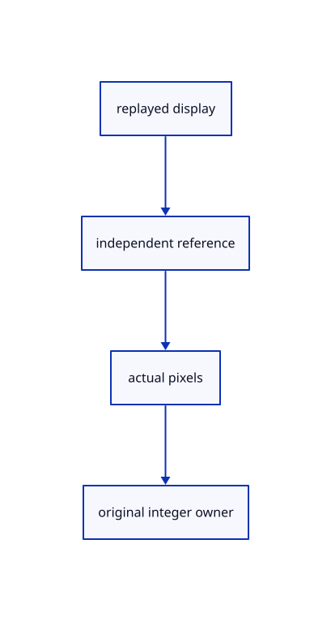

# 13.1.23 · Compare actual replay pixels and integer owners

**Chapter 13 · Shared definitions and drawing sheets · Section 13.1 · Shared CAD definitions** · [Contents](contents.md)

**Typing: 0–0 minutes.** [Estimate](typing-load.md).

Compare replay with independent CAD preparation using actual colour, boundary ink and integer picking.

## Type

Continue from [Share recordings only during document preparation](69ad-share-recordings-only-during-document-preparation.md). [Save or recover your work](recovery.md).

<details>
<summary>Supplied validation fixture</summary>

Copy this supplied authoring fixture once. Continue with the browser build below; the course does not require running native tests.

### 1. `src/pick_gpu_tests.rs`

Copy actual GPU independent face, boundary ink, integer ownership and source-release comparison.

<details>
<summary>Locate the existing block</summary>

```text
    Rc::make_mut(&mut scene.view).hide(&[b],true);renderer.set_scene(&scene,None);assert_eq!(renderer.instance_usage()[1],1);scene.clear();renderer.set_scene(&scene,None);assert_eq!(&renderer.instance_usage()[..3],&[0,0,0]);assert!(weak.upgrade().is_none());
}
```

</details>

After that block, append this supplied code:

```text
--8<-- "journey/code/69ae-compare-actual-replay-pixels-and-integer-owners-01.rs" skip=261
```

</details>

## Run and check

Run this from `session_viewer` to select the fixed dependency versions and install supplied binary assets. It updates Cargo.lock and preserves the previous lock. It does not write implementation code:

```sh
npm --prefix ../session_tests run course -- dependencies 13.1.23
```

In your project:

```sh
cd workspace/journey
REGEN_PROTO=0 cargo build --lib --locked --target wasm32-unknown-unknown -j1
REGEN_PROTO=0 CARGO_BUILD_JOBS=1 trunk serve --port 8780
```

Open `http://127.0.0.1:8780/`. Keep an existing Trunk server running; saving rebuilds it.


### Recorded visual result

**Previous native render — current verification pending.**

Independent yellow and blue shared-definition placements remain visible beside original CAD borders.


*This recorded image predates a source or checker change. Rebuild this checkpoint before using it as current evidence; browser controls require separate acceptance.*

This reference image is shared with [13.1.14 · Inspect and exercise original definition instances](69n-inspect-and-exercise-original-definition-instances.md). It does not demonstrate a new feature by itself.

<details>
<summary>Code explanation and diagram</summary>


replayed display → independent reference → actual pixels → original integer owner.



Does matching source topology alone prove rendering agreement?

No. Compare actual faces and border ink, as well as original integer picks, against an independently prepared source.

Study estimate, including typing and experiments: 0.5–1 hours.

</details>

<details>
<summary>Optional experiment</summary>

Import congruent originals using the preceding lesson's replay example. Orbit, select each original, clear selection and compare their boundary ink. Clear the document and inspect released resources. The supplied GPU comparison separately records exact pixels and integer-owner equality.

</details>

<details>
<summary>Check and save your work</summary>

Restore experimental edits, then run from `session_viewer`:

```sh
npm --prefix ../session_tests run course -- check 13.1.23
npm --prefix ../session_tests run course -- save 13.1.23
```

Source comparison leaves your project untouched. [Save and recovery instructions](recovery.md).

</details>

<details>
<summary>Viewer coverage and verification</summary>


The inherited instance acceptance remains authored and unrun. The final congruent-CAD exercise inspects one walk/one replay, original identities, Save/Open, Delete/Undo/Redo and Close; actual browser execution remains required.

[Full validation scope](release.md).

To reproduce the scripted acceptance of the reference checkpoint, run from `session_viewer` with the [course bundle server](release.md#reproduce) running on port 8781:

```sh
npm --prefix ../session_tests run course -- capture 13.1.23
```

This uses the verified reference bundle; it does not check or change your typed project.

</details>
