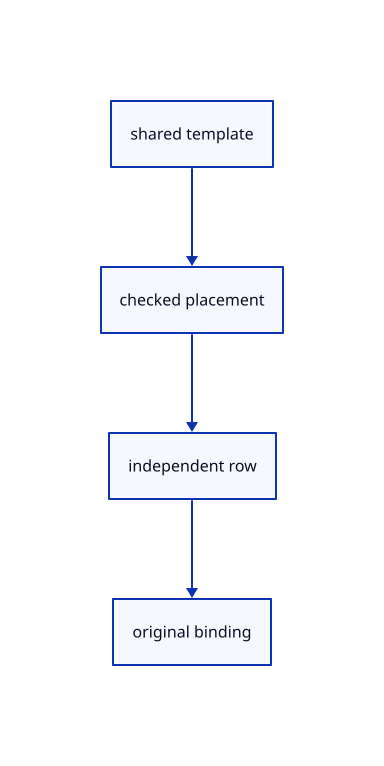

# 13.1.4 · Append independently placed shared rows

**Chapter 13 · Shared definitions and drawing sheets · Section 13.1 · Shared CAD definitions** · [Contents](contents.md)

**Typing: 24–48 minutes.** [Estimate](typing-load.md).

Validate one placed template before appending its row. Avoid cloning the growing destination scene for every instance.

## Type

Continue from [Keep instance bindings through scene history](69c-keep-instance-bindings-through-scene-history.md). [Save or recover your work](recovery.md).

### 1. `src/scene.rs`

Append checked independent instance rows without cloning the growing scene.

<details>
<summary>Locate the existing block</summary>

```rust
    }

    pub(crate) fn reserve_document_key(&mut self)->Result<u32,&'static str> {
        let key=self.next_id;self.next_id=self.next_id.checked_add(1).ok_or("Object IDs exhausted")?;Ok(key)
```

</details>

Edit the existing block to match this code; keep unchanged lines:

```rust
--8<-- "journey/code/69d-append-independently-placed-shared-rows-01.rs"
```

## Run and check

Run this from `session_viewer` to select the fixed dependency versions and install supplied binary assets. It updates Cargo.lock and preserves the previous lock. It does not write implementation code:

```sh
npm --prefix ../session_tests run course -- dependencies 13.1.4
```

In your project:

```sh
cd workspace/journey
REGEN_PROTO=0 cargo build --lib --locked --target wasm32-unknown-unknown -j1
REGEN_PROTO=0 CARGO_BUILD_JOBS=1 trunk serve --port 8780
```

Open `http://127.0.0.1:8780/`. Keep an existing Trunk server running; saving rebuilds it.


### Recorded visual result

**Previous native render — current verification pending.**

The existing CAD, surface and original coarse/detailed point pages remain visible.


*This recorded image predates a source or checker change. Rebuild this checkpoint before using it as current evidence; browser controls require separate acceptance.*

This reference image is shared with [13.1.1 · Validate original definition references](69-validate-original-definition-references.md). It does not demonstrate a new feature by itself.

<details>
<summary>Code explanation and diagram</summary>


shared template → checked placement → independent row → original binding.



Why prepare the placed row in a tiny temporary scene?

Existing placement checks remain usable while the growing destination is cloned only once for atomic document import.

Study estimate, including typing and experiments: 0.5–1 hours.

</details>

<details>
<summary>Optional experiment</summary>

Compare two precise models while their original and derived geometry allocations remain shared.

</details>

<details>
<summary>Check and save your work</summary>

Restore experimental edits, then run from `session_viewer`:

```sh
npm --prefix ../session_tests run course -- check 13.1.4
npm --prefix ../session_tests run course -- save 13.1.4
```

Source comparison leaves your project untouched. [Save and recovery instructions](recovery.md).

</details>

<details>
<summary>Viewer coverage and verification</summary>


The inherited range exercise remains authored and unrun. The final instance exercise checks shared definitions, independent placements, Save/Open, Move, Delete, Undo/Redo and Close; browser execution remains required.

[Full validation scope](release.md).

To reproduce the scripted acceptance of the reference checkpoint, run from `session_viewer` with the [course bundle server](release.md#reproduce) running on port 8781:

```sh
npm --prefix ../session_tests run course -- capture 13.1.4
```

This uses the verified reference bundle; it does not check or change your typed project.

</details>
