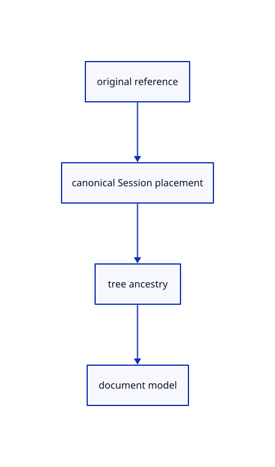

# 13.1.5 · Import canonical original instance placements

**Chapter 13 · Shared definitions and drawing sheets · Section 13.1 · Shared CAD definitions** · [Contents](contents.md)

**Typing: 16–31 minutes.** [Estimate](typing-load.md).

Resolve each original reference, preserve its tree identity and combine document placement with canonical source ancestry once.

## Type

Continue from [Append independently placed shared rows](69d-append-independently-placed-shared-rows.md). [Save or recover your work](recovery.md).

### 1. `src/document_source.rs`

Import original definitions and apply canonical instance placement once.

<details>
<summary>Locate the existing block</summary>

```rust
use session_rust::{proto,Session,Xform};
use prost::Message;
use std::{collections::HashSet,rc::Rc};

pub(crate) struct Source {pub document:Rc<Session>,pub origin:Rc<crate::origin::Origin>,pub tree:Option<proto::TreeNode>}
pub(crate) fn prepare(bytes:&[u8],place:&Xform,point_px:f32)->Result<Source,String> {
    if bytes.len()>crate::archive::LIMIT {return Err("Session exceeds the 512 MiB file limit".into());}
    let message=proto::Session::decode(bytes).map_err(|e|e.to_string())?;
    crate::source_validate::session(&message)?;
    supported(&message)?;
    if !crate::placement::valid(&place.m)||!point_px.is_finite() {return Err("Invalid document placement or point size".into());}
    let tree=message.tree.as_ref().and_then(|tree|tree.root.clone());
    let mut guids=HashSet::new();let objects=message.objects.as_ref().ok_or("Session has no objects")?;
    macro_rules! identity {($field:ident)=>{for object in &objects.$field {if object.guid.is_empty()||!guids.insert(object.guid.as_str()) {return Err("Source GUIDs must be distinct within a document".into());}}};}
    identity!(meshes);identity!(points);identity!(lines);identity!(polylines);identity!(nurbscurves);identity!(nurbssurfaces);identity!(breps);identity!(pointclouds);
    if let Some(root)=tree.as_ref() {crate::hierarchy::validate(root,&guids).map_err(str::to_owned)?;}
    let mut placed=HashSet::new();for entry in &message.xforms {if !placed.insert(entry.guid.as_str())||!crate::placement::valid(&entry.xform.as_ref().ok_or("Missing placement matrix")?.matrix) {return Err("Invalid source placement".into());}}
    let origin=Rc::new(crate::origin::Origin::new(&message,bytes));
    let document=Rc::new(Session::from_proto(message).map_err(|e|e.to_string())?);
    Ok(Source {document,origin,tree})
}

fn supported(source:&proto::Session)->Result<(),String> {
    if source.definitions.is_some()||!source.interactions.is_empty() {return Err("Definitions and interactions arrive in later subjects".into());}
    let objects=source.objects.as_ref().ok_or("Session has no objects")?;
    if !objects.planes.is_empty()||!objects.bboxes.is_empty()||!objects.elements.is_empty()||!objects.components.is_empty()||!objects.sheets.is_empty()||!objects.instances.is_empty() {return Err("This subject cannot open planes, boxes, assemblies, sheets or instances yet".into());}
    Ok(())
}
```

</details>

Edit the existing block to match this code; keep unchanged lines:

```rust
use session_rust::{proto,Session,Xform};
use prost::Message;
use std::{collections::HashSet,rc::Rc};

pub(crate) struct Source {pub document:Rc<Session>,pub origin:Rc<crate::origin::Origin>,pub tree:Option<proto::TreeNode>}
pub(crate) fn prepare(bytes:&[u8],place:&Xform,point_px:f32)->Result<Source,String> {
    if bytes.len()>crate::archive::LIMIT {return Err("Session exceeds the 512 MiB file limit".into());}
    let message=proto::Session::decode(bytes).map_err(|e|e.to_string())?;
    crate::source_validate::session(&message)?;
    supported(&message)?;
    if !crate::placement::valid(&place.m)||!point_px.is_finite() {return Err("Invalid document placement or point size".into());}
    let tree=message.tree.as_ref().and_then(|tree|tree.root.clone());
    let mut guids=HashSet::new();let objects=message.objects.as_ref().ok_or("Session has no objects")?;
    macro_rules! identity {($field:ident)=>{for object in &objects.$field {if object.guid.is_empty()||!guids.insert(object.guid.as_str()) {return Err("Source GUIDs must be distinct within a document".into());}}};}
    identity!(meshes);identity!(points);identity!(lines);identity!(polylines);identity!(nurbscurves);identity!(nurbssurfaces);identity!(breps);identity!(pointclouds);identity!(instances);
    if let Some(root)=tree.as_ref() {crate::hierarchy::validate(root,&guids).map_err(str::to_owned)?;}
    let mut placed=HashSet::new();for entry in &message.xforms {if !placed.insert(entry.guid.as_str())||!crate::placement::valid(&entry.xform.as_ref().ok_or("Missing placement matrix")?.matrix) {return Err("Invalid source placement".into());}}
    let origin=Rc::new(crate::origin::Origin::new(&message,bytes));
    let document=Rc::new(Session::from_proto(message).map_err(|e|e.to_string())?);
    Ok(Source {document,origin,tree})
}

fn supported(source:&proto::Session)->Result<(),String> {
    crate::instance_plan::validate(source)?;
    if !source.interactions.is_empty() {return Err("Interactions arrive with element features".into());}
    let objects=source.objects.as_ref().ok_or("Session has no objects")?;
    if !objects.planes.is_empty()||!objects.bboxes.is_empty()||!objects.elements.is_empty()||!objects.components.is_empty()||!objects.sheets.is_empty() {return Err("This subject cannot open planes, boxes, assemblies, sheets or instances yet".into());}
    Ok(())
}
```

<details>
<summary>Optional patch references</summary>

Use these original edit fragments when comparing a saved checkpoint. Apply the complete blocks above.

```text
--8<-- "journey/code/69e-import-canonical-original-instance-placements-01.rs"
```

```text
--8<-- "journey/code/69e-import-canonical-original-instance-placements-02.rs"
```

</details>

### 2. `src/document_geometry.rs`

Import original definitions and apply canonical instance placement once.

<details>
<summary>Locate the existing block</summary>

```rust
    for source in &loaded.document.objects.breps {add!(source,scene.insert_cad(source.clone()));}
    for source in &loaded.document.objects.pointclouds {let id=add!(source,scene.insert_cloud(crate::cloud::Prepared::new(source.clone()).map_err(str::to_owned)?));scene.cloud_point_size(id,point_px).map_err(str::to_owned)?;}
    Ok(owners)
}
```

</details>

Edit the existing block to match this code; keep unchanged lines:

```rust
--8<-- "journey/code/69e-import-canonical-original-instance-placements-03.rs"
```

<details>
<summary>Supplied validation fixture</summary>

Copy this supplied authoring fixture once. Continue with the browser build below; the course does not require running native tests.

### 3. `src/scene_document.rs`

Copy the revised unsupported nested-definition fixture.

<details>
<summary>Locate the existing block</summary>

```text
        let mut scene=Scene::demo();let ids=scene.objects().iter().map(|row|row.id).collect::<Vec<_>>();assert!(open(&mut scene,b"broken").is_err());assert_eq!(scene.objects().iter().map(|row|row.id).collect::<Vec<_>>(),ids);
        let mut source=proto::Session::decode(crate::specimen::bytes().as_slice()).unwrap();source.tree=None;source.objects.as_mut().unwrap().points.push(session_rust::Point::new(1e100,0.,0.).to_proto());let bytes=source.encode_to_vec();assert!(import(&mut scene,&bytes,"too large",&Xform::identity(),0.).is_err());assert_eq!(scene.objects().iter().map(|row|row.id).collect::<Vec<_>>(),ids);assert!(scene.points().is_empty());assert!(scene.forest.documents.iter().all(|doc|doc.label!="too large"));
        source.objects.as_mut().unwrap().points.clear();source.definitions=Some(proto::Objects::default());assert!(import(&mut scene,&source.encode_to_vec(),"unsupported",&Xform::identity(),0.).unwrap_err().contains("Definitions"));assert_eq!(scene.objects().iter().map(|row|row.id).collect::<Vec<_>>(),ids);
    }
    #[test]
```

</details>

Update the existing block with this supplied code; keep unchanged lines:

```text
--8<-- "journey/code/69h-save-original-instance-references-and-namespaces-05.rs"
```

</details>

## Run and check

Run this from `session_viewer` to select the fixed dependency versions and install supplied binary assets. It updates Cargo.lock and preserves the previous lock. It does not write implementation code:

```sh
npm --prefix ../session_tests run course -- dependencies 13.1.5
```

In your project:

```sh
cd workspace/journey
REGEN_PROTO=0 cargo build --lib --locked --target wasm32-unknown-unknown -j1
REGEN_PROTO=0 CARGO_BUILD_JOBS=1 trunk serve --port 8780
```

Open `http://127.0.0.1:8780/`. Keep an existing Trunk server running; saving rebuilds it.


### Recorded visual result

**Previous native render — current verification pending.**

The existing CAD, surface and original coarse/detailed point pages remain visible.


*This recorded image predates a source or checker change. Rebuild this checkpoint before using it as current evidence; browser controls require separate acceptance.*

This reference image is shared with [13.1.1 · Validate original definition references](69-validate-original-definition-references.md). It does not demonstrate a new feature by itself.

<details>
<summary>Code explanation and diagram</summary>


original reference → canonical Session placement → tree ancestry → document model.



Should the viewer multiply the legacy instance transform again?

No. The kernel already folds it into Session.xforms. Multiplying it again would apply the same placement twice.

Study estimate, including typing and experiments: 0.5–1 hours.

</details>

<details>
<summary>Optional experiment</summary>

Import a source at 1000000000.125 with a legacy 1000 shift and an extra 0.25 document translation.

</details>

<details>
<summary>Check and save your work</summary>

Restore experimental edits, then run from `session_viewer`:

```sh
npm --prefix ../session_tests run course -- check 13.1.5
npm --prefix ../session_tests run course -- save 13.1.5
```

Source comparison leaves your project untouched. [Save and recovery instructions](recovery.md).

</details>

<details>
<summary>Viewer coverage and verification</summary>


All earlier checks remain. Original references, precise canonical placements, supported definition families, source sharing, Save/Open without flattening, GUID conflict refusal, part-edit refusal, reversible Delete and release have native regressions. The final endpoint also checks actual GPU batching, colour overrides and full integer owner IDs. Software rendering does not establish Lenovo timing. The rejection fixture now uses a malformed definition reference, because an empty definitions table is valid after canonical instance import.

The inherited range exercise remains authored and unrun. The final instance exercise checks shared definitions, independent placements, Save/Open, Move, Delete, Undo/Redo and Close; browser execution remains required.

[Full validation scope](release.md).

To reproduce the scripted acceptance of the reference checkpoint, run from `session_viewer` with the [course bundle server](release.md#reproduce) running on port 8781:

```sh
npm --prefix ../session_tests run course -- capture 13.1.5
```

This uses the verified reference bundle; it does not check or change your typed project.

</details>
