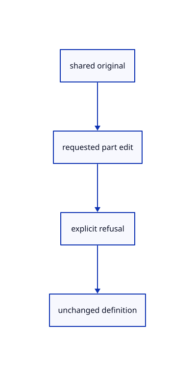

# 13.1.6 · Protect shared originals during part edits

**Chapter 13 · Shared definitions and drawing sheets · Section 13.1 · Shared CAD definitions** · [Contents](contents.md)

**Typing: 2–3 minutes.** [Estimate](typing-load.md).

Refuse source-part previews until explicit shared-definition editing or detachment is implemented. Whole-row placement remains reversible.

## Type

Continue from [Import canonical original instance placements](69e-import-canonical-original-instance-placements.md). [Save or recover your work](recovery.md).

### 1. `src/part_preview.rs`

Protect original definitions from unsupported source-part edits.

<details>
<summary>Locate the existing block</summary>

```rust

pub fn points(scene:&Scene,target:Target) -> Result<Vec<Point>, &'static str> {
    if !target.valid(scene) {return Err("Selected part is no longer editable");}
    if matches!(target.part,Part::CloudPoint(_)) {return Err("Cloud point editing connects with source transforms");}
```

</details>

Edit the existing block to match this code; keep unchanged lines:

```rust
--8<-- "journey/code/69f-protect-shared-originals-during-part-edits-01.rs"
```

## Run and check

Run this from `session_viewer` to select the fixed dependency versions and install supplied binary assets. It updates Cargo.lock and preserves the previous lock. It does not write implementation code:

```sh
npm --prefix ../session_tests run course -- dependencies 13.1.6
```

In your project:

```sh
cd workspace/journey
REGEN_PROTO=0 cargo build --lib --locked --target wasm32-unknown-unknown -j1
REGEN_PROTO=0 CARGO_BUILD_JOBS=1 trunk serve --port 8780
```

Open `http://127.0.0.1:8780/`. Keep an existing Trunk server running; saving rebuilds it.


### Recorded visual result

**Previous native render — current verification pending.**

The existing CAD, surface and original coarse/detailed point pages remain visible.


*This recorded image predates a source or checker change. Rebuild this checkpoint before using it as current evidence; browser controls require separate acceptance.*

This reference image is shared with [13.1.1 · Validate original definition references](69-validate-original-definition-references.md). It does not demonstrate a new feature by itself.

<details>
<summary>Code explanation and diagram</summary>


shared original → requested part edit → explicit refusal → unchanged definition.



May a part edit change only the displayed mesh and Save the old definition?

No. That would save geometry different from the display. Keep this guard until subject 77 connects explicit source editing and detachment.

Study estimate, including typing and experiments: 0.5–1 hours.

</details>

<details>
<summary>Optional experiment</summary>

Request a face preview on a definition instance and verify the original definition remains exact.

</details>

<details>
<summary>Check and save your work</summary>

Restore experimental edits, then run from `session_viewer`:

```sh
npm --prefix ../session_tests run course -- check 13.1.6
npm --prefix ../session_tests run course -- save 13.1.6
```

Source comparison leaves your project untouched. [Save and recovery instructions](recovery.md).

</details>

<details>
<summary>Viewer coverage and verification</summary>


The inherited range exercise remains authored and unrun. The final instance exercise checks shared definitions, independent placements, Save/Open, Move, Delete, Undo/Redo and Close; browser execution remains required.

[Full validation scope](release.md).

To reproduce the scripted acceptance of the reference checkpoint, run from `session_viewer` with the [course bundle server](release.md#reproduce) running on port 8781:

```sh
npm --prefix ../session_tests run course -- capture 13.1.6
```

This uses the verified reference bundle; it does not check or change your typed project.

</details>
