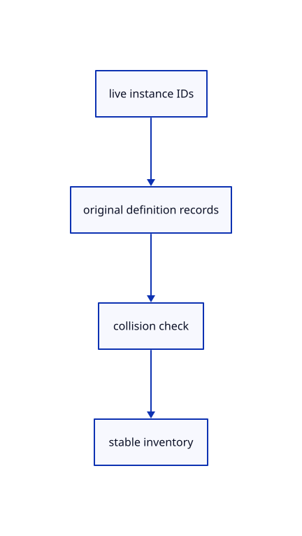

# 13.1.7 · Collect shared definitions without flattening

**Chapter 13 · Shared definitions and drawing sheets · Section 13.1 · Shared CAD definitions** · [Contents](contents.md)

**Typing: 19–38 minutes.** [Estimate](typing-load.md).

Save each live original definition once. Compare different owners by semantic protobuf records, independent of map encoding order.

## Type

Continue from [Protect shared originals during part edits](69f-protect-shared-originals-during-part-edits.md). [Save or recover your work](recovery.md).

### 1. `src/instance_snapshot.rs`

Collect original definitions once and reject semantic identity conflicts.

Create the file and type:

```rust
--8<-- "journey/code/69g-collect-shared-definitions-without-flattening-01.rs"
```

### 2. `src/lib.rs`

Register the source component.

<details>
<summary>Locate the existing block</summary>

```rust

pub mod instance_definition;
```

</details>

After that block, type:

```rust
--8<-- "journey/code/69g-collect-shared-definitions-without-flattening-02.rs" skip=30
```

## Run and check

Run this from `session_viewer` to select the fixed dependency versions and install supplied binary assets. It updates Cargo.lock and preserves the previous lock. It does not write implementation code:

```sh
npm --prefix ../session_tests run course -- dependencies 13.1.7
```

In your project:

```sh
cd workspace/journey
REGEN_PROTO=0 cargo build --lib --locked --target wasm32-unknown-unknown -j1
REGEN_PROTO=0 CARGO_BUILD_JOBS=1 trunk serve --port 8780
```

Open `http://127.0.0.1:8780/`. Keep an existing Trunk server running; saving rebuilds it.


### Recorded visual result

**Previous native render — current verification pending.**

The existing CAD, surface and original coarse/detailed point pages remain visible.


*This recorded image predates a source or checker change. Rebuild this checkpoint before using it as current evidence; browser controls require separate acceptance.*

This reference image is shared with [13.1.1 · Validate original definition references](69-validate-original-definition-references.md). It does not demonstrate a new feature by itself.

<details>
<summary>Code explanation and diagram</summary>


live instance IDs → original definition records → collision check → stable inventory.



Do different protobuf byte orders imply different geometry?

No. Protobuf maps may encode in different orders. Compare semantic source records, using Rc identity to skip repeated serialization.

Study estimate, including typing and experiments: 0.5–1 hours.

</details>

<details>
<summary>Optional experiment</summary>

Merge conflicting same-GUID definitions and refuse Save instead of silently choosing one source.

</details>

<details>
<summary>Check and save your work</summary>

Restore experimental edits, then run from `session_viewer`:

```sh
npm --prefix ../session_tests run course -- check 13.1.7
npm --prefix ../session_tests run course -- save 13.1.7
```

Source comparison leaves your project untouched. [Save and recovery instructions](recovery.md).

</details>

<details>
<summary>Viewer coverage and verification</summary>


The inherited range exercise remains authored and unrun. The final instance exercise checks shared definitions, independent placements, Save/Open, Move, Delete, Undo/Redo and Close; browser execution remains required.

[Full validation scope](release.md).

To reproduce the scripted acceptance of the reference checkpoint, run from `session_viewer` with the [course bundle server](release.md#reproduce) running on port 8781:

```sh
npm --prefix ../session_tests run course -- capture 13.1.7
```

This uses the verified reference bundle; it does not check or change your typed project.

</details>
