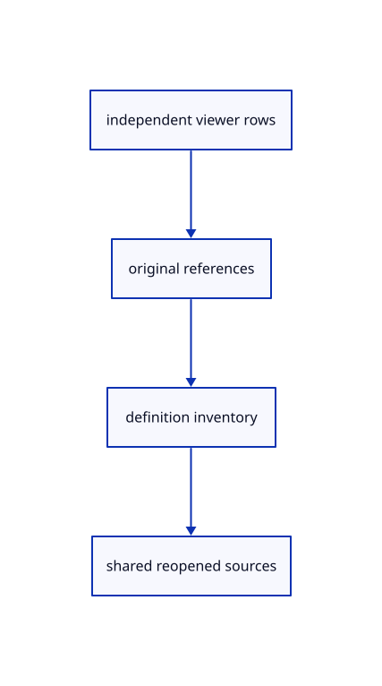

# 13.1.8 · Save original instance references and namespaces

**Chapter 13 · Shared definitions and drawing sheets · Section 13.1 · Shared CAD definitions** · [Contents](contents.md)

**Typing: 17–34 minutes.** [Estimate](typing-load.md).

Save original references beside definitions and portable instance identities. Reopening prepares shared definitions again.

## Type

Continue from [Collect shared definitions without flattening](69g-collect-shared-definitions-without-flattening.md). [Save or recover your work](recovery.md).

### 1. `src/geometry_snapshot.rs`

Save original references and definitions without flattening source geometry.

<details>
<summary>Locate the existing block</summary>

```rust
use crate::scene::{ObjectId,Scene};
use session_rust::proto;
use std::collections::HashSet;

// Save original source records; f32 display triangles, sampled controls and LOD subsets are not editable source geometry.
pub fn objects(scene:&Scene,ids:&HashSet<ObjectId>)->Result<proto::Objects,String> {
    let mut out=proto::Objects::default();let mut guids=HashSet::new();
    macro_rules! push {
        ($field:ident,$id:expr,$source:expr)=>{{
            let id=$id;let mut source=$source;let guid=scene.row_guid(id).ok_or("Saved source owner is missing")?;
            if !guids.insert(guid.to_owned()) {return Err("Source GUID occurs twice within one saved document".into());}
            source.guid=guid.to_owned();source.is_visible=(!scene.visible(id)).then_some(false);source.is_locked=scene.view.locked.contains(&id).then_some(true);out.$field.push(source);
        }};
    }
    for row in scene.objects().iter().filter(|row|ids.contains(&row.id)) {
        if let Some(cad)=row.cad.as_ref() {push!(breps,row.id,cad.source.to_proto());}
        else if let Some(surface)=row.surface.as_ref() {push!(nurbssurfaces,row.id,surface.source.to_proto());}
        else {push!(meshes,row.id,row.geometry().ok_or("Reload editable sources before saving")?.to_proto());}
    }
    for row in scene.lines().iter().filter(|row|ids.contains(&row.id)) {push!(lines,row.id,row.prepared.source.to_proto());}
    for row in scene.paths().iter().filter(|row|ids.contains(&row.id)) {
        match &row.prepared.source {
            crate::chain::Source::Line(source)=>push!(lines,row.id,source.to_proto()),
            crate::chain::Source::Polyline(source)=>push!(polylines,row.id,source.to_proto()),
            crate::chain::Source::Curve(source,_)=>push!(nurbscurves,row.id,source.to_proto()),
        }
    }
    for row in scene.points().iter().filter(|row|ids.contains(&row.id)) {push!(points,row.id,row.prepared.source.to_proto());}
    for row in scene.clouds().iter().filter(|row|ids.contains(&row.id)) {push!(pointclouds,row.id,row.prepared.source.to_proto());}
    Ok(out)
}

#[cfg(test)]
mod tests {
    use super::*;
    use std::rc::Rc;
    #[test]
    fn snapshot_retains_original_cad_curves_clouds_flags_and_independent_line_guids() {
        let mut scene=Scene::demo();scene.clear();let cad=Rc::new(crate::cad_display::example());let _=cad.guid();let cad_before=cad.to_proto();let cad_id=scene.insert_cad(cad.clone()).unwrap();
        let surface=Rc::new(crate::surface::example());let _=surface.guid();let surface_before=surface.to_proto();let surface_id=scene.insert_surface(surface.clone()).unwrap();
        let mut original_curve=session_rust::NurbsCurve::create(true,2,&[session_rust::Point::new(-0.6,-0.4,0.),session_rust::Point::new(0.123456789012345,0.6,0.),session_rust::Point::new(0.6,-0.4,0.)]);assert!(original_curve.set_cv_4d(1,0.123456789012345*4.,2.4,0.,4.));let curve=Rc::new(original_curve);let _=curve.guid();let curve_before=curve.to_proto();let curve_id=scene.insert_path(crate::chain::PreparedChain::curve(curve.clone()).unwrap()).unwrap();
        let mut proto=crate::cloud::example().to_proto();proto.point_ids[0]=u32::MAX;let cloud=Rc::new(session_rust::PointCloud::from_proto(proto));let _=cloud.guid();let cloud_before=cloud.to_proto();let cloud_id=scene.insert_cloud(crate::cloud::Prepared::new(cloud.clone()).unwrap()).unwrap();
        let line=scene.insert_line(crate::stroke::PreparedLine::new(Rc::new(session_rust::Line::new(0.,0.,0.,1.,0.,0.))).unwrap()).unwrap();let copy=scene.copy_row(line,false).unwrap();
        Rc::make_mut(&mut scene.view).hide(&[cad_id],true);Rc::make_mut(&mut scene.view).lock(&[cloud_id],true);
        let ids=[cad_id,surface_id,curve_id,cloud_id,line,copy].into_iter().collect();let out=objects(&scene,&ids).unwrap();
        assert!(out.meshes.is_empty());assert_eq!(out.breps.len(),1);assert_eq!(out.nurbssurfaces.len(),1);assert_eq!(out.nurbscurves.len(),1);assert_eq!(out.lines.len(),2);assert_ne!(out.lines[0].guid,out.lines[1].guid);
        assert_eq!(out.breps[0].is_visible,Some(false));assert_eq!(out.pointclouds[0].is_locked,Some(true));assert_eq!(out.pointclouds[0].point_ids[0],u32::MAX);assert_eq!(out.pointclouds[0].coords,cloud_before.coords);assert_eq!(out.nurbscurves[0].cvs,curve_before.cvs);assert!(out.nurbscurves[0].is_rational);assert_eq!(out.nurbscurves[0].cvs[7],4.);
        assert_eq!(cad.to_proto(),cad_before);assert_eq!(surface.to_proto(),surface_before);assert_eq!(curve.to_proto(),curve_before);assert_eq!(cloud.to_proto(),cloud_before);
        crate::source_validate::session(&proto::Session {objects:Some(out),..Default::default()}).unwrap();
    }
}
```

</details>

Edit the existing block to match this code; keep unchanged lines:

```rust
use crate::scene::{ObjectId,Scene};
use session_rust::proto;
use std::collections::HashSet;

// Save original source records; f32 display triangles, sampled controls and LOD subsets are not editable source geometry.
pub fn objects(scene:&Scene,ids:&HashSet<ObjectId>)->Result<proto::Objects,String> {
    let mut out=proto::Objects::default();let mut guids=HashSet::new();
    macro_rules! push {
        ($field:ident,$id:expr,$source:expr)=>{{
            let id=$id;let mut source=$source;let guid=scene.row_guid(id).ok_or("Saved source owner is missing")?;
            if !guids.insert(guid.to_owned()) {return Err("Source GUID occurs twice within one saved document".into());}
            source.guid=guid.to_owned();source.is_visible=(!scene.visible(id)).then_some(false);source.is_locked=scene.view.locked.contains(&id).then_some(true);out.$field.push(source);
        }};
    }
    for row in scene.objects().iter().filter(|row|ids.contains(&row.id)&&!scene.instances.contains_key(&row.id)) {
        if let Some(cad)=row.cad.as_ref() {push!(breps,row.id,cad.source.to_proto());}
        else if let Some(surface)=row.surface.as_ref() {push!(nurbssurfaces,row.id,surface.source.to_proto());}
        else {push!(meshes,row.id,row.geometry().ok_or("Reload editable sources before saving")?.to_proto());}
    }
    for row in scene.lines().iter().filter(|row|ids.contains(&row.id)&&!scene.instances.contains_key(&row.id)) {push!(lines,row.id,row.prepared.source.to_proto());}
    for row in scene.paths().iter().filter(|row|ids.contains(&row.id)&&!scene.instances.contains_key(&row.id)) {
        match &row.prepared.source {
            crate::chain::Source::Line(source)=>push!(lines,row.id,source.to_proto()),
            crate::chain::Source::Polyline(source)=>push!(polylines,row.id,source.to_proto()),
            crate::chain::Source::Curve(source,_)=>push!(nurbscurves,row.id,source.to_proto()),
        }
    }
    for row in scene.points().iter().filter(|row|ids.contains(&row.id)&&!scene.instances.contains_key(&row.id)) {push!(points,row.id,row.prepared.source.to_proto());}
    for row in scene.clouds().iter().filter(|row|ids.contains(&row.id)&&!scene.instances.contains_key(&row.id)) {push!(pointclouds,row.id,row.prepared.source.to_proto());}
    for (id,owner) in scene.instances.iter().filter(|(id,_)|ids.contains(id)) {
        let mut source=owner.instance.to_proto();source.guid=scene.row_guid(*id).ok_or("Original instance owner is missing")?.into();source.flags=(source.flags&!(session_rust::InstanceRef::FLAG_HIDDEN|session_rust::InstanceRef::FLAG_LOCKED))|if scene.visible(*id) {0} else {session_rust::InstanceRef::FLAG_HIDDEN}|if scene.view.locked.contains(id) {session_rust::InstanceRef::FLAG_LOCKED} else {0};out.instances.push(source);
    }
    out.instances.sort_by(|a,b|a.guid.cmp(&b.guid));Ok(out)
}

#[cfg(test)]
mod tests {
    use super::*;
    use std::rc::Rc;
    #[test]
    fn snapshot_retains_original_cad_curves_clouds_flags_and_independent_line_guids() {
        let mut scene=Scene::demo();scene.clear();let cad=Rc::new(crate::cad_display::example());let _=cad.guid();let cad_before=cad.to_proto();let cad_id=scene.insert_cad(cad.clone()).unwrap();
        let surface=Rc::new(crate::surface::example());let _=surface.guid();let surface_before=surface.to_proto();let surface_id=scene.insert_surface(surface.clone()).unwrap();
        let mut original_curve=session_rust::NurbsCurve::create(true,2,&[session_rust::Point::new(-0.6,-0.4,0.),session_rust::Point::new(0.123456789012345,0.6,0.),session_rust::Point::new(0.6,-0.4,0.)]);assert!(original_curve.set_cv_4d(1,0.123456789012345*4.,2.4,0.,4.));let curve=Rc::new(original_curve);let _=curve.guid();let curve_before=curve.to_proto();let curve_id=scene.insert_path(crate::chain::PreparedChain::curve(curve.clone()).unwrap()).unwrap();
        let mut proto=crate::cloud::example().to_proto();proto.point_ids[0]=u32::MAX;let cloud=Rc::new(session_rust::PointCloud::from_proto(proto));let _=cloud.guid();let cloud_before=cloud.to_proto();let cloud_id=scene.insert_cloud(crate::cloud::Prepared::new(cloud.clone()).unwrap()).unwrap();
        let line=scene.insert_line(crate::stroke::PreparedLine::new(Rc::new(session_rust::Line::new(0.,0.,0.,1.,0.,0.))).unwrap()).unwrap();let copy=scene.copy_row(line,false).unwrap();
        Rc::make_mut(&mut scene.view).hide(&[cad_id],true);Rc::make_mut(&mut scene.view).lock(&[cloud_id],true);
        let ids=[cad_id,surface_id,curve_id,cloud_id,line,copy].into_iter().collect();let out=objects(&scene,&ids).unwrap();
        assert!(out.meshes.is_empty());assert_eq!(out.breps.len(),1);assert_eq!(out.nurbssurfaces.len(),1);assert_eq!(out.nurbscurves.len(),1);assert_eq!(out.lines.len(),2);assert_ne!(out.lines[0].guid,out.lines[1].guid);
        assert_eq!(out.breps[0].is_visible,Some(false));assert_eq!(out.pointclouds[0].is_locked,Some(true));assert_eq!(out.pointclouds[0].point_ids[0],u32::MAX);assert_eq!(out.pointclouds[0].coords,cloud_before.coords);assert_eq!(out.nurbscurves[0].cvs,curve_before.cvs);assert!(out.nurbscurves[0].is_rational);assert_eq!(out.nurbscurves[0].cvs[7],4.);
        assert_eq!(cad.to_proto(),cad_before);assert_eq!(surface.to_proto(),surface_before);assert_eq!(curve.to_proto(),curve_before);assert_eq!(cloud.to_proto(),cloud_before);
        crate::source_validate::session(&proto::Session {objects:Some(out),..Default::default()}).unwrap();
    }
}
```

<details>
<summary>Optional patch references</summary>

Use these original edit fragments when comparing a saved checkpoint. Apply the complete blocks above.

```text
--8<-- "journey/code/69h-save-original-instance-references-and-namespaces-01.rs"
```

```text
--8<-- "journey/code/69h-save-original-instance-references-and-namespaces-02.rs"
```

</details>

### 2. `src/archive_identity.rs`

Save original references and definitions without flattening source geometry.

<details>
<summary>Locate the existing block</summary>

```rust
pub(crate) fn objects(objects:&mut proto::Objects,names:&HashMap<String,String>) {
    macro_rules! remap {($field:ident)=>{for object in &mut objects.$field {if let Some(guid)=names.get(&object.guid) {object.guid=guid.clone();}}};}
    remap!(meshes);remap!(lines);remap!(points);remap!(polylines);remap!(nurbscurves);remap!(nurbssurfaces);remap!(breps);remap!(pointclouds);
}
pub(crate) fn tree(node:&mut proto::TreeNode,names:&HashMap<String,String>) {
```

</details>

Edit the existing block to match this code; keep unchanged lines:

```rust
--8<-- "journey/code/69h-save-original-instance-references-and-namespaces-03.rs"
```

### 3. `src/archive_document.rs`

Save original references and definitions without flattening source geometry.

<details>
<summary>Locate the existing block</summary>

```rust
    let mut source=namespace.doc.as_ref().and_then(|doc|doc.header.as_ref()).map_or_else(proto::Session::default,|header|header.header.clone());if source.name.is_empty() {source.name=namespace.name.clone();}
    let root=if namespace.doc.is_some()&&roots.len()==1 {roots.pop().unwrap()} else {proto::TreeNode {name:source.name.clone(),children:roots,..Default::default()}};
    source.objects=Some(objects);source.tree=Some(proto::Tree {root:Some(root),..Default::default()});source.xforms=xforms;source.bvh_boxes.clear();
    let mut clouds=scene.clouds().iter().filter(|row|namespace.ids.contains(&row.id));let point_px=clouds.next().map_or(0.,|row|row.point_px);
    if clouds.any(|row|row.point_px!=point_px) {return Err("Cloud placements in one saved document need the same point size override".into());}Ok((source,names,point_px))
```

</details>

Edit the existing block to match this code; keep unchanged lines:

```rust
--8<-- "journey/code/69h-save-original-instance-references-and-namespaces-04.rs"
```

## Run and check

Run this from `session_viewer` to select the fixed dependency versions and install supplied binary assets. It updates Cargo.lock and preserves the previous lock. It does not write implementation code:

```sh
npm --prefix ../session_tests run course -- dependencies 13.1.8
```

In your project:

```sh
cd workspace/journey
REGEN_PROTO=0 cargo build --lib --locked --target wasm32-unknown-unknown -j1
REGEN_PROTO=0 CARGO_BUILD_JOBS=1 trunk serve --port 8780
```

Open `http://127.0.0.1:8780/`. Keep an existing Trunk server running; saving rebuilds it.


### Recorded visual result

**Previous native render — current verification pending.**

The existing CAD, surface and original coarse/detailed point pages remain visible.


*This recorded image predates a source or checker change. Rebuild this checkpoint before using it as current evidence; browser controls require separate acceptance.*

This reference image is shared with [13.1.1 · Validate original definition references](69-validate-original-definition-references.md). It does not demonstrate a new feature by itself.

<details>
<summary>Code explanation and diagram</summary>


independent viewer rows → original references → definition inventory → shared reopened sources.



Should Save replace instances with world-space triangles?

No. Keep original definition records, reference GUIDs and source placements so editable identities survive reopening.

Study estimate, including typing and experiments: 0.5–1 hours.

</details>

<details>
<summary>Optional experiment</summary>

Compare all eight basic definition families and 16 references before and after Save/Open.

</details>

<details>
<summary>Check and save your work</summary>

Restore experimental edits, then run from `session_viewer`:

```sh
npm --prefix ../session_tests run course -- check 13.1.8
npm --prefix ../session_tests run course -- save 13.1.8
```

Source comparison leaves your project untouched. [Save and recovery instructions](recovery.md).

</details>

<details>
<summary>Viewer coverage and verification</summary>


The inherited range exercise remains authored and unrun. The final instance exercise checks shared definitions, independent placements, Save/Open, Move, Delete, Undo/Redo and Close; browser execution remains required.

[Full validation scope](release.md).

To reproduce the scripted acceptance of the reference checkpoint, run from `session_viewer` with the [course bundle server](release.md#reproduce) running on port 8781:

```sh
npm --prefix ../session_tests run course -- capture 13.1.8
```

This uses the verified reference bundle; it does not check or change your typed project.

</details>
