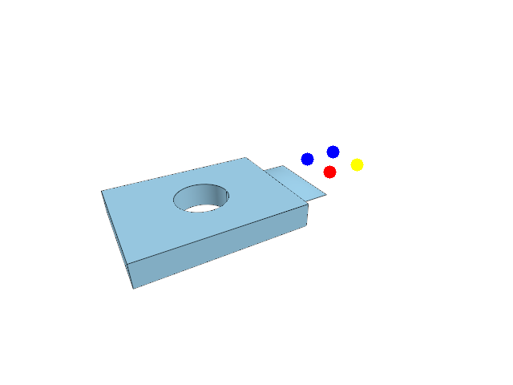
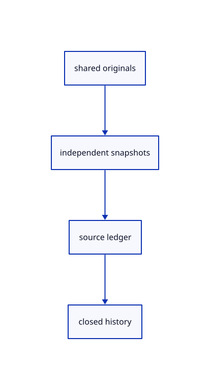

# 13.1.9 · Check sharing precision history and release

**Chapter 13 · Shared definitions and drawing sheets · Section 13.1 · Shared CAD definitions** · [Contents](contents.md)

**Typing: 6–11 minutes.** [Estimate](typing-load.md).

Count original documents and definition owners once across scene snapshots. Supply regression sources with legacy and precise placements.

## Type

Continue from [Save original instance references and namespaces](69h-save-original-instance-references-and-namespaces.md). [Save or recover your work](recovery.md).

### 1. `src/memory.rs`

Count original instance documents and definitions across shared scene snapshots.

<details>
<summary>Locate the existing block</summary>

```rust
    }}usage[1]=sources.len();usage
}
```

</details>

After that block, type:

```rust
--8<-- "journey/code/69i-check-sharing-precision-history-and-release-01.rs" skip=37
```

<details>
<summary>Supplied example data</summary>

Copy this supplied data once; it is excluded from the typing estimate.

### 2. `src/instance_specimen.rs`

Copy precise original and visible shared-definition examples.

Copy this supplied file:

```text
--8<-- "journey/code/69i-check-sharing-precision-history-and-release-02.rs"
```

</details>

### 3. `src/lib.rs`

Register the source component.

<details>
<summary>Locate the existing block</summary>

```rust

pub mod instance_snapshot;
```

</details>

After that block, type:

```rust
--8<-- "journey/code/69i-check-sharing-precision-history-and-release-03.rs" skip=28
```

<details>
<summary>Supplied validation fixture</summary>

Copy this supplied authoring fixture once. Continue with the browser build below; the course does not require running native tests.

### 4. `src/instance_scene_tests.rs`

Copy original reference, family, identity, placement, history and release regressions.

Copy this supplied file:

```text
--8<-- "journey/code/69i-check-sharing-precision-history-and-release-04.rs"
```

</details>

<details>
<summary>Supplied validation fixture</summary>

Copy this supplied authoring fixture once. Continue with the browser build below; the course does not require running native tests.

### 5. `src/lib.rs`

Register the source component.

<details>
<summary>Locate the existing block</summary>

```text

pub mod instance_specimen;
```

</details>

After that block, append this supplied code:

```text
--8<-- "journey/code/69i-check-sharing-precision-history-and-release-05.rs" skip=28
```

</details>

## Run and check

Run this from `session_viewer` to select the fixed dependency versions and install supplied binary assets. It updates Cargo.lock and preserves the previous lock. It does not write implementation code:

```sh
npm --prefix ../session_tests run course -- dependencies 13.1.9
```

In your project:

```sh
cd workspace/journey
REGEN_PROTO=0 cargo build --lib --locked --target wasm32-unknown-unknown -j1
REGEN_PROTO=0 CARGO_BUILD_JOBS=1 trunk serve --port 8780
```

Open `http://127.0.0.1:8780/`. Keep an existing Trunk server running; saving rebuilds it.


### Recorded visual result

**Previous native render — current verification pending.**

The existing CAD, surface and original coarse/detailed point pages remain visible.



*This recorded image predates a source or checker change. Rebuild this checkpoint before using it as current evidence; browser controls require separate acceptance.*

This reference image is shared with [13.1.1 · Validate original definition references](69-validate-original-definition-references.md). It does not demonstrate a new feature by itself.

<details>
<summary>Code explanation and diagram</summary>


shared originals → independent snapshots → source ledger → closed history.



Does Undo require another original geometry allocation?

No. Scene snapshots retain shared original owners and independent presentation state. Close releases history and current owners.

Study estimate, including typing and experiments: 0.5–1 hours.

</details>

<details>
<summary>Optional experiment</summary>

Run reference sharing, all-family persistence, conflicting namespaces, precise placement, colour and Delete/Undo regressions.

</details>

<details>
<summary>Check and save your work</summary>

Restore experimental edits, then run from `session_viewer`:

```sh
npm --prefix ../session_tests run course -- check 13.1.9
npm --prefix ../session_tests run course -- save 13.1.9
```

Source comparison leaves your project untouched. [Save and recovery instructions](recovery.md).

</details>

<details>
<summary>Viewer coverage and verification</summary>


The inherited range exercise remains authored and unrun. The final instance exercise checks shared definitions, independent placements, Save/Open, Move, Delete, Undo/Redo and Close; browser execution remains required.

[Full validation scope](release.md).

To reproduce the scripted acceptance of the reference checkpoint, run from `session_viewer` with the [course bundle server](release.md#reproduce) running on port 8781:

```sh
npm --prefix ../session_tests run course -- capture 13.1.9
```

This uses the verified reference bundle; it does not check or change your typed project.

</details>
