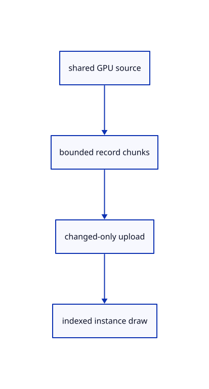

# 13.1.12 · Reuse bounded independent draw records

**Chapter 13 · Shared definitions and drawing sheets · Section 13.1 · Shared CAD definitions** · [Contents](contents.md)

**Typing: 23–46 minutes.** [Estimate](typing-load.md).

Group visible placements by shared GPU geometry and split them at the device storage limit. Reuse unchanged record buffers.

## Type

Continue from [Create a shared definition face pipeline](69k-create-a-shared-definition-face-pipeline.md). [Save or recover your work](recovery.md).

### 1. `src/instance_gpu.rs`

Reuse bounded shared-definition draw batches and changed-only record uploads.

<details>
<summary>Locate the existing block</summary>

```rust
        Self {pipeline,layout,batches:BTreeMap::new(),writes:0,written_bytes:0}
    }
}
```

</details>

Edit the existing block to match this code; keep unchanged lines:

```rust
--8<-- "journey/code/69l-reuse-bounded-independent-draw-records-01.rs"
```

## Run and check

Run this from `session_viewer` to select the fixed dependency versions and install supplied binary assets. It updates Cargo.lock and preserves the previous lock. It does not write implementation code:

```sh
npm --prefix ../session_tests run course -- dependencies 13.1.12
```

In your project:

```sh
cd workspace/journey
REGEN_PROTO=0 cargo build --lib --locked --target wasm32-unknown-unknown -j1
REGEN_PROTO=0 CARGO_BUILD_JOBS=1 trunk serve --port 8780
```

Open `http://127.0.0.1:8780/`. Keep an existing Trunk server running; saving rebuilds it.


### Recorded visual result

**Previous native render — current verification pending.**

The existing CAD, surface and original coarse/detailed point pages remain visible.


*This recorded image predates a source or checker change. Rebuild this checkpoint before using it as current evidence; browser controls require separate acceptance.*

This reference image is shared with [13.1.1 · Validate original definition references](69-validate-original-definition-references.md). It does not demonstrate a new feature by itself.

<details>
<summary>Code explanation and diagram</summary>


shared GPU source → bounded record chunks → changed-only upload → indexed instance draw.



Must an unchanged frame upload instance records again?

No. Compare packed records and reuse both their storage buffer and the original geometry allocation.

Study estimate, including typing and experiments: 0.5–1 hours.

</details>

<details>
<summary>Optional experiment</summary>

Draw two placements in one face batch; move one, preserve geometry uploads and release record capacity after Close.

</details>

<details>
<summary>Check and save your work</summary>

Restore experimental edits, then run from `session_viewer`:

```sh
npm --prefix ../session_tests run course -- check 13.1.12
npm --prefix ../session_tests run course -- save 13.1.12
```

Source comparison leaves your project untouched. [Save and recovery instructions](recovery.md).

</details>

<details>
<summary>Viewer coverage and verification</summary>


The inherited range exercise remains authored and unrun. The final instance exercise checks shared definitions, independent placements, Save/Open, Move, Delete, Undo/Redo and Close; browser execution remains required.

[Full validation scope](release.md).

To reproduce the scripted acceptance of the reference checkpoint, run from `session_viewer` with the [course bundle server](release.md#reproduce) running on port 8781:

```sh
npm --prefix ../session_tests run course -- capture 13.1.12
```

This uses the verified reference bundle; it does not check or change your typed project.

</details>
