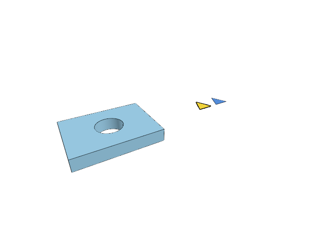

# 13.1.15 · Move between original rigid frames

**Chapter 13 · Shared definitions and drawing sheets · Section 13.1 · Shared CAD definitions** · [Contents](contents.md)

**Typing: 30–60 minutes.** [Estimate](typing-load.md).

Write local coordinates and the rotation between two right-handed frames. Move render positions and turn normals using the same original motion.

## Type

Continue from [Inspect and exercise original definition instances](69n-inspect-and-exercise-original-definition-instances.md). [Save or recover your work](recovery.md).

### 1. `src/cad_shape_key.rs`

Type the whole original helpers introduced today.

Create the file and type:

```rust
--8<-- "journey/code/69zza-move-between-original-rigid-frames-1.rs"
```

### 2. `src/lib.rs`

Register the original rigid-frame and shape-key owner.

<details>
<summary>Locate the existing block</summary>

```rust

pub mod instance_gpu;
```

</details>

After that block, type:

```rust
--8<-- "journey/code/69zza-move-between-original-rigid-frames-2.rs" skip=23
```

## Run and check

Run this from `session_viewer` to select the fixed dependency versions and install supplied binary assets. It updates Cargo.lock and preserves the previous lock. It does not write implementation code:

```sh
npm --prefix ../session_tests run course -- dependencies 13.1.15
```

In your project:

```sh
cd workspace/journey
REGEN_PROTO=0 cargo build --lib --locked --target wasm32-unknown-unknown -j1
REGEN_PROTO=0 CARGO_BUILD_JOBS=1 trunk serve --port 8780
```

Open `http://127.0.0.1:8780/`. Keep an existing Trunk server running; saving rebuilds it.

Point and normal helpers can move between rigid frames; the existing browser drawing is unchanged.

### Recorded visual result

**Previous native render — current verification pending.**



*This recorded image predates a source or checker change. Rebuild this checkpoint before using it as current evidence; browser controls require separate acceptance.*

<details>
<summary>Code explanation and diagram</summary>


original controls → rigid frame → local shape words → candidate rigid copy.


Why translate positions but only rotate normals?

Positions have an origin; normals describe directions. Translation does not change a surface direction.

Study estimate, including typing and experiments: 0.5–1 hours.

</details>

<details>
<summary>Optional experiment</summary>

Trace a quarter turn and translation through point and normal separately.

</details>

<details>
<summary>Check and save your work</summary>

Restore experimental edits, then run from `session_viewer`:

```sh
npm --prefix ../session_tests run course -- check 13.1.15
npm --prefix ../session_tests run course -- save 13.1.15
```

Source comparison leaves your project untouched. [Save and recovery instructions](recovery.md).

</details>

<details>
<summary>Viewer coverage and verification</summary>

These original frame and key helpers prepare reuse of one display walk for congruent CAD originals.


[Full validation scope](release.md).

</details>
