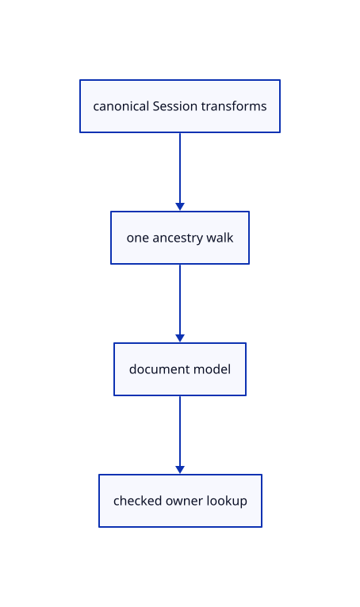

# 13.2.1 · Evaluate source ancestry once per document

**Chapter 13 · Shared definitions and drawing sheets · Section 13.2 · Feature ancestry and sheet metadata** · [Contents](contents.md)

**Typing: 8–16 minutes.** [Estimate](typing-load.md).

Collect canonical source world transforms once and check composed document matrices before deriving display geometry.

## Type

Continue from [Exercise independent original CAD reuse](69af-exercise-independent-original-cad-reuse.md). [Save or recover your work](recovery.md).

### 1. `src/nested_placement.rs`

Evaluate canonical source ancestry once before deriving placed display rows.

Create the file and type:

```rust
--8<-- "journey/code/70-evaluate-source-ancestry-once-per-document-01.rs"
```

### 2. `src/lib.rs`

Register the placement component.

<details>
<summary>Locate the existing block</summary>

```rust

pub mod cad_shape_example;
```

</details>

After that block, type:

```rust
--8<-- "journey/code/70-evaluate-source-ancestry-once-per-document-02.rs" skip=28
```

## Run and check

Run this from `session_viewer` to select the fixed dependency versions and install supplied binary assets. It updates Cargo.lock and preserves the previous lock. It does not write implementation code:

```sh
npm --prefix ../session_tests run course -- dependencies 13.2.1
```

In your project:

```sh
cd workspace/journey
REGEN_PROTO=0 cargo build --lib --locked --target wasm32-unknown-unknown -j1
REGEN_PROTO=0 CARGO_BUILD_JOBS=1 trunk serve --port 8780
```

Open `http://127.0.0.1:8780/`. Keep an existing Trunk server running; saving rebuilds it.

The earlier congruent original CAD example remains visible while cached nested placements and exact local-transform persistence connect. The final endpoint opens rotated and mirrored references under separate parent branches.

### Recorded visual result

**Previous native render — current verification pending.**

Original blue and selected yellow CAD bores retain their black original boundaries.


*This recorded image predates a source or checker change. Rebuild this checkpoint before using it as current evidence; browser controls require separate acceptance.*

This reference image is shared with [13.1.24 · Exercise independent original CAD reuse](69af-exercise-independent-original-cad-reuse.md). It does not demonstrate a new feature by itself.

<details>
<summary>Code explanation and diagram</summary>


canonical Session transforms → one ancestry walk → document model → checked owner lookup.



Why avoid walking the tree for every instance?

One cached ancestry map avoids repeated searches. The kernel has already folded legacy instance placement, so apply it once.

Study estimate, including typing and experiments: 0.5–1 hours.

</details>

<details>
<summary>Optional experiment</summary>

Compare rotated and mirrored parent branches with a legacy local shift; reject composed overflow before adopting any rows.

</details>

<details>
<summary>Check and save your work</summary>

Restore experimental edits, then run from `session_viewer`:

```sh
npm --prefix ../session_tests run course -- check 13.2.1
npm --prefix ../session_tests run course -- save 13.2.1
```

Source comparison leaves your project untouched. [Save and recovery instructions](recovery.md).

</details>

<details>
<summary>Viewer coverage and verification</summary>


The inherited congruent CAD exercise remains authored and unrun. The final nested example checks original local transforms, independent instance models, Save/Open, parent Move, Undo/Redo and Close; actual browser execution remains required.

[Full validation scope](release.md).

To reproduce the scripted acceptance of the reference checkpoint, run from `session_viewer` with the [course bundle server](release.md#reproduce) running on port 8781:

```sh
npm --prefix ../session_tests run course -- capture 13.2.1
```

This uses the verified reference bundle; it does not check or change your typed project.

</details>
