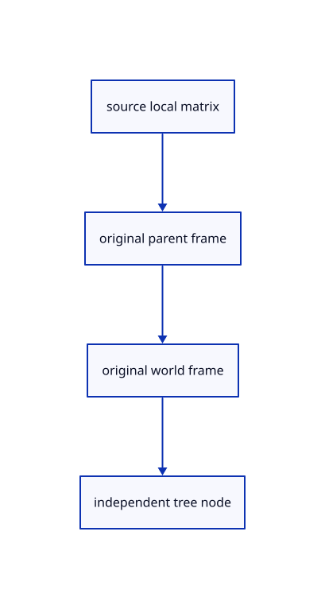

# 13.2.2 · Keep original local parent and world matrices

**Chapter 13 · Shared definitions and drawing sheets · Section 13.2 · Feature ancestry and sheet metadata** · [Contents](contents.md)

**Typing: 23–45 minutes.** [Estimate](typing-load.md).

Retain original local and parent/world frames beside tree identities. New generated nodes begin with identity placement.

## Type

Continue from [Evaluate source ancestry once per document](70-evaluate-source-ancestry-once-per-document.md). [Save or recover your work](recovery.md).

### 1. `src/nested_placement.rs`

Preserve exact original local transforms and derive changed locals from the current parent.

<details>
<summary>Locate the existing block</summary>

```rust
}
pub fn model(world:&HashMap<String,Xform>,place:&Xform,guid:&str)->Xform {world.get(guid).cloned().unwrap_or_else(||place.clone())}
```

</details>

After that block, type:

```rust
--8<-- "journey/code/70a-keep-original-local-parent-and-world-matrices-01.rs" skip=134
```

### 2. `src/hierarchy.rs`

Own original local, parent and world matrices alongside tree identities.

Edit these blocks from bottom to top. Keep the surrounding lines unchanged.

<details>
<summary>Locate this block</summary>

```rust
        self.documents.push(Rc::new(Document {header:None,key,label,nodes}));
    }

    pub(crate) fn push(&mut self,document:Document) {
        Rc::make_mut(&mut self.readonly_ids).extend(document.nodes.iter().filter(|node|node.readonly).filter_map(|node|node.object));
        self.documents.push(Rc::new(document));
```

</details>

Replace it with:

```rust
        self.documents.push(Rc::new(Document {header:None,key,label,nodes}));
    }

    pub(crate) fn original_placements(&mut self,key:u32,source:&session_rust::Session,place:&Xform,world:&HashMap<String,Xform>) {
        let doc=Rc::make_mut(self.documents.iter_mut().find(|doc|doc.key==key).unwrap());
        for i in 0..doc.nodes.len() {
            let node=&doc.nodes[i];let parent=node.parent.map_or_else(Xform::identity,|p|doc.nodes[p].placement.world.clone());let local=source.xforms.get(&node.source.name).cloned().unwrap_or_else(Xform::identity);let local=if node.parent.is_none() {place*&local} else {local};let matrix=world.get(&node.source.name).cloned().unwrap_or_else(||&parent*&local);doc.nodes[i].placement=crate::nested_placement::Node {local,world:matrix,parent};
        }
    }

    pub(crate) fn push(&mut self,document:Document) {
        Rc::make_mut(&mut self.readonly_ids).extend(document.nodes.iter().filter(|node|node.readonly).filter_map(|node|node.object));
        self.documents.push(Rc::new(document));
```

<details>
<summary>Locate this block</summary>

```rust
            if exit {nodes[parent.unwrap()].end=nodes.len();continue;}
            let object=lookup.get(node.name.as_str()).copied();let readonly=readonly || inside && matches!(node.name.as_str(),"attributes"|"interactions");
            let index=nodes.len();let source=proto::TreeNode {guid:if node.guid.is_empty() {uuid::Uuid::new_v4().to_string()} else {node.guid.clone()},name:node.name.clone(),parent_guid:node.parent_guid.clone(),color:node.color.clone(),children:Vec::new()};
            nodes.push(Node {portable_guid:uuid::Uuid::new_v4().to_string(),source,object:object.map(|v|v.0),label:object.map_or_else(||node.name.clone(),|v|v.1.to_owned()),parent,depth,end:index+1,readonly});
            stack.push((node,Some(index),depth,inside,readonly,true));
            stack.extend(node.children.iter().rev().map(|child|(child,Some(index),depth+1,inside||object.is_some(),readonly,false)));
        }
```

</details>

Replace it with:

```rust
            if exit {nodes[parent.unwrap()].end=nodes.len();continue;}
            let object=lookup.get(node.name.as_str()).copied();let readonly=readonly || inside && matches!(node.name.as_str(),"attributes"|"interactions");
            let index=nodes.len();let source=proto::TreeNode {guid:if node.guid.is_empty() {uuid::Uuid::new_v4().to_string()} else {node.guid.clone()},name:node.name.clone(),parent_guid:node.parent_guid.clone(),color:node.color.clone(),children:Vec::new()};
            nodes.push(Node {placement:Default::default(),portable_guid:uuid::Uuid::new_v4().to_string(),source,object:object.map(|v|v.0),label:object.map_or_else(||node.name.clone(),|v|v.1.to_owned()),parent,depth,end:index+1,readonly});
            stack.push((node,Some(index),depth,inside,readonly,true));
            stack.extend(node.children.iter().rev().map(|child|(child,Some(index),depth+1,inside||object.is_some(),readonly,false)));
        }
```

<details>
<summary>Locate this block</summary>

```rust
}

#[derive(Clone)]
pub struct Node {pub portable_guid:String, pub source:proto::TreeNode,pub object:Option<ObjectId>,pub label:String,pub parent:Option<usize>,pub depth:usize,pub end:usize,pub readonly:bool }
#[derive(Clone)]
pub struct Document {pub header:Option<Rc<crate::origin::Origin>>,pub key:u32,pub label:String,pub nodes:Vec<Node>}
#[derive(Clone,Default)]
```

</details>

Replace it with:

```rust
}

#[derive(Clone)]
pub struct Node {pub placement:crate::nested_placement::Node,pub portable_guid:String, pub source:proto::TreeNode,pub object:Option<ObjectId>,pub label:String,pub parent:Option<usize>,pub depth:usize,pub end:usize,pub readonly:bool }
#[derive(Clone)]
pub struct Document {pub header:Option<Rc<crate::origin::Origin>>,pub key:u32,pub label:String,pub nodes:Vec<Node>}
#[derive(Clone,Default)]
```

<details>
<summary>Complete updated block reference</summary>

```rust
use crate::scene::{Scene,ObjectId};
use session_rust::{proto,Xform};
use std::{collections::{HashMap,HashSet},rc::Rc};

pub const MAX_NODES:usize=4096;
pub const MAX_DEPTH:usize=64;

pub fn validate(root:&proto::TreeNode,guids:&HashSet<&str>)->Result<(), &'static str> {
    let mut stack=vec![(root,0)];let mut seen=HashSet::new();let mut count=0;
    while let Some((node,depth))=stack.pop() {
        count+=1;if count>MAX_NODES || depth>MAX_DEPTH {return Err("Tree exceeds this checkpoint's node or depth limit");}
        if guids.contains(node.name.as_str()) && !seen.insert(node.name.as_str()) {return Err("A source object occurs twice in the tree");}
        stack.extend(node.children.iter().rev().map(|child|(child,depth+1)));
    }
    if seen!=*guids {return Err("The tree must contain every source mesh once");} Ok(())
}

pub fn world(root:Option<&proto::TreeNode>,xforms:&HashMap<String,Xform>,guid:&str)->Xform {
    let mut stack=root.into_iter().map(|node|(node,Xform::identity())).collect::<Vec<_>>();
    while let Some((node,parent))=stack.pop() {
        let local=xforms.get(&node.name).cloned().unwrap_or_else(Xform::identity);let matrix=&parent*&local;
        if node.name==guid {return matrix;}
        stack.extend(node.children.iter().rev().map(|child|(child,matrix.clone())));
    }
    xforms.get(guid).cloned().unwrap_or_else(Xform::identity)
}

#[derive(Clone)]
pub struct Node {pub placement:crate::nested_placement::Node,pub portable_guid:String, pub source:proto::TreeNode,pub object:Option<ObjectId>,pub label:String,pub parent:Option<usize>,pub depth:usize,pub end:usize,pub readonly:bool }
#[derive(Clone)]
pub struct Document {pub header:Option<Rc<crate::origin::Origin>>,pub key:u32,pub label:String,pub nodes:Vec<Node>}
#[derive(Clone,Default)]
pub struct Forest { pub documents:Vec<Rc<Document>>,readonly_ids:Rc<HashSet<ObjectId>> }

impl Forest {
    pub fn add(&mut self,key:u32,label:String,root:Option<proto::TreeNode>,objects:&[(String,ObjectId,String)]) {
        let fallback=proto::TreeNode {name:label.clone(),children:objects.iter().map(|(guid,_,_)|proto::TreeNode {name:guid.clone(),..Default::default()}).collect(),..Default::default()};
        let root=root.unwrap_or(fallback);let lookup=objects.iter().map(|(guid,id,name)|(guid.as_str(),(*id,name.as_str()))).collect::<HashMap<_,_>>();
        let mut nodes:Vec<Node>=Vec::new();let mut stack=vec![(&root,None::<usize>,0,false,false,false)];
        while let Some((node,parent,depth,inside,readonly,exit))=stack.pop() {
            if exit {nodes[parent.unwrap()].end=nodes.len();continue;}
            let object=lookup.get(node.name.as_str()).copied();let readonly=readonly || inside && matches!(node.name.as_str(),"attributes"|"interactions");
            let index=nodes.len();let source=proto::TreeNode {guid:if node.guid.is_empty() {uuid::Uuid::new_v4().to_string()} else {node.guid.clone()},name:node.name.clone(),parent_guid:node.parent_guid.clone(),color:node.color.clone(),children:Vec::new()};
            nodes.push(Node {placement:Default::default(),portable_guid:uuid::Uuid::new_v4().to_string(),source,object:object.map(|v|v.0),label:object.map_or_else(||node.name.clone(),|v|v.1.to_owned()),parent,depth,end:index+1,readonly});
            stack.push((node,Some(index),depth,inside,readonly,true));
            stack.extend(node.children.iter().rev().map(|child|(child,Some(index),depth+1,inside||object.is_some(),readonly,false)));
        }
        Rc::make_mut(&mut self.readonly_ids).extend(nodes.iter().filter(|node|node.readonly).filter_map(|node|node.object));
        self.documents.push(Rc::new(Document {header:None,key,label,nodes}));
    }

    pub(crate) fn original_placements(&mut self,key:u32,source:&session_rust::Session,place:&Xform,world:&HashMap<String,Xform>) {
        let doc=Rc::make_mut(self.documents.iter_mut().find(|doc|doc.key==key).unwrap());
        for i in 0..doc.nodes.len() {
            let node=&doc.nodes[i];let parent=node.parent.map_or_else(Xform::identity,|p|doc.nodes[p].placement.world.clone());let local=source.xforms.get(&node.source.name).cloned().unwrap_or_else(Xform::identity);let local=if node.parent.is_none() {place*&local} else {local};let matrix=world.get(&node.source.name).cloned().unwrap_or_else(||&parent*&local);doc.nodes[i].placement=crate::nested_placement::Node {local,world:matrix,parent};
        }
    }

    pub(crate) fn push(&mut self,document:Document) {
        Rc::make_mut(&mut self.readonly_ids).extend(document.nodes.iter().filter(|node|node.readonly).filter_map(|node|node.object));
        self.documents.push(Rc::new(document));
    }

    pub fn colours(&self,key:u32)->HashMap<ObjectId,[u8;3]> {
        let mut out=HashMap::new();let Some(doc)=self.documents.iter().find(|doc|doc.key==key) else {return out;};
        let mut inherited=vec![None;doc.nodes.len()];
        for (index,node) in doc.nodes.iter().enumerate() {
            let colour=node.source.color.as_ref().map(|colour|[colour.r,colour.g,colour.b].map(|value|(value.clamp(0.,1.)*255.).round() as u8)).or_else(||node.parent.and_then(|parent|inherited[parent]));
            inherited[index]=colour;if let (Some(id),Some(colour))=(node.object,colour) {out.insert(id,colour);}
        }
        out
    }

    pub(crate) fn replace(&mut self,index:usize,document:Document) {
        self.documents[index]=Rc::new(document);
        self.readonly_ids=Rc::new(self.documents.iter().flat_map(|doc|doc.nodes.iter()).filter(|node|node.readonly).filter_map(|node|node.object).collect());
    }

    pub fn readonly(&self,id:ObjectId)->bool {self.readonly_ids.contains(&id)}
    pub fn descendants(&self,ids:&[ObjectId])->Vec<ObjectId> {
        let mut out=ids.to_vec();
        for doc in &self.documents {for (index,node) in doc.nodes.iter().enumerate() {if node.object.is_some_and(|id|ids.contains(&id)) {out.extend(doc.nodes[index+1..node.end].iter().filter_map(|n|n.object));}}}
        out.sort_unstable_by_key(|id|id.value());out.dedup();out
    }

    pub fn snapshot(&self,scene:&Scene,xforms:&mut Vec<proto::XformEntry>)->Result<(Vec<proto::TreeNode>,HashSet<ObjectId>), &'static str> {
        let mut roots=Vec::new();let mut placed=HashSet::new();
        for doc in &self.documents {if let Some(root)=save_node(doc,0,scene,&Xform::identity(),"",xforms,&mut placed)? {roots.push(root);}}
        Ok((roots,placed))
    }
}

fn save_node(doc:&Document,index:usize,scene:&Scene,parent:&Xform,parent_guid:&str,xforms:&mut Vec<proto::XformEntry>,placed:&mut HashSet<ObjectId>)->Result<Option<proto::TreeNode>, &'static str> {
    let original=&doc.nodes[index];let mut node=original.source.clone();node.guid=original.portable_guid.clone();node.parent_guid=parent_guid.to_owned();let mut matrix=parent.clone();
    if let Some(id)=original.object {
        let Some(guid)=scene.row_guid(id) else {return Ok(None);};
        node.name=guid.to_owned();matrix=scene.placement(id).ok_or("Saved source placement is missing")?;let local=&parent.inverse().ok_or("Parent placement cannot be inverted for Save")?*&matrix;
        if local.m!=Xform::identity().m {xforms.push(proto::XformEntry {guid:guid.to_owned(),xform:Some(local.to_proto())});} placed.insert(id);
    }
    for child in index+1..original.end {if doc.nodes[child].parent==Some(index) {if let Some(child)=save_node(doc,child,scene,&matrix,&node.guid,xforms,placed)? {node.children.push(child);}}}
    Ok(Some(node))
}

#[derive(Clone)]
pub struct Row {pub key:String,pub label:String,pub depth:usize,pub end:usize,pub ids:Vec<ObjectId>,pub readonly:bool}
pub fn rows(scene:&Scene)->Vec<Row> {
    let mut rows=Vec::new();let mut placed=HashSet::new();
    for doc in &scene.forest.documents {
        let mut visible=Vec::new();let mut index=0;
        while index<doc.nodes.len() {
            let node=&doc.nodes[index];
            if node.object.is_some_and(|id|!scene.contains(id)) {index=node.end;continue;}
            visible.push(index);index+=1;
        }
        let start=rows.len();
        for &index in &visible {
            let node=&doc.nodes[index];let ids=doc.nodes[index..node.end].iter().filter_map(|n|n.object).filter(|id|scene.contains(*id)).collect::<Vec<_>>();
            placed.extend(node.object);let end=start+visible.partition_point(|i|*i<node.end);
            rows.push(Row {key:format!("{}/{}",doc.key,node.source.guid),label:if index==0 {doc.label.clone()} else {node.label.clone()},depth:node.depth,end,ids,readonly:node.readonly});
        }
    }
    for row in scene.objects().iter().filter(|r|!placed.contains(&r.id)) {let index=rows.len();rows.push(Row {key:format!("created/{}",row.id.value()),label:row.metadata.name.clone(),depth:0,end:index+1,ids:vec![row.id],readonly:false});}
    let other=scene.lines().iter().map(|r|(r.id,r.prepared.source.name.as_str())).chain(scene.paths().iter().map(|r|(r.id,r.prepared.source.name()))).chain(scene.points().iter().map(|r|(r.id,r.prepared.source.name.as_str()))).chain(scene.texts().iter().map(|r|(r.id,r.prepared.source.name.as_str()))).chain(scene.clouds().iter().map(|r|(r.id,r.prepared.source.name.as_str()))).chain(scene.streams().iter().map(|r|(r.id,r.prepared.source.name.as_str())));
    for (id,label) in other.filter(|(id,_)|!placed.contains(id)) {let index=rows.len();rows.push(Row {key:format!("created/{}",id.value()),label:label.to_owned(),depth:0,end:index+1,ids:vec![id],readonly:false});}
    rows
}
```

</details>

<details>
<summary>Optional patch references</summary>

Use these original edit fragments when comparing a saved checkpoint. Apply the complete blocks above.

```text
--8<-- "journey/code/70a-keep-original-local-parent-and-world-matrices-02.rs"
```

```text
--8<-- "journey/code/70a-keep-original-local-parent-and-world-matrices-03.rs"
```

```text
--8<-- "journey/code/70a-keep-original-local-parent-and-world-matrices-04.rs"
```

</details>

### 3. `src/layer_edit.rs`

Give generated layer and geometry nodes explicit identity placement defaults.

Edit these blocks from bottom to top. Keep the surrounding lines unchanged.

<details>
<summary>Locate this block</summary>

```rust
    if doc.nodes[parent].depth>=crate::hierarchy::MAX_DEPTH {return Err("Tree exceeds its depth limit");}
    let label=(1..).map(|i|format!("Layer {i:02}")).find(|name|!doc.nodes.iter().any(|node|node.label==*name||node.source.name==*name)).unwrap();
    let source=session_rust::proto::TreeNode {guid:uuid::Uuid::new_v4().to_string(),name:label.clone(),..Default::default()};
    let child=Branch {node:Node {portable_guid:source.guid.clone(),source,object:None,label,parent:None,depth:0,end:1,readonly:false},children:Vec::new()};
    let mut tree=branch(doc,0);find(&mut tree,&doc.nodes[parent].source.guid).unwrap().children.push(child);replace(scene,owner,tree);Ok(())
}
```

</details>

Replace it with:

```rust
    if doc.nodes[parent].depth>=crate::hierarchy::MAX_DEPTH {return Err("Tree exceeds its depth limit");}
    let label=(1..).map(|i|format!("Layer {i:02}")).find(|name|!doc.nodes.iter().any(|node|node.label==*name||node.source.name==*name)).unwrap();
    let source=session_rust::proto::TreeNode {guid:uuid::Uuid::new_v4().to_string(),name:label.clone(),..Default::default()};
    let child=Branch {node:Node {placement:Default::default(),portable_guid:source.guid.clone(),source,object:None,label,parent:None,depth:0,end:1,readonly:false},children:Vec::new()};
    let mut tree=branch(doc,0);find(&mut tree,&doc.nodes[parent].source.guid).unwrap().children.push(child);replace(scene,owner,tree);Ok(())
}
```

<details>
<summary>Locate this block</summary>

```rust
    if doc.nodes.len()>=crate::hierarchy::MAX_NODES||doc.nodes[index].depth>=crate::hierarchy::MAX_DEPTH {return Err("Current layer exceeds its tree limit");}
    let parent=doc.nodes[index].source.guid.clone();let mut tree=branch(doc,0);
    let source=session_rust::proto::TreeNode {guid:uuid::Uuid::new_v4().to_string(),name:guid,..Default::default()};
    find(&mut tree,&parent).unwrap().children.push(Branch {node:Node {portable_guid:source.guid.clone(),source,object:Some(id),label,parent:None,depth:0,end:1,readonly:false},children:Vec::new()});
    replace(scene,owner,tree);Ok(())
}
```

</details>

Replace it with:

```rust
    if doc.nodes.len()>=crate::hierarchy::MAX_NODES||doc.nodes[index].depth>=crate::hierarchy::MAX_DEPTH {return Err("Current layer exceeds its tree limit");}
    let parent=doc.nodes[index].source.guid.clone();let mut tree=branch(doc,0);
    let source=session_rust::proto::TreeNode {guid:uuid::Uuid::new_v4().to_string(),name:guid,..Default::default()};
    find(&mut tree,&parent).unwrap().children.push(Branch {node:Node {placement:Default::default(),portable_guid:source.guid.clone(),source,object:Some(id),label,parent:None,depth:0,end:1,readonly:false},children:Vec::new()});
    replace(scene,owner,tree);Ok(())
}
```

<details>
<summary>Complete updated block reference</summary>

```rust
use crate::{hierarchy::{Document,Node},scene::Scene};
use std::rc::Rc;

pub enum Edit {Current,New {sublayer:bool},Rename(String),Delete,Duplicate,Move(Vec<crate::scene::ObjectId>),Copy(Vec<crate::scene::ObjectId>)}

// Temporary branches make subtree edits atomic while the saved scene continues sharing its original source and display allocations.
#[derive(Clone)]
struct Branch {node:Node,children:Vec<Branch>}

fn branch(doc:&Document,index:usize)->Branch {
    Branch {node:doc.nodes[index].clone(),children:(index+1..doc.nodes[index].end).filter(|child|doc.nodes[*child].parent==Some(index)).map(|child|branch(doc,child)).collect()}
}

fn find<'a>(root:&'a mut Branch,guid:&str)->Option<&'a mut Branch> {
    if root.node.source.guid==guid {return Some(root);}
    root.children.iter_mut().find_map(|child|find(child,guid))
}

fn flatten(root:Branch,parent:Option<usize>,depth:usize,nodes:&mut Vec<Node>) {
    let index=nodes.len();let mut node=root.node;node.parent=parent;node.depth=depth;
    node.source.parent_guid=parent.map_or_else(String::new,|parent|nodes[parent].source.guid.clone());
    nodes.push(node);
    for child in root.children {flatten(child,Some(index),depth+1,nodes);}
    nodes[index].end=nodes.len();
}

pub fn locate(scene:&Scene,key:&str)->Result<(usize,usize), &'static str> {locate_group(scene,key,true)}

fn locate_group(scene:&Scene,key:&str,editable:bool)->Result<(usize,usize), &'static str> {
    for (owner,doc) in scene.forest.documents.iter().enumerate() {
        for (index,node) in doc.nodes.iter().enumerate() {
            if format!("{}/{}",doc.key,node.source.guid)!=key {continue;}
            let mut ancestor=Some(index);
            while let Some(index)=ancestor {
                if doc.nodes[index].object.is_some() {return Err("Objects and their attributes are not layers");}
                ancestor=doc.nodes[index].parent;
            }
            if editable && doc.nodes.iter().filter_map(|node|node.object).any(|id|scene.objects().iter().any(|row|row.id==id&&row.geometry().is_none())) {return Err("Reload editable sources before editing layers");}
            return Ok((owner,index));
        }
    }
    Err("This layer is gone")
}

pub fn holds_current(scene:&Scene,key:&str)->bool {
    let Some(current)=current_key(scene) else {return false;};
    let rows=crate::hierarchy::rows(scene);
    rows.iter().position(|row|row.key==key).is_some_and(|index|rows[index..rows[index].end].iter().any(|row|row.key==current))
}

pub fn current_key(scene:&Scene)->Option<String> {
    if let Some(key)=scene.view.current.as_ref() && locate_group(scene,key,false).is_ok() {return Some(key.clone());}
    let doc=scene.forest.documents.iter().find(|doc|Some(doc.key)==scene.created)?;
    Some(format!("{}/{}",doc.key,doc.nodes[0].source.guid))
}

fn replace(scene:&mut Scene,owner:usize,tree:Branch) {
    let old=&scene.forest.documents[owner];let mut document=Document {header:old.header.clone(),key:old.key,label:old.label.clone(),nodes:Vec::new()};
    flatten(tree,None,0,&mut document.nodes);scene.forest.replace(owner,document);Rc::make_mut(&mut scene.view).refresh(&scene.forest);
}

pub(crate) fn attach_generated(scene:&mut Scene,id:crate::scene::ObjectId,guid:String,label:String)->Result<(), &'static str> {
    if current_key(scene).is_none() {
        scene.forest.add(id.value(),"Created".into(),None,&[]);scene.created=Some(id.value());
    }
    let key=current_key(scene).unwrap();let (owner,index)=locate(scene,&key)?;let doc=&scene.forest.documents[owner];
    if doc.nodes.len()>=crate::hierarchy::MAX_NODES||doc.nodes[index].depth>=crate::hierarchy::MAX_DEPTH {return Err("Current layer exceeds its tree limit");}
    let parent=doc.nodes[index].source.guid.clone();let mut tree=branch(doc,0);
    let source=session_rust::proto::TreeNode {guid:uuid::Uuid::new_v4().to_string(),name:guid,..Default::default()};
    find(&mut tree,&parent).unwrap().children.push(Branch {node:Node {placement:Default::default(),portable_guid:source.guid.clone(),source,object:Some(id),label,parent:None,depth:0,end:1,readonly:false},children:Vec::new()});
    replace(scene,owner,tree);Ok(())
}

fn take(root:&mut Branch,id:crate::scene::ObjectId)->Option<Branch> {
    if let Some(index)=root.children.iter().position(|child|child.node.object==Some(id)) {return Some(root.children.remove(index));}
    root.children.iter_mut().find_map(|child|take(child,id))
}

fn copy_branch(scene:&mut Scene,mut tree:Branch,all:bool)->Result<Branch,&'static str> {
    tree.node.source.guid=uuid::Uuid::new_v4().to_string();tree.node.portable_guid=tree.node.source.guid.clone();
    if let Some(id)=tree.node.object {let copy=scene.copy_row(id,all)?;tree.node.object=Some(copy);tree.node.source.name=scene.row_guid(copy).unwrap().to_owned();}
    tree.children=tree.children.into_iter().map(|child|copy_branch(scene,child,all)).collect::<Result<_,_>>()?;Ok(tree)
}

fn transfer(scene:&mut Scene,key:&str,ids:Vec<crate::scene::ObjectId>,copy:bool)->Result<(), &'static str> {
    let (owner,index)=locate(scene,key)?;let target=scene.forest.documents[owner].nodes[index].source.guid.clone();
    if ids.is_empty() {return Err("Select objects first");}
    if ids.iter().any(|id|scene.pick_id(id.value())!=Some(*id)) {return Err("Choose visible unlocked editable objects");}
    let chosen=ids.into_iter().collect::<std::collections::HashSet<_>>();let mut trees=scene.forest.documents.iter().map(|doc|branch(doc,0)).collect::<Vec<_>>();let mut moved=Vec::new();
    for (doc_index,doc) in scene.forest.documents.iter().enumerate() {
        for (index,node) in doc.nodes.iter().enumerate() {
            let Some(id)=node.object.filter(|id|chosen.contains(id)) else {continue;};let mut parent=node.parent;let mut follows=false;
            while let Some(index)=parent {follows|=doc.nodes[index].object.is_some_and(|id|chosen.contains(&id));parent=doc.nodes[index].parent;}
            if follows&&!copy {continue;}
            if !copy&&doc_index==owner&&node.parent.is_some_and(|parent|doc.nodes[parent].source.guid==target) {continue;}
            let mut tree=if copy {branch(doc,index)} else {take(&mut trees[doc_index],id).ok_or("Object tree is gone")?};
            if copy {tree.children.clear();}
            moved.push(tree);
        }
    }
    if moved.is_empty() {return Err("The objects are already on this layer");}
    let mut target_nodes=Vec::new();flatten(trees[owner].clone(),None,0,&mut target_nodes);let count=target_nodes.len()+moved.iter().map(|tree|{let mut nodes=Vec::new();flatten(tree.clone(),None,0,&mut nodes);nodes.len()}).sum::<usize>();
    if count>crate::hierarchy::MAX_NODES {return Err("Target layer exceeds its node limit");}
    for tree in moved {let tree=if copy {copy_branch(scene,tree,false)?} else {tree};find(&mut trees[owner],&target).unwrap().children.push(tree);}
    for (owner,tree) in trees.into_iter().enumerate() {let mut nodes=Vec::new();flatten(tree.clone(),None,0,&mut nodes);if nodes.iter().any(|node|node.depth>crate::hierarchy::MAX_DEPTH) {return Err("Target layer exceeds its depth limit");}replace(scene,owner,tree);}
    Ok(())
}

fn new_layer(scene:&mut Scene,key:&str,sublayer:bool)->Result<(), &'static str> {
    let (owner,index)=locate(scene,key)?;let doc=&scene.forest.documents[owner];let node=&doc.nodes[index];
    if doc.nodes.len()>=crate::hierarchy::MAX_NODES {return Err("Tree exceeds its node limit");}
    let parent=if sublayer {index} else {node.parent.unwrap_or(index)};
    if doc.nodes[parent].depth>=crate::hierarchy::MAX_DEPTH {return Err("Tree exceeds its depth limit");}
    let label=(1..).map(|i|format!("Layer {i:02}")).find(|name|!doc.nodes.iter().any(|node|node.label==*name||node.source.name==*name)).unwrap();
    let source=session_rust::proto::TreeNode {guid:uuid::Uuid::new_v4().to_string(),name:label.clone(),..Default::default()};
    let child=Branch {node:Node {placement:Default::default(),portable_guid:source.guid.clone(),source,object:None,label,parent:None,depth:0,end:1,readonly:false},children:Vec::new()};
    let mut tree=branch(doc,0);find(&mut tree,&doc.nodes[parent].source.guid).unwrap().children.push(child);replace(scene,owner,tree);Ok(())
}

fn rename(scene:&mut Scene,key:&str,label:&str)->Result<(), &'static str> {
    let (owner,index)=locate(scene,key)?;let doc=&scene.forest.documents[owner];let node=&doc.nodes[index];
    if node.parent.is_none() {return Err("The root layer cannot be renamed");}
    let label=label.trim();
    if label.is_empty()||label.contains('/') {return Err("A layer name must be non-empty and without /");}
    if label==node.label {return Err("The layer already has that name");}
    if doc.nodes.iter().any(|other|other.label==label||other.source.name==label) {return Err("This name is already used in the document");}
    let mut tree=branch(doc,0);let node=&mut find(&mut tree,&node.source.guid).unwrap().node;node.label=label.to_owned();node.source.name=label.to_owned();replace(scene,owner,tree);Ok(())
}

fn delete(scene:&mut Scene,key:&str)->Result<(), &'static str> {
    let (owner,index)=locate(scene,key)?;let doc=&scene.forest.documents[owner];let node=&doc.nodes[index];
    let parent=node.parent.ok_or("The root layer cannot be deleted")?;
    if holds_current(scene,key) {return Err("The current layer cannot be deleted");}
    let ids=doc.nodes[index..node.end].iter().filter_map(|node|node.object).collect::<Vec<_>>();let mut tree=branch(doc,0);
    find(&mut tree,&doc.nodes[parent].source.guid).unwrap().children.retain(|child|child.node.source.guid!=node.source.guid);
    for id in ids {scene.remove(id);}replace(scene,owner,tree);Ok(())
}

fn duplicate(scene:&mut Scene,key:&str)->Result<(), &'static str> {
    let (owner,index)=locate(scene,key)?;let doc=&scene.forest.documents[owner];let node=&doc.nodes[index];
    let parent=node.parent.ok_or("The root layer cannot be duplicated")?;
    if doc.nodes.len()+node.end-index>crate::hierarchy::MAX_NODES {return Err("Tree exceeds its node limit");}
    let label=(1..).map(|i|format!("{} copy {i:02}",node.label)).find(|name|!doc.nodes.iter().any(|node|node.label==*name||node.source.name==*name)).unwrap();
    let parent=doc.nodes[parent].source.guid.clone();let source=branch(doc,index);let mut tree=branch(doc,0);let mut copy=copy_branch(scene,source,true)?;copy.node.label=label.clone();copy.node.source.name=label;
    find(&mut tree,&parent).unwrap().children.push(copy);replace(scene,owner,tree);Ok(())
}

pub fn apply(scene:&mut Scene,key:&str,edit:Edit)->Result<(), &'static str> {
    match edit {
        Edit::Current=>{locate(scene,key)?;Rc::make_mut(&mut scene.view).current=Some(key.to_owned());Ok(())},
        Edit::New {sublayer}=>new_layer(scene,key,sublayer),
        Edit::Rename(label)=>rename(scene,key,&label),
        Edit::Delete=>delete(scene,key),
        Edit::Duplicate=>duplicate(scene,key),
        Edit::Move(ids)=>transfer(scene,key,ids,false),
        Edit::Copy(ids)=>transfer(scene,key,ids,true),
    }
}
```

</details>

<details>
<summary>Optional patch references</summary>

Use these original edit fragments when comparing a saved checkpoint. Apply the complete blocks above.

```text
--8<-- "journey/code/70a-keep-original-local-parent-and-world-matrices-05.rs"
```

```text
--8<-- "journey/code/70a-keep-original-local-parent-and-world-matrices-06.rs"
```

</details>

## Run and check

Run this from `session_viewer` to select the fixed dependency versions and install supplied binary assets. It updates Cargo.lock and preserves the previous lock. It does not write implementation code:

```sh
npm --prefix ../session_tests run course -- dependencies 13.2.2
```

In your project:

```sh
cd workspace/journey
REGEN_PROTO=0 cargo build --lib --locked --target wasm32-unknown-unknown -j1
REGEN_PROTO=0 CARGO_BUILD_JOBS=1 trunk serve --port 8780
```

Open `http://127.0.0.1:8780/`. Keep an existing Trunk server running; saving rebuilds it.


### Recorded visual result

**Previous native render — current verification pending.**

Original blue and selected yellow CAD bores retain their black original boundaries.


*This recorded image predates a source or checker change. Rebuild this checkpoint before using it as current evidence; browser controls require separate acceptance.*

This reference image is shared with [13.1.24 · Exercise independent original CAD reuse](69af-exercise-independent-original-cad-reuse.md). It does not demonstrate a new feature by itself.

<details>
<summary>Code explanation and diagram</summary>


source local matrix → original parent frame → original world frame → independent tree node.



Why retain local transforms after computing world placement?

Save can preserve unchanged originals exactly. Repeatedly deriving locals through matrix inversion may add rounding error or flatten the source hierarchy.

Study estimate, including typing and experiments: 0.5–1 hours.

</details>

<details>
<summary>Optional experiment</summary>

Inspect exact original local matrices independently of the placed row model and generated layer defaults.

</details>

<details>
<summary>Check and save your work</summary>

Restore experimental edits, then run from `session_viewer`:

```sh
npm --prefix ../session_tests run course -- check 13.2.2
npm --prefix ../session_tests run course -- save 13.2.2
```

Source comparison leaves your project untouched. [Save and recovery instructions](recovery.md).

</details>

<details>
<summary>Viewer coverage and verification</summary>


The inherited congruent CAD exercise remains authored and unrun. The final nested example checks original local transforms, independent instance models, Save/Open, parent Move, Undo/Redo and Close; actual browser execution remains required.

[Full validation scope](release.md).

To reproduce the scripted acceptance of the reference checkpoint, run from `session_viewer` with the [course bundle server](release.md#reproduce) running on port 8781:

```sh
npm --prefix ../session_tests run course -- capture 13.2.2
```

This uses the verified reference bundle; it does not check or change your typed project.

</details>
