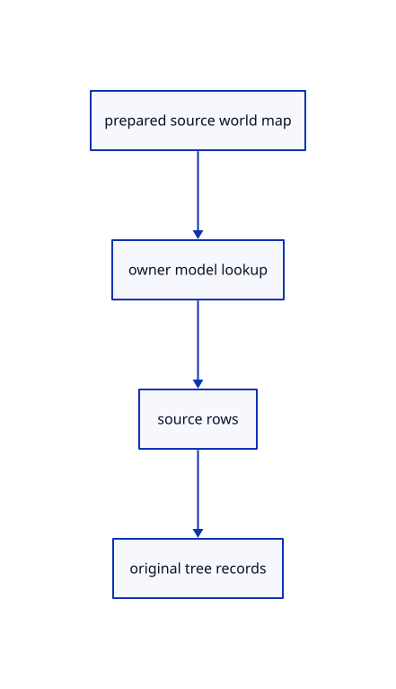

# 13.2.3 · Connect canonical cached models to every source owner

**Chapter 13 · Shared definitions and drawing sheets · Section 13.2 · Feature ancestry and sheet metadata** · [Contents](contents.md)

**Typing: 11–22 minutes.** [Estimate](typing-load.md).

Use cached composed models for ordinary geometry and original references, then retain their canonical tree placement records.

## Type

Continue from [Keep original local parent and world matrices](70a-keep-original-local-parent-and-world-matrices.md). [Save or recover your work](recovery.md).

### 1. `src/document_source.rs`

Connect cached canonical models and exact original tree placement records.

<details>
<summary>Locate the existing block</summary>

```rust
use session_rust::{proto,Session,Xform};
use prost::Message;
use std::{collections::HashSet,rc::Rc};

pub(crate) struct Source {pub document:Rc<Session>,pub origin:Rc<crate::origin::Origin>,pub tree:Option<proto::TreeNode>}
pub(crate) fn prepare(bytes:&[u8],place:&Xform,point_px:f32)->Result<Source,String> {
    if bytes.len()>crate::archive::LIMIT {return Err("Session exceeds the 512 MiB file limit".into());}
    let message=proto::Session::decode(bytes).map_err(|e|e.to_string())?;
    crate::source_validate::session(&message)?;
    supported(&message)?;
    if !crate::placement::valid(&place.m)||!point_px.is_finite() {return Err("Invalid document placement or point size".into());}
    let tree=message.tree.as_ref().and_then(|tree|tree.root.clone());
    let mut guids=HashSet::new();let objects=message.objects.as_ref().ok_or("Session has no objects")?;
    macro_rules! identity {($field:ident)=>{for object in &objects.$field {if object.guid.is_empty()||!guids.insert(object.guid.as_str()) {return Err("Source GUIDs must be distinct within a document".into());}}};}
    identity!(meshes);identity!(points);identity!(lines);identity!(polylines);identity!(nurbscurves);identity!(nurbssurfaces);identity!(breps);identity!(pointclouds);identity!(instances);
    if let Some(root)=tree.as_ref() {crate::hierarchy::validate(root,&guids).map_err(str::to_owned)?;}
    let mut placed=HashSet::new();for entry in &message.xforms {if !placed.insert(entry.guid.as_str())||!crate::placement::valid(&entry.xform.as_ref().ok_or("Missing placement matrix")?.matrix) {return Err("Invalid source placement".into());}}
    let origin=Rc::new(crate::origin::Origin::new(&message,bytes));
    let document=Rc::new(Session::from_proto(message).map_err(|e|e.to_string())?);
    Ok(Source {document,origin,tree})
}

fn supported(source:&proto::Session)->Result<(),String> {
    crate::instance_plan::validate(source)?;
    if !source.interactions.is_empty() {return Err("Interactions arrive with element features".into());}
    let objects=source.objects.as_ref().ok_or("Session has no objects")?;
    if !objects.planes.is_empty()||!objects.bboxes.is_empty()||!objects.elements.is_empty()||!objects.components.is_empty()||!objects.sheets.is_empty() {return Err("This subject cannot open planes, boxes, assemblies, sheets or instances yet".into());}
    Ok(())
}
```

</details>

Edit the existing block to match this code; keep unchanged lines:

```rust
use session_rust::{proto,Session,Xform};
use prost::Message;
use std::{collections::{HashMap,HashSet},rc::Rc};

pub(crate) struct Source {pub document:Rc<Session>,pub origin:Rc<crate::origin::Origin>,pub tree:Option<proto::TreeNode>,pub world:HashMap<String,Xform>}
pub(crate) fn prepare(bytes:&[u8],place:&Xform,point_px:f32)->Result<Source,String> {
    if bytes.len()>crate::archive::LIMIT {return Err("Session exceeds the 512 MiB file limit".into());}
    let message=proto::Session::decode(bytes).map_err(|e|e.to_string())?;
    crate::source_validate::session(&message)?;
    supported(&message)?;
    if !crate::placement::valid(&place.m)||!point_px.is_finite() {return Err("Invalid document placement or point size".into());}
    let tree=message.tree.as_ref().and_then(|tree|tree.root.clone());
    let mut guids=HashSet::new();let objects=message.objects.as_ref().ok_or("Session has no objects")?;
    macro_rules! identity {($field:ident)=>{for object in &objects.$field {if object.guid.is_empty()||!guids.insert(object.guid.as_str()) {return Err("Source GUIDs must be distinct within a document".into());}}};}
    identity!(meshes);identity!(points);identity!(lines);identity!(polylines);identity!(nurbscurves);identity!(nurbssurfaces);identity!(breps);identity!(pointclouds);identity!(instances);
    if let Some(root)=tree.as_ref() {crate::hierarchy::validate(root,&guids).map_err(str::to_owned)?;}
    let mut placed=HashSet::new();for entry in &message.xforms {if !placed.insert(entry.guid.as_str())||!crate::placement::valid(&entry.xform.as_ref().ok_or("Missing placement matrix")?.matrix) {return Err("Invalid source placement".into());}}
    let origin=Rc::new(crate::origin::Origin::new(&message,bytes));
    let document=Rc::new(Session::from_proto(message).map_err(|e|e.to_string())?);
    let world=crate::nested_placement::prepare(&document,place).map_err(str::to_owned)?;
    Ok(Source {document,origin,tree,world})
}

fn supported(source:&proto::Session)->Result<(),String> {
    crate::instance_plan::validate(source)?;
    if !source.interactions.is_empty() {return Err("Interactions arrive with element features".into());}
    let objects=source.objects.as_ref().ok_or("Session has no objects")?;
    if !objects.planes.is_empty()||!objects.bboxes.is_empty()||!objects.elements.is_empty()||!objects.components.is_empty()||!objects.sheets.is_empty() {return Err("This subject cannot open planes, boxes, assemblies or sheets yet".into());}
    Ok(())
}
```

<details>
<summary>Optional patch references</summary>

Use these original edit fragments when comparing a saved checkpoint. Apply the complete blocks above.

```text
--8<-- "journey/code/70b-connect-canonical-cached-models-to-every-source-owner-01.rs"
```

```text
--8<-- "journey/code/70b-connect-canonical-cached-models-to-every-source-owner-02.rs"
```

```text
--8<-- "journey/code/70b-connect-canonical-cached-models-to-every-source-owner-03.rs"
```

</details>

### 2. `src/document_geometry.rs`

Connect cached canonical models and exact original tree placement records.

<details>
<summary>Locate the existing block</summary>

```rust
use crate::{document_source::Source,scene::{Scene,ObjectId}};
use session_rust::Xform;

pub(crate) fn append(scene:&mut Scene,loaded:&Source,place:&Xform,point_px:f32)->Result<Vec<(String,ObjectId,String)>,String> {
    let mut owners=Vec::new();let mut shapes=crate::cad_shape_cache::Cache::default();
    macro_rules! add {($source:expr,$insert:expr)=>{{let source=$source;let guid=source.guid().to_owned();let label=source.name.clone();let model=place*&crate::hierarchy::world(loaded.tree.as_ref(),&loaded.document.xforms,&guid);let id=$insert.map_err(str::to_owned)?;scene.place_following(id,model).map_err(str::to_owned)?;owners.push((guid,id,label));id}};}
    for source in &loaded.document.objects.meshes {
        let mut prepared=crate::prepared::PreparedMesh::from_shared(source.clone()).map_err(str::to_owned)?;
        prepared.source=Some(crate::document::Source {document:loaded.document.clone(),guid:source.guid().to_owned(),origin:loaded.origin.clone()});
        add!(source,scene.insert(prepared));
    }
    for source in &loaded.document.objects.points {add!(source,scene.insert_point(crate::marker::PreparedPoint::new(source.clone()).map_err(str::to_owned)?));}
    for source in &loaded.document.objects.lines {add!(source,scene.insert_line(crate::stroke::PreparedLine::new(source.clone()).map_err(str::to_owned)?));}
    for source in &loaded.document.objects.polylines {add!(source,scene.insert_path(crate::chain::PreparedChain::polyline(source.clone()).map_err(str::to_owned)?));}
    for source in &loaded.document.objects.nurbscurves {add!(source,scene.insert_path(crate::chain::PreparedChain::curve(source.clone()).map_err(str::to_owned)?));}
    for source in &loaded.document.objects.nurbssurfaces {add!(source,scene.insert_surface(source.clone()));}
    for source in &loaded.document.objects.breps {add!(source,scene.insert_prepared_cad(shapes.prepare(source.clone()).map_err(str::to_owned)?));}
    for source in &loaded.document.objects.pointclouds {let id=add!(source,scene.insert_cloud(crate::cloud::Prepared::new(source.clone()).map_err(str::to_owned)?));scene.cloud_point_size(id,point_px).map_err(str::to_owned)?;}
    let templates=crate::instance_definition::templates(loaded.document.clone(),&mut shapes).map_err(str::to_owned)?;let mut used=scene.used_guids();
    for instance in &loaded.document.objects.instances {
        let template=&templates[&instance.definition_guid];let mut guid=instance.guid().to_owned();while !used.insert(guid.clone()) {guid=uuid::Uuid::new_v4().to_string();}
        // The kernel folds legacy instance placement into Session.xforms; combine that canonical placement with tree ancestry once, without another instance transform.
        let model=place*&crate::hierarchy::world(loaded.tree.as_ref(),&loaded.document.xforms,instance.guid());
        let owner=crate::instance_plan::Owner::new(loaded.document.clone(),instance.clone()).map_err(str::to_owned)?;
        let id=scene.append_instance(template,owner,model,guid,point_px).map_err(str::to_owned)?;owners.push((instance.guid().to_owned(),id,instance.name.clone()));
    }
    scene.cad_walks=[shapes.walks,shapes.replays];Ok(owners)
}
```

</details>

Edit the existing block to match this code; keep unchanged lines:

```rust
use crate::{document_source::Source,scene::{Scene,ObjectId}};
use session_rust::Xform;

pub(crate) fn append(scene:&mut Scene,loaded:&Source,place:&Xform,point_px:f32)->Result<Vec<(String,ObjectId,String)>,String> {
    let mut owners=Vec::new();let mut shapes=crate::cad_shape_cache::Cache::default();
    macro_rules! add {($source:expr,$insert:expr)=>{{let source=$source;let guid=source.guid().to_owned();let label=source.name.clone();let model=crate::nested_placement::model(&loaded.world,place,&guid);let id=$insert.map_err(str::to_owned)?;scene.place_following(id,model).map_err(str::to_owned)?;owners.push((guid,id,label));id}};}
    for source in &loaded.document.objects.meshes {
        let mut prepared=crate::prepared::PreparedMesh::from_shared(source.clone()).map_err(str::to_owned)?;
        prepared.source=Some(crate::document::Source {document:loaded.document.clone(),guid:source.guid().to_owned(),origin:loaded.origin.clone()});
        add!(source,scene.insert(prepared));
    }
    for source in &loaded.document.objects.points {add!(source,scene.insert_point(crate::marker::PreparedPoint::new(source.clone()).map_err(str::to_owned)?));}
    for source in &loaded.document.objects.lines {add!(source,scene.insert_line(crate::stroke::PreparedLine::new(source.clone()).map_err(str::to_owned)?));}
    for source in &loaded.document.objects.polylines {add!(source,scene.insert_path(crate::chain::PreparedChain::polyline(source.clone()).map_err(str::to_owned)?));}
    for source in &loaded.document.objects.nurbscurves {add!(source,scene.insert_path(crate::chain::PreparedChain::curve(source.clone()).map_err(str::to_owned)?));}
    for source in &loaded.document.objects.nurbssurfaces {add!(source,scene.insert_surface(source.clone()));}
    for source in &loaded.document.objects.breps {add!(source,scene.insert_prepared_cad(shapes.prepare(source.clone()).map_err(str::to_owned)?));}
    for source in &loaded.document.objects.pointclouds {let id=add!(source,scene.insert_cloud(crate::cloud::Prepared::new(source.clone()).map_err(str::to_owned)?));scene.cloud_point_size(id,point_px).map_err(str::to_owned)?;}
    let templates=crate::instance_definition::templates(loaded.document.clone(),&mut shapes).map_err(str::to_owned)?;let mut used=scene.used_guids();
    for instance in &loaded.document.objects.instances {
        let template=&templates[&instance.definition_guid];let mut guid=instance.guid().to_owned();while !used.insert(guid.clone()) {guid=uuid::Uuid::new_v4().to_string();}
        // The kernel folds legacy instance placement into Session.xforms; combine that canonical placement with tree ancestry once, without another instance transform.
        let model=crate::nested_placement::model(&loaded.world,place,instance.guid());
        let owner=crate::instance_plan::Owner::new(loaded.document.clone(),instance.clone()).map_err(str::to_owned)?;
        let id=scene.append_instance(template,owner,model,guid,point_px).map_err(str::to_owned)?;owners.push((instance.guid().to_owned(),id,instance.name.clone()));
    }
    scene.cad_walks=[shapes.walks,shapes.replays];Ok(owners)
}
```

<details>
<summary>Optional patch references</summary>

Use these original edit fragments when comparing a saved checkpoint. Apply the complete blocks above.

```text
--8<-- "journey/code/70b-connect-canonical-cached-models-to-every-source-owner-04.rs"
```

```text
--8<-- "journey/code/70b-connect-canonical-cached-models-to-every-source-owner-05.rs"
```

</details>

### 3. `src/scene_document.rs`

Connect cached canonical models and exact original tree placement records.

<details>
<summary>Locate the existing block</summary>

```rust
    candidate.forest=forest;candidate.created=created;Rc::make_mut(&mut candidate.view).current=current;
    candidate.forest.add(key,if name.is_empty() {source.document.name.clone()} else {name.into()},source.tree,&owners);
    Rc::make_mut(candidate.forest.documents.last_mut().unwrap()).header=Some(source.origin);
    let colours=candidate.forest.colours(key);Rc::make_mut(&mut candidate.view).faces.extend(colours);
```

</details>

Edit the existing block to match this code; keep unchanged lines:

```rust
--8<-- "journey/code/70b-connect-canonical-cached-models-to-every-source-owner-06.rs"
```

## Run and check

Run this from `session_viewer` to select the fixed dependency versions and install supplied binary assets. It updates Cargo.lock and preserves the previous lock. It does not write implementation code:

```sh
npm --prefix ../session_tests run course -- dependencies 13.2.3
```

In your project:

```sh
cd workspace/journey
REGEN_PROTO=0 cargo build --lib --locked --target wasm32-unknown-unknown -j1
REGEN_PROTO=0 CARGO_BUILD_JOBS=1 trunk serve --port 8780
```

Open `http://127.0.0.1:8780/`. Keep an existing Trunk server running; saving rebuilds it.


### Recorded visual result

**Previous native render — current verification pending.**

Original blue and selected yellow CAD bores retain their black original boundaries.


*This recorded image predates a source or checker change. Rebuild this checkpoint before using it as current evidence; browser controls require separate acceptance.*

This reference image is shared with [13.1.24 · Exercise independent original CAD reuse](69af-exercise-independent-original-cad-reuse.md). It does not demonstrate a new feature by itself.

<details>
<summary>Code explanation and diagram</summary>


prepared source world map → owner model lookup → source rows → original tree records.



Does a source without a tree lose its document placement?

No. Use the document model as fallback, once. Named source transforms still come from the canonical world map.

Study estimate, including typing and experiments: 0.5–1 hours.

</details>

<details>
<summary>Optional experiment</summary>

Import a no-tree point under 0.25 translation and verify exactly 0.25 rather than 0.5 or zero.

</details>

<details>
<summary>Check and save your work</summary>

Restore experimental edits, then run from `session_viewer`:

```sh
npm --prefix ../session_tests run course -- check 13.2.3
npm --prefix ../session_tests run course -- save 13.2.3
```

Source comparison leaves your project untouched. [Save and recovery instructions](recovery.md).

</details>

<details>
<summary>Viewer coverage and verification</summary>


The inherited congruent CAD exercise remains authored and unrun. The final nested example checks original local transforms, independent instance models, Save/Open, parent Move, Undo/Redo and Close; actual browser execution remains required.

[Full validation scope](release.md).

To reproduce the scripted acceptance of the reference checkpoint, run from `session_viewer` with the [course bundle server](release.md#reproduce) running on port 8781:

```sh
npm --prefix ../session_tests run course -- capture 13.2.3
```

This uses the verified reference bundle; it does not check or change your typed project.

</details>
