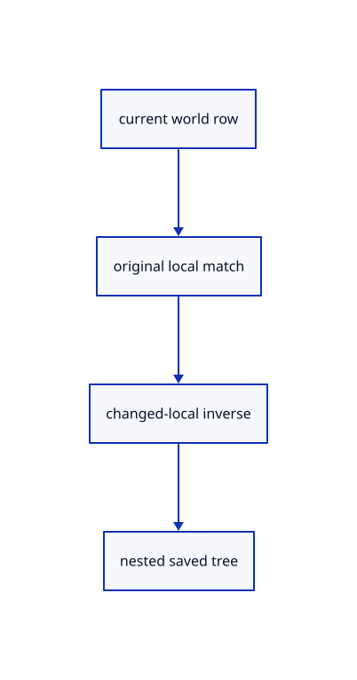

# 13.2.4 · Save nested local frames without flattening

**Chapter 13 · Shared definitions and drawing sheets · Section 13.2 · Feature ancestry and sheet metadata** · [Contents](contents.md)

**Typing: 9–17 minutes.** [Estimate](typing-load.md).

Preserve unchanged group and object local transforms. Recompute a changed row relative to its current parent and refuse conflicting names.

## Type

Continue from [Connect canonical cached models to every source owner](70b-connect-canonical-cached-models-to-every-source-owner.md). [Save or recover your work](recovery.md).

### 1. `src/hierarchy.rs`

Save exact unchanged local frames while preserving current world placement after edits.

<details>
<summary>Locate the existing block</summary>

```rust

fn save_node(doc:&Document,index:usize,scene:&Scene,parent:&Xform,parent_guid:&str,xforms:&mut Vec<proto::XformEntry>,placed:&mut HashSet<ObjectId>)->Result<Option<proto::TreeNode>, &'static str> {
    let original=&doc.nodes[index];let mut node=original.source.clone();node.guid=original.portable_guid.clone();node.parent_guid=parent_guid.to_owned();let mut matrix=parent.clone();
    if let Some(id)=original.object {
        let Some(guid)=scene.row_guid(id) else {return Ok(None);};
        node.name=guid.to_owned();matrix=scene.placement(id).ok_or("Saved source placement is missing")?;let local=&parent.inverse().ok_or("Parent placement cannot be inverted for Save")?*&matrix;
        if local.m!=Xform::identity().m {xforms.push(proto::XformEntry {guid:guid.to_owned(),xform:Some(local.to_proto())});} placed.insert(id);
    }
    for child in index+1..original.end {if doc.nodes[child].parent==Some(index) {if let Some(child)=save_node(doc,child,scene,&matrix,&node.guid,xforms,placed)? {node.children.push(child);}}}
```

</details>

Edit the existing block to match this code; keep unchanged lines:

```rust
--8<-- "journey/code/70c-save-nested-local-frames-without-flattening-01.rs"
```

<details>
<summary>Supplied example data</summary>

Copy this supplied data once; it is excluded from the typing estimate.

### 2. `src/nested_example.rs`

Copy precise and visible nested original-reference specimens.

Copy this supplied file:

```text
--8<-- "journey/code/70c-save-nested-local-frames-without-flattening-02.rs"
```

</details>

### 3. `src/lib.rs`

Register the placement component.

<details>
<summary>Locate the existing block</summary>

```rust

pub mod nested_placement;
```

</details>

After that block, type:

```rust
--8<-- "journey/code/70c-save-nested-local-frames-without-flattening-03.rs" skip=27
```

<details>
<summary>Supplied validation fixture</summary>

Copy this supplied authoring fixture once. Continue with the browser build below; the course does not require running native tests.

### 4. `src/nested_placement_tests.rs`

Copy exact canonical ancestry, local persistence, overflow, fallback, history and release fixtures.

Copy this supplied file:

```text
--8<-- "journey/code/70c-save-nested-local-frames-without-flattening-04.rs"
```

</details>

<details>
<summary>Supplied validation fixture</summary>

Copy this supplied authoring fixture once. Continue with the browser build below; the course does not require running native tests.

### 5. `src/lib.rs`

Register the placement component.

<details>
<summary>Locate the existing block</summary>

```text

pub mod nested_example;
```

</details>

After that block, append this supplied code:

```text
--8<-- "journey/code/70c-save-nested-local-frames-without-flattening-05.rs" skip=25
```

</details>

## Run and check

Run this from `session_viewer` to select the fixed dependency versions and install supplied binary assets. It updates Cargo.lock and preserves the previous lock. It does not write implementation code:

```sh
npm --prefix ../session_tests run course -- dependencies 13.2.4
```

In your project:

```sh
cd workspace/journey
REGEN_PROTO=0 cargo build --lib --locked --target wasm32-unknown-unknown -j1
REGEN_PROTO=0 CARGO_BUILD_JOBS=1 trunk serve --port 8780
```

Open `http://127.0.0.1:8780/`. Keep an existing Trunk server running; saving rebuilds it.


### Recorded visual result

**Previous native render — current verification pending.**

Original blue and selected yellow CAD bores retain their black original boundaries.


*This recorded image predates a source or checker change. Rebuild this checkpoint before using it as current evidence; browser controls require separate acceptance.*

This reference image is shared with [13.1.24 · Exercise independent original CAD reuse](69af-exercise-independent-original-cad-reuse.md). It does not demonstrate a new feature by itself.

<details>
<summary>Code explanation and diagram</summary>


current world row → original local match → changed-local inverse → nested saved tree.



Should Save turn all parent transforms into leaf translations?

No. Keep group transforms and unchanged canonical locals, while edited rows receive the local matrix matching their current world placement.

Study estimate, including typing and experiments: 0.5–1 hours.

</details>

<details>
<summary>Optional experiment</summary>

Run exact root/branch transforms, legacy-fold precision, Save/Open, composed overflow, parent Move and source-release fixtures.

</details>

<details>
<summary>Check and save your work</summary>

Restore experimental edits, then run from `session_viewer`:

```sh
npm --prefix ../session_tests run course -- check 13.2.4
npm --prefix ../session_tests run course -- save 13.2.4
```

Source comparison leaves your project untouched. [Save and recovery instructions](recovery.md).

</details>

<details>
<summary>Viewer coverage and verification</summary>


The inherited congruent CAD exercise remains authored and unrun. The final nested example checks original local transforms, independent instance models, Save/Open, parent Move, Undo/Redo and Close; actual browser execution remains required.

[Full validation scope](release.md).

To reproduce the scripted acceptance of the reference checkpoint, run from `session_viewer` with the [course bundle server](release.md#reproduce) running on port 8781:

```sh
npm --prefix ../session_tests run course -- capture 13.2.4
```

This uses the verified reference bundle; it does not check or change your typed project.

</details>
