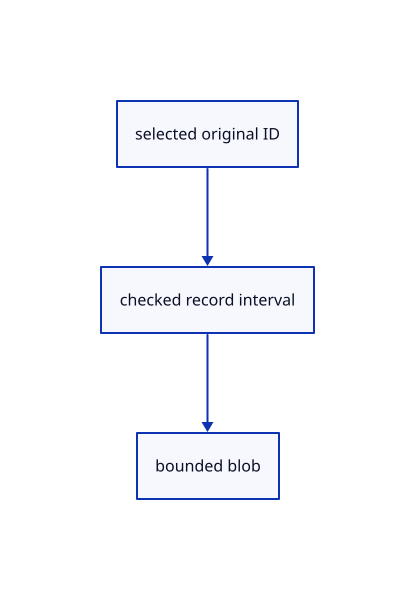

# 14.1.2 · Bound original entity records before reading

**Chapter 14 · Coordinates and geometry tools · Section 14.1 · Sheet queries and construction planes** · [Contents](contents.md)

**Typing: 8–15 minutes.** [Estimate](typing-load.md).

Check record count, offset overflow, JSON size and file end before fetching an entity.

## Type

Continue from [Own cancellable sheet-entity lookups](71-read-original-sheet-entity-metadata.md). [Save or recover your work](recovery.md).

### 1. `src/sheet_entity.rs`

Bound metadata records and retain the original side-table byte length.

Edit these blocks from bottom to top. Keep the surrounding lines unchanged.

<details>
<summary>Locate this block</summary>

```rust
        assert!(token.get());
    }
}
```

</details>

Replace it with:

```rust
        assert!(token.get());
    }
}

pub fn blob_range(count: u32, id: u32, raw: &[u8], total: u64) -> Result<(u64, u64), String> {
    if id >= count {
        return Err("Selected entity is outside the original side table".into());
    }
    let (offset, length) = record(raw)?;
    if length == 0 || length > MAX_BLOB {
        return Err("Entity record exceeds its bounded JSON size".into());
    }
    let at = record_at(count)
        .checked_add(offset)
        .ok_or("Entity record offset overflows")?;
    let end = at
        .checked_add(length)
        .ok_or("Entity record end overflows")?;
    if end > total {
        return Err("Entity record is outside its original side table".into());
    }
    Ok((at, length))
}
```

<details>
<summary>Locate this block</summary>

```rust
/// The table head, cached per sheet.
#[derive(Clone, Debug)]
pub struct SheetTable {
    pub count: u32,               // records in the table
    pub revision: Option<String>, // ETag every read must match
}
```

</details>

Replace it with:

```rust
/// The table head, cached per sheet.
#[derive(Clone, Debug)]
pub struct SheetTable {
    pub total: u64,
    pub count: u32,               // records in the table
    pub revision: Option<String>, // ETag every read must match
}
```

<details>
<summary>Complete updated block reference</summary>

```rust
use serde::Deserialize;
use std::cell::Cell;
use std::rc::Rc;

/// Bytes of the table head: `SHM1` then a u32 record count.
pub const HEAD_BYTES: u64 = 8;

/// Bytes of one record: u64 offset, u64 length.
pub const RECORD_BYTES: u64 = 16;

/// Largest entity record accepted.
pub const MAX_BLOB: u64 = 64 * 1024;

/// One sheet entity's identity, from its JSON record.
#[derive(Clone, Debug, Default, Deserialize, PartialEq)]
pub struct EntityMeta {
    #[serde(default)]
    pub guid: String, // source object id
    #[serde(default)]
    pub name: String, // display name
    #[serde(default)]
    pub kind: String, // wall, door, ...
    #[serde(default)]
    pub width: f32, // pen width
    #[serde(default)]
    pub color: Vec<f32>, // pen colour
}

/// The table head, cached per sheet.
#[derive(Clone, Debug)]
pub struct SheetTable {
    pub total: u64,
    pub count: u32,               // records in the table
    pub revision: Option<String>, // ETag every read must match
}

/// The record count from a table head.
pub fn table_count(raw: &[u8]) -> Result<u32, String> {
    if raw.len() != HEAD_BYTES as usize || &raw[..4] != b"SHM1" {
        return Err("Side table head is not SHM1".to_string());
    }

    Ok(u32::from_le_bytes(
        raw[4..8].try_into().expect("exact head checked above"),
    ))
}

/// One record as (offset, length).
pub fn record(raw: &[u8]) -> Result<(u64, u64), String> {
    if raw.len() != RECORD_BYTES as usize {
        return Err("Side table record must contain exactly 16 bytes".to_string());
    }

    Ok((
        u64::from_le_bytes(raw[..8].try_into().expect("exact record checked above")),
        u64::from_le_bytes(raw[8..].try_into().expect("exact record checked above")),
    ))
}

/// Byte position of record `id`; `record_at(count)` starts the blobs.
pub fn record_at(id: u32) -> u64 {
    HEAD_BYTES + RECORD_BYTES * u64::from(id)
}

/// An entity from its JSON; missing keys default.
pub fn entity_from(raw: &[u8]) -> Result<EntityMeta, String> {
    serde_json::from_slice(raw).map_err(|error| format!("Entity record is not valid JSON: {error}"))
}

/// One entity lookup in flight.
pub struct Query {
    pub id: u64,                   // lookup number
    pub row: u32,                  // the sheet's object row
    pub entity: u32,               // entity index in the sheet
    pub cancelled: Rc<Cell<bool>>, // set when a newer lookup replaces this
}

impl Query {
    /// A new lookup.
    pub fn new(id: u64, row: u32, entity: u32) -> Self {
        Self {
            id,
            row,
            entity,
            cancelled: Rc::new(Cell::new(false)),
        }
    }
}

impl Drop for Query {
    /// Cancel the lookup.
    fn drop(&mut self) {
        self.cancelled.set(true);
    }
}

/// The answer to one lookup.
pub struct Resolved {
    pub query: u64,                                       // which lookup
    pub result: Result<(EntityMeta, SheetTable), String>, // the entity and the table head
}

#[cfg(test)]
mod tests {
    use super::*;

    /// Build a side table from JSON blobs.
    fn table(blobs: &[&str]) -> Vec<u8> {
        let mut out = b"SHM1".to_vec();
        out.extend((blobs.len() as u32).to_le_bytes());
        let mut offset = 0u64;

        for blob in blobs {
            out.extend(offset.to_le_bytes());
            out.extend((blob.len() as u64).to_le_bytes());
            offset += blob.len() as u64;
        }

        for blob in blobs {
            out.extend(blob.as_bytes());
        }

        out
    }

    /// Head, records and blobs parse; junk is refused.
    #[test]
    fn side_table_head_records_and_blobs_parse_from_a_hand_built_buffer() {
        let raw = table(&[
            r#"{"guid":"g0","name":"Wall A","kind":"wall","width":0.35,"color":[0,0,0,255]}"#,
            r#"{"name":"Door","kind":"door","extra":true}"#,
        ]);
        let count = table_count(&raw[..HEAD_BYTES as usize]).unwrap();
        assert_eq!(count, 2);
        let blobs = record_at(count) as usize;
        let at = record_at(1) as usize;
        let (offset, length) = record(&raw[at..at + RECORD_BYTES as usize]).unwrap();
        let door = entity_from(&raw[blobs + offset as usize..][..length as usize]).unwrap();
        assert_eq!(door.name, "Door");
        assert_eq!(door.kind, "door");
        assert_eq!(door.guid, "");
        let at = record_at(0) as usize;
        let (offset, length) = record(&raw[at..at + RECORD_BYTES as usize]).unwrap();
        let wall = entity_from(&raw[blobs + offset as usize..][..length as usize]).unwrap();
        assert_eq!(wall.guid, "g0");
        assert_eq!(wall.width, 0.35);
        assert_eq!(wall.color, [0.0, 0.0, 0.0, 255.0]);
        assert!(table_count(b"SHM2\0\0\0\0").is_err());
        assert!(table_count(&raw[..7]).is_err());
        assert!(record(&raw[..15]).is_err());
        assert!(entity_from(b"{").is_err());
    }

    /// Dropping a query retires its token, so a late answer is ignored.
    #[test]
    fn dropping_a_query_cancels_its_token() {
        let query = Query::new(3, 1, 9);
        let token = query.cancelled.clone();
        drop(query);
        assert!(token.get());
    }
}

pub fn blob_range(count: u32, id: u32, raw: &[u8], total: u64) -> Result<(u64, u64), String> {
    if id >= count {
        return Err("Selected entity is outside the original side table".into());
    }
    let (offset, length) = record(raw)?;
    if length == 0 || length > MAX_BLOB {
        return Err("Entity record exceeds its bounded JSON size".into());
    }
    let at = record_at(count)
        .checked_add(offset)
        .ok_or("Entity record offset overflows")?;
    let end = at
        .checked_add(length)
        .ok_or("Entity record end overflows")?;
    if end > total {
        return Err("Entity record is outside its original side table".into());
    }
    Ok((at, length))
}
```

</details>

<details>
<summary>Optional patch references</summary>

Use these original edit fragments when comparing a saved checkpoint. Apply the complete blocks above.

```text
--8<-- "journey/code/71a-bound-original-entity-records-before-reading-01.rs"
```

```text
--8<-- "journey/code/71a-bound-original-entity-records-before-reading-02.rs"
```

</details>

<details>
<summary>Supplied validation fixture</summary>

Copy this supplied authoring fixture once. Continue with the browser build below; the course does not require running native tests.

### 2. `src/sheet_entity.rs`

Copy bounded metadata-record fixtures.

<details>
<summary>Locate the existing block</summary>

```text
    Ok((at, length))
}
```

</details>

After that block, append this supplied code:

```text
--8<-- "journey/code/71a-bound-original-entity-records-before-reading-03.rs" skip=24
```

</details>

## Run and check

Run this from `session_viewer` to select the fixed dependency versions and install supplied binary assets. It updates Cargo.lock and preserves the previous lock. It does not write implementation code:

```sh
npm --prefix ../session_tests run course -- dependencies 14.1.2
```

In your project:

```sh
cd workspace/journey
REGEN_PROTO=0 cargo build --lib --locked --target wasm32-unknown-unknown -j1
REGEN_PROTO=0 CARGO_BUILD_JOBS=1 trunk serve --port 8780
```

Open `http://127.0.0.1:8780/`. Keep an existing Trunk server running; saving rebuilds it.


### Recorded visual result

**Previous native render — current verification pending.**

The blue rotated and selected yellow mirrored references retain their original source definition.


*This recorded image predates a source or checker change. Rebuild this checkpoint before using it as current evidence; browser controls require separate acceptance.*

This reference image is shared with [13.2.5 · Exercise rotated and mirrored original references](70d-exercise-rotated-and-mirrored-original-references.md). It does not demonstrate a new feature by itself.

<details>
<summary>Code explanation and diagram</summary>


selected original ID → checked record interval → bounded blob.



Can a valid record header point outside its file?

Yes. Check its offset and length against the total side-table size, and retain that size with the revision.

Study estimate, including typing and experiments: 0.5–1 hours.

</details>

<details>
<summary>Optional experiment</summary>

Inspect overflow, oversized blob, out-of-range entity and exact file-end fixtures.

</details>

<details>
<summary>Check and save your work</summary>

Restore experimental edits, then run from `session_viewer`:

```sh
npm --prefix ../session_tests run course -- check 14.1.2
npm --prefix ../session_tests run course -- save 14.1.2
```

Source comparison leaves your project untouched. [Save and recovery instructions](recovery.md).

</details>

<details>
<summary>Viewer coverage and verification</summary>


The inherited nested-reference exercise remains authored and unrun. The final sheet contract covers complete archive reopening, repeated checked-range placements, metadata only after selection, bounded reads and Close during a lookup. Actual browser execution remains required.

[Full validation scope](release.md).

To reproduce the scripted acceptance of the reference checkpoint, run from `session_viewer` with the [course bundle server](release.md#reproduce) running on port 8781:

```sh
npm --prefix ../session_tests run course -- capture 14.1.2
```

This uses the verified reference bundle; it does not check or change your typed project.

</details>
