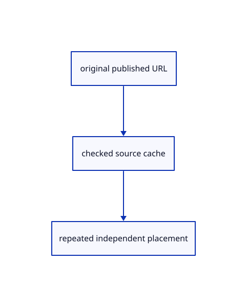

# 14.1.33 · Keep published drawing sources and URL bases independent

**Chapter 14 · Coordinates and geometry tools · Section 14.1 · Sheet queries and construction planes** · [Contents](contents.md)

**Typing: 12–24 minutes.** [Estimate](typing-load.md).

Cache checked ranged sources and preserve each original drawing’s metadata base when appending another document.

## Type

Continue from [Query metadata only for the current selected entity](71ae-query-metadata-only-for-the-current-selected-entity.md). [Save or recover your work](recovery.md).

### 1. `src/publication.rs`

Keep original drawing revisions and per-import metadata URL bases independent.

<details>
<summary>Locate the existing block</summary>

```rust
    if bytes.starts_with(crate::archive::MAGIC) {crate::scene_document::open(&mut candidate,bytes)?;return Ok(candidate);}
    if replace {candidate.clear();}
    match crate::document::load_at(bytes,location) {
        Ok(loaded)=>candidate.import(loaded).map_err(str::to_owned)?,
        Err(_)=>{crate::scene_document::import(&mut candidate,bytes,"",&session_rust::Xform::identity(),0.)?;}
    }
    Ok(candidate)
```

</details>

Edit the existing block to match this code; keep unchanged lines:

```rust
--8<-- "journey/code/71af-keep-published-drawing-sources-and-url-bases-independent-01.rs"
```

### 2. `src/publication_index.rs`

Keep original drawing revisions and per-import metadata URL bases independent.

<details>
<summary>Locate the existing block</summary>

```rust
        let source=match crate::publication::prepare(&Scene::empty(),bytes,true,Some(Rc::new(crate::reload_url::ReloadUrl::new(url.into())))) {Ok(source)=>source,Err(error)=>{self.revisions.forget(url);return Err(error);}};
        self.sources.insert(url.into(),source);self.sizes.insert(url.into(),bytes.len());self.pending=true;Ok(true)
    }
    pub fn source_points(&self,url:&str)->u32 {self.sources.get(url).map_or(0,|scene|scene.streams().iter().map(|row|row.prepared.loaded.get()).sum())}
```

</details>

Edit the existing block to match this code; keep unchanged lines:

```rust
--8<-- "journey/code/71af-keep-published-drawing-sources-and-url-bases-independent-02.rs"
```

## Run and check

Run this from `session_viewer` to select the fixed dependency versions and install supplied binary assets. It updates Cargo.lock and preserves the previous lock. It does not write implementation code:

```sh
npm --prefix ../session_tests run course -- dependencies 14.1.33
```

In your project:

```sh
cd workspace/journey
REGEN_PROTO=0 cargo build --lib --locked --target wasm32-unknown-unknown -j1
REGEN_PROTO=0 CARGO_BUILD_JOBS=1 trunk serve --port 8780
```

Open `http://127.0.0.1:8780/`. Keep an existing Trunk server running; saving rebuilds it.


### Recorded visual result

**Previous native render — current verification pending.**

The blue rotated and selected yellow mirrored references retain their original source definition.


*This recorded image predates a source or checker change. Rebuild this checkpoint before using it as current evidence; browser controls require separate acceptance.*

This reference image is shared with [13.2.5 · Exercise rotated and mirrored original references](70d-exercise-rotated-and-mirrored-original-references.md). It does not demonstrate a new feature by itself.

<details>
<summary>Code explanation and diagram</summary>


original published URL → checked source cache → repeated independent placement.



May a new import rewrite older drawings’ metadata URLs?

No. Attach the new URL only to newly imported rows and keep earlier originals unchanged.

Study estimate, including typing and experiments: 0.5–1 hours.

</details>

<details>
<summary>Optional experiment</summary>

Compare repeated revisions, independent placement records and sources imported from two folders.

</details>

<details>
<summary>Check and save your work</summary>

Restore experimental edits, then run from `session_viewer`:

```sh
npm --prefix ../session_tests run course -- check 14.1.33
npm --prefix ../session_tests run course -- save 14.1.33
```

Source comparison leaves your project untouched. [Save and recovery instructions](recovery.md).

</details>

<details>
<summary>Viewer coverage and verification</summary>


The inherited nested-reference exercise remains authored and unrun. The final sheet contract covers complete archive reopening, repeated checked-range placements, metadata only after selection, bounded reads and Close during a lookup. Actual browser execution remains required.

[Full validation scope](release.md).

To reproduce the scripted acceptance of the reference checkpoint, run from `session_viewer` with the [course bundle server](release.md#reproduce) running on port 8781:

```sh
npm --prefix ../session_tests run course -- capture 14.1.33
```

This uses the verified reference bundle; it does not check or change your typed project.

</details>
