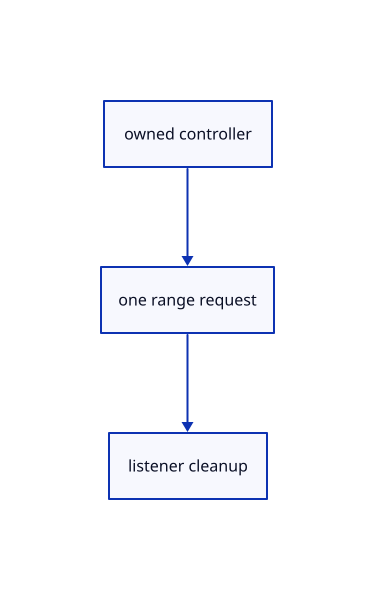

# 14.1.3 · Give metadata reads their own cancellation signal

**Chapter 14 · Coordinates and geometry tools · Section 14.1 · Sheet queries and construction planes** · [Contents](contents.md)

**Typing: 13–26 minutes.** [Estimate](typing-load.md).

Connect one external abort signal without cancelling unrelated reads from the same source URL.

## Type

Continue from [Bound original entity records before reading](71a-bound-original-entity-records-before-reading.md). [Save or recover your work](recovery.md).

### 1. `src/range_fetch.rs`

Forward an owned cancellation signal to one bounded range read.

Edit these blocks from bottom to top. Keep the surrounding lines unchanged.

<details>
<summary>Locate this block</summary>

```rust
    pub fn whole(self)->Option<Vec<u8>> {(self.status==206&&self.total==Some(self.bytes.len() as u64)).then_some(self.bytes)}
}

pub async fn get(url:&str,opts:&GetOpts)->Result<Reply,String> {
    let (start,length)=opts.range.ok_or("This reader requires a byte range")?;
    if length==0 {return Ok(Reply {status:206,etag:None,total:None,bytes:vec![]});}
    let range=crate::range_rules::header(start,length)?;
    let mut read=Read::new(url)?;let init=web_sys::RequestInit::new();init.set_signal(Some(&read.controller.signal()));
    init.set_mode(web_sys::RequestMode::Cors);
    if opts.revalidate {init.set_cache(web_sys::RequestCache::NoCache);}
    let headers=web_sys::Headers::new().map_err(|error|describe(error.into()))?;headers.set("Range",&range).map_err(|error|describe(error.into()))?;init.set_headers(&headers);
```

</details>

Replace it with:

```rust
    pub fn whole(self)->Option<Vec<u8>> {(self.status==206&&self.total==Some(self.bytes.len() as u64)).then_some(self.bytes)}
}

pub async fn get(url:&str,opts:&GetOpts)->Result<Reply,String> {get_with_signal(url,opts,None).await}
pub async fn get_with_signal(url:&str,opts:&GetOpts,signal:Option<&web_sys::AbortSignal>)->Result<Reply,String> {
    let (start,length)=opts.range.ok_or("This reader requires a byte range")?;
    if length==0 {return Ok(Reply {status:206,etag:None,total:None,bytes:vec![]});}
    let range=crate::range_rules::header(start,length)?;
    let mut read=Read::new(url,signal)?;let init=web_sys::RequestInit::new();init.set_signal(Some(&read.controller.signal()));
    init.set_mode(web_sys::RequestMode::Cors);
    if opts.revalidate {init.set_cache(web_sys::RequestCache::NoCache);}
    let headers=web_sys::Headers::new().map_err(|error|describe(error.into()))?;headers.set("Range",&range).map_err(|error|describe(error.into()))?;init.set_headers(&headers);
```

<details>
<summary>Locate this block</summary>

```rust
}
impl Drop for Read {
    fn drop(&mut self) {
        REQUESTS.with(|requests|requests.borrow_mut().remove(&self.key));self.controller.abort();
        if let Some(window)=web_sys::window() {window.clear_timeout_with_handle(self.timer);}
    }
```

</details>

Replace it with:

```rust
}
impl Drop for Read {
    fn drop(&mut self) {
        if let Some((signal,callback))=self.external.take() {let _=signal.remove_event_listener_with_callback("abort",callback.as_ref().unchecked_ref());}
        REQUESTS.with(|requests|requests.borrow_mut().remove(&self.key));self.controller.abort();
        if let Some(window)=web_sys::window() {window.clear_timeout_with_handle(self.timer);}
    }
```

<details>
<summary>Locate this block</summary>

```rust
    callback:Closure<dyn FnMut()>,
}
impl Read {
    fn new(url:&str)->Result<Self,String> {
        let controller=web_sys::AbortController::new().map_err(|error|describe(error.into()))?;
        let key=NEXT.with(|next| {let key=next.get().checked_add(1).ok_or("Range request IDs exhausted")?;next.set(key);Ok::<_,String>(key)})?;
        let stalled=Rc::new(Cell::new(false));let owned=controller.clone();let flag=stalled.clone();
        let callback=Closure::<dyn FnMut()>::new(move || {flag.set(true);owned.abort();});
        let mut read=Self {key,controller,timer:0,stalled,callback};read.touch()?;
        REQUESTS.with(|requests|requests.borrow_mut().insert(key,(url.to_owned(),read.controller.clone())));Ok(read)
    }
    fn touch(&mut self)->Result<(),String> {
```

</details>

Replace it with:

```rust
    callback:Closure<dyn FnMut()>,
}
impl Read {
    fn new(url:&str,signal:Option<&web_sys::AbortSignal>)->Result<Self,String> {
        let controller=web_sys::AbortController::new().map_err(|error|describe(error.into()))?;
        let key=NEXT.with(|next| {let key=next.get().checked_add(1).ok_or("Range request IDs exhausted")?;next.set(key);Ok::<_,String>(key)})?;
        let stalled=Rc::new(Cell::new(false));let owned=controller.clone();let flag=stalled.clone();
        let callback=Closure::<dyn FnMut()>::new(move || {flag.set(true);owned.abort();});
        let external=if let Some(signal)=signal {let owned=controller.clone();let callback=Closure::<dyn FnMut()>::new(move ||owned.abort());signal.add_event_listener_with_callback("abort",callback.as_ref().unchecked_ref()).map_err(describe)?;if signal.aborted() {controller.abort();}Some((signal.clone(),callback))} else {None};
        let mut read=Self {external,key,controller,timer:0,stalled,callback};read.touch()?;
        REQUESTS.with(|requests|requests.borrow_mut().insert(key,(url.to_owned(),read.controller.clone())));Ok(read)
    }
    fn touch(&mut self)->Result<(),String> {
```

<details>
<summary>Locate this block</summary>

```rust
pub fn cancel_url(url:&str) {REQUESTS.with(|requests|requests.borrow_mut().retain(|_,(source,controller)| {if source==url {controller.abort();false} else {true}}));}

struct Read {
    key:u64,
    controller:web_sys::AbortController,
    timer:i32,
```

</details>

Replace it with:

```rust
pub fn cancel_url(url:&str) {REQUESTS.with(|requests|requests.borrow_mut().retain(|_,(source,controller)| {if source==url {controller.abort();false} else {true}}));}

struct Read {
    external:Option<(web_sys::AbortSignal,Closure<dyn FnMut()>)>,
    key:u64,
    controller:web_sys::AbortController,
    timer:i32,
```

<details>
<summary>Complete updated block reference</summary>

```rust
use std::{cell::{Cell,RefCell},collections::BTreeMap,rc::Rc};
use wasm_bindgen::{JsCast,JsValue,closure::Closure};
use wasm_bindgen_futures::JsFuture;
pub use crate::range_rules::PROBE_BYTES;

thread_local! {
    static REQUESTS:RefCell<BTreeMap<u64,(String,web_sys::AbortController)>>=const {RefCell::new(BTreeMap::new())};
    static NEXT:Cell<u64>=const {Cell::new(0)};
}

pub fn cancel() {
    for (_,controller) in REQUESTS.with(|requests|std::mem::take(&mut *requests.borrow_mut())).into_values() {controller.abort();}
}

pub fn cancel_url(url:&str) {REQUESTS.with(|requests|requests.borrow_mut().retain(|_,(source,controller)| {if source==url {controller.abort();false} else {true}}));}

struct Read {
    external:Option<(web_sys::AbortSignal,Closure<dyn FnMut()>)>,
    key:u64,
    controller:web_sys::AbortController,
    timer:i32,
    stalled:Rc<Cell<bool>>,
    callback:Closure<dyn FnMut()>,
}
impl Read {
    fn new(url:&str,signal:Option<&web_sys::AbortSignal>)->Result<Self,String> {
        let controller=web_sys::AbortController::new().map_err(|error|describe(error.into()))?;
        let key=NEXT.with(|next| {let key=next.get().checked_add(1).ok_or("Range request IDs exhausted")?;next.set(key);Ok::<_,String>(key)})?;
        let stalled=Rc::new(Cell::new(false));let owned=controller.clone();let flag=stalled.clone();
        let callback=Closure::<dyn FnMut()>::new(move || {flag.set(true);owned.abort();});
        let external=if let Some(signal)=signal {let owned=controller.clone();let callback=Closure::<dyn FnMut()>::new(move ||owned.abort());signal.add_event_listener_with_callback("abort",callback.as_ref().unchecked_ref()).map_err(describe)?;if signal.aborted() {controller.abort();}Some((signal.clone(),callback))} else {None};
        let mut read=Self {external,key,controller,timer:0,stalled,callback};read.touch()?;
        REQUESTS.with(|requests|requests.borrow_mut().insert(key,(url.to_owned(),read.controller.clone())));Ok(read)
    }
    fn touch(&mut self)->Result<(),String> {
        let window=web_sys::window().ok_or("No browser window")?;window.clear_timeout_with_handle(self.timer);
        self.timer=window.set_timeout_with_callback_and_timeout_and_arguments_0(self.callback.as_ref().unchecked_ref(),30_000).map_err(|error|describe(error.into()))?;Ok(())
    }
    fn error(&self,error:JsValue)->String {
        if self.stalled.get() {"network error: range read stalled for30s".into()}
        else if self.controller.signal().aborted() {"Range read cancelled".into()}
        else {format!("network error: {}",describe(error))}
    }
}
impl Drop for Read {
    fn drop(&mut self) {
        if let Some((signal,callback))=self.external.take() {let _=signal.remove_event_listener_with_callback("abort",callback.as_ref().unchecked_ref());}
        REQUESTS.with(|requests|requests.borrow_mut().remove(&self.key));self.controller.abort();
        if let Some(window)=web_sys::window() {window.clear_timeout_with_handle(self.timer);}
    }
}
fn describe(error:JsValue)->String {error.as_string().unwrap_or_else(||format!("{error:?}"))}
pub fn retryable(error:&str)->bool {error.starts_with("network error")}

#[derive(Default)]
pub struct GetOpts {pub range:Option<(u64,u64)>,pub revalidate:bool}
pub struct Reply {pub status:u16,pub etag:Option<String>,pub total:Option<u64>,pub bytes:Vec<u8>}
impl Reply {
    pub fn whole(self)->Option<Vec<u8>> {(self.status==206&&self.total==Some(self.bytes.len() as u64)).then_some(self.bytes)}
}

pub async fn get(url:&str,opts:&GetOpts)->Result<Reply,String> {get_with_signal(url,opts,None).await}
pub async fn get_with_signal(url:&str,opts:&GetOpts,signal:Option<&web_sys::AbortSignal>)->Result<Reply,String> {
    let (start,length)=opts.range.ok_or("This reader requires a byte range")?;
    if length==0 {return Ok(Reply {status:206,etag:None,total:None,bytes:vec![]});}
    let range=crate::range_rules::header(start,length)?;
    let mut read=Read::new(url,signal)?;let init=web_sys::RequestInit::new();init.set_signal(Some(&read.controller.signal()));
    init.set_mode(web_sys::RequestMode::Cors);
    if opts.revalidate {init.set_cache(web_sys::RequestCache::NoCache);}
    let headers=web_sys::Headers::new().map_err(|error|describe(error.into()))?;headers.set("Range",&range).map_err(|error|describe(error.into()))?;init.set_headers(&headers);
    let window=web_sys::window().ok_or("No browser window")?;let started=crate::browser_phase::now();
    let response=JsFuture::from(window.fetch_with_str_and_init(url,&init)).await.map_err(|error|read.error(error))?.dyn_into::<web_sys::Response>().map_err(|error|describe(error.into()))?;
    let status=response.status();let etag=response.headers().get("ETag").map_err(|error|describe(error.into()))?;
    let content=response.headers().get("Content-Range").map_err(|error|describe(error.into()))?;
    if status!=206 {return Ok(Reply {status,etag,total:None,bytes:vec![]});}
    if response.headers().get("Content-Length").map_err(|error|describe(error.into()))?.is_some_and(|size|size.parse::<u64>().map_or(true,|size|size>length)) {return Err("Range response exceeds its byte limit".into());}
    let reader=response.body().ok_or("Range response has no body")?.get_reader().dyn_into::<web_sys::ReadableStreamDefaultReader>().map_err(|error|describe(error.into()))?;
    let result=body(&reader,length,&mut read).await;if result.is_err() {let _=reader.cancel();}reader.release_lock();let bytes=result?;
    let total=crate::range_rules::accept(start,length,status,content.as_deref(),bytes.len() as u64)?;
    crate::browser_phase::finish("HTTP range",started,bytes.len() as u64,url);Ok(Reply {status,etag,total:Some(total),bytes})
}
async fn body(reader:&web_sys::ReadableStreamDefaultReader,limit:u64,read:&mut Read)->Result<Vec<u8>,String> {
    let mut bytes=Vec::new();loop {
        let part=JsFuture::from(reader.read()).await.map_err(|error|read.error(error))?;
        if js_sys::Reflect::get(&part,&"done".into()).map_err(|error|describe(error.into()))?.as_bool()==Some(true) {break;}
        let chunk=js_sys::Reflect::get(&part,&"value".into()).map_err(|error|describe(error.into()))?.dyn_into::<js_sys::Uint8Array>().map_err(|error|describe(error.into()))?;
        if u64::from(chunk.length())>limit-bytes.len() as u64 {return Err("Range response exceeds its byte limit".into());}
        bytes.extend_from_slice(&chunk.to_vec());read.touch()?;
    }Ok(bytes)
}
pub async fn fetch_range(url:&str,start:u64,len:u64,revision:&Option<String>)->Result<(Vec<u8>,Option<String>),String> {
    let reply=get(url,&GetOpts {range:Some((start,len)),revalidate:!crate::manifest::immutable_key(url)}).await?;
    if reply.status!=206||reply.bytes.len() as u64!=len {return Err(format!("Range read failed: HTTP{} with{} of{len}bytes",reply.status,reply.bytes.len()));}
    if revision.is_some()&&revision!=&reply.etag {return Err("Source changed during the range read; reload it".into());}
    Ok((reply.bytes,reply.etag))
}

pub struct Task<T> {done:js_sys::Promise,out:Rc<RefCell<Option<T>>>}
impl<T:'static> Task<T> {
    pub fn start(work:impl Future<Output=T>+'static)->Self {
        let out=Rc::new(RefCell::new(None));let slot=out.clone();
        let done=wasm_bindgen_futures::future_to_promise(async move {*slot.borrow_mut()=Some(work.await);Ok(JsValue::UNDEFINED)});Self {done,out}
    }
    pub async fn wait(self)->Option<T> {let _=JsFuture::from(self.done).await;self.out.take()}
}
```

</details>

<details>
<summary>Optional patch references</summary>

Use these original edit fragments when comparing a saved checkpoint. Apply the complete blocks above.

```text
--8<-- "journey/code/71b-give-metadata-reads-their-own-cancellation-signal-01.rs"
```

```text
--8<-- "journey/code/71b-give-metadata-reads-their-own-cancellation-signal-02.rs"
```

```text
--8<-- "journey/code/71b-give-metadata-reads-their-own-cancellation-signal-03.rs"
```

```text
--8<-- "journey/code/71b-give-metadata-reads-their-own-cancellation-signal-04.rs"
```

</details>

### 2. `src/sheet_entity_fetch.rs`

Register the current original metadata range types.

Create the file and type:

```rust
--8<-- "journey/code/71b-give-metadata-reads-their-own-cancellation-signal-05.rs"
```

### 3. `src/lib.rs`

Register the drawing component.

<details>
<summary>Locate the existing block</summary>

```rust

pub mod sheet_example;
```

</details>

After that block, type:

```rust
--8<-- "journey/code/71b-give-metadata-reads-their-own-cancellation-signal-06.rs" skip=24
```

## Run and check

Run this from `session_viewer` to select the fixed dependency versions and install supplied binary assets. It updates Cargo.lock and preserves the previous lock. It does not write implementation code:

```sh
npm --prefix ../session_tests run course -- dependencies 14.1.3
```

In your project:

```sh
cd workspace/journey
REGEN_PROTO=0 cargo build --lib --locked --target wasm32-unknown-unknown -j1
REGEN_PROTO=0 CARGO_BUILD_JOBS=1 trunk serve --port 8780
```

Open `http://127.0.0.1:8780/`. Keep an existing Trunk server running; saving rebuilds it.


### Recorded visual result

**Previous native render — current verification pending.**

The blue rotated and selected yellow mirrored references retain their original source definition.


*This recorded image predates a source or checker change. Rebuild this checkpoint before using it as current evidence; browser controls require separate acceptance.*

This reference image is shared with [13.2.5 · Exercise rotated and mirrored original references](70d-exercise-rotated-and-mirrored-original-references.md). It does not demonstrate a new feature by itself.

<details>
<summary>Code explanation and diagram</summary>


owned controller → one range request → listener cleanup.



Why not cancel every request to the metadata URL?

Another owner can share that URL. Forward this query’s signal to its own request controller and remove the listener on Drop.

Study estimate, including typing and experiments: 0.5–1 hours.

</details>

<details>
<summary>Optional experiment</summary>

Compare query cancellation with whole-scene reset and the existing request stall timer.

</details>

<details>
<summary>Check and save your work</summary>

Restore experimental edits, then run from `session_viewer`:

```sh
npm --prefix ../session_tests run course -- check 14.1.3
npm --prefix ../session_tests run course -- save 14.1.3
```

Source comparison leaves your project untouched. [Save and recovery instructions](recovery.md).

</details>

<details>
<summary>Viewer coverage and verification</summary>


The inherited nested-reference exercise remains authored and unrun. The final sheet contract covers complete archive reopening, repeated checked-range placements, metadata only after selection, bounded reads and Close during a lookup. Actual browser execution remains required.

[Full validation scope](release.md).

To reproduce the scripted acceptance of the reference checkpoint, run from `session_viewer` with the [course bundle server](release.md#reproduce) running on port 8781:

```sh
npm --prefix ../session_tests run course -- capture 14.1.3
```

This uses the verified reference bundle; it does not check or change your typed project.

</details>
