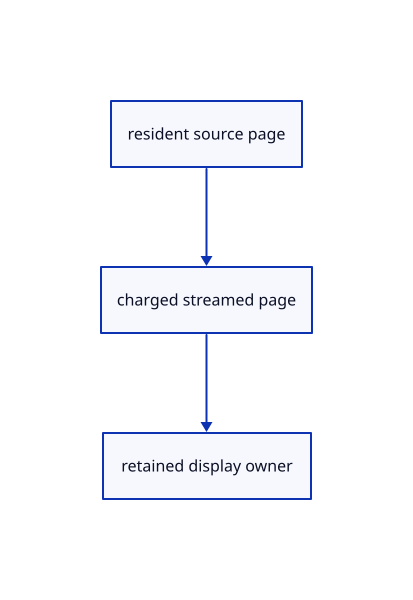

# 14.1.7 · Retain charged pages beside resident pages

**Chapter 14 · Coordinates and geometry tools · Section 14.1 · Sheet queries and construction planes** · [Contents](contents.md)

**Typing: 9–18 minutes.** [Estimate](typing-load.md).

Give display owners one page interface while streamed owners keep their cache charge alive.

## Type

Continue from [Measure original sheet pages and world pens](71e-measure-original-sheet-pages-and-world-pens.md). [Save or recover your work](recovery.md).

### 1. `src/sheet_stream.rs`

Retain resident and charged streamed pages through one display interface.

Create the file and type:

```rust
--8<-- "journey/code/71f-retain-charged-pages-beside-resident-pages-01.rs"
```

### 2. `src/lib.rs`

Register the drawing component.

<details>
<summary>Locate the existing block</summary>

```rust

pub mod sheet_page;
```

</details>

After that block, type:

```rust
--8<-- "journey/code/71f-retain-charged-pages-beside-resident-pages-02.rs" skip=21
```

## Run and check

Run this from `session_viewer` to select the fixed dependency versions and install supplied binary assets. It updates Cargo.lock and preserves the previous lock. It does not write implementation code:

```sh
npm --prefix ../session_tests run course -- dependencies 14.1.7
```

In your project:

```sh
cd workspace/journey
REGEN_PROTO=0 cargo build --lib --locked --target wasm32-unknown-unknown -j1
REGEN_PROTO=0 CARGO_BUILD_JOBS=1 trunk serve --port 8780
```

Open `http://127.0.0.1:8780/`. Keep an existing Trunk server running; saving rebuilds it.


### Recorded visual result

**Previous native render — current verification pending.**

The blue rotated and selected yellow mirrored references retain their original source definition.


*This recorded image predates a source or checker change. Rebuild this checkpoint before using it as current evidence; browser controls require separate acceptance.*

This reference image is shared with [13.2.5 · Exercise rotated and mirrored original references](70d-exercise-rotated-and-mirrored-original-references.md). It does not demonstrate a new feature by itself.

<details>
<summary>Code explanation and diagram</summary>


resident source page → charged streamed page → retained display owner.



Does eviction immediately release a displayed page?

No. Its renderer or reader can still own it. Release the payload charge only after the last owner drops.

Study estimate, including typing and experiments: 0.5–1 hours.

</details>

<details>
<summary>Optional experiment</summary>

Inspect the shared page interface and explicit segment prefix, chunk, ceiling and temporary-byte rules.

</details>

<details>
<summary>Check and save your work</summary>

Restore experimental edits, then run from `session_viewer`:

```sh
npm --prefix ../session_tests run course -- check 14.1.7
npm --prefix ../session_tests run course -- save 14.1.7
```

Source comparison leaves your project untouched. [Save and recovery instructions](recovery.md).

</details>

<details>
<summary>Viewer coverage and verification</summary>


The inherited nested-reference exercise remains authored and unrun. The final sheet contract covers complete archive reopening, repeated checked-range placements, metadata only after selection, bounded reads and Close during a lookup. Actual browser execution remains required.

[Full validation scope](release.md).

To reproduce the scripted acceptance of the reference checkpoint, run from `session_viewer` with the [course bundle server](release.md#reproduce) running on port 8781:

```sh
npm --prefix ../session_tests run course -- capture 14.1.7
```

This uses the verified reference bundle; it does not check or change your typed project.

</details>
