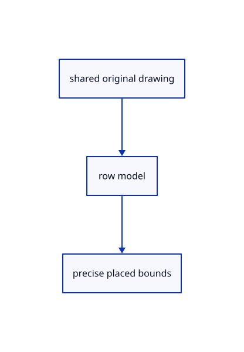

# 14.1.9 · Place drawing rows without changing endpoints

**Chapter 14 · Coordinates and geometry tools · Section 14.1 · Sheet queries and construction planes** · [Contents](contents.md)

**Typing: 18–35 minutes.** [Estimate](typing-load.md).

Keep independent row identity, placement and source URL beside shared original pages.

## Type

Continue from [Own the complete original drawing source](71g-own-the-complete-original-drawing-source.md). [Save or recover your work](recovery.md).

### 1. `src/sheet_source.rs`

Own independent row models and precise placed bounds.

<details>
<summary>Locate the existing block</summary>

```rust
use session_rust::{Point, Xform, proto};
use std::rc::Rc;

pub struct Prepared {
    pub original: Rc<proto::Sheet>,
    pub page: Rc<crate::sheet_page::Page>,
}
impl Prepared {
    pub fn new(original: Rc<proto::Sheet>) -> Result<Self, &'static str> {
        if original.guid.is_empty()
            || original.coords.len() % 6 != 0
            || original.coords.len() / 6 != original.segment_count as usize
        {
            return Err("Original sheet count does not match its coordinates");
        }
        let count = original.segment_count as usize;
        // Missing authored columns use source defaults; present words stay original, including repeated entity IDs and hairline pens.
        fn column<T: Copy>(words: &[T], count: usize, default: T) -> Result<Vec<T>, &'static str> {
            if words.len() > count {
                return Err("Sheet attribute exceeds original segment count");
            }
            let mut words = words.to_vec();
            words.resize(count, default);
            Ok(words)
        }
        let coordinates = original
            .coords
            .iter()
            .flat_map(|v| v.to_le_bytes())
            .collect::<Vec<_>>();
        let colors = column(&original.colors, count, 0xff00_0000)?
            .into_iter()
            .flat_map(u32::to_le_bytes)
            .collect::<Vec<_>>();
        let widths = column(&original.widths, count, 0.)?
            .into_iter()
            .flat_map(f32::to_le_bytes)
            .collect::<Vec<_>>();
        let ids = column(&original.source_ids, count, u32::MAX)?
            .into_iter()
            .flat_map(u32::to_le_bytes)
            .collect::<Vec<_>>();
        let page = crate::sheet_page::Page::decode(
            0..original.segment_count,
            original.segment_count,
            original.entity_count,
            &coordinates,
            Some(&colors),
            Some(&widths),
            Some(&ids),
        )?;
        Ok(Self {
            original,
            page: Rc::new(page),
        })
    }
}
```

</details>

Edit the existing block to match this code; keep unchanged lines:

```rust
use session_rust::{Point, Xform, proto};
use std::rc::Rc;

pub struct Prepared {
    pub original: Rc<proto::Sheet>,
    pub page: Rc<crate::sheet_page::Page>,
}
impl Prepared {
    pub fn pages(&self)->Vec<crate::sheet_stream::DisplayPage> {vec![crate::sheet_stream::DisplayPage::Resident(self.page.clone())]}
    pub fn bounds(&self) -> Option<crate::bounds::Bounds> {
        let mut bounds = None;
        for page in self.pages() {
            if let Some(next) = page.bounds() {
                if let Some(bounds) = &mut bounds {
                    crate::bounds::Bounds::include(bounds, next.min);
                    bounds.include(next.max);
                } else {
                    bounds = Some(next);
                }
            }
        }
        bounds
    }
    pub fn new(original: Rc<proto::Sheet>) -> Result<Self, &'static str> {
        if original.guid.is_empty()
            || original.coords.len() % 6 != 0
            || original.coords.len() / 6 != original.segment_count as usize
        {
            return Err("Original sheet count does not match its coordinates");
        }
        let count = original.segment_count as usize;
        // Missing authored columns use source defaults; present words stay original, including repeated entity IDs and hairline pens.
        fn column<T: Copy>(words: &[T], count: usize, default: T) -> Result<Vec<T>, &'static str> {
            if words.len() > count {
                return Err("Sheet attribute exceeds original segment count");
            }
            let mut words = words.to_vec();
            words.resize(count, default);
            Ok(words)
        }
        let coordinates = original
            .coords
            .iter()
            .flat_map(|v| v.to_le_bytes())
            .collect::<Vec<_>>();
        let colors = column(&original.colors, count, 0xff00_0000)?
            .into_iter()
            .flat_map(u32::to_le_bytes)
            .collect::<Vec<_>>();
        let widths = column(&original.widths, count, 0.)?
            .into_iter()
            .flat_map(f32::to_le_bytes)
            .collect::<Vec<_>>();
        let ids = column(&original.source_ids, count, u32::MAX)?
            .into_iter()
            .flat_map(u32::to_le_bytes)
            .collect::<Vec<_>>();
        let page = crate::sheet_page::Page::decode(
            0..original.segment_count,
            original.segment_count,
            original.entity_count,
            &coordinates,
            Some(&colors),
            Some(&widths),
            Some(&ids),
        )?;
        Ok(Self {
            original,
            page: Rc::new(page),
        })
    }
}
#[derive(Clone)]
pub struct Row {
    pub id: crate::scene::ObjectId,
    pub guid: String,
    pub prepared: Rc<Prepared>,
    pub model: Xform,
    pub url: Option<String>,
}
impl Row {
    pub fn bounds(&self) -> Option<crate::bounds::Bounds> {
        let local = self.prepared.bounds()?;
        let mut bounds = None;
        for x in [local.min[0], local.max[0]] {
            for y in [local.min[1], local.max[1]] {
                for z in [local.min[2], local.max[2]] {
                    let p = self.model.transform_point(&Point::new(x, y, z));
                    let p = [p[0], p[1], p[2]];
                    if let Some(b) = &mut bounds {
                        crate::bounds::Bounds::include(b, p);
                    } else {
                        bounds = Some(crate::bounds::Bounds::point(p));
                    }
                }
            }
        }
        bounds
    }
    pub fn has_entity(&self, id: u32) -> bool {
        id != u32::MAX
            && self
                .prepared
                .pages()
                .iter()
                .any(|page| page.entities.contains(&id))
    }
}
```

<details>
<summary>Optional patch references</summary>

Use these original edit fragments when comparing a saved checkpoint. Apply the complete blocks above.

```text
--8<-- "journey/code/71h-place-drawing-rows-without-changing-endpoints-01.rs"
```

```text
--8<-- "journey/code/71h-place-drawing-rows-without-changing-endpoints-02.rs"
```

</details>

## Run and check

Run this from `session_viewer` to select the fixed dependency versions and install supplied binary assets. It updates Cargo.lock and preserves the previous lock. It does not write implementation code:

```sh
npm --prefix ../session_tests run course -- dependencies 14.1.9
```

In your project:

```sh
cd workspace/journey
REGEN_PROTO=0 cargo build --lib --locked --target wasm32-unknown-unknown -j1
REGEN_PROTO=0 CARGO_BUILD_JOBS=1 trunk serve --port 8780
```

Open `http://127.0.0.1:8780/`. Keep an existing Trunk server running; saving rebuilds it.


### Recorded visual result

**Previous native render — current verification pending.**

The blue rotated and selected yellow mirrored references retain their original source definition.


*This recorded image predates a source or checker change. Rebuild this checkpoint before using it as current evidence; browser controls require separate acceptance.*

This reference image is shared with [13.2.5 · Exercise rotated and mirrored original references](70d-exercise-rotated-and-mirrored-original-references.md). It does not demonstrate a new feature by itself.

<details>
<summary>Code explanation and diagram</summary>


shared original drawing → row model → precise placed bounds.



Does copying a sheet duplicate its source endpoints?

No. Copy shares original and derived columns while keeping independent row identity and placement.

Study estimate, including typing and experiments: 0.5–1 hours.

</details>

<details>
<summary>Optional experiment</summary>

Inspect transformed bound corners and original-entity eligibility without editing the source.

</details>

<details>
<summary>Check and save your work</summary>

Restore experimental edits, then run from `session_viewer`:

```sh
npm --prefix ../session_tests run course -- check 14.1.9
npm --prefix ../session_tests run course -- save 14.1.9
```

Source comparison leaves your project untouched. [Save and recovery instructions](recovery.md).

</details>

<details>
<summary>Viewer coverage and verification</summary>


The inherited nested-reference exercise remains authored and unrun. The final sheet contract covers complete archive reopening, repeated checked-range placements, metadata only after selection, bounded reads and Close during a lookup. Actual browser execution remains required.

[Full validation scope](release.md).

To reproduce the scripted acceptance of the reference checkpoint, run from `session_viewer` with the [course bundle server](release.md#reproduce) running on port 8781:

```sh
npm --prefix ../session_tests run course -- capture 14.1.9
```

This uses the verified reference bundle; it does not check or change your typed project.

</details>
