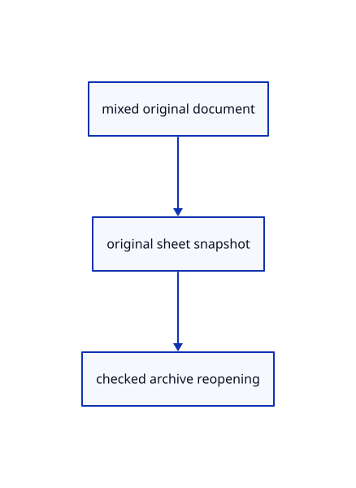

# 14.1.12 · Save and reopen complete original sheets

**Chapter 14 · Coordinates and geometry tools · Section 14.1 · Sheet queries and construction planes** · [Contents](contents.md)

**Typing: 22–43 minutes.** [Estimate](typing-load.md).

Import original Sheet records beside other geometry and save original columns with independent placements and layer flags.

## Type

Continue from [Carry drawing identity through scene operations](71j-carry-drawing-identity-through-scene-operations.md). [Save or recover your work](recovery.md).

### 1. `src/document_source.rs`

Connect original sheets to mixed document persistence and namespace identities.

<details>
<summary>Locate the existing block</summary>

```rust
use session_rust::{proto,Session,Xform};
use prost::Message;
use std::{collections::{HashMap,HashSet},rc::Rc};

pub(crate) struct Source {pub document:Rc<Session>,pub origin:Rc<crate::origin::Origin>,pub tree:Option<proto::TreeNode>,pub world:HashMap<String,Xform>}
pub(crate) fn prepare(bytes:&[u8],place:&Xform,point_px:f32)->Result<Source,String> {
    if bytes.len()>crate::archive::LIMIT {return Err("Session exceeds the 512 MiB file limit".into());}
    let message=proto::Session::decode(bytes).map_err(|e|e.to_string())?;
    crate::source_validate::session(&message)?;
    supported(&message)?;
    if !crate::placement::valid(&place.m)||!point_px.is_finite() {return Err("Invalid document placement or point size".into());}
    let tree=message.tree.as_ref().and_then(|tree|tree.root.clone());
    let mut guids=HashSet::new();let objects=message.objects.as_ref().ok_or("Session has no objects")?;
    macro_rules! identity {($field:ident)=>{for object in &objects.$field {if object.guid.is_empty()||!guids.insert(object.guid.as_str()) {return Err("Source GUIDs must be distinct within a document".into());}}};}
    identity!(meshes);identity!(points);identity!(lines);identity!(polylines);identity!(nurbscurves);identity!(nurbssurfaces);identity!(breps);identity!(pointclouds);identity!(instances);
    if let Some(root)=tree.as_ref() {crate::hierarchy::validate(root,&guids).map_err(str::to_owned)?;}
    let mut placed=HashSet::new();for entry in &message.xforms {if !placed.insert(entry.guid.as_str())||!crate::placement::valid(&entry.xform.as_ref().ok_or("Missing placement matrix")?.matrix) {return Err("Invalid source placement".into());}}
    let origin=Rc::new(crate::origin::Origin::new(&message,bytes));
    let document=Rc::new(Session::from_proto(message).map_err(|e|e.to_string())?);
    let world=crate::nested_placement::prepare(&document,place).map_err(str::to_owned)?;
    Ok(Source {document,origin,tree,world})
}

fn supported(source:&proto::Session)->Result<(),String> {
    crate::instance_plan::validate(source)?;
    if !source.interactions.is_empty() {return Err("Interactions arrive with element features".into());}
    let objects=source.objects.as_ref().ok_or("Session has no objects")?;
    if !objects.planes.is_empty()||!objects.bboxes.is_empty()||!objects.elements.is_empty()||!objects.components.is_empty()||!objects.sheets.is_empty() {return Err("This subject cannot open planes, boxes, assemblies or sheets yet".into());}
    Ok(())
}
```

</details>

Edit the existing block to match this code; keep unchanged lines:

```rust
use session_rust::{proto,Session,Xform};
use prost::Message;
use std::{collections::{HashMap,HashSet},rc::Rc};

pub(crate) struct Source {pub document:Rc<Session>,pub origin:Rc<crate::origin::Origin>,pub tree:Option<proto::TreeNode>,pub world:HashMap<String,Xform>,pub sheets:Vec<Rc<crate::sheet_source::Prepared>>}
pub(crate) fn prepare(bytes:&[u8],place:&Xform,point_px:f32)->Result<Source,String> {
    if bytes.len()>crate::archive::LIMIT {return Err("Session exceeds the 512 MiB file limit".into());}
    let message=proto::Session::decode(bytes).map_err(|e|e.to_string())?;
    crate::source_validate::session(&message)?;
    supported(&message)?;
    if !crate::placement::valid(&place.m)||!point_px.is_finite() {return Err("Invalid document placement or point size".into());}
    let tree=message.tree.as_ref().and_then(|tree|tree.root.clone());
    let mut guids=HashSet::new();let objects=message.objects.as_ref().ok_or("Session has no objects")?;
    macro_rules! identity {($field:ident)=>{for object in &objects.$field {if object.guid.is_empty()||!guids.insert(object.guid.as_str()) {return Err("Source GUIDs must be distinct within a document".into());}}};}
    identity!(meshes);identity!(points);identity!(lines);identity!(polylines);identity!(nurbscurves);identity!(nurbssurfaces);identity!(breps);identity!(pointclouds);identity!(instances);identity!(sheets);
    if let Some(root)=tree.as_ref() {crate::hierarchy::validate(root,&guids).map_err(str::to_owned)?;}
    let mut placed=HashSet::new();for entry in &message.xforms {if !placed.insert(entry.guid.as_str())||!crate::placement::valid(&entry.xform.as_ref().ok_or("Missing placement matrix")?.matrix) {return Err("Invalid source placement".into());}}
    let sheets=objects.sheets.iter().cloned().map(|sheet|crate::sheet_source::Prepared::new(Rc::new(sheet)).map(Rc::new).map_err(str::to_owned)).collect::<Result<Vec<_>,_>>()?;
    let origin=Rc::new(crate::origin::Origin::new(&message,bytes));
    let document=Rc::new(Session::from_proto(message).map_err(|e|e.to_string())?);
    let world=crate::nested_placement::prepare(&document,place).map_err(str::to_owned)?;
    Ok(Source {document,origin,tree,world,sheets})
}

fn supported(source:&proto::Session)->Result<(),String> {
    crate::instance_plan::validate(source)?;
    if !source.interactions.is_empty() {return Err("Interactions arrive with element features".into());}
    let objects=source.objects.as_ref().ok_or("Session has no objects")?;
    if !objects.planes.is_empty()||!objects.bboxes.is_empty()||!objects.elements.is_empty()||!objects.components.is_empty() {return Err("This subject cannot open planes, boxes or assemblies yet".into());}
    Ok(())
}
```

<details>
<summary>Optional patch references</summary>

Use these original edit fragments when comparing a saved checkpoint. Apply the complete blocks above.

```text
--8<-- "journey/code/71k-save-and-reopen-complete-original-sheets-01.rs"
```

```text
--8<-- "journey/code/71k-save-and-reopen-complete-original-sheets-02.rs"
```

```text
--8<-- "journey/code/71k-save-and-reopen-complete-original-sheets-03.rs"
```

</details>

### 2. `src/document_geometry.rs`

Connect original sheets to mixed document persistence and namespace identities.

<details>
<summary>Locate the existing block</summary>

```rust
    for source in &loaded.document.objects.breps {add!(source,scene.insert_prepared_cad(shapes.prepare(source.clone()).map_err(str::to_owned)?));}
    for source in &loaded.document.objects.pointclouds {let id=add!(source,scene.insert_cloud(crate::cloud::Prepared::new(source.clone()).map_err(str::to_owned)?));scene.cloud_point_size(id,point_px).map_err(str::to_owned)?;}
    let templates=crate::instance_definition::templates(loaded.document.clone(),&mut shapes).map_err(str::to_owned)?;let mut used=scene.used_guids();
    for instance in &loaded.document.objects.instances {
```

</details>

Edit the existing block to match this code; keep unchanged lines:

```rust
--8<-- "journey/code/71k-save-and-reopen-complete-original-sheets-04.rs"
```

### 3. `src/archive_identity.rs`

Connect original sheets to mixed document persistence and namespace identities.

<details>
<summary>Locate the existing block</summary>

```rust
pub(crate) fn objects(objects:&mut proto::Objects,names:&HashMap<String,String>) {
    macro_rules! remap {($field:ident)=>{for object in &mut objects.$field {if let Some(guid)=names.get(&object.guid) {object.guid=guid.clone();}}};}
    remap!(meshes);remap!(lines);remap!(points);remap!(polylines);remap!(nurbscurves);remap!(nurbssurfaces);remap!(breps);remap!(pointclouds);remap!(instances);
}
pub(crate) fn tree(node:&mut proto::TreeNode,names:&HashMap<String,String>) {
```

</details>

Edit the existing block to match this code; keep unchanged lines:

```rust
--8<-- "journey/code/71k-save-and-reopen-complete-original-sheets-05.rs"
```

### 4. `src/scene_archive.rs`

Connect original sheets to mixed document persistence and namespace identities.

<details>
<summary>Locate the existing block</summary>

```rust
fn inventory(scene:&Scene)->Vec<Namespace> {
    let mut out=scene.forest.documents.iter().map(|doc|Namespace {name:doc.label.clone(),doc:Some(doc.clone()),ids:doc.nodes.iter().filter_map(|node|node.object).filter(|id|scene.contains(*id)).collect()}).collect::<Vec<_>>();
    let all=scene.objects().iter().map(|row|row.id).chain(scene.lines().iter().map(|row|row.id)).chain(scene.paths().iter().map(|row|row.id)).chain(scene.points().iter().map(|row|row.id)).chain(scene.clouds().iter().map(|row|row.id)).chain(scene.texts().iter().map(|row|row.id)).collect::<HashSet<_>>();
    let assigned=out.iter().flat_map(|namespace|namespace.ids.iter().copied()).collect::<HashSet<_>>();let ids=all.difference(&assigned).copied().collect::<HashSet<_>>();if !ids.is_empty() {out.push(Namespace {name:"Created".into(),doc:None,ids});}out
}
```

</details>

Edit the existing block to match this code; keep unchanged lines:

```rust
--8<-- "journey/code/71k-save-and-reopen-complete-original-sheets-06.rs"
```

### 5. `src/document.rs`

Connect original sheets to mixed document persistence and namespace identities.

<details>
<summary>Locate the existing block</summary>

```rust
pub fn snapshot(scene: &crate::scene::Scene) -> Result<Vec<u8>, &'static str> {
    if scene.objects().iter().any(|row|row.surface.is_some()||row.cad.is_some()) {return Err("This checkpoint cannot save CAD surface objects yet");}
    if !scene.clouds().is_empty() {return Err("This checkpoint cannot save cloud objects yet");}
    if !scene.texts().is_empty() {return Err("This checkpoint cannot save scene text objects yet");}
```

</details>

Edit the existing block to match this code; keep unchanged lines:

```rust
--8<-- "journey/code/71k-save-and-reopen-complete-original-sheets-07.rs"
```

### 6. `src/geometry_snapshot.rs`

Save complete original Sheet protobuf columns rather than display segments.

<details>
<summary>Locate the existing block</summary>

```rust
    for row in scene.points().iter().filter(|row|ids.contains(&row.id)&&!scene.instances.contains_key(&row.id)) {push!(points,row.id,row.prepared.source.to_proto());}
    for row in scene.clouds().iter().filter(|row|ids.contains(&row.id)&&!scene.instances.contains_key(&row.id)) {push!(pointclouds,row.id,row.prepared.source.to_proto());}
    for (id,owner) in scene.instances.iter().filter(|(id,_)|ids.contains(id)) {
        let mut source=owner.instance.to_proto();source.guid=scene.row_guid(*id).ok_or("Original instance owner is missing")?.into();source.flags=(source.flags&!(session_rust::InstanceRef::FLAG_HIDDEN|session_rust::InstanceRef::FLAG_LOCKED))|if scene.visible(*id) {0} else {session_rust::InstanceRef::FLAG_HIDDEN}|if scene.view.locked.contains(id) {session_rust::InstanceRef::FLAG_LOCKED} else {0};out.instances.push(source);
```

</details>

Edit the existing block to match this code; keep unchanged lines:

```rust
--8<-- "journey/code/71k-save-and-reopen-complete-original-sheets-08.rs"
```

## Run and check

Run this from `session_viewer` to select the fixed dependency versions and install supplied binary assets. It updates Cargo.lock and preserves the previous lock. It does not write implementation code:

```sh
npm --prefix ../session_tests run course -- dependencies 14.1.12
```

In your project:

```sh
cd workspace/journey
REGEN_PROTO=0 cargo build --lib --locked --target wasm32-unknown-unknown -j1
REGEN_PROTO=0 CARGO_BUILD_JOBS=1 trunk serve --port 8780
```

Open `http://127.0.0.1:8780/`. Keep an existing Trunk server running; saving rebuilds it.


### Recorded visual result

**Previous native render — current verification pending.**

The blue rotated and selected yellow mirrored references retain their original source definition.


*This recorded image predates a source or checker change. Rebuild this checkpoint before using it as current evidence; browser controls require separate acceptance.*

This reference image is shared with [13.2.5 · Exercise rotated and mirrored original references](70d-exercise-rotated-and-mirrored-original-references.md). It does not demonstrate a new feature by itself.

<details>
<summary>Code explanation and diagram</summary>


mixed original document → original sheet snapshot → checked archive reopening.



Does the Sheet protobuf contain object visibility flags?

No. Keep viewer layer presentation in archive metadata while retaining the original drawing columns and source names.

Study estimate, including typing and experiments: 0.5–1 hours.

</details>

<details>
<summary>Optional experiment</summary>

Compare complete mixed archives with original doubles, repeated entity IDs and separate namespaces.

</details>

<details>
<summary>Check and save your work</summary>

Restore experimental edits, then run from `session_viewer`:

```sh
npm --prefix ../session_tests run course -- check 14.1.12
npm --prefix ../session_tests run course -- save 14.1.12
```

Source comparison leaves your project untouched. [Save and recovery instructions](recovery.md).

</details>

<details>
<summary>Viewer coverage and verification</summary>


The inherited nested-reference exercise remains authored and unrun. The final sheet contract covers complete archive reopening, repeated checked-range placements, metadata only after selection, bounded reads and Close during a lookup. Actual browser execution remains required.

[Full validation scope](release.md).

To reproduce the scripted acceptance of the reference checkpoint, run from `session_viewer` with the [course bundle server](release.md#reproduce) running on port 8781:

```sh
npm --prefix ../session_tests run course -- capture 14.1.12
```

This uses the verified reference bundle; it does not check or change your typed project.

</details>
