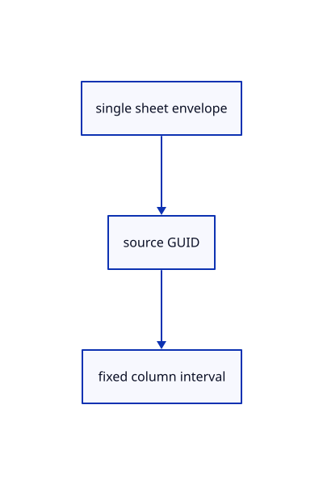

# 14.1.13 · Locate original drawing identity and fixed ranges

**Chapter 14 · Coordinates and geometry tools · Section 14.1 · Sheet queries and construction planes** · [Contents](contents.md)

**Typing: 22–43 minutes.** [Estimate](typing-load.md).

Accept one original sheet envelope and derive checked intervals within its fixed-width arrays.

## Type

Continue from [Save and reopen complete original sheets](71k-save-and-reopen-complete-original-sheets.md). [Save or recover your work](recovery.md).

### 1. `src/sheet_range.rs`

Locate original sheet identity and checked column intervals.

Create the file and type:

```rust
--8<-- "journey/code/71l-locate-original-drawing-identity-and-fixed-ranges-01.rs"
```

### 2. `src/lib.rs`

Register the drawing component.

<details>
<summary>Locate the existing block</summary>

```rust

pub mod sheet_source;
```

</details>

After that block, type:

```rust
--8<-- "journey/code/71l-locate-original-drawing-identity-and-fixed-ranges-02.rs" skip=23
```

<details>
<summary>Supplied validation fixture</summary>

Copy this supplied authoring fixture once. Continue with the browser build below; the course does not require running native tests.

### 3. `src/sheet_range.rs`

Copy exact original drawing-envelope and interval fixtures.

<details>
<summary>Locate the existing block</summary>

```text
    Some((start, bytes))
}
```

</details>

After that block, append this supplied code:

```text
--8<-- "journey/code/71l-locate-original-drawing-identity-and-fixed-ranges-03.rs" skip=27
```

</details>

## Run and check

Run this from `session_viewer` to select the fixed dependency versions and install supplied binary assets. It updates Cargo.lock and preserves the previous lock. It does not write implementation code:

```sh
npm --prefix ../session_tests run course -- dependencies 14.1.13
```

In your project:

```sh
cd workspace/journey
REGEN_PROTO=0 cargo build --lib --locked --target wasm32-unknown-unknown -j1
REGEN_PROTO=0 CARGO_BUILD_JOBS=1 trunk serve --port 8780
```

Open `http://127.0.0.1:8780/`. Keep an existing Trunk server running; saving rebuilds it.


### Recorded visual result

**Previous native render — current verification pending.**

The blue rotated and selected yellow mirrored references retain their original source definition.


*This recorded image predates a source or checker change. Rebuild this checkpoint before using it as current evidence; browser controls require separate acceptance.*

This reference image is shared with [13.2.5 · Exercise rotated and mirrored original references](70d-exercise-rotated-and-mirrored-original-references.md). It does not demonstrate a new feature by itself.

<details>
<summary>Code explanation and diagram</summary>


single sheet envelope → source GUID → fixed column interval.



Can a mixed document use this single-sheet shortcut?

No. Mixed documents load complete so other source owners and placements remain intact.

Study estimate, including typing and experiments: 0.5–1 hours.

</details>

<details>
<summary>Optional experiment</summary>

Copy original protobuf layout, repeated-sheet, mixed-source and overflow fixtures.

</details>

<details>
<summary>Check and save your work</summary>

Restore experimental edits, then run from `session_viewer`:

```sh
npm --prefix ../session_tests run course -- check 14.1.13
npm --prefix ../session_tests run course -- save 14.1.13
```

Source comparison leaves your project untouched. [Save and recovery instructions](recovery.md).

</details>

<details>
<summary>Viewer coverage and verification</summary>


The inherited nested-reference exercise remains authored and unrun. The final sheet contract covers complete archive reopening, repeated checked-range placements, metadata only after selection, bounded reads and Close during a lookup. Actual browser execution remains required.

[Full validation scope](release.md).

To reproduce the scripted acceptance of the reference checkpoint, run from `session_viewer` with the [course bundle server](release.md#reproduce) running on port 8781:

```sh
npm --prefix ../session_tests run course -- capture 14.1.13
```

This uses the verified reference bundle; it does not check or change your typed project.

</details>
