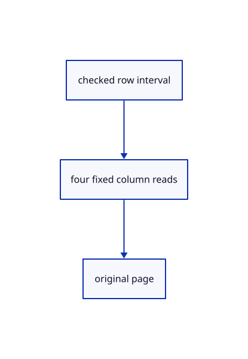

# 14.1.16 · Read drawing page columns through the shared queue

**Chapter 14 · Coordinates and geometry tools · Section 14.1 · Sheet queries and construction planes** · [Contents](contents.md)

**Typing: 17–34 minutes.** [Estimate](typing-load.md).

Request coordinate, color, pen and entity ranges through the existing bounded range queue.

## Type

Continue from [Scan drawing columns under one revision](71n-scan-drawing-columns-under-one-revision.md). [Save or recover your work](recovery.md).

### 1. `src/sheet_range.rs`

Read original page columns through the bounded source range queue.

Edit these blocks from bottom to top. Keep the surrounding lines unchanged.

<details>
<summary>Locate this block</summary>

```rust
            fields,
        })
    }
}
#[cfg(test)]
mod tests {
```

</details>

Replace it with:

```rust
            fields,
        })
    }
    pub async fn page(
        &self,
        rows: std::ops::Range<u32>,
    ) -> Result<crate::sheet_page::Page, String> {
        let fields = &self.fields;
        let ranges = [
            slice(
                fields,
                fields.coords_at,
                fields.coords_len,
                rows.clone(),
                48,
            ),
            slice(fields, fields.colors_at, fields.colors_len, rows.clone(), 4),
            slice(fields, fields.widths_at, fields.widths_len, rows.clone(), 4),
            slice(fields, fields.ids_at, fields.ids_len, rows.clone(), 4),
        ];
        let mut tasks = Vec::new();
        for range in ranges {
            let (at, length) = range.ok_or("Original sheet page is outside its array")?;
            let url = self.url.clone();
            let revision = fields.revision.clone();
            tasks.push(crate::range_fetch::Task::start(async move {
                crate::stream::source_range(&url, at, length, &revision).await
            }));
        }
        let mut raw = Vec::new();
        for task in tasks {
            raw.push(
                task.wait()
                    .await
                    .flatten()
                    .ok_or("Original sheet page read failed")?,
            );
        }
        crate::sheet_page::Page::decode(
            rows,
            fields.count,
            fields.entities,
            &raw[0],
            (fields.colors_len > 0).then_some(raw[1].as_slice()),
            (fields.widths_len > 0).then_some(raw[2].as_slice()),
            (fields.ids_len > 0).then_some(raw[3].as_slice()),
        )
        .map_err(str::to_owned)
    }
}
#[cfg(test)]
mod tests {
```

<details>
<summary>Locate this block</summary>

```rust
    }
    Some((start, bytes))
}
#[cfg(target_arch="wasm32")]
impl Source {
    pub async fn from_probe(
        url: String,
```

</details>

Replace it with:

```rust
    }
    Some((start, bytes))
}
#[cfg(target_arch = "wasm32")]
impl Source {
    pub async fn from_probe(
        url: String,
```

<details>
<summary>Complete updated block reference</summary>

```rust
use crate::stream::{SheetFields, field_at};
pub struct Source {
    pub guid: String,
    pub name: String,
    pub url: String,
    pub fields: SheetFields,
}
pub fn identity(head: &[u8]) -> Option<(String, String)> {
    let mut at = 0u64;
    let objects = loop {
        let f = field_at(head.get(at as usize..)?, at, u64::MAX)?;
        if f.field == 3 && f.wire == 2 {
            break f;
        }
        if f.field > 2 || f.wire != 2 {
            return None;
        }
        at = f.next;
    };
    at = objects.body;
    let sheet = loop {
        let f = field_at(head.get(at as usize..)?, at, objects.next)?;
        if f.field == 17 && f.wire == 2 && f.next == objects.next {
            break f;
        }
        if f.field > 2 || f.wire != 2 {
            return None;
        }
        at = f.next;
    };
    at = sheet.body;
    let mut guid = None;
    let mut name = String::new();
    loop {
        let f = field_at(head.get(at as usize..)?, at, sheet.next)?;
        if f.field == 3 && f.wire == 2 {
            return Some((guid?, name));
        }
        if f.wire != 2 || f.field > 2 || f.value > 256 {
            return None;
        }
        let text = std::str::from_utf8(head.get(f.body as usize..f.next as usize)?)
            .ok()?
            .to_owned();
        match f.field {
            1 if guid.is_none() && !text.is_empty() => guid = Some(text),
            2 => name = text,
            _ => return None,
        }
        at = f.next;
    }
}
pub fn slice(
    fields: &SheetFields,
    at: u64,
    length: u64,
    rows: std::ops::Range<u32>,
    stride: u64,
) -> Option<(u64, u64)> {
    if rows.start > rows.end || rows.end > fields.count {
        return None;
    }
    if length == 0 {
        return Some((0, 0));
    }
    let start = at.checked_add(u64::from(rows.start).checked_mul(stride)?)?;
    let bytes = u64::from(rows.end - rows.start).checked_mul(stride)?;
    let end = at.checked_add(length)?;
    if start.checked_add(bytes)? > end || end > fields.end {
        return None;
    }
    Some((start, bytes))
}
#[cfg(target_arch = "wasm32")]
impl Source {
    pub async fn from_probe(
        url: String,
        probe: &crate::range_fetch::Reply,
    ) -> Result<Self, String> {
        if probe.status != 206 || probe.etag.is_none() && !crate::manifest::immutable_key(&url) {
            return Err(
                "Ranged drawings require byte ranges and a revision or immutable URL".into(),
            );
        }
        let (guid, name) =
            identity(&probe.bytes).ok_or("Ranged drawing must contain one original sheet")?;
        let (coords_at, coords_len, end) =
            crate::stream::sheet_layout(&probe.bytes).ok_or("Missing sheet coordinates")?;
        if coords_len == 0
            || coords_len % 48 != 0
            || end > probe.total.ok_or("Missing original drawing length")?
        {
            return Err("Invalid original sheet coordinate interval".into());
        }
        let mut fields = SheetFields {
            end,
            coords_at,
            coords_len,
            count: u32::try_from(coords_len / 48).map_err(|_| "Too many drawing segments")?,
            revision: probe.etag.clone(),
            ..Default::default()
        };
        let mut at = coords_at + coords_len;
        let mut window = crate::stream::MetadataWindow::default();
        let mut seen = std::collections::HashSet::new();
        while at < end {
            let header = window
                .read(&url, at, 64.min(end - at), end, &fields.revision)
                .await
                .ok_or("Drawing metadata range failed")?;
            let field = field_at(header, at, end).ok_or("Invalid drawing field")?;
            if !seen.insert(field.field) {
                return Err("Repeated original drawing field".into());
            }
            let body = if (field.field, field.wire) == (8, 2) {
                if field.value > 256 {
                    return Err("Original metadata URL is too long".into());
                }
                window
                    .read(&url, field.body, field.value, end, &fields.revision)
                    .await
                    .ok_or("Drawing metadata URL range failed")?
            } else {
                &[]
            };
            if !fields.set(&field, body) {
                return Err("Invalid original drawing array or count".into());
            }
            at = field.next;
        }
        if !seen.contains(&6) {
            return Err("Original drawing has no declared segment count".into());
        }
        envelope(&url, end, probe.total.unwrap(), &fields.revision, &guid).await?;
        Ok(Self {
            guid,
            name,
            url,
            fields,
        })
    }
    pub async fn page(
        &self,
        rows: std::ops::Range<u32>,
    ) -> Result<crate::sheet_page::Page, String> {
        let fields = &self.fields;
        let ranges = [
            slice(
                fields,
                fields.coords_at,
                fields.coords_len,
                rows.clone(),
                48,
            ),
            slice(fields, fields.colors_at, fields.colors_len, rows.clone(), 4),
            slice(fields, fields.widths_at, fields.widths_len, rows.clone(), 4),
            slice(fields, fields.ids_at, fields.ids_len, rows.clone(), 4),
        ];
        let mut tasks = Vec::new();
        for range in ranges {
            let (at, length) = range.ok_or("Original sheet page is outside its array")?;
            let url = self.url.clone();
            let revision = fields.revision.clone();
            tasks.push(crate::range_fetch::Task::start(async move {
                crate::stream::source_range(&url, at, length, &revision).await
            }));
        }
        let mut raw = Vec::new();
        for task in tasks {
            raw.push(
                task.wait()
                    .await
                    .flatten()
                    .ok_or("Original sheet page read failed")?,
            );
        }
        crate::sheet_page::Page::decode(
            rows,
            fields.count,
            fields.entities,
            &raw[0],
            (fields.colors_len > 0).then_some(raw[1].as_slice()),
            (fields.widths_len > 0).then_some(raw[2].as_slice()),
            (fields.ids_len > 0).then_some(raw[3].as_slice()),
        )
        .map_err(str::to_owned)
    }
}
#[cfg(test)]
mod tests {
    use super::*;
    use prost::Message;
    #[test]
    fn ranged_drawing_identity_and_fixed_column_offsets_match_the_original_protobuf() {
        let raw = crate::sheet_example::bytes();
        let original = crate::sheet_example::source();
        assert_eq!(identity(&raw), Some((original.guid, original.name)));
        let (at, length, end) = crate::stream::sheet_layout(&raw).unwrap();
        let fields = SheetFields {
            count: 5,
            end,
            coords_at: at,
            coords_len: length,
            ..Default::default()
        };
        assert_eq!(slice(&fields, at, length, 2..4, 48), Some((at + 96, 96)));
        assert!(slice(&fields, at, length, 4..6, 48).is_none());
        assert!(slice(&fields, u64::MAX, 48, 1..2, 48).is_none());
        let mut mixed = session_rust::proto::Session::decode(raw.as_slice()).unwrap();
        mixed
            .objects
            .as_mut()
            .unwrap()
            .points
            .push(session_rust::Point::new(0., 0., 0.).to_proto());
        assert!(identity(&mixed.encode_to_vec()).is_none());
        let mut repeated = session_rust::proto::Session::decode(raw.as_slice()).unwrap();
        repeated
            .objects
            .as_mut()
            .unwrap()
            .sheets
            .push(crate::sheet_example::source());
        assert!(identity(&repeated.encode_to_vec()).is_none());
    }
}

#[cfg(target_arch = "wasm32")]
async fn envelope(
    url: &str,
    end: u64,
    total: u64,
    revision: &Option<String>,
    guid: &str,
) -> Result<(), String> {
    let length = total
        .checked_sub(end)
        .ok_or("Drawing exceeds its original file")?;
    if length > 1024 * 1024 {
        return Err("Original drawing envelope metadata exceeds its range limit".into());
    }
    if length > 0 {
        let tail = crate::stream::source_range(url, end, length, revision)
            .await
            .ok_or("Drawing envelope read failed")?;
        crate::range_shape::metadata(&tail, guid)?;
    }
    Ok(())
}
```

</details>

<details>
<summary>Optional patch references</summary>

Use these original edit fragments when comparing a saved checkpoint. Apply the complete blocks above.

```text
--8<-- "journey/code/71o-read-drawing-page-columns-through-the-shared-queue-01.rs"
```

```text
--8<-- "journey/code/71o-read-drawing-page-columns-through-the-shared-queue-02.rs"
```

</details>

## Run and check

Run this from `session_viewer` to select the fixed dependency versions and install supplied binary assets. It updates Cargo.lock and preserves the previous lock. It does not write implementation code:

```sh
npm --prefix ../session_tests run course -- dependencies 14.1.16
```

In your project:

```sh
cd workspace/journey
REGEN_PROTO=0 cargo build --lib --locked --target wasm32-unknown-unknown -j1
REGEN_PROTO=0 CARGO_BUILD_JOBS=1 trunk serve --port 8780
```

Open `http://127.0.0.1:8780/`. Keep an existing Trunk server running; saving rebuilds it.


### Recorded visual result

**Previous native render — current verification pending.**

The blue rotated and selected yellow mirrored references retain their original source definition.


*This recorded image predates a source or checker change. Rebuild this checkpoint before using it as current evidence; browser controls require separate acceptance.*

This reference image is shared with [13.2.5 · Exercise rotated and mirrored original references](70d-exercise-rotated-and-mirrored-original-references.md). It does not demonstrate a new feature by itself.

<details>
<summary>Code explanation and diagram</summary>


checked row interval → four fixed column reads → original page.



Does four columns mean four unrestricted requests?

No. They use the shared range gate, retaining existing concurrency, retry and cancellation rules.

Study estimate, including typing and experiments: 0.5–1 hours.

</details>

<details>
<summary>Optional experiment</summary>

Trace absent-column defaults and exact byte counts before constructing a page.

</details>

<details>
<summary>Check and save your work</summary>

Restore experimental edits, then run from `session_viewer`:

```sh
npm --prefix ../session_tests run course -- check 14.1.16
npm --prefix ../session_tests run course -- save 14.1.16
```

Source comparison leaves your project untouched. [Save and recovery instructions](recovery.md).

</details>

<details>
<summary>Viewer coverage and verification</summary>


The inherited nested-reference exercise remains authored and unrun. The final sheet contract covers complete archive reopening, repeated checked-range placements, metadata only after selection, bounded reads and Close during a lookup. Actual browser execution remains required.

[Full validation scope](release.md).

To reproduce the scripted acceptance of the reference checkpoint, run from `session_viewer` with the [course bundle server](release.md#reproduce) running on port 8781:

```sh
npm --prefix ../session_tests run course -- capture 14.1.16
```

This uses the verified reference bundle; it does not check or change your typed project.

</details>
