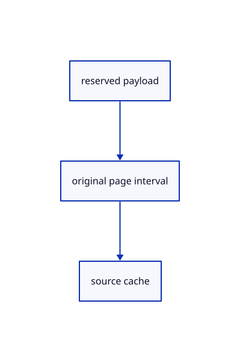

# 14.1.17 · Adopt nonoverlapping charged drawing pages

**Chapter 14 · Coordinates and geometry tools · Section 14.1 · Sheet queries and construction planes** · [Contents](contents.md)

**Typing: 18–35 minutes.** [Estimate](typing-load.md).

Keep original intervals in a source-owned cache and retain its generation and loaded extent.

## Type

Continue from [Read drawing page columns through the shared queue](71o-read-drawing-page-columns-through-the-shared-queue.md). [Save or recover your work](recovery.md).

### 1. `src/sheet_stream.rs`

Own checked original page intervals, cache charges and source generations.

<details>
<summary>Locate the existing block</summary>

```rust
use std::rc::Rc;
use crate::{page_cache::Held,sheet_page::Page};
pub const PREFIX:u32=25000;
pub const CHUNK:u32=500000;
pub const CEILING:u32=3000000;
#[derive(Clone)]
pub enum DisplayPage {
```

</details>

Edit the existing block to match this code; keep unchanged lines:

```rust
--8<-- "journey/code/71p-adopt-nonoverlapping-charged-drawing-pages-01.rs"
```

<details>
<summary>Supplied validation fixture</summary>

Copy this supplied authoring fixture once. Continue with the browser build below; the course does not require running native tests.

### 2. `src/sheet_stream.rs`

Copy segment-budget and retained-page ownership fixtures.

<details>
<summary>Locate the existing block</summary>

```text
    (count > 0).then(|| from..from + count)
}
```

</details>

After that block, append this supplied code:

```text
--8<-- "journey/code/71p-adopt-nonoverlapping-charged-drawing-pages-02.rs" skip=46
```

</details>

## Run and check

Run this from `session_viewer` to select the fixed dependency versions and install supplied binary assets. It updates Cargo.lock and preserves the previous lock. It does not write implementation code:

```sh
npm --prefix ../session_tests run course -- dependencies 14.1.17
```

In your project:

```sh
cd workspace/journey
REGEN_PROTO=0 cargo build --lib --locked --target wasm32-unknown-unknown -j1
REGEN_PROTO=0 CARGO_BUILD_JOBS=1 trunk serve --port 8780
```

Open `http://127.0.0.1:8780/`. Keep an existing Trunk server running; saving rebuilds it.


### Recorded visual result

**Previous native render — current verification pending.**

The blue rotated and selected yellow mirrored references retain their original source definition.


*This recorded image predates a source or checker change. Rebuild this checkpoint before using it as current evidence; browser controls require separate acceptance.*

This reference image is shared with [13.2.5 · Exercise rotated and mirrored original references](70d-exercise-rotated-and-mirrored-original-references.md). It does not demonstrate a new feature by itself.

<details>
<summary>Code explanation and diagram</summary>


reserved payload → original page interval → source cache.



Can a second page overlap a resident original interval?

No. Reject it before adoption; payload charges and original source identity remain attached to the accepted page.

Study estimate, including typing and experiments: 0.5–1 hours.

</details>

<details>
<summary>Optional experiment</summary>

Copy segment-limit, overflow and retained-charge fixtures.

</details>

<details>
<summary>Check and save your work</summary>

Restore experimental edits, then run from `session_viewer`:

```sh
npm --prefix ../session_tests run course -- check 14.1.17
npm --prefix ../session_tests run course -- save 14.1.17
```

Source comparison leaves your project untouched. [Save and recovery instructions](recovery.md).

</details>

<details>
<summary>Viewer coverage and verification</summary>


The inherited nested-reference exercise remains authored and unrun. The final sheet contract covers complete archive reopening, repeated checked-range placements, metadata only after selection, bounded reads and Close during a lookup. Actual browser execution remains required.

[Full validation scope](release.md).

To reproduce the scripted acceptance of the reference checkpoint, run from `session_viewer` with the [course bundle server](release.md#reproduce) running on port 8781:

```sh
npm --prefix ../session_tests run course -- capture 14.1.17
```

This uses the verified reference bundle; it does not check or change your typed project.

</details>
