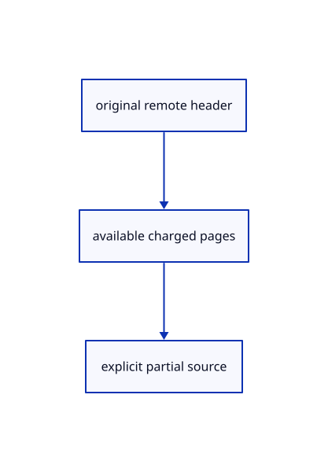

# 14.1.18 · Keep partial drawing sources explicit

**Chapter 14 · Coordinates and geometry tools · Section 14.1 · Sheet queries and construction planes** · [Contents](contents.md)

**Typing: 25–49 minutes.** [Estimate](typing-load.md).

Expose available charged pages and preserve original header fields without claiming a complete editable drawing.

## Type

Continue from [Adopt nonoverlapping charged drawing pages](71p-adopt-nonoverlapping-charged-drawing-pages.md). [Save or recover your work](recovery.md).

### 1. `src/sheet_source.rs`

Keep complete and partial source ownership explicit.

Edit these blocks from bottom to top. Keep the surrounding lines unchanged.

<details>
<summary>Locate this block</summary>

```rust
        Ok(Self {
            original,
            page: Rc::new(page),
        })
    }
}
```

</details>

Replace it with:

```rust
        Ok(Self {
            original,
            page: Rc::new(page),
            streamed: None,
        })
    }
}
```

<details>
<summary>Locate this block</summary>

```rust
        }
        bounds
    }
    pub fn new(original: Rc<proto::Sheet>) -> Result<Self, &'static str> {
        if original.guid.is_empty()
            || original.coords.len() % 6 != 0
```

</details>

Replace it with:

```rust
        }
        bounds
    }

    pub fn new(original: Rc<proto::Sheet>) -> Result<Self, &'static str> {
        if original.guid.is_empty()
            || original.coords.len() % 6 != 0
```

<details>
<summary>Locate this block</summary>

```rust
pub struct Prepared {
    pub original: Rc<proto::Sheet>,
    pub page: Rc<crate::sheet_page::Page>,
}
impl Prepared {
    pub fn pages(&self)->Vec<crate::sheet_stream::DisplayPage> {vec![crate::sheet_stream::DisplayPage::Resident(self.page.clone())]}
    pub fn bounds(&self) -> Option<crate::bounds::Bounds> {
        let mut bounds = None;
        for page in self.pages() {
```

</details>

Replace it with:

```rust
pub struct Prepared {
    pub original: Rc<proto::Sheet>,
    pub page: Rc<crate::sheet_page::Page>,
    pub streamed: Option<Rc<crate::sheet_stream::Stream>>,
}
impl Prepared {
    pub fn streamed(stream: Rc<crate::sheet_stream::Stream>) -> Self {
        let source = &stream.source;
        let original = Rc::new(proto::Sheet {
            guid: source.guid.clone(),
            name: source.name.clone(),
            segment_count: source.fields.count,
            entity_count: source.fields.entities,
            meta: source.fields.meta.clone(),
            ..Default::default()
        });
        let page = Rc::new(
            crate::sheet_page::Page::decode(
                0..0,
                source.fields.count,
                source.fields.entities,
                &[],
                None,
                None,
                None,
            )
            .unwrap(),
        );
        Self {
            original,
            page,
            streamed: Some(stream),
        }
    }
    pub fn pages(&self) -> Vec<crate::sheet_stream::DisplayPage> {
        if let Some(stream) = &self.streamed {
            stream
                .pages()
                .into_iter()
                .map(crate::sheet_stream::DisplayPage::Streamed)
                .collect()
        } else {
            vec![crate::sheet_stream::DisplayPage::Resident(
                self.page.clone(),
            )]
        }
    }
    pub fn bounds(&self) -> Option<crate::bounds::Bounds> {
        let mut bounds = None;
        for page in self.pages() {
```

<details>
<summary>Complete updated block reference</summary>

```rust
use session_rust::{Point, Xform, proto};
use std::rc::Rc;

pub struct Prepared {
    pub original: Rc<proto::Sheet>,
    pub page: Rc<crate::sheet_page::Page>,
    pub streamed: Option<Rc<crate::sheet_stream::Stream>>,
}
impl Prepared {
    pub fn streamed(stream: Rc<crate::sheet_stream::Stream>) -> Self {
        let source = &stream.source;
        let original = Rc::new(proto::Sheet {
            guid: source.guid.clone(),
            name: source.name.clone(),
            segment_count: source.fields.count,
            entity_count: source.fields.entities,
            meta: source.fields.meta.clone(),
            ..Default::default()
        });
        let page = Rc::new(
            crate::sheet_page::Page::decode(
                0..0,
                source.fields.count,
                source.fields.entities,
                &[],
                None,
                None,
                None,
            )
            .unwrap(),
        );
        Self {
            original,
            page,
            streamed: Some(stream),
        }
    }
    pub fn pages(&self) -> Vec<crate::sheet_stream::DisplayPage> {
        if let Some(stream) = &self.streamed {
            stream
                .pages()
                .into_iter()
                .map(crate::sheet_stream::DisplayPage::Streamed)
                .collect()
        } else {
            vec![crate::sheet_stream::DisplayPage::Resident(
                self.page.clone(),
            )]
        }
    }
    pub fn bounds(&self) -> Option<crate::bounds::Bounds> {
        let mut bounds = None;
        for page in self.pages() {
            if let Some(next) = page.bounds() {
                if let Some(bounds) = &mut bounds {
                    crate::bounds::Bounds::include(bounds, next.min);
                    bounds.include(next.max);
                } else {
                    bounds = Some(next);
                }
            }
        }
        bounds
    }

    pub fn new(original: Rc<proto::Sheet>) -> Result<Self, &'static str> {
        if original.guid.is_empty()
            || original.coords.len() % 6 != 0
            || original.coords.len() / 6 != original.segment_count as usize
        {
            return Err("Original sheet count does not match its coordinates");
        }
        let count = original.segment_count as usize;
        // Missing authored columns use source defaults; present words stay original, including repeated entity IDs and hairline pens.
        fn column<T: Copy>(words: &[T], count: usize, default: T) -> Result<Vec<T>, &'static str> {
            if words.len() > count {
                return Err("Sheet attribute exceeds original segment count");
            }
            let mut words = words.to_vec();
            words.resize(count, default);
            Ok(words)
        }
        let coordinates = original
            .coords
            .iter()
            .flat_map(|v| v.to_le_bytes())
            .collect::<Vec<_>>();
        let colors = column(&original.colors, count, 0xff00_0000)?
            .into_iter()
            .flat_map(u32::to_le_bytes)
            .collect::<Vec<_>>();
        let widths = column(&original.widths, count, 0.)?
            .into_iter()
            .flat_map(f32::to_le_bytes)
            .collect::<Vec<_>>();
        let ids = column(&original.source_ids, count, u32::MAX)?
            .into_iter()
            .flat_map(u32::to_le_bytes)
            .collect::<Vec<_>>();
        let page = crate::sheet_page::Page::decode(
            0..original.segment_count,
            original.segment_count,
            original.entity_count,
            &coordinates,
            Some(&colors),
            Some(&widths),
            Some(&ids),
        )?;
        Ok(Self {
            original,
            page: Rc::new(page),
            streamed: None,
        })
    }
}
#[derive(Clone)]
pub struct Row {
    pub id: crate::scene::ObjectId,
    pub guid: String,
    pub prepared: Rc<Prepared>,
    pub model: Xform,
    pub url: Option<String>,
}
impl Row {
    pub fn bounds(&self) -> Option<crate::bounds::Bounds> {
        let local = self.prepared.bounds()?;
        let mut bounds = None;
        for x in [local.min[0], local.max[0]] {
            for y in [local.min[1], local.max[1]] {
                for z in [local.min[2], local.max[2]] {
                    let p = self.model.transform_point(&Point::new(x, y, z));
                    let p = [p[0], p[1], p[2]];
                    if let Some(b) = &mut bounds {
                        crate::bounds::Bounds::include(b, p);
                    } else {
                        bounds = Some(crate::bounds::Bounds::point(p));
                    }
                }
            }
        }
        bounds
    }
    pub fn has_entity(&self, id: u32) -> bool {
        id != u32::MAX
            && self
                .prepared
                .pages()
                .iter()
                .any(|page| page.entities.contains(&id))
    }
}
```

</details>

<details>
<summary>Optional patch references</summary>

Use these original edit fragments when comparing a saved checkpoint. Apply the complete blocks above.

```text
--8<-- "journey/code/71q-keep-partial-drawing-sources-explicit-01.rs"
```

```text
--8<-- "journey/code/71q-keep-partial-drawing-sources-explicit-02.rs"
```

```text
--8<-- "journey/code/71q-keep-partial-drawing-sources-explicit-03.rs"
```

</details>

<details>
<summary>Supplied validation fixture</summary>

Copy this supplied authoring fixture once. Continue with the browser build below; the course does not require running native tests.

### 2. `src/sheet_source.rs`

Copy immutable original source and display-default fixtures.

<details>
<summary>Locate the existing block</summary>

```text
                .any(|page| page.entities.contains(&id))
    }
}
```

</details>

After that block, append this supplied code:

```text
--8<-- "journey/code/71q-keep-partial-drawing-sources-explicit-04.rs" skip=65
```

</details>

### 3. `src/scene.rs`

Keep original stream URLs beside independent drawing rows.

<details>
<summary>Locate the existing block</summary>

```rust
    pub fn sheets(&self)->&[crate::sheet_source::Row] {&self.sheets}
    pub fn insert_sheet(&mut self,prepared:Rc<crate::sheet_source::Prepared>)->Result<ObjectId,&'static str> {
        let next=self.next_id.checked_add(1).ok_or("Object IDs exhausted")?;let id=ObjectId(self.next_id);let mut guid=prepared.original.guid.clone();let used=self.used_guids();while used.contains(&guid) {guid=uuid::Uuid::new_v4().to_string();}let name=prepared.original.name.clone();let url=None;let row=crate::sheet_source::Row {id,guid:guid.clone(),prepared,model:session_rust::Xform::identity(),url};self.next_id=next;Rc::make_mut(&mut self.ids).insert(id);self.sheets.push(row);crate::layer_edit::attach_generated(self,id,guid,name)?;Ok(id)
    }
    pub fn place_sheet(&mut self,id:ObjectId,model:session_rust::Xform)->Result<(),&'static str> {
```

</details>

Edit the existing block to match this code; keep unchanged lines:

```rust
--8<-- "journey/code/71q-keep-partial-drawing-sources-explicit-05.rs"
```

### 4. `src/geometry_snapshot.rs`

Refuse partial drawing sources before editable archive creation.

<details>
<summary>Locate the existing block</summary>

```rust
    for row in scene.points().iter().filter(|row|ids.contains(&row.id)&&!scene.instances.contains_key(&row.id)) {push!(points,row.id,row.prepared.source.to_proto());}
    for row in scene.clouds().iter().filter(|row|ids.contains(&row.id)&&!scene.instances.contains_key(&row.id)) {push!(pointclouds,row.id,row.prepared.source.to_proto());}
    for row in scene.sheets().iter().filter(|row|ids.contains(&row.id)) {let mut source=row.prepared.original.as_ref().clone();source.guid=scene.row_guid(row.id).ok_or("Original sheet owner is missing")?.into();if !guids.insert(source.guid.clone()) {return Err("Sheet GUID occurs twice within one saved document".into());}out.sheets.push(source);}
    for (id,owner) in scene.instances.iter().filter(|(id,_)|ids.contains(id)) {
        let mut source=owner.instance.to_proto();source.guid=scene.row_guid(*id).ok_or("Original instance owner is missing")?.into();source.flags=(source.flags&!(session_rust::InstanceRef::FLAG_HIDDEN|session_rust::InstanceRef::FLAG_LOCKED))|if scene.visible(*id) {0} else {session_rust::InstanceRef::FLAG_HIDDEN}|if scene.view.locked.contains(id) {session_rust::InstanceRef::FLAG_LOCKED} else {0};out.instances.push(source);
```

</details>

Edit the existing block to match this code; keep unchanged lines:

```rust
--8<-- "journey/code/71q-keep-partial-drawing-sources-explicit-06.rs"
```

## Run and check

Run this from `session_viewer` to select the fixed dependency versions and install supplied binary assets. It updates Cargo.lock and preserves the previous lock. It does not write implementation code:

```sh
npm --prefix ../session_tests run course -- dependencies 14.1.18
```

In your project:

```sh
cd workspace/journey
REGEN_PROTO=0 cargo build --lib --locked --target wasm32-unknown-unknown -j1
REGEN_PROTO=0 CARGO_BUILD_JOBS=1 trunk serve --port 8780
```

Open `http://127.0.0.1:8780/`. Keep an existing Trunk server running; saving rebuilds it.


### Recorded visual result

**Previous native render — current verification pending.**

The blue rotated and selected yellow mirrored references retain their original source definition.


*This recorded image predates a source or checker change. Rebuild this checkpoint before using it as current evidence; browser controls require separate acceptance.*

This reference image is shared with [13.2.5 · Exercise rotated and mirrored original references](70d-exercise-rotated-and-mirrored-original-references.md). It does not demonstrate a new feature by itself.

<details>
<summary>Code explanation and diagram</summary>


original remote header → available charged pages → explicit partial source.



Can a fully displayed prefix become an editable Save?

No. The original complete source is required; retained display pages can omit coordinates or be evicted.

Study estimate, including typing and experiments: 0.5–1 hours.

</details>

<details>
<summary>Optional experiment</summary>

Compare original count, available page intervals, source URL and the editable-save refusal.

</details>

<details>
<summary>Check and save your work</summary>

Restore experimental edits, then run from `session_viewer`:

```sh
npm --prefix ../session_tests run course -- check 14.1.18
npm --prefix ../session_tests run course -- save 14.1.18
```

Source comparison leaves your project untouched. [Save and recovery instructions](recovery.md).

</details>

<details>
<summary>Viewer coverage and verification</summary>


The inherited nested-reference exercise remains authored and unrun. The final sheet contract covers complete archive reopening, repeated checked-range placements, metadata only after selection, bounded reads and Close during a lookup. Actual browser execution remains required.

[Full validation scope](release.md).

To reproduce the scripted acceptance of the reference checkpoint, run from `session_viewer` with the [course bundle server](release.md#reproduce) running on port 8781:

```sh
npm --prefix ../session_tests run course -- capture 14.1.18
```

This uses the verified reference bundle; it does not check or change your typed project.

</details>
