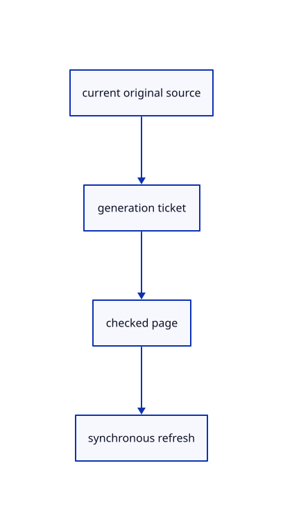

# 14.1.20 · Continue drawing reads without reviving closed sources

**Chapter 14 · Coordinates and geometry tools · Section 14.1 · Sheet queries and construction planes** · [Contents](contents.md)

**Typing: 19–38 minutes.** [Estimate](typing-load.md).

Require the current source, runtime, cancellation token and generation before adopting each page.

## Type

Continue from [Reserve memory before the drawing prefix](71r-reserve-memory-before-the-drawing-prefix.md). [Save or recover your work](recovery.md).

### 1. `src/sheet_stream.rs`

Continue checked drawing pages with explicit ownership and visible eviction refresh.

<details>
<summary>Locate the existing block</summary>

```rust
    })
}
#[cfg(test)]
mod tests {
```

</details>

Edit the existing block to match this code; keep unchanged lines:

```rust
--8<-- "journey/code/71s-continue-drawing-reads-without-reviving-closed-sources-01.rs"
```

## Run and check

Run this from `session_viewer` to select the fixed dependency versions and install supplied binary assets. It updates Cargo.lock and preserves the previous lock. It does not write implementation code:

```sh
npm --prefix ../session_tests run course -- dependencies 14.1.20
```

In your project:

```sh
cd workspace/journey
REGEN_PROTO=0 cargo build --lib --locked --target wasm32-unknown-unknown -j1
REGEN_PROTO=0 CARGO_BUILD_JOBS=1 trunk serve --port 8780
```

Open `http://127.0.0.1:8780/`. Keep an existing Trunk server running; saving rebuilds it.


### Recorded visual result

**Previous native render — current verification pending.**

The blue rotated and selected yellow mirrored references retain their original source definition.


*This recorded image predates a source or checker change. Rebuild this checkpoint before using it as current evidence; browser controls require separate acceptance.*

This reference image is shared with [13.2.5 · Exercise rotated and mirrored original references](70d-exercise-rotated-and-mirrored-original-references.md). It does not demonstrate a new feature by itself.

<details>
<summary>Code explanation and diagram</summary>


current original source → generation ticket → checked page → synchronous refresh.



When can an evicted page charge be reused?

After refresh drops its GPU owner and cancels old pick addresses. Other retained readers remain charged.

Study estimate, including typing and experiments: 0.5–1 hours.

</details>

<details>
<summary>Optional experiment</summary>

Trace chunk ceilings, eviction, failed reads and late replies after Close.

</details>

<details>
<summary>Check and save your work</summary>

Restore experimental edits, then run from `session_viewer`:

```sh
npm --prefix ../session_tests run course -- check 14.1.20
npm --prefix ../session_tests run course -- save 14.1.20
```

Source comparison leaves your project untouched. [Save and recovery instructions](recovery.md).

</details>

<details>
<summary>Viewer coverage and verification</summary>


The inherited nested-reference exercise remains authored and unrun. The final sheet contract covers complete archive reopening, repeated checked-range placements, metadata only after selection, bounded reads and Close during a lookup. Actual browser execution remains required.

[Full validation scope](release.md).

To reproduce the scripted acceptance of the reference checkpoint, run from `session_viewer` with the [course bundle server](release.md#reproduce) running on port 8781:

```sh
npm --prefix ../session_tests run course -- capture 14.1.20
```

This uses the verified reference bundle; it does not check or change your typed project.

</details>
