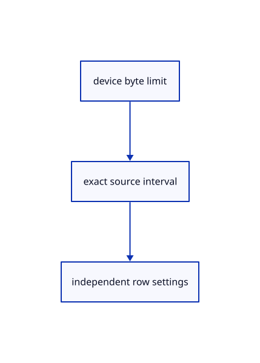

# 14.1.26 · Bound drawing buffers and pack independent settings

**Chapter 14 · Coordinates and geometry tools · Section 14.1 · Sheet queries and construction planes** · [Contents](contents.md)

**Typing: 12–24 minutes.** [Estimate](typing-load.md).

Split large resident pages at device limits and keep row identity, source address and style in independent settings.

## Type

Continue from [Own the shared drawing lane resources](71x-own-the-shared-drawing-lane-resources.md). [Save or recover your work](recovery.md).

### 1. `src/sheet_gpu.rs`

Bound source-buffer intervals and pack independent original owner settings.

<details>
<summary>Locate the existing block</summary>

```rust
    }
}
```

</details>

After that block, type:

```rust
--8<-- "journey/code/71y-bound-drawing-buffers-and-pack-independent-settings-01.rs" skip=8
```

<details>
<summary>Supplied validation fixture</summary>

Copy this supplied authoring fixture once. Continue with the browser build below; the course does not require running native tests.

### 2. `src/sheet_gpu.rs`

Copy exact original GPU interval fixtures.

<details>
<summary>Locate the existing block</summary>

```text
    Ok(out)
}
fn settings(scene: &Scene, row: &crate::sheet_source::Row, base: u32, selected: bool) -> Vec<u8> {
    let mut bytes = row
```

</details>

Update the existing block with this supplied code; keep unchanged lines:

```text
--8<-- "journey/code/71y-bound-drawing-buffers-and-pack-independent-settings-02.rs"
```

</details>

## Run and check

Run this from `session_viewer` to select the fixed dependency versions and install supplied binary assets. It updates Cargo.lock and preserves the previous lock. It does not write implementation code:

```sh
npm --prefix ../session_tests run course -- dependencies 14.1.26
```

In your project:

```sh
cd workspace/journey
REGEN_PROTO=0 cargo build --lib --locked --target wasm32-unknown-unknown -j1
REGEN_PROTO=0 CARGO_BUILD_JOBS=1 trunk serve --port 8780
```

Open `http://127.0.0.1:8780/`. Keep an existing Trunk server running; saving rebuilds it.


### Recorded visual result

**Previous native render — current verification pending.**

The blue rotated and selected yellow mirrored references retain their original source definition.


*This recorded image predates a source or checker change. Rebuild this checkpoint before using it as current evidence; browser controls require separate acceptance.*

This reference image is shared with [13.2.5 · Exercise rotated and mirrored original references](70d-exercise-rotated-and-mirrored-original-references.md). It does not demonstrate a new feature by itself.

<details>
<summary>Code explanation and diagram</summary>


device byte limit → exact source interval → independent row settings.



Does splitting a buffer renumber original entities?

No. Preserve each original interval and offset its compact address base; original entity IDs stay in the source table.

Study estimate, including typing and experiments: 0.5–1 hours.

</details>

<details>
<summary>Optional experiment</summary>

Copy exact chunk-limit fixtures and inspect packed model, color and eligibility words.

</details>

<details>
<summary>Check and save your work</summary>

Restore experimental edits, then run from `session_viewer`:

```sh
npm --prefix ../session_tests run course -- check 14.1.26
npm --prefix ../session_tests run course -- save 14.1.26
```

Source comparison leaves your project untouched. [Save and recovery instructions](recovery.md).

</details>

<details>
<summary>Viewer coverage and verification</summary>


The inherited nested-reference exercise remains authored and unrun. The final sheet contract covers complete archive reopening, repeated checked-range placements, metadata only after selection, bounded reads and Close during a lookup. Actual browser execution remains required.

[Full validation scope](release.md).

To reproduce the scripted acceptance of the reference checkpoint, run from `session_viewer` with the [course bundle server](release.md#reproduce) running on port 8781:

```sh
npm --prefix ../session_tests run course -- capture 14.1.26
```

This uses the verified reference bundle; it does not check or change your typed project.

</details>
