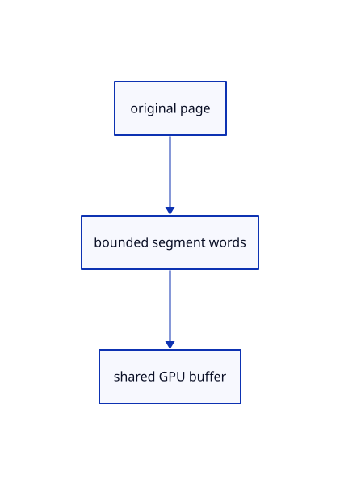

# 14.1.27 · Upload each original drawing page once

**Chapter 14 · Coordinates and geometry tools · Section 14.1 · Sheet queries and construction planes** · [Contents](contents.md)

**Typing: 21–41 minutes.** [Estimate](typing-load.md).

Cache source-owned32-byte segment buffers while retaining their resident or charged page owner.

## Type

Continue from [Bound drawing buffers and pack independent settings](71y-bound-drawing-buffers-and-pack-independent-settings.md). [Save or recover your work](recovery.md).

### 1. `src/sheet_gpu.rs`

Reuse original page uploads while retaining their payload ownership.

<details>
<summary>Locate the existing block</summary>

```rust
        }
    }
}
pub fn chunks(count: u32, bytes: u64) -> Result<Vec<std::ops::Range<u32>>, &'static str> {
```

</details>

Edit the existing block to match this code; keep unchanged lines:

```rust
--8<-- "journey/code/71z-upload-each-original-drawing-page-once-01.rs"
```

## Run and check

Run this from `session_viewer` to select the fixed dependency versions and install supplied binary assets. It updates Cargo.lock and preserves the previous lock. It does not write implementation code:

```sh
npm --prefix ../session_tests run course -- dependencies 14.1.27
```

In your project:

```sh
cd workspace/journey
REGEN_PROTO=0 cargo build --lib --locked --target wasm32-unknown-unknown -j1
REGEN_PROTO=0 CARGO_BUILD_JOBS=1 trunk serve --port 8780
```

Open `http://127.0.0.1:8780/`. Keep an existing Trunk server running; saving rebuilds it.


### Recorded visual result

**Previous native render — current verification pending.**

The blue rotated and selected yellow mirrored references retain their original source definition.


*This recorded image predates a source or checker change. Rebuild this checkpoint before using it as current evidence; browser controls require separate acceptance.*

This reference image is shared with [13.2.5 · Exercise rotated and mirrored original references](70d-exercise-rotated-and-mirrored-original-references.md). It does not demonstrate a new feature by itself.

<details>
<summary>Code explanation and diagram</summary>


original page → bounded segment words → shared GPU buffer.



Can a GPU buffer outlive an evicted cache entry?

Yes. Retain the charged page alongside that buffer, so memory cannot be reused while display still owns it.

Study estimate, including typing and experiments: 0.5–1 hours.

</details>

<details>
<summary>Optional experiment</summary>

Compare repeated placements, original page keys and exact upload-byte counters.

</details>

<details>
<summary>Check and save your work</summary>

Restore experimental edits, then run from `session_viewer`:

```sh
npm --prefix ../session_tests run course -- check 14.1.27
npm --prefix ../session_tests run course -- save 14.1.27
```

Source comparison leaves your project untouched. [Save and recovery instructions](recovery.md).

</details>

<details>
<summary>Viewer coverage and verification</summary>


The inherited nested-reference exercise remains authored and unrun. The final sheet contract covers complete archive reopening, repeated checked-range placements, metadata only after selection, bounded reads and Close during a lookup. Actual browser execution remains required.

[Full validation scope](release.md).

To reproduce the scripted acceptance of the reference checkpoint, run from `session_viewer` with the [course bundle server](release.md#reproduce) running on port 8781:

```sh
npm --prefix ../session_tests run course -- capture 14.1.27
```

This uses the verified reference bundle; it does not check or change your typed project.

</details>
