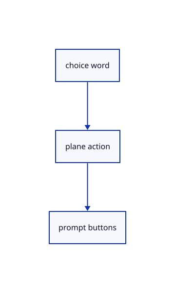

# 14.2.4 · Name the construction plane chooser options

**Chapter 14 · Coordinates and geometry tools · Section 14.2 · Coordinates and drawing tools** · [Contents](contents.md)

**Typing: 2–4 minutes.** [Estimate](typing-load.md).

Keep XY, XZ, YZ,3 Point,View and Cancel in one typed option table.

## Type

Continue from [Place clicks on stable construction planes](72b-place-clicks-on-stable-construction-planes.md). [Save or recover your work](recovery.md).

### 1. `src/drawing_input.rs`

Describe current construction-plane options without silently changing a plane.

<details>
<summary>Locate the existing block</summary>

```rust
    if distance>ray.max_distance {return None;}crate::tool_coords::checked([hit[0],hit[1],hit[2]]).ok()
}
```

</details>

After that block, type:

```rust
--8<-- "journey/code/72c-name-the-construction-plane-chooser-options-01.rs" skip=107
```

## Run and check

Run this from `session_viewer` to select the fixed dependency versions and install supplied binary assets. It updates Cargo.lock and preserves the previous lock. It does not write implementation code:

```sh
npm --prefix ../session_tests run course -- dependencies 14.2.4
```

In your project:

```sh
cd workspace/journey
REGEN_PROTO=0 cargo build --lib --locked --target wasm32-unknown-unknown -j1
REGEN_PROTO=0 CARGO_BUILD_JOBS=1 trunk serve --port 8780
```

Open `http://127.0.0.1:8780/`. Keep an existing Trunk server running; saving rebuilds it.


### Recorded visual result

**Previous native render — current verification pending.**

Original black physical drawing pens and the blue hairline remain visible.


*This recorded image predates a source or checker change. Rebuild this checkpoint before using it as current evidence; browser controls require separate acceptance.*

This reference image is shared with [14.1.37 · Exercise complete and ranged original drawings](71aj-exercise-complete-and-ranged-original-drawings.md). It does not demonstrate a new feature by itself.

<details>
<summary>Code explanation and diagram</summary>


choice word → plane action → prompt buttons.



Should bare CPlane silently select XY?

No. It opens the chooser. An explicit option sets the fixed plane or restores View mode.

Study estimate, including typing and experiments: 0.5–1 hours.

</details>

<details>
<summary>Optional experiment</summary>

Inspect command strings for each option; their Editor actions connect after the draft state.

</details>

<details>
<summary>Check and save your work</summary>

Restore experimental edits, then run from `session_viewer`:

```sh
npm --prefix ../session_tests run course -- check 14.2.4
npm --prefix ../session_tests run course -- save 14.2.4
```

Source comparison leaves your project untouched. [Save and recovery instructions](recovery.md).

</details>

<details>
<summary>Viewer coverage and verification</summary>


The inherited drawing/sheet contracts remain authored and unrun. The completed exercise adds fixed-plane input, original coordinate diagnostics, invalid drafts, Close, Undo/Redo and Save/Open; actual browser execution remains required.

[Full validation scope](release.md).

To reproduce the scripted acceptance of the reference checkpoint, run from `session_viewer` with the [course bundle server](release.md#reproduce) running on port 8781:

```sh
npm --prefix ../session_tests run course -- capture 14.2.4
```

This uses the verified reference bundle; it does not check or change your typed project.

</details>
