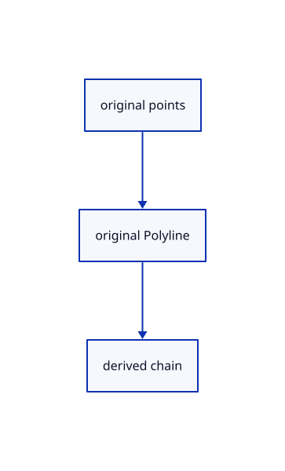

# 14.2.5 · Add original polylines to the point tool

**Chapter 14 · Coordinates and geometry tools · Section 14.2 · Coordinates and drawing tools** · [Contents](contents.md)

**Typing: 11–22 minutes.** [Estimate](typing-load.md).

Reuse original point collection and prepare one kernel Polyline after enough distinct points exist.

## Type

Continue from [Name the construction plane chooser options](72c-name-the-construction-plane-chooser-options.md). [Save or recover your work](recovery.md).

### 1. `src/tool.rs`

Prepare original bounded polylines beside existing point, line and Move tools.

<details>
<summary>Locate the existing block</summary>

```rust
use crate::{marker::PreparedPoint, stroke::PreparedLine};
use std::rc::Rc;

pub enum Built { Point(PreparedPoint), Line(PreparedLine), Move([f64; 3]) }

pub trait Tool: std::fmt::Debug {
    fn name(&self) -> &'static str;
    fn count(&self) -> usize;
    fn build(&self, points: &[[f64; 3]]) -> Result<Built, &'static str>;
    fn buttons(&self) -> Vec<(String, String)> { vec![("Cancel".into(), "Escape".into())] }
}

#[derive(Clone, Copy, Debug)]
pub enum Shape { Point, Line, Move }

impl Tool for Shape {
    fn name(&self) -> &'static str { match self { Self::Point => "Point", Self::Line => "Line", Self::Move => "Move" } }
    fn count(&self) -> usize { match self { Self::Point => 1, Self::Line | Self::Move => 2 } }
    fn build(&self, points: &[[f64; 3]]) -> Result<Built, &'static str> {
        match (self, points) {
            (Self::Point, [p]) => Ok(Built::Point(PreparedPoint::new(Rc::new(session_rust::Point::new(p[0], p[1], p[2])))?)),
            (Self::Line, [a, b]) => {
                if a.iter().zip(b).all(|(a, b)| (a-b).abs() < 1e-12) { return Err("Line endpoints must differ"); }
                Ok(Built::Line(PreparedLine::new(Rc::new(session_rust::Line::new(a[0], a[1], a[2], b[0], b[1], b[2])))?))
            }
            (Self::Move, [a,b]) => Ok(Built::Move(std::array::from_fn(|i| b[i]-a[i]))),
            _ => Err("The tool needs more points"),
        }
    }
}

// A draft owns unfinished points and a cursor, so preview motion cannot become saved geometry or an Undo transaction.
pub struct Draft { pub tool: Box<dyn Tool>, pub points: Vec<[f64; 3]>, pub cursor: Option<[f64; 3]>, pub snapped: Option<crate::snap::Kind> }

impl Draft {
    pub fn new(shape: Shape) -> Self { Self { tool: Box::new(shape), points: Vec::new(), cursor: None, snapped: None } }
    pub fn prompt(&self) -> String {
        let mut prompt=format!("{} point {} of {} · Esc cancels", self.tool.name(), self.points.len()+1, self.tool.count());
        if let Some(kind)=self.snapped { prompt.push_str(&format!(" · Snap {kind:?}")); }
        prompt
    }
    pub fn submit(&mut self, point: [f64; 3]) -> Result<Option<Built>, &'static str> {
        let point = crate::tool_coords::checked(point)?;
        let mut points = self.points.clone(); points.push(point);
        if points.len() == self.tool.count() { return self.tool.build(&points).map(Some); }
        if points.len() > self.tool.count() { return Err("The tool has enough points"); }
        self.points = points; self.cursor = None; self.snapped = None; Ok(None)
    }
    pub fn hover(&mut self, point: Option<[f64; 3]>) -> Result<(), &'static str> {
        self.cursor = point.map(crate::tool_coords::checked).transpose()?; Ok(())
    }
}
```

</details>

Edit the existing block to match this code; keep unchanged lines:

```rust
use crate::{marker::PreparedPoint, stroke::PreparedLine};
use std::rc::Rc;

pub enum Built { Point(PreparedPoint), Line(PreparedLine), Move([f64; 3]), Polyline(crate::chain::PreparedChain) }

pub trait Tool: std::fmt::Debug {
    fn name(&self) -> &'static str;
    fn count(&self) -> usize;
    fn build(&self, points: &[[f64; 3]]) -> Result<Built, &'static str>;
    fn buttons(&self) -> Vec<(String, String)> { vec![("Cancel".into(), "Escape".into())] }
}

#[derive(Clone, Copy, Debug)]
pub enum Shape { Point, Line, Move, Polyline }

impl Tool for Shape {
    fn name(&self) -> &'static str { match self { Self::Point => "Point", Self::Line => "Line", Self::Move => "Move", Self::Polyline => "Polyline" } }
    fn count(&self) -> usize { match self { Self::Point => 1, Self::Line | Self::Move => 2, Self::Polyline => 0 } }
    fn build(&self, points: &[[f64; 3]]) -> Result<Built, &'static str> {
        match (self, points) {
            (Self::Point, [p]) => Ok(Built::Point(PreparedPoint::new(Rc::new(session_rust::Point::new(p[0], p[1], p[2])))?)),
            (Self::Line, [a, b]) => {
                if a.iter().zip(b).all(|(a, b)| (a-b).abs() < 1e-12) { return Err("Line endpoints must differ"); }
                Ok(Built::Line(PreparedLine::new(Rc::new(session_rust::Line::new(a[0], a[1], a[2], b[0], b[1], b[2])))?))
            }
            (Self::Move, [a,b]) => Ok(Built::Move(std::array::from_fn(|i| b[i]-a[i]))),
            (Self::Polyline, points) if (2..=MAX_POINTS).contains(&points.len()) => {
                if !points.windows(2).any(|p| p[0] != p[1]) { return Err("Polyline points must differ"); }
                let points=points.iter().map(|p|session_rust::Point::new(p[0],p[1],p[2])).collect();
                Ok(Built::Polyline(crate::chain::PreparedChain::polyline(Rc::new(session_rust::Polyline::new(points)))?))
            }
            _ => Err("The tool needs more points"),
        }
    }
}

pub const MAX_POINTS: usize = 4096;

// A draft owns unfinished points and a cursor, so preview motion cannot become saved geometry or an Undo transaction.
pub struct Draft { pub tool: Box<dyn Tool>, pub points: Vec<[f64; 3]>, pub cursor: Option<[f64; 3]>, pub snapped: Option<crate::snap::Kind> }

impl Draft {
    pub fn new(shape: Shape) -> Self { Self { tool: Box::new(shape), points: Vec::new(), cursor: None, snapped: None } }
    pub fn prompt(&self) -> String {
        let mut prompt=format!("{} point {} of {} · Esc cancels", self.tool.name(), self.points.len()+1, self.tool.count());
        if let Some(kind)=self.snapped { prompt.push_str(&format!(" · Snap {kind:?}")); }
        prompt
    }
    pub fn submit(&mut self, point: [f64; 3]) -> Result<Option<Built>, &'static str> {
        let point = crate::tool_coords::checked(point)?;
        let mut points = self.points.clone(); points.push(point);
        if points.len() == self.tool.count() { return self.tool.build(&points).map(Some); }
        if points.len() > self.tool.count() { return Err("The tool has enough points"); }
        self.points = points; self.cursor = None; self.snapped = None; Ok(None)
    }
    pub fn hover(&mut self, point: Option<[f64; 3]>) -> Result<(), &'static str> {
        self.cursor = point.map(crate::tool_coords::checked).transpose()?; Ok(())
    }
}
```

<details>
<summary>Optional patch references</summary>

Use these original edit fragments when comparing a saved checkpoint. Apply the complete blocks above.

```text
--8<-- "journey/code/72d-add-original-polylines-to-the-point-tool-01.rs"
```

```text
--8<-- "journey/code/72d-add-original-polylines-to-the-point-tool-02.rs"
```

```text
--8<-- "journey/code/72d-add-original-polylines-to-the-point-tool-03.rs"
```

</details>

### 2. `src/drawing_input.rs`

Share the same original point cap with coordinate parsing.

<details>
<summary>Locate the existing block</summary>

```rust
    let (x,y)=frame.axes();let mut all=previous.to_vec();let mut added=Vec::new();
    for word in text.split_whitespace() {
        if all.len()>=4096 {return Err("Drawing commands accept at most 4096 points");}
        if word.trim_start_matches(['w','W','@']).split([',','<']).any(|part|part.parse::<f64>().is_ok_and(|v|!v.is_finite())) {return Err("Coordinates must be finite and within ±1e12");}
        let (typed,world)=coords::parse_world(word).ok_or("Use x,y,z, @x,y,z, distance<angle, or w for world")?;
```

</details>

Edit the existing block to match this code; keep unchanged lines:

```rust
--8<-- "journey/code/72d-add-original-polylines-to-the-point-tool-04.rs"
```

### 3. `src/editor.rs`

Adopt a completed original polyline through the existing history transaction.

<details>
<summary>Locate the existing block</summary>

```rust
            crate::tool::Built::Point(point) => scene.insert_point(point).map(|_| ()),
            crate::tool::Built::Line(line) => scene.insert_line(line).map(|_| ()),
            crate::tool::Built::Move(_) => unreachable!("Move uses its placement preview"),
        })?;
```

</details>

Edit the existing block to match this code; keep unchanged lines:

```rust
--8<-- "journey/code/72d-add-original-polylines-to-the-point-tool-05.rs"
```

## Run and check

Run this from `session_viewer` to select the fixed dependency versions and install supplied binary assets. It updates Cargo.lock and preserves the previous lock. It does not write implementation code:

```sh
npm --prefix ../session_tests run course -- dependencies 14.2.5
```

In your project:

```sh
cd workspace/journey
REGEN_PROTO=0 cargo build --lib --locked --target wasm32-unknown-unknown -j1
REGEN_PROTO=0 CARGO_BUILD_JOBS=1 trunk serve --port 8780
```

Open `http://127.0.0.1:8780/`. Keep an existing Trunk server running; saving rebuilds it.


### Recorded visual result

**Previous native render — current verification pending.**

Original black physical drawing pens and the blue hairline remain visible.


*This recorded image predates a source or checker change. Rebuild this checkpoint before using it as current evidence; browser controls require separate acceptance.*

This reference image is shared with [14.1.37 · Exercise complete and ranged original drawings](71aj-exercise-complete-and-ranged-original-drawings.md). It does not demonstrate a new feature by itself.

<details>
<summary>Code explanation and diagram</summary>


original points → original Polyline → derived chain.



Does a polyline have a fixed point count?

No. Zero means an open collector; Enter or Close completes it after at least two points.

Study estimate, including typing and experiments: 0.5–1 hours.

</details>

<details>
<summary>Optional experiment</summary>

Compare fixed Point and Line counts with the bounded open Polyline collector.

</details>

<details>
<summary>Check and save your work</summary>

Restore experimental edits, then run from `session_viewer`:

```sh
npm --prefix ../session_tests run course -- check 14.2.5
npm --prefix ../session_tests run course -- save 14.2.5
```

Source comparison leaves your project untouched. [Save and recovery instructions](recovery.md).

</details>

<details>
<summary>Viewer coverage and verification</summary>


The inherited drawing/sheet contracts remain authored and unrun. The completed exercise adds fixed-plane input, original coordinate diagnostics, invalid drafts, Close, Undo/Redo and Save/Open; actual browser execution remains required.

[Full validation scope](release.md).

To reproduce the scripted acceptance of the reference checkpoint, run from `session_viewer` with the [course bundle server](release.md#reproduce) running on port 8781:

```sh
npm --prefix ../session_tests run course -- capture 14.2.5
```

This uses the verified reference bundle; it does not check or change your typed project.

</details>
