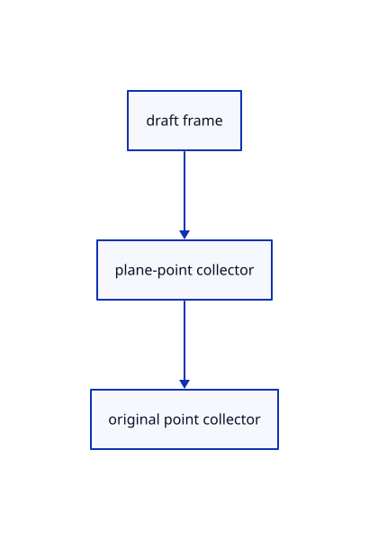

# 14.2.6 · Keep construction frames and plane points in drafts

**Chapter 14 · Coordinates and geometry tools · Section 14.2 · Coordinates and drawing tools** · [Contents](contents.md)

**Typing: 8–16 minutes.** [Estimate](typing-load.md).

Retain one frame and a separate three-point collector; neither changes original geometry during preview.

## Type

Continue from [Add original polylines to the point tool](72d-add-original-polylines-to-the-point-tool.md). [Save or recover your work](recovery.md).

### 1. `src/tool.rs`

Own separate construction-plane points and current drawing prompts.

<details>
<summary>Locate the existing block</summary>

```rust

// A draft owns unfinished points and a cursor, so preview motion cannot become saved geometry or an Undo transaction.
pub struct Draft { pub tool: Box<dyn Tool>, pub points: Vec<[f64; 3]>, pub cursor: Option<[f64; 3]>, pub snapped: Option<crate::snap::Kind> }

impl Draft {
    pub fn new(shape: Shape) -> Self { Self { tool: Box::new(shape), points: Vec::new(), cursor: None, snapped: None } }
    pub fn prompt(&self) -> String {
        let mut prompt=format!("{} point {} of {} · Esc cancels", self.tool.name(), self.points.len()+1, self.tool.count());
        if let Some(kind)=self.snapped { prompt.push_str(&format!(" · Snap {kind:?}")); }
        prompt
```

</details>

Edit the existing block to match this code; keep unchanged lines:

```rust
--8<-- "journey/code/72e-keep-construction-frames-and-plane-points-in-drafts-01.rs"
```

## Run and check

Run this from `session_viewer` to select the fixed dependency versions and install supplied binary assets. It updates Cargo.lock and preserves the previous lock. It does not write implementation code:

```sh
npm --prefix ../session_tests run course -- dependencies 14.2.6
```

In your project:

```sh
cd workspace/journey
REGEN_PROTO=0 cargo build --lib --locked --target wasm32-unknown-unknown -j1
REGEN_PROTO=0 CARGO_BUILD_JOBS=1 trunk serve --port 8780
```

Open `http://127.0.0.1:8780/`. Keep an existing Trunk server running; saving rebuilds it.


### Recorded visual result

**Previous native render — current verification pending.**

Original black physical drawing pens and the blue hairline remain visible.


*This recorded image predates a source or checker change. Rebuild this checkpoint before using it as current evidence; browser controls require separate acceptance.*

This reference image is shared with [14.1.37 · Exercise complete and ranged original drawings](71aj-exercise-complete-and-ranged-original-drawings.md). It does not demonstrate a new feature by itself.

<details>
<summary>Code explanation and diagram</summary>


draft frame → plane-point collector → original point collector.



Are the three plane points also polyline vertices?

No. They define the input frame and leave the accepted original shape points unchanged.

Study estimate, including typing and experiments: 0.5–1 hours.

</details>

<details>
<summary>Optional experiment</summary>

Inspect fixed-count and open-tool prompts, cursor reset and separate plane-point progress.

</details>

<details>
<summary>Check and save your work</summary>

Restore experimental edits, then run from `session_viewer`:

```sh
npm --prefix ../session_tests run course -- check 14.2.6
npm --prefix ../session_tests run course -- save 14.2.6
```

Source comparison leaves your project untouched. [Save and recovery instructions](recovery.md).

</details>

<details>
<summary>Viewer coverage and verification</summary>


The inherited drawing/sheet contracts remain authored and unrun. The completed exercise adds fixed-plane input, original coordinate diagnostics, invalid drafts, Close, Undo/Redo and Save/Open; actual browser execution remains required.

[Full validation scope](release.md).

To reproduce the scripted acceptance of the reference checkpoint, run from `session_viewer` with the [course bundle server](release.md#reproduce) running on port 8781:

```sh
npm --prefix ../session_tests run course -- capture 14.2.6
```

This uses the verified reference bundle; it does not check or change your typed project.

</details>
