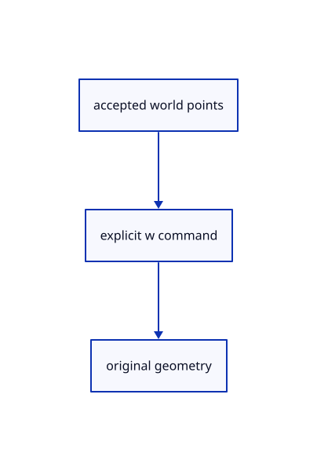

# 14.2.7 · Replay finished drafts with explicit world prefixes

**Chapter 14 · Coordinates and geometry tools · Section 14.2 · Coordinates and drawing tools** · [Contents](contents.md)

**Typing: 15–29 minutes.** [Estimate](typing-load.md).

Write every finished original point with w before reparsing it under the active fixed plane.

## Type

Continue from [Keep construction frames and plane points in drafts](72e-keep-construction-frames-and-plane-points-in-drafts.md). [Save or recover your work](recovery.md).

### 1. `src/tool.rs`

Validate bounded batches and preserve original world positions through finished-command replay.

<details>
<summary>Locate the existing block</summary>

```rust
        prompt
    }
    pub fn submit(&mut self, point: [f64; 3]) -> Result<Option<Built>, &'static str> {
        let point = crate::tool_coords::checked(point)?;
        let mut points = self.points.clone(); points.push(point);
        if points.len() == self.tool.count() { return self.tool.build(&points).map(Some); }
        if points.len() > self.tool.count() { return Err("The tool has enough points"); }
        self.points = points; self.cursor = None; self.snapped = None; Ok(None)
    }
    pub fn hover(&mut self, point: Option<[f64; 3]>) -> Result<(), &'static str> {
```

</details>

Edit the existing block to match this code; keep unchanged lines:

```rust
--8<-- "journey/code/72f-replay-finished-drafts-with-explicit-world-prefixes-01.rs"
```

## Run and check

Run this from `session_viewer` to select the fixed dependency versions and install supplied binary assets. It updates Cargo.lock and preserves the previous lock. It does not write implementation code:

```sh
npm --prefix ../session_tests run course -- dependencies 14.2.7
```

In your project:

```sh
cd workspace/journey
REGEN_PROTO=0 cargo build --lib --locked --target wasm32-unknown-unknown -j1
REGEN_PROTO=0 CARGO_BUILD_JOBS=1 trunk serve --port 8780
```

Open `http://127.0.0.1:8780/`. Keep an existing Trunk server running; saving rebuilds it.


### Recorded visual result

**Previous native render — current verification pending.**

Original black physical drawing pens and the blue hairline remain visible.


*This recorded image predates a source or checker change. Rebuild this checkpoint before using it as current evidence; browser controls require separate acceptance.*

This reference image is shared with [14.1.37 · Exercise complete and ranged original drawings](71aj-exercise-complete-and-ranged-original-drawings.md). It does not demonstrate a new feature by itself.

<details>
<summary>Code explanation and diagram</summary>


accepted world points → explicit w command → original geometry.



What happens without the world prefix?

A translated or tilted fixed plane transforms already placed points a second time. The latest maintained commit prevents that.

Study estimate, including typing and experiments: 0.5–1 hours.

</details>

<details>
<summary>Optional experiment</summary>

Compare Line w4,5,6 w9,8,7 with unprefixed local coordinates under a translated three-point frame.

</details>

<details>
<summary>Check and save your work</summary>

Restore experimental edits, then run from `session_viewer`:

```sh
npm --prefix ../session_tests run course -- check 14.2.7
npm --prefix ../session_tests run course -- save 14.2.7
```

Source comparison leaves your project untouched. [Save and recovery instructions](recovery.md).

</details>

<details>
<summary>Viewer coverage and verification</summary>


The inherited drawing/sheet contracts remain authored and unrun. The completed exercise adds fixed-plane input, original coordinate diagnostics, invalid drafts, Close, Undo/Redo and Save/Open; actual browser execution remains required.

[Full validation scope](release.md).

To reproduce the scripted acceptance of the reference checkpoint, run from `session_viewer` with the [course bundle server](release.md#reproduce) running on port 8781:

```sh
npm --prefix ../session_tests run course -- capture 14.2.7
```

This uses the verified reference bundle; it does not check or change your typed project.

</details>
