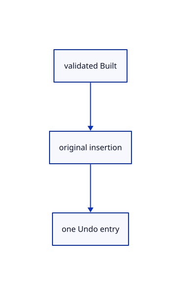

# 14.2.9 · Commit completed original geometry exactly once

**Chapter 14 · Coordinates and geometry tools · Section 14.2 · Coordinates and drawing tools** · [Contents](contents.md)

**Typing: 12–23 minutes.** [Estimate](typing-load.md).

Separate the validated tool result from its one history transaction; Move keeps its existing placement preview.

## Type

Continue from [Own the fixed construction plane in the editor](72g-own-the-fixed-construction-plane-in-the-editor.md). [Save or recover your work](recovery.md).

### 1. `src/editor.rs`

Commit completed originals once and preserve the existing Move preview contract.

<details>
<summary>Locate the existing block</summary>

```rust
    }

    fn place_tool_point(&mut self, point: [f64; 3]) -> Result<Change, &'static str> {
        let draft = self.draft.as_mut().ok_or("No point tool is running")?;
        let name = draft.tool.name();
        let Some(built) = draft.submit(point)? else { self.tool_status = draft.prompt(); self.snap_index=None; return self.update_edit_preview(); };
        if let crate::tool::Built::Move(offset)=built {
            let preview=self.edit_preview.as_mut().ok_or("No placement preview is running")?;
            preview.set(session_rust::Xform::translation(offset[0],offset[1],offset[2]))?;
            let changed=preview.commit(&mut self.scene,&mut self.history)?;
            if self.edit_preview.take().is_some() { self.draft=None; } self.tool_status="Move completed.".into();
            return Ok(if changed { Change::Scene } else { Change::Preview });
        }
        self.history.try_edit(&mut self.scene, |scene| match built {
            crate::tool::Built::Point(point) => scene.insert_point(point).map(|_| ()),
            crate::tool::Built::Line(line) => scene.insert_line(line).map(|_| ()),
            crate::tool::Built::Polyline(line)=>scene.insert_path(line).map(|_|()),
            crate::tool::Built::Move(_) => unreachable!("Move uses its placement preview"),
        })?;
        self.draft = None; self.tool_status = format!("{name} created."); Ok(Change::Scene)
    }
```

</details>

Edit the existing block to match this code; keep unchanged lines:

```rust
--8<-- "journey/code/72h-commit-completed-original-geometry-exactly-once-01.rs"
```

## Run and check

Run this from `session_viewer` to select the fixed dependency versions and install supplied binary assets. It updates Cargo.lock and preserves the previous lock. It does not write implementation code:

```sh
npm --prefix ../session_tests run course -- dependencies 14.2.9
```

In your project:

```sh
cd workspace/journey
REGEN_PROTO=0 cargo build --lib --locked --target wasm32-unknown-unknown -j1
REGEN_PROTO=0 CARGO_BUILD_JOBS=1 trunk serve --port 8780
```

Open `http://127.0.0.1:8780/`. Keep an existing Trunk server running; saving rebuilds it.


### Recorded visual result

**Previous native render — current verification pending.**

Original black physical drawing pens and the blue hairline remain visible.


*This recorded image predates a source or checker change. Rebuild this checkpoint before using it as current evidence; browser controls require separate acceptance.*

This reference image is shared with [14.1.37 · Exercise complete and ranged original drawings](71aj-exercise-complete-and-ranged-original-drawings.md). It does not demonstrate a new feature by itself.

<details>
<summary>Code explanation and diagram</summary>


validated Built → original insertion → one Undo entry.



Does cursor movement belong in history?

No. Only the completed original geometry or placement is committed. A cancelled draft preserves the existing Redo branch.

Study estimate, including typing and experiments: 0.5–1 hours.

</details>

<details>
<summary>Optional experiment</summary>

Compare original point/line/polyline insertion with the existing Move placement preview.

</details>

<details>
<summary>Check and save your work</summary>

Restore experimental edits, then run from `session_viewer`:

```sh
npm --prefix ../session_tests run course -- check 14.2.9
npm --prefix ../session_tests run course -- save 14.2.9
```

Source comparison leaves your project untouched. [Save and recovery instructions](recovery.md).

</details>

<details>
<summary>Viewer coverage and verification</summary>


The inherited drawing/sheet contracts remain authored and unrun. The completed exercise adds fixed-plane input, original coordinate diagnostics, invalid drafts, Close, Undo/Redo and Save/Open; actual browser execution remains required.

[Full validation scope](release.md).

To reproduce the scripted acceptance of the reference checkpoint, run from `session_viewer` with the [course bundle server](release.md#reproduce) running on port 8781:

```sh
npm --prefix ../session_tests run course -- capture 14.2.9
```

This uses the verified reference bundle; it does not check or change your typed project.

</details>
