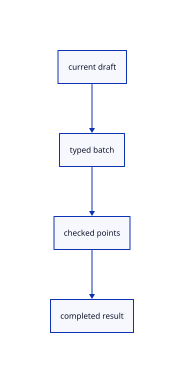

# 14.2.12 · Resolve typed input against the current draft

**Chapter 14 · Coordinates and geometry tools · Section 14.2 · Coordinates and drawing tools** · [Contents](contents.md)

**Typing: 8–15 minutes.** [Estimate](typing-load.md).

Use accepted points, hover direction and the current fixed plane to resolve one atomic coordinate batch.

## Type

Continue from [Open the plane chooser and collect its frame](72j-open-the-plane-chooser-and-collect-its-frame.md). [Save or recover your work](recovery.md).

### 1. `src/editor.rs`

Resolve typed batches before mutating the current original-point collector.

<details>
<summary>Locate the existing block</summary>

```rust
        })?;
        self.draft=None;self.tool_status=format!("{name} created.");Ok(Change::Scene)
    }
```

</details>

After that block, type:

```rust
--8<-- "journey/code/72k-resolve-typed-input-against-the-current-draft-01.rs" skip=106
```

## Run and check

Run this from `session_viewer` to select the fixed dependency versions and install supplied binary assets. It updates Cargo.lock and preserves the previous lock. It does not write implementation code:

```sh
npm --prefix ../session_tests run course -- dependencies 14.2.12
```

In your project:

```sh
cd workspace/journey
REGEN_PROTO=0 cargo build --lib --locked --target wasm32-unknown-unknown -j1
REGEN_PROTO=0 CARGO_BUILD_JOBS=1 trunk serve --port 8780
```

Open `http://127.0.0.1:8780/`. Keep an existing Trunk server running; saving rebuilds it.


### Recorded visual result

**Previous native render — current verification pending.**

Original black physical drawing pens and the blue hairline remain visible.


*This recorded image predates a source or checker change. Rebuild this checkpoint before using it as current evidence; browser controls require separate acceptance.*

This reference image is shared with [14.1.37 · Exercise complete and ranged original drawings](71aj-exercise-complete-and-ranged-original-drawings.md). It does not demonstrate a new feature by itself.

<details>
<summary>Code explanation and diagram</summary>


current draft → typed batch → checked points → completed result.



Can distance input infer a direction without hover?

No. It needs a previous point and cursor direction. Relative input needs a previous point; polar input uses the current axes.

Study estimate, including typing and experiments: 0.5–1 hours.

</details>

<details>
<summary>Optional experiment</summary>

Try1,2,3, @1,0,5<90 and5 after moving the cursor, then a malformed batch.

</details>

<details>
<summary>Check and save your work</summary>

Restore experimental edits, then run from `session_viewer`:

```sh
npm --prefix ../session_tests run course -- check 14.2.12
npm --prefix ../session_tests run course -- save 14.2.12
```

Source comparison leaves your project untouched. [Save and recovery instructions](recovery.md).

</details>

<details>
<summary>Viewer coverage and verification</summary>


The inherited drawing/sheet contracts remain authored and unrun. The completed exercise adds fixed-plane input, original coordinate diagnostics, invalid drafts, Close, Undo/Redo and Save/Open; actual browser execution remains required.

[Full validation scope](release.md).

To reproduce the scripted acceptance of the reference checkpoint, run from `session_viewer` with the [course bundle server](release.md#reproduce) running on port 8781:

```sh
npm --prefix ../session_tests run course -- capture 14.2.12
```

This uses the verified reference bundle; it does not check or change your typed project.

</details>
