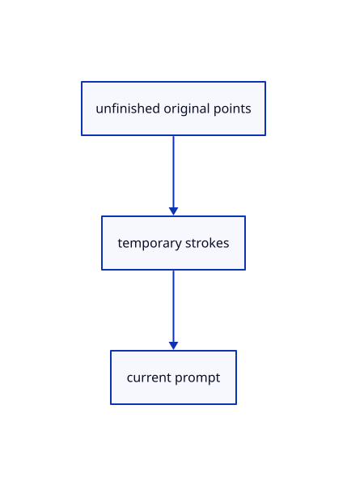

# 14.2.18 · Preview accepted segments without committing originals

**Chapter 14 · Coordinates and geometry tools · Section 14.2 · Coordinates and drawing tools** · [Contents](contents.md)

**Typing: 6–12 minutes.** [Estimate](typing-load.md).

Draw temporary accepted segments plus the current cursor; connect the chooser and original-coordinate diagnostics.

## Type

Continue from [Register current drawing commands and plane choices](72p-register-current-drawing-commands-and-plane-choices.md). [Save or recover your work](recovery.md).

### 1. `src/tool_preview.rs`

Preview accepted draft segments and cursor motion without scene or history changes.

<details>
<summary>Locate the existing block</summary>

```rust
    pub fn set(&mut self, device: &wgpu::Device, draft: Option<&Draft>) -> Result<(), &'static str> {
        let yellow = [1., 0.75, 0.05, 1.]; let mut strokes = Vec::new(); let mut markers = Vec::new();
        if let Some(draft) = draft { if let Some(cursor) = draft.cursor {
            markers.push(crate::marker::Marker { center: cursor.map(|v| v as f32), diameter: 8., colour: yellow });
            if let Some(&start) = draft.points.last().filter(|&&p| p != cursor) {
```

</details>

Edit the existing block to match this code; keep unchanged lines:

```rust
--8<-- "journey/code/72q-preview-accepted-segments-without-committing-originals-01.rs"
```

### 2. `src/browser.rs`

Connect the current construction-plane chooser and drawing controls.

<details>
<summary>Locate the existing block</summary>

```rust
            }
        }
        if let Some(draft) = editor.draft.as_ref() { panel.tool(draft.prompt(), draft.tool.buttons()); }
        else { panel.tool(String::new(), Vec::new()); }
        if let Some(reply)=text_fonts.reply.borrow_mut().take() {match reply {Ok(fonts)=>{if let Err(error)=renderer.replace_text_fonts(fonts) {text_fonts.failed();panel.result(&format!("Text: {error}"));}},Err(error)=>panel.result(&format!("Text: {error}"))}}
```

</details>

Edit the existing block to match this code; keep unchanged lines:

```rust
--8<-- "journey/code/72q-preview-accepted-segments-without-committing-originals-02.rs"
```

## Run and check

Run this from `session_viewer` to select the fixed dependency versions and install supplied binary assets. It updates Cargo.lock and preserves the previous lock. It does not write implementation code:

```sh
npm --prefix ../session_tests run course -- dependencies 14.2.18
```

In your project:

```sh
cd workspace/journey
REGEN_PROTO=0 cargo build --lib --locked --target wasm32-unknown-unknown -j1
REGEN_PROTO=0 CARGO_BUILD_JOBS=1 trunk serve --port 8780
```

Open `http://127.0.0.1:8780/`. Keep an existing Trunk server running; saving rebuilds it.


### Recorded visual result

**Previous native render — current verification pending.**

Original black physical drawing pens and the blue hairline remain visible.


*This recorded image predates a source or checker change. Rebuild this checkpoint before using it as current evidence; browser controls require separate acceptance.*

This reference image is shared with [14.1.37 · Exercise complete and ranged original drawings](71aj-exercise-complete-and-ranged-original-drawings.md). It does not demonstrate a new feature by itself.

<details>
<summary>Code explanation and diagram</summary>


unfinished original points → temporary strokes → current prompt.



Do preview segments appear in Save or Undo?

No. They are derived temporary display. The scene receives only the completed original geometry.

Study estimate, including typing and experiments: 0.5–1 hours.

</details>

<details>
<summary>Optional experiment</summary>

Add several Polyline points and move the cursor; inspect the original scene before Enter.

</details>

<details>
<summary>Check and save your work</summary>

Restore experimental edits, then run from `session_viewer`:

```sh
npm --prefix ../session_tests run course -- check 14.2.18
npm --prefix ../session_tests run course -- save 14.2.18
```

Source comparison leaves your project untouched. [Save and recovery instructions](recovery.md).

</details>

<details>
<summary>Viewer coverage and verification</summary>


The inherited drawing/sheet contracts remain authored and unrun. The completed exercise adds fixed-plane input, original coordinate diagnostics, invalid drafts, Close, Undo/Redo and Save/Open; actual browser execution remains required.

[Full validation scope](release.md).

To reproduce the scripted acceptance of the reference checkpoint, run from `session_viewer` with the [course bundle server](release.md#reproduce) running on port 8781:

```sh
npm --prefix ../session_tests run course -- capture 14.2.18
```

This uses the verified reference bundle; it does not check or change your typed project.

</details>
