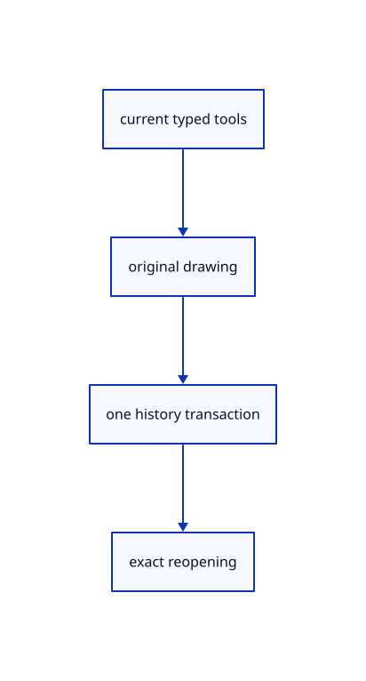

# 14.2.20 · Exercise current drawing tools and original persistence

**Chapter 14 · Coordinates and geometry tools · Section 14.2 · Coordinates and drawing tools** · [Contents](contents.md)

**Typing: 0–0 minutes.** [Estimate](typing-load.md).

Copy translated-plane replay, coordinate forms, open/closed polyline and original Save/Open regression fixtures.

## Type

Continue from [Expose original drawing coordinates and cancellation state](72r-expose-original-drawing-coordinates-and-cancellation-state.md). [Save or recover your work](recovery.md).

<details>
<summary>Supplied validation fixture</summary>

Copy this supplied authoring fixture once. Continue with the browser build below; the course does not require running native tests.

### 1. `src/drawing_tests.rs`

Copy precise current drawing, fixed-plane replay, bounded input and history fixtures.

Copy this supplied file:

```text
--8<-- "journey/code/72s-exercise-current-drawing-tools-and-original-persistence-01.rs"
```

</details>

<details>
<summary>Supplied validation fixture</summary>

Copy this supplied authoring fixture once. Continue with the browser build below; the course does not require running native tests.

### 2. `src/lib.rs`

Register the drawing component.

<details>
<summary>Locate the existing block</summary>

```text

pub mod drawing_input;
```

</details>

After that block, append this supplied code:

```text
--8<-- "journey/code/72s-exercise-current-drawing-tools-and-original-persistence-02.rs" skip=24
```

</details>

## Run and check

Run this from `session_viewer` to select the fixed dependency versions and install supplied binary assets. It updates Cargo.lock and preserves the previous lock. It does not write implementation code:

```sh
npm --prefix ../session_tests run course -- dependencies 14.2.20
```

In your project:

```sh
cd workspace/journey
REGEN_PROTO=0 cargo build --lib --locked --target wasm32-unknown-unknown -j1
REGEN_PROTO=0 CARGO_BUILD_JOBS=1 trunk serve --port 8780
```

Open `http://127.0.0.1:8780/`. Keep an existing Trunk server running; saving rebuilds it.

Original Point, Line and Polyline geometry renders on white. Interactive drafts share current fixed-plane and typed-coordinate rules; completed commands retain explicit world prefixes. Polyline Enter/Close commits once, and exact original coordinates survive Undo/Redo and Save/Open.

### Recorded visual result

**Previous native render — current verification pending.**

One original horizontal line, a two-segment original polyline and its point marker render from completed drawing commands.


*This recorded image predates a source or checker change. Rebuild this checkpoint before using it as current evidence; browser controls require separate acceptance.*

<details>
<summary>Code explanation and diagram</summary>


current typed tools → original drawing → one history transaction → exact reopening.



Which regression proves the latest world-prefix fix?

A picked endpoint under a translated or tilted fixed plane must remain identical after finished-command replay and Save/Open.

Study estimate, including typing and experiments: 0.5–1 hours.

</details>

<details>
<summary>Optional experiment</summary>

Type Close, CPlane XY, Line w-0.75,-0.4,0 w0.75,-0.4,0, Polyline w-0.6,0,0 w0,0.6,0 w0.6,0,0, Point w0,0.3,0 and Fit. Try H/S/F, Delete and Undo/Redo on the created originals.

</details>

<details>
<summary>Check and save your work</summary>

Restore experimental edits, then run from `session_viewer`:

```sh
npm --prefix ../session_tests run course -- check 14.2.20
npm --prefix ../session_tests run course -- save 14.2.20
```

Source comparison leaves your project untouched. [Save and recovery instructions](recovery.md).

</details>

<details>
<summary>Viewer coverage and verification</summary>

Use the current local d918ec90 world-prefix fix: finished draft points serialize as wX,Y,Z before replay, preventing a translated or tilted fixed construction plane from being applied twice. Copy maintained CPlane and coordinate parser tests, and synchronize the fixed coordinate context from the current Editor before every parse. View uses named world planes for clicking and the maintained parser rules for typed coordinates; fixed planes measure local coordinates unless prefixed w. A bounded draft holds at most4096 points and commits geometry once. Enter finishes open polylines; Escape cancels. This course adds atomic typed batches and a retryable third construction-plane point. Planar rectangle/polygon constructions follow in73; later tool integration and final parity audits85/96 cover the full modelling toolbox. Original f64 precision here does not prove distant-coordinate GPU rendering or Lenovo performance.

Earlier tests remain. Copied CPlane/coordinate parity tests and drawing regressions cover translated/tilted fixed planes, world-prefixed replay, direct/interactive input, relative/polar/distance forms, bad batches, original Save/Open, one Undo transaction, open/closed polylines,4096 points, mid-draft plane changes, editor context and edge-on clicks.

Fixed-plane typed input, world-prefixed draft completion, invalid batches, open/closed polylines, Undo/Redo and exact Save/Open are authored and syntax checked; actual browser execution remains required.

[Full validation scope](release.md).

To reproduce the scripted acceptance of the reference checkpoint, run from `session_viewer` with the [course bundle server](release.md#reproduce) running on port 8781:

```sh
npm --prefix ../session_tests run course -- capture 14.2.20
```

This uses the verified reference bundle; it does not check or change your typed project.

</details>
