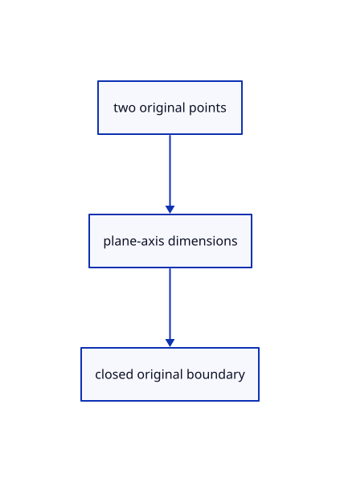

# 14.3.1 · Construct rectangles and polygons in plane axes

**Chapter 14 · Coordinates and geometry tools · Section 14.3 · Planar shapes and regular solids** · [Contents](contents.md)

**Typing: 16–31 minutes.** [Estimate](typing-load.md).

Measure the second point along the current frame and produce original closed kernel polylines.

## Type

Continue from [Exercise current drawing tools and original persistence](72s-exercise-current-drawing-tools-and-original-persistence.md). [Save or recover your work](recovery.md).

### 1. `src/planar.rs`

Construct current planar polylines from signed dimensions and a checked orientation frame.

Create the file and type:

```rust
--8<-- "journey/code/73-construct-rectangles-and-polygons-in-plane-axes-01.rs"
```

### 2. `src/lib.rs`

Register the planar component.

<details>
<summary>Locate the existing block</summary>

```rust
#[cfg(test)]
mod drawing_tests;
```

</details>

After that block, type:

```rust
--8<-- "journey/code/73-construct-rectangles-and-polygons-in-plane-axes-02.rs" skip=32
```

## Run and check

Run this from `session_viewer` to select the fixed dependency versions and install supplied binary assets. It updates Cargo.lock and preserves the previous lock. It does not write implementation code:

```sh
npm --prefix ../session_tests run course -- dependencies 14.3.1
```

In your project:

```sh
cd workspace/journey
REGEN_PROTO=0 cargo build --lib --locked --target wasm32-unknown-unknown -j1
REGEN_PROTO=0 CARGO_BUILD_JOBS=1 trunk serve --port 8780
```

Open `http://127.0.0.1:8780/`. Keep an existing Trunk server running; saving rebuilds it.

The original line, polyline and marker remain visible while current planar constructions extend the same draft. The completed exercise creates a closed rectangle and oriented polygon.

### Recorded visual result

**Previous native render — current verification pending.**

One original horizontal line, a two-segment polyline and its point marker remain visible.


*This recorded image predates a source or checker change. Rebuild this checkpoint before using it as current evidence; browser controls require separate acceptance.*

This reference image is shared with [14.2.20 · Exercise current drawing tools and original persistence](72s-exercise-current-drawing-tools-and-original-persistence.md). It does not demonstrate a new feature by itself.

<details>
<summary>Code explanation and diagram</summary>


two original points → plane-axis dimensions → closed original boundary.



Does the second polygon point set a bounding-box corner?

No. It is a polygon corner on the radius from the first point, which is the center.

Study estimate, including typing and experiments: 0.5–1 hours.

</details>

<details>
<summary>Optional experiment</summary>

Inspect signed rectangle dimensions and the polygon rotation that places a corner on the second point.

</details>

<details>
<summary>Check and save your work</summary>

Restore experimental edits, then run from `session_viewer`:

```sh
npm --prefix ../session_tests run course -- check 14.3.1
npm --prefix ../session_tests run course -- save 14.3.1
```

Source comparison leaves your project untouched. [Save and recovery instructions](recovery.md).

</details>

<details>
<summary>Viewer coverage and verification</summary>


The inherited drawing contract remains authored and unrun. The final planar contract adds rectangle and polygon options, Sides, invalid input, Undo/Redo and original coordinates; actual browser execution remains required.

[Full validation scope](release.md).

To reproduce the scripted acceptance of the reference checkpoint, run from `session_viewer` with the [course bundle server](release.md#reproduce) running on port 8781:

```sh
npm --prefix ../session_tests run course -- capture 14.3.1
```

This uses the verified reference bundle; it does not check or change your typed project.

</details>
