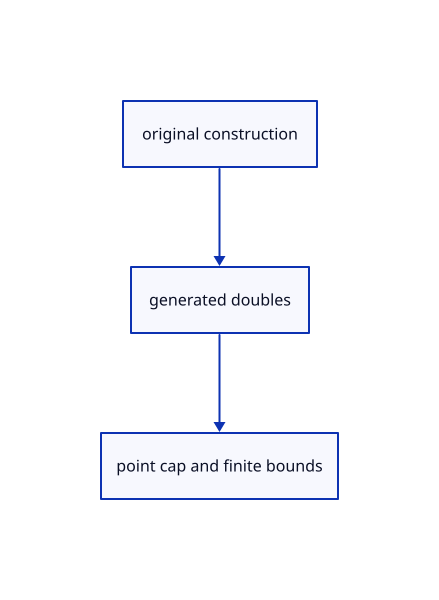

# 14.3.2 · Bound generated original construction points

**Chapter 14 · Coordinates and geometry tools · Section 14.3 · Planar shapes and regular solids** · [Contents](contents.md)

**Typing: 6–12 minutes.** [Estimate](typing-load.md).

Validate polygon sides and every generated original coordinate before preparing display geometry.

## Type

Continue from [Construct rectangles and polygons in plane axes](73-construct-rectangles-and-polygons-in-plane-axes.md). [Save or recover your work](recovery.md).

### 1. `src/planar.rs`

Bound original side counts and generated coordinates before preparing the resulting chain.

<details>
<summary>Locate the existing block</summary>

```rust
}
```

</details>

After that block, type:

```rust
--8<-- "journey/code/73a-bound-generated-original-construction-points-01.rs" skip=3
```

## Run and check

Run this from `session_viewer` to select the fixed dependency versions and install supplied binary assets. It updates Cargo.lock and preserves the previous lock. It does not write implementation code:

```sh
npm --prefix ../session_tests run course -- dependencies 14.3.2
```

In your project:

```sh
cd workspace/journey
REGEN_PROTO=0 cargo build --lib --locked --target wasm32-unknown-unknown -j1
REGEN_PROTO=0 CARGO_BUILD_JOBS=1 trunk serve --port 8780
```

Open `http://127.0.0.1:8780/`. Keep an existing Trunk server running; saving rebuilds it.


### Recorded visual result

**Previous native render — current verification pending.**

One original horizontal line, a two-segment polyline and its point marker remain visible.


*This recorded image predates a source or checker change. Rebuild this checkpoint before using it as current evidence; browser controls require separate acceptance.*

This reference image is shared with [14.2.20 · Exercise current drawing tools and original persistence](72s-exercise-current-drawing-tools-and-original-persistence.md). It does not demonstrate a new feature by itself.

<details>
<summary>Code explanation and diagram</summary>


original construction → generated doubles → point cap and finite bounds.



Why reserve one point below4096 sides?

The closed original polyline repeats its first point at the end;4095 sides produce4096 original points.

Study estimate, including typing and experiments: 0.5–1 hours.

</details>

<details>
<summary>Optional experiment</summary>

Try Sides2 and4096, zero-width rectangles and a generated point beyond the coordinate range.

</details>

<details>
<summary>Check and save your work</summary>

Restore experimental edits, then run from `session_viewer`:

```sh
npm --prefix ../session_tests run course -- check 14.3.2
npm --prefix ../session_tests run course -- save 14.3.2
```

Source comparison leaves your project untouched. [Save and recovery instructions](recovery.md).

</details>

<details>
<summary>Viewer coverage and verification</summary>


The inherited drawing contract remains authored and unrun. The final planar contract adds rectangle and polygon options, Sides, invalid input, Undo/Redo and original coordinates; actual browser execution remains required.

[Full validation scope](release.md).

To reproduce the scripted acceptance of the reference checkpoint, run from `session_viewer` with the [course bundle server](release.md#reproduce) running on port 8781:

```sh
npm --prefix ../session_tests run course -- capture 14.3.2
```

This uses the verified reference bundle; it does not check or change your typed project.

</details>
