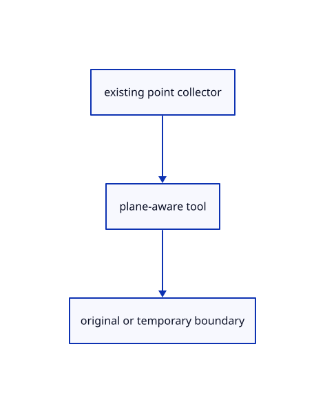

# 14.3.3 · Give point tools a plane aware construction hook

**Chapter 14 · Coordinates and geometry tools · Section 14.3 · Planar shapes and regular solids** · [Contents](contents.md)

**Typing: 4–8 minutes.** [Estimate](typing-load.md).

Extend the existing tool with plane-aware builds, temporary outlines and optional side-count input.

## Type

Continue from [Bound generated original construction points](73a-bound-generated-original-construction-points.md). [Save or recover your work](recovery.md).

### 1. `src/tool.rs`

Extend the point-tool interface with original construction frames and temporary boundary hooks.

<details>
<summary>Locate the existing block</summary>

```rust
    fn count(&self) -> usize;
    fn build(&self, points: &[[f64; 3]]) -> Result<Built, &'static str>;
    fn buttons(&self) -> Vec<(String, String)> { vec![("Cancel".into(), "Escape".into())] }
}
```

</details>

Edit the existing block to match this code; keep unchanged lines:

```rust
--8<-- "journey/code/73b-give-point-tools-a-plane-aware-construction-hook-01.rs"
```

## Run and check

Run this from `session_viewer` to select the fixed dependency versions and install supplied binary assets. It updates Cargo.lock and preserves the previous lock. It does not write implementation code:

```sh
npm --prefix ../session_tests run course -- dependencies 14.3.3
```

In your project:

```sh
cd workspace/journey
REGEN_PROTO=0 cargo build --lib --locked --target wasm32-unknown-unknown -j1
REGEN_PROTO=0 CARGO_BUILD_JOBS=1 trunk serve --port 8780
```

Open `http://127.0.0.1:8780/`. Keep an existing Trunk server running; saving rebuilds it.


### Recorded visual result

**Previous native render — current verification pending.**

One original horizontal line, a two-segment polyline and its point marker remain visible.


*This recorded image predates a source or checker change. Rebuild this checkpoint before using it as current evidence; browser controls require separate acceptance.*

This reference image is shared with [14.2.20 · Exercise current drawing tools and original persistence](72s-exercise-current-drawing-tools-and-original-persistence.md). It does not demonstrate a new feature by itself.

<details>
<summary>Code explanation and diagram</summary>


existing point collector → plane-aware tool → original or temporary boundary.



Should every tool accept Sides?

No. Only Polygon owns a side count; other tools reject that input. Existing Point, Line and Move keep their behavior.

Study estimate, including typing and experiments: 0.5–1 hours.

</details>

<details>
<summary>Optional experiment</summary>

Compare the default tool hooks with the explicit Polygon side-count hook.

</details>

<details>
<summary>Check and save your work</summary>

Restore experimental edits, then run from `session_viewer`:

```sh
npm --prefix ../session_tests run course -- check 14.3.3
npm --prefix ../session_tests run course -- save 14.3.3
```

Source comparison leaves your project untouched. [Save and recovery instructions](recovery.md).

</details>

<details>
<summary>Viewer coverage and verification</summary>


The inherited drawing contract remains authored and unrun. The final planar contract adds rectangle and polygon options, Sides, invalid input, Undo/Redo and original coordinates; actual browser execution remains required.

[Full validation scope](release.md).

To reproduce the scripted acceptance of the reference checkpoint, run from `session_viewer` with the [course bundle server](release.md#reproduce) running on port 8781:

```sh
npm --prefix ../session_tests run course -- capture 14.3.3
```

This uses the verified reference bundle; it does not check or change your typed project.

</details>
