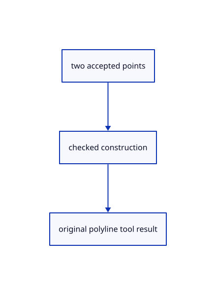

# 14.3.4 · Build original rectangle and polygon tool results

**Chapter 14 · Coordinates and geometry tools · Section 14.3 · Planar shapes and regular solids** · [Contents](contents.md)

**Typing: 13–26 minutes.** [Estimate](typing-load.md).

Add two-point construction tools that generate one validated original polyline in the current frame.

## Type

Continue from [Give point tools a plane aware construction hook](73b-give-point-tools-a-plane-aware-construction-hook.md). [Save or recover your work](recovery.md).

### 1. `src/tool.rs`

Build precise original rectangle and polygon results through the current construction frame.

Edit these blocks from bottom to top. Keep the surrounding lines unchanged.

<details>
<summary>Locate this block</summary>

```rust
                let points=points.iter().map(|p|session_rust::Point::new(p[0],p[1],p[2])).collect();
                Ok(Built::Polyline(crate::chain::PreparedChain::polyline(Rc::new(session_rust::Polyline::new(points)))?))
            }
            _ => Err("The tool needs more points"),
        }
    }
```

</details>

Replace it with:

```rust
                let points=points.iter().map(|p|session_rust::Point::new(p[0],p[1],p[2])).collect();
                Ok(Built::Polyline(crate::chain::PreparedChain::polyline(Rc::new(session_rust::Polyline::new(points)))?))
            }
            (Self::Rectangle|Self::Polygon {..},_)=>self.build_on_plane(points,crate::cplane::CPlane::Xy),
            _ => Err("The tool needs more points"),
        }
    }
```

<details>
<summary>Locate this block</summary>

```rust
}

#[derive(Clone, Copy, Debug)]
pub enum Shape { Point, Line, Move, Polyline }

impl Tool for Shape {
    fn name(&self) -> &'static str { match self { Self::Point => "Point", Self::Line => "Line", Self::Move => "Move", Self::Polyline => "Polyline" } }
    fn count(&self) -> usize { match self { Self::Point => 1, Self::Line | Self::Move => 2, Self::Polyline => 0 } }
    fn buttons(&self)->Vec<(String,String)> {
        let mut buttons=vec![("Cancel".into(),"Escape".into())];
        if matches!(self,Self::Polyline) {buttons.insert(0,("Close".into(),"Close".into()));}buttons
```

</details>

Replace it with:

```rust
}

#[derive(Clone, Copy, Debug)]
pub enum Shape { Point, Line, Move, Polyline, Rectangle, Polygon {sides:usize} }

impl Tool for Shape {
    fn name(&self) -> &'static str { match self { Self::Point => "Point", Self::Line => "Line", Self::Move => "Move", Self::Polyline => "Polyline", Self::Rectangle=>"Polyline Rectangle",Self::Polygon {..}=>"Polyline Polygon" } }
    fn count(&self) -> usize { match self { Self::Point => 1, Self::Line | Self::Move => 2, Self::Polyline => 0,Self::Rectangle|Self::Polygon {..}=>2 } }
    fn build_on_plane(&self,points:&[[f64;3]],plane:crate::cplane::CPlane)->Result<Built,&'static str> {
        let (kind,sides)=match self {Self::Rectangle=>("rectangle",4),Self::Polygon {sides}=>("polygon",*sides),_=>return self.build(points)};
        let points=crate::planar::points(kind,plane,sides,points)?;Self::Polyline.build(&points)
    }
    fn outline(&self,points:&[[f64;3]],plane:crate::cplane::CPlane)->Vec<[f64;3]> {
        match self {Self::Rectangle if points.len()==2=>crate::planar::points("rectangle",plane,4,points).unwrap_or_default(),
            Self::Polygon {sides} if points.len()==2=>crate::planar::points("polygon",plane,*sides,points).unwrap_or_default(),_=>points.to_vec()}
    }
    fn buttons(&self)->Vec<(String,String)> {
        let mut buttons=vec![("Cancel".into(),"Escape".into())];
        if matches!(self,Self::Polyline) {buttons.insert(0,("Close".into(),"Close".into()));}buttons
```

<details>
<summary>Complete updated block reference</summary>

```rust
use crate::{marker::PreparedPoint, stroke::PreparedLine};
use std::rc::Rc;

pub enum Built { Point(PreparedPoint), Line(PreparedLine), Move([f64; 3]), Polyline(crate::chain::PreparedChain) }

pub trait Tool: std::fmt::Debug {
    fn name(&self) -> &'static str;
    fn count(&self) -> usize;
    fn build(&self, points: &[[f64; 3]]) -> Result<Built, &'static str>;
    fn build_on_plane(&self,points:&[[f64;3]],_plane:crate::cplane::CPlane)->Result<Built,&'static str> {self.build(points)}
    fn outline(&self,points:&[[f64;3]],_plane:crate::cplane::CPlane)->Vec<[f64;3]> {points.to_vec()}
    fn sides(&self)->Option<usize> {None}
    fn set_sides(&mut self,_sides:usize)->Result<(),&'static str> {Err("Sides works while drawing a polygon")}
    fn buttons(&self) -> Vec<(String, String)> { vec![("Cancel".into(), "Escape".into())] }
}

#[derive(Clone, Copy, Debug)]
pub enum Shape { Point, Line, Move, Polyline, Rectangle, Polygon {sides:usize} }

impl Tool for Shape {
    fn name(&self) -> &'static str { match self { Self::Point => "Point", Self::Line => "Line", Self::Move => "Move", Self::Polyline => "Polyline", Self::Rectangle=>"Polyline Rectangle",Self::Polygon {..}=>"Polyline Polygon" } }
    fn count(&self) -> usize { match self { Self::Point => 1, Self::Line | Self::Move => 2, Self::Polyline => 0,Self::Rectangle|Self::Polygon {..}=>2 } }
    fn build_on_plane(&self,points:&[[f64;3]],plane:crate::cplane::CPlane)->Result<Built,&'static str> {
        let (kind,sides)=match self {Self::Rectangle=>("rectangle",4),Self::Polygon {sides}=>("polygon",*sides),_=>return self.build(points)};
        let points=crate::planar::points(kind,plane,sides,points)?;Self::Polyline.build(&points)
    }
    fn outline(&self,points:&[[f64;3]],plane:crate::cplane::CPlane)->Vec<[f64;3]> {
        match self {Self::Rectangle if points.len()==2=>crate::planar::points("rectangle",plane,4,points).unwrap_or_default(),
            Self::Polygon {sides} if points.len()==2=>crate::planar::points("polygon",plane,*sides,points).unwrap_or_default(),_=>points.to_vec()}
    }
    fn buttons(&self)->Vec<(String,String)> {
        let mut buttons=vec![("Cancel".into(),"Escape".into())];
        if matches!(self,Self::Polyline) {buttons.insert(0,("Close".into(),"Close".into()));}buttons
    }
    fn build(&self, points: &[[f64; 3]]) -> Result<Built, &'static str> {
        match (self, points) {
            (Self::Point, [p]) => Ok(Built::Point(PreparedPoint::new(Rc::new(session_rust::Point::new(p[0], p[1], p[2])))?)),
            (Self::Line, [a, b]) => {
                if a.iter().zip(b).all(|(a, b)| (a-b).abs() < 1e-12) { return Err("Line endpoints must differ"); }
                Ok(Built::Line(PreparedLine::new(Rc::new(session_rust::Line::new(a[0], a[1], a[2], b[0], b[1], b[2])))?))
            }
            (Self::Move, [a,b]) => Ok(Built::Move(std::array::from_fn(|i| b[i]-a[i]))),
            (Self::Polyline, points) if (2..=MAX_POINTS).contains(&points.len()) => {
                if !points.windows(2).any(|p| p[0] != p[1]) { return Err("Polyline points must differ"); }
                let points=points.iter().map(|p|session_rust::Point::new(p[0],p[1],p[2])).collect();
                Ok(Built::Polyline(crate::chain::PreparedChain::polyline(Rc::new(session_rust::Polyline::new(points)))?))
            }
            (Self::Rectangle|Self::Polygon {..},_)=>self.build_on_plane(points,crate::cplane::CPlane::Xy),
            _ => Err("The tool needs more points"),
        }
    }
}

pub const MAX_POINTS: usize = 4096;

// A draft owns unfinished points and a cursor, so preview motion cannot become saved geometry or an Undo transaction.
pub struct Draft { pub tool: Box<dyn Tool>, pub points: Vec<[f64; 3]>, pub cursor: Option<[f64; 3]>, pub snapped: Option<crate::snap::Kind>, pub frame: crate::cplane::CPlane, pub plane_points: Option<Vec<[f64;3]>> }

impl Draft {
    pub fn new(shape: Shape) -> Self { Self { tool: Box::new(shape), points: Vec::new(), cursor: None, snapped: None, frame: crate::cplane::CPlane::Xy, plane_points: None } }
    pub fn prompt(&self) -> String {
        let mut prompt=if let Some(points)=&self.plane_points {format!("CPlane 3 Point · point {} of 3 · Esc cancels",points.len()+1)}
            else if self.tool.count()==0 {format!("{} point {} · Enter finishes · Esc cancels",self.tool.name(),self.points.len()+1)}
            else {format!("{} point {} of {} · Esc cancels", self.tool.name(), self.points.len()+1, self.tool.count())};
        if let Some(kind)=self.snapped { prompt.push_str(&format!(" · Snap {kind:?}")); }
        prompt
    }
    pub fn submit(&mut self, point: [f64; 3]) -> Result<Option<Built>, &'static str> { self.submit_many(&[point]) }
    pub fn submit_many(&mut self, added: &[[f64;3]]) -> Result<Option<Built>, &'static str> {
        let mut points=self.points.clone();
        for &point in added { points.push(crate::tool_coords::checked(point)?); }
        let count=self.tool.count(); let limit=if count==0 {MAX_POINTS} else {count};
        if points.len()>limit {return Err("The tool has enough points");}
        let built=if count>0 && points.len()==count {Some(self.build_world(&points)?)} else {None};
        self.points=points;self.cursor=None;self.snapped=None;Ok(built)
    }
    pub fn finish(&self) -> Result<Built,&'static str> { self.build_world(&self.points) }
    // Finished coordinates already belong to the world; their prefix prevents applying a fixed plane a second time during replay.
    pub fn command(&self, points:&[[f64;3]]) -> String {
        let mut line=self.tool.name().to_owned();
        for p in points {line.push_str(&format!(" w{},{},{}",p[0],p[1],p[2]));}line
    }
    pub fn build_world(&self, points:&[[f64;3]]) -> Result<Built,&'static str> {
        let command=self.command(points);let text=command.split_once(' ').map_or("",|(_,text)|text);
        let world=crate::drawing_input::points(text,crate::drawing_coords::plane(),self.frame,&[],None)?;
        self.tool.build(&world)
    }
    pub fn hover(&mut self, point: Option<[f64; 3]>) -> Result<(), &'static str> {
        self.cursor = point.map(crate::tool_coords::checked).transpose()?; Ok(())
    }
}
```

</details>

<details>
<summary>Optional patch references</summary>

Use these original edit fragments when comparing a saved checkpoint. Apply the complete blocks above.

```text
--8<-- "journey/code/73c-build-original-rectangle-and-polygon-tool-results-01.rs"
```

```text
--8<-- "journey/code/73c-build-original-rectangle-and-polygon-tool-results-02.rs"
```

</details>

## Run and check

Run this from `session_viewer` to select the fixed dependency versions and install supplied binary assets. It updates Cargo.lock and preserves the previous lock. It does not write implementation code:

```sh
npm --prefix ../session_tests run course -- dependencies 14.3.4
```

In your project:

```sh
cd workspace/journey
REGEN_PROTO=0 cargo build --lib --locked --target wasm32-unknown-unknown -j1
REGEN_PROTO=0 CARGO_BUILD_JOBS=1 trunk serve --port 8780
```

Open `http://127.0.0.1:8780/`. Keep an existing Trunk server running; saving rebuilds it.


### Recorded visual result

**Previous native render — current verification pending.**

One original horizontal line, a two-segment polyline and its point marker remain visible.


*This recorded image predates a source or checker change. Rebuild this checkpoint before using it as current evidence; browser controls require separate acceptance.*

This reference image is shared with [14.2.20 · Exercise current drawing tools and original persistence](72s-exercise-current-drawing-tools-and-original-persistence.md). It does not demonstrate a new feature by itself.

<details>
<summary>Code explanation and diagram</summary>


two accepted points → checked construction → original polyline tool result.



Should changing the construction frame flatten the shape to XY?

No. Generate every original point along the current plane axes and preserve its world placement.

Study estimate, including typing and experiments: 0.5–1 hours.

</details>

<details>
<summary>Optional experiment</summary>

Compare Rectangle in XZ with a rotated Polygon on a translated three-point frame.

</details>

<details>
<summary>Check and save your work</summary>

Restore experimental edits, then run from `session_viewer`:

```sh
npm --prefix ../session_tests run course -- check 14.3.4
npm --prefix ../session_tests run course -- save 14.3.4
```

Source comparison leaves your project untouched. [Save and recovery instructions](recovery.md).

</details>

<details>
<summary>Viewer coverage and verification</summary>


The inherited drawing contract remains authored and unrun. The final planar contract adds rectangle and polygon options, Sides, invalid input, Undo/Redo and original coordinates; actual browser execution remains required.

[Full validation scope](release.md).

To reproduce the scripted acceptance of the reference checkpoint, run from `session_viewer` with the [course bundle server](release.md#reproduce) running on port 8781:

```sh
npm --prefix ../session_tests run course -- capture 14.3.4
```

This uses the verified reference bundle; it does not check or change your typed project.

</details>
