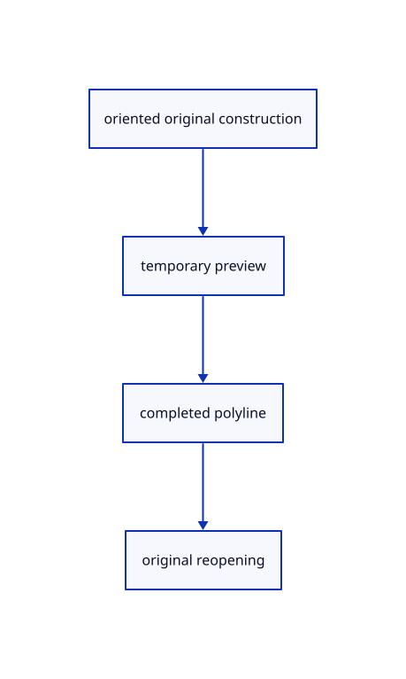

# 14.3.8 · Exercise oriented original planar constructions

**Chapter 14 · Coordinates and geometry tools · Section 14.3 · Planar shapes and regular solids** · [Contents](contents.md)

**Typing: 0–0 minutes.** [Estimate](typing-load.md).

Copy precise plane, side-count, preview, original persistence and single-transaction fixtures.

## Type

Continue from [Register current planar options and temporary outlines](73f-register-current-planar-options-and-temporary-outlines.md). [Save or recover your work](recovery.md).

<details>
<summary>Supplied validation fixture</summary>

Copy this supplied authoring fixture once. Continue with the browser build below; the course does not require running native tests.

### 1. `src/planar_tests.rs`

Copy current oriented construction, original archive, side-cap, failed-input and temporary-preview fixtures.

Copy this supplied file:

```text
--8<-- "journey/code/73g-exercise-oriented-original-planar-constructions-01.rs"
```

</details>

<details>
<summary>Supplied validation fixture</summary>

Copy this supplied authoring fixture once. Continue with the browser build below; the course does not require running native tests.

### 2. `src/lib.rs`

Register the planar component.

<details>
<summary>Locate the existing block</summary>

```text

pub mod planar;
```

</details>

After that block, append this supplied code:

```text
--8<-- "journey/code/73g-exercise-oriented-original-planar-constructions-02.rs" skip=17
```

</details>

## Run and check

Run this from `session_viewer` to select the fixed dependency versions and install supplied binary assets. It updates Cargo.lock and preserves the previous lock. It does not write implementation code:

```sh
npm --prefix ../session_tests run course -- dependencies 14.3.8
```

In your project:

```sh
cd workspace/journey
REGEN_PROTO=0 cargo build --lib --locked --target wasm32-unknown-unknown -j1
REGEN_PROTO=0 CARGO_BUILD_JOBS=1 trunk serve --port 8780
```

Open `http://127.0.0.1:8780/`. Keep an existing Trunk server running; saving rebuilds it.

An original rectangle and five-sided polygon render on white. Both are closed kernel polylines in the chosen plane; hover remains temporary. Invalid input preserves the draft, and completion creates one Undo transaction with exact original Save/Open.

### Recorded visual result

**Previous native render — current verification pending.**

A closed original rectangle and an oriented five-sided original polygon render from completed current commands.


*This recorded image predates a source or checker change. Rebuild this checkpoint before using it as current evidence; browser controls require separate acceptance.*

<details>
<summary>Code explanation and diagram</summary>


oriented original construction → temporary preview → completed polyline → original reopening.



What proves an oriented polygon keeps its source geometry?

Its original radius, closing point and tilted plane coordinates remain exact through Save/Open and Undo/Redo.

Study estimate, including typing and experiments: 0.5–1 hours.

</details>

<details>
<summary>Optional experiment</summary>

Type Close, CPlane XY, Polyline Rectangle w-0.8,-0.4,0 w-0.1,0.4,0, Polyline Polygon, Sides5, w0.5,0,0, w0.8,0,0 and Fit. Try invalid corners, Escape and Undo/Redo.

</details>

<details>
<summary>Check and save your work</summary>

Restore experimental edits, then run from `session_viewer`:

```sh
npm --prefix ../session_tests run course -- check 14.3.8
npm --prefix ../session_tests run course -- save 14.3.8
```

Source comparison leaves your project untouched. [Save and recovery instructions](recovery.md).

</details>

<details>
<summary>Viewer coverage and verification</summary>

Use the maintained Polyline Points/Rectangle/Polygon options and plane-axis construction function. Rectangle measures signed width and height along the current frame; Polygon uses its first point as center and second as a corner. Sides accepts3 through4095, leaving one original closing point under the4096 cap. Finished input points keep current d918ec90 world prefixes, including multiword tool names. Generated original f64 polylines remain editable and persist with existing scene transactions. Preview boundaries are temporary derived strokes. Exact rational circle, ellipse, arc and parabola tools are covered with the curve family76; their verbs must also remain in85/96 inventories. This course preserves original doubles and bounds generated coordinates; it does not claim distant-coordinate GPU or Lenovo timing proof.

Earlier tests remain. Completed planar fixtures cover plane-axis rectangles, oriented polygons, side bounds, tilted world-prefixed drafts, original Save/Open, one Undo/Redo transaction, invalid construction without lost points, temporary boundaries and the closing-point cap.

Current Rectangle/Polygon options, Sides, failed input, Undo/Redo and exact original coordinates are authored and syntax checked; actual browser execution remains required.

[Full validation scope](release.md).

To reproduce the scripted acceptance of the reference checkpoint, run from `session_viewer` with the [course bundle server](release.md#reproduce) running on port 8781:

```sh
npm --prefix ../session_tests run course -- capture 14.3.8
```

This uses the verified reference bundle; it does not check or change your typed project.

</details>
