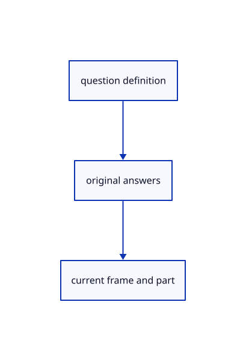

# 14.4.2 · Own current shape questions and answer state

**Chapter 14 · Coordinates and geometry tools · Section 14.4 · Polyhedra and round solids** · [Contents](contents.md)

**Typing: 12–23 minutes.** [Estimate](typing-load.md).

Retain Point or Number answers, the chosen representation and a checked frame beside the current question.

## Type

Continue from [Add the remaining regular kernel solids](74-copy-current-solid-geometry-and-question-definitions.md). [Save or recover your work](recovery.md).

### 1. `src/primitive_draft.rs`

Own checked current primitive questions, representation choice and original answer state.

Create the file and type:

```rust
--8<-- "journey/code/74a-own-current-shape-questions-and-answer-state-01.rs"
```

### 2. `src/lib.rs`

Register the primitive component.

<details>
<summary>Locate the existing block</summary>

```rust

pub mod primitive_dodecahedron;
```

</details>

After that block, type:

```rust
--8<-- "journey/code/74a-own-current-shape-questions-and-answer-state-02.rs" skip=33
```

## Run and check

Run this from `session_viewer` to select the fixed dependency versions and install supplied binary assets. It updates Cargo.lock and preserves the previous lock. It does not write implementation code:

```sh
npm --prefix ../session_tests run course -- dependencies 14.4.2
```

In your project:

```sh
cd workspace/journey
REGEN_PROTO=0 cargo build --lib --locked --target wasm32-unknown-unknown -j1
REGEN_PROTO=0 CARGO_BUILD_JOBS=1 trunk serve --port 8780
```

Open `http://127.0.0.1:8780/`. Keep an existing Trunk server running; saving rebuilds it.


### Recorded visual result

**Previous native render — current verification pending.**

A closed original rectangle and an oriented five-sided original polygon remain visible.


*This recorded image predates a source or checker change. Rebuild this checkpoint before using it as current evidence; browser controls require separate acceptance.*

This reference image is shared with [14.3.8 · Exercise oriented original planar constructions](73g-exercise-oriented-original-planar-constructions.md). It does not demonstrate a new feature by itself.

<details>
<summary>Code explanation and diagram</summary>


question definition → original answers → current frame and part.



Why distinguish a number from a point?

A number answers a size or signed height. A point supplies a measured location in the current frame.

Study estimate, including typing and experiments: 0.5–1 hours.

</details>

<details>
<summary>Optional experiment</summary>

Compare Box base center, corner or length, width and signed height prompts.

</details>

<details>
<summary>Check and save your work</summary>

Restore experimental edits, then run from `session_viewer`:

```sh
npm --prefix ../session_tests run course -- check 14.4.2
npm --prefix ../session_tests run course -- save 14.4.2
```

Source comparison leaves your project untouched. [Save and recovery instructions](recovery.md).

</details>

<details>
<summary>Viewer coverage and verification</summary>


The inherited planar contract remains authored and unrun. The final solid contract adds typed/clicked dimensions, choices/defaults, atomic invalid input, original creation, Undo/Redo, temporary previews and current quick-click drift; actual browser execution remains required.

[Full validation scope](release.md).

To reproduce the scripted acceptance of the reference checkpoint, run from `session_viewer` with the [course bundle server](release.md#reproduce) running on port 8781:

```sh
npm --prefix ../session_tests run course -- capture 14.4.2
```

This uses the verified reference bundle; it does not check or change your typed project.

</details>
