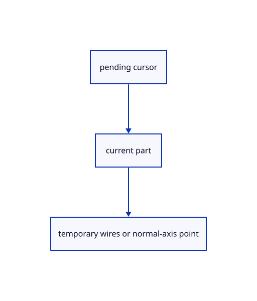

# 14.4.6 · Preview solid wires and measure normal axis clicks

**Chapter 14 · Coordinates and geometry tools · Section 14.4 · Polyhedra and round solids** · [Contents](contents.md)

**Typing: 10–20 minutes.** [Estimate](typing-load.md).

Derive temporary wires from the pending answer and resolve a height click along the frame’s normal.

## Type

Continue from [Answer shape dimensions with atomic typed batches](74d-answer-shape-dimensions-with-atomic-typed-batches.md). [Save or recover your work](recovery.md).

### 1. `src/primitive_draft.rs`

Derive temporary current solid wires and finite height-axis click locations.

<details>
<summary>Locate the existing block</summary>

```rust
        *self=candidate;Ok(geometry)
    }
}
```

</details>

Edit the existing block to match this code; keep unchanged lines:

```rust
--8<-- "journey/code/74e-preview-solid-wires-and-measure-normal-axis-clicks-01.rs"
```

## Run and check

Run this from `session_viewer` to select the fixed dependency versions and install supplied binary assets. It updates Cargo.lock and preserves the previous lock. It does not write implementation code:

```sh
npm --prefix ../session_tests run course -- dependencies 14.4.6
```

In your project:

```sh
cd workspace/journey
REGEN_PROTO=0 cargo build --lib --locked --target wasm32-unknown-unknown -j1
REGEN_PROTO=0 CARGO_BUILD_JOBS=1 trunk serve --port 8780
```

Open `http://127.0.0.1:8780/`. Keep an existing Trunk server running; saving rebuilds it.


### Recorded visual result

**Previous native render — current verification pending.**

A closed original rectangle and an oriented five-sided original polygon remain visible.


*This recorded image predates a source or checker change. Rebuild this checkpoint before using it as current evidence; browser controls require separate acceptance.*

This reference image is shared with [14.3.8 · Exercise oriented original planar constructions](73g-exercise-oriented-original-planar-constructions.md). It does not demonstrate a new feature by itself.

<details>
<summary>Code explanation and diagram</summary>


pending cursor → current part → temporary wires or normal-axis point.



Why reject a height click from Top on an XY base?

The view lies along the height axis, so that click cannot determine a unique height. A typed number remains valid.

Study estimate, including typing and experiments: 0.5–1 hours.

</details>

<details>
<summary>Optional experiment</summary>

Compare the base preview, a complete cuboid preview and a height-axis click from an oblique view.

</details>

<details>
<summary>Check and save your work</summary>

Restore experimental edits, then run from `session_viewer`:

```sh
npm --prefix ../session_tests run course -- check 14.4.6
npm --prefix ../session_tests run course -- save 14.4.6
```

Source comparison leaves your project untouched. [Save and recovery instructions](recovery.md).

</details>

<details>
<summary>Viewer coverage and verification</summary>


The inherited planar contract remains authored and unrun. The final solid contract adds typed/clicked dimensions, choices/defaults, atomic invalid input, original creation, Undo/Redo, temporary previews and current quick-click drift; actual browser execution remains required.

[Full validation scope](release.md).

To reproduce the scripted acceptance of the reference checkpoint, run from `session_viewer` with the [course bundle server](release.md#reproduce) running on port 8781:

```sh
npm --prefix ../session_tests run course -- capture 14.4.6
```

This uses the verified reference bundle; it does not check or change your typed project.

</details>
