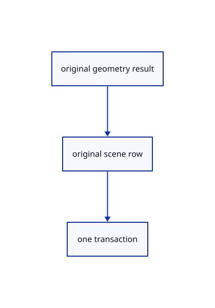

# 14.4.7 · Adopt original primitive geometry through existing rows

**Chapter 14 · Coordinates and geometry tools · Section 14.4 · Polyhedra and round solids** · [Contents](contents.md)

**Typing: 8–16 minutes.** [Estimate](typing-load.md).

Send original BRep, Mesh and NURBS curve results to the established scene adapters and history boundary.

## Type

Continue from [Preview solid wires and measure normal axis clicks](74e-preview-solid-wires-and-measure-normal-axis-clicks.md). [Save or recover your work](recovery.md).

### 1. `src/primitive_geometry.rs`

Adopt original kernel geometry through existing original-source scene rows.

Create the file and type:

```rust
--8<-- "journey/code/74f-adopt-original-primitive-geometry-through-existing-rows-01.rs"
```

### 2. `src/lib.rs`

Register the primitive component.

<details>
<summary>Locate the existing block</summary>

```rust

pub mod primitive_draft;
```

</details>

After that block, type:

```rust
--8<-- "journey/code/74f-adopt-original-primitive-geometry-through-existing-rows-02.rs" skip=26
```

### 3. `src/tool.rs`

Carry an original completed primitive result beside existing point and placement results.

<details>
<summary>Locate the existing block</summary>

```rust
use std::rc::Rc;

pub enum Built { Point(PreparedPoint), Line(PreparedLine), Move([f64; 3]), Polyline(crate::chain::PreparedChain) }

pub trait Tool: std::fmt::Debug {
```

</details>

Edit the existing block to match this code; keep unchanged lines:

```rust
--8<-- "journey/code/74f-adopt-original-primitive-geometry-through-existing-rows-03.rs"
```

### 4. `src/editor.rs`

Commit completed original primitive geometry inside the existing history transaction.

<details>
<summary>Locate the existing block</summary>

```rust
            crate::tool::Built::Line(line)=>scene.insert_line(line).map(|_|()),
            crate::tool::Built::Polyline(line)=>scene.insert_path(line).map(|_|()),
            crate::tool::Built::Move(_)=>unreachable!("Move uses its placement preview"),
        })?;
```

</details>

Edit the existing block to match this code; keep unchanged lines:

```rust
--8<-- "journey/code/74f-adopt-original-primitive-geometry-through-existing-rows-04.rs"
```

## Run and check

Run this from `session_viewer` to select the fixed dependency versions and install supplied binary assets. It updates Cargo.lock and preserves the previous lock. It does not write implementation code:

```sh
npm --prefix ../session_tests run course -- dependencies 14.4.7
```

In your project:

```sh
cd workspace/journey
REGEN_PROTO=0 cargo build --lib --locked --target wasm32-unknown-unknown -j1
REGEN_PROTO=0 CARGO_BUILD_JOBS=1 trunk serve --port 8780
```

Open `http://127.0.0.1:8780/`. Keep an existing Trunk server running; saving rebuilds it.


### Recorded visual result

**Previous native render — current verification pending.**

A closed original rectangle and an oriented five-sided original polygon remain visible.


*This recorded image predates a source or checker change. Rebuild this checkpoint before using it as current evidence; browser controls require separate acceptance.*

This reference image is shared with [14.3.8 · Exercise oriented original planar constructions](73g-exercise-oriented-original-planar-constructions.md). It does not demonstrate a new feature by itself.

<details>
<summary>Code explanation and diagram</summary>


original geometry result → original scene row → one transaction.



Does the tool save its preview mesh?

No. It saves the original kernel geometry; derived display and temporary wires remain separate.

Study estimate, including typing and experiments: 0.5–1 hours.

</details>

<details>
<summary>Optional experiment</summary>

Inspect the original BRep owner and Mesh source before Undo and exact archive reopening.

</details>

<details>
<summary>Check and save your work</summary>

Restore experimental edits, then run from `session_viewer`:

```sh
npm --prefix ../session_tests run course -- check 14.4.7
npm --prefix ../session_tests run course -- save 14.4.7
```

Source comparison leaves your project untouched. [Save and recovery instructions](recovery.md).

</details>

<details>
<summary>Viewer coverage and verification</summary>


The inherited planar contract remains authored and unrun. The final solid contract adds typed/clicked dimensions, choices/defaults, atomic invalid input, original creation, Undo/Redo, temporary previews and current quick-click drift; actual browser execution remains required.

[Full validation scope](release.md).

To reproduce the scripted acceptance of the reference checkpoint, run from `session_viewer` with the [course bundle server](release.md#reproduce) running on port 8781:

```sh
npm --prefix ../session_tests run course -- capture 14.4.7
```

This uses the verified reference bundle; it does not check or change your typed project.

</details>
