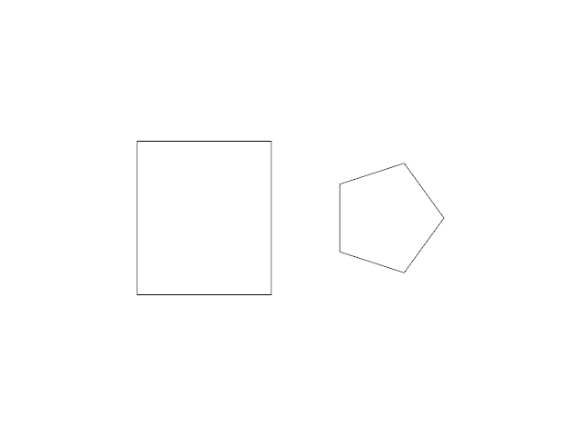
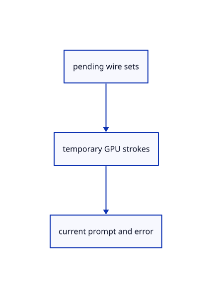

# 14.4.15 · Draw temporary solid wire sets and report current input failures

**Chapter 14 · Coordinates and geometry tools · Section 14.4 · Polyhedra and round solids** · [Contents](contents.md)

**Typing: 4–8 minutes.** [Estimate](typing-load.md).

Draw each pending wire independently and deliver the original detailed shape error through the existing command UI.

## Type

Continue from [Register every current solid name and representation](74m-register-every-current-solid-name-and-representation.md). [Save or recover your work](recovery.md).

### 1. `src/tool_preview.rs`

Preview independent temporary solid wire sets without connecting unrelated boundaries.

<details>
<summary>Locate the existing block</summary>

```rust
        let yellow = [1., 0.75, 0.05, 1.]; let mut strokes = Vec::new(); let mut markers = Vec::new();
        if let Some(draft) = draft {
            for pair in draft.outline().windows(2) {if pair[0]!=pair[1] {strokes.push(crate::stroke::Stroke {start:pair[0].map(|v|v as f32),end:pair[1].map(|v|v as f32),width:2.,colour:yellow});}}
            if let Some(cursor) = draft.cursor {
                markers.push(crate::marker::Marker { center: cursor.map(|v| v as f32), diameter: 8., colour: yellow });
```

</details>

Edit the existing block to match this code; keep unchanged lines:

```rust
--8<-- "journey/code/74n-draw-temporary-solid-wire-sets-and-report-current-input-failures-01.rs"
```

### 2. `src/browser.rs`

Show current detailed shape input failures without changing the existing browser command lifecycle.

<details>
<summary>Locate the existing block</summary>

```rust
                Ok(Some(Change::View)) | Ok(None) => {}
                Err(error) => {
                    report(&error);
                    if event.type_() == "viewer-file" { panel.answer("Open", &error); }
                    else { panel.result(&error); }
```

</details>

Edit the existing block to match this code; keep unchanged lines:

```rust
--8<-- "journey/code/74n-draw-temporary-solid-wire-sets-and-report-current-input-failures-02.rs"
```

## Run and check

Run this from `session_viewer` to select the fixed dependency versions and install supplied binary assets. It updates Cargo.lock and preserves the previous lock. It does not write implementation code:

```sh
npm --prefix ../session_tests run course -- dependencies 14.4.15
```

In your project:

```sh
cd workspace/journey
REGEN_PROTO=0 cargo build --lib --locked --target wasm32-unknown-unknown -j1
REGEN_PROTO=0 CARGO_BUILD_JOBS=1 trunk serve --port 8780
```

Open `http://127.0.0.1:8780/`. Keep an existing Trunk server running; saving rebuilds it.


### Recorded visual result

**Previous native render — current verification pending.**

A closed original rectangle and an oriented five-sided original polygon remain visible.



*This recorded image predates a source or checker change. Rebuild this checkpoint before using it as current evidence; browser controls require separate acceptance.*

This reference image is shared with [14.3.8 · Exercise oriented original planar constructions](73g-exercise-oriented-original-planar-constructions.md). It does not demonstrate a new feature by itself.

<details>
<summary>Code explanation and diagram</summary>


pending wire sets → temporary GPU strokes → current prompt and error.



Should separate wires be joined into one polyline?

No. Their independent boundaries must not gain fabricated connector segments between the base, top and side edges.

Study estimate, including typing and experiments: 0.5–1 hours.

</details>

<details>
<summary>Optional experiment</summary>

Hover a Box height and inspect both rectangles and four vertical edges before completion.

</details>

<details>
<summary>Check and save your work</summary>

Restore experimental edits, then run from `session_viewer`:

```sh
npm --prefix ../session_tests run course -- check 14.4.15
npm --prefix ../session_tests run course -- save 14.4.15
```

Source comparison leaves your project untouched. [Save and recovery instructions](recovery.md).

</details>

<details>
<summary>Viewer coverage and verification</summary>


The inherited planar contract remains authored and unrun. The final solid contract adds typed/clicked dimensions, choices/defaults, atomic invalid input, original creation, Undo/Redo, temporary previews and current quick-click drift; actual browser execution remains required.

[Full validation scope](release.md).

To reproduce the scripted acceptance of the reference checkpoint, run from `session_viewer` with the [course bundle server](release.md#reproduce) running on port 8781:

```sh
npm --prefix ../session_tests run course -- capture 14.4.15
```

This uses the verified reference bundle; it does not check or change your typed project.

</details>
