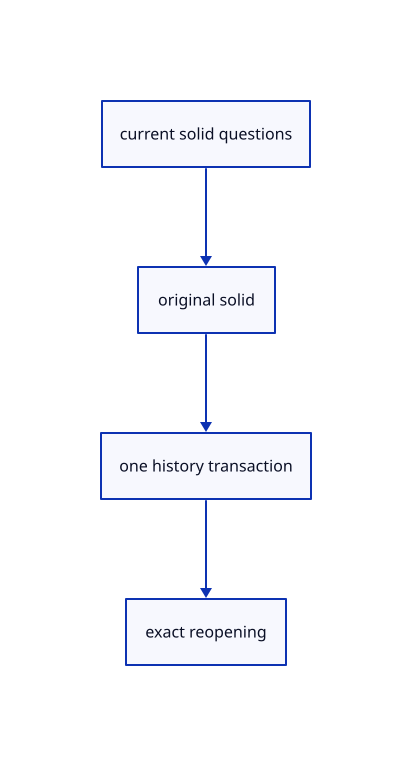

# 14.4.17 · Exercise current solid input and original persistence

**Chapter 14 · Coordinates and geometry tools · Section 14.4 · Polyhedra and round solids** · [Contents](contents.md)

**Typing: 0–0 minutes.** [Estimate](typing-load.md).

Copy current dimension, choice, default, preview, history and exact original Save/Open fixtures.

## Type

Continue from [Keep quick mouse drift as a click using current event time](74o-keep-quick-mouse-drift-as-a-click-using-current-event-time.md). [Save or recover your work](recovery.md).

<details>
<summary>Supplied validation fixture</summary>

Copy this supplied authoring fixture once. Continue with the browser build below; the course does not require running native tests.

### 1. `src/primitive_tests.rs`

Copy current integrated solid input, original persistence, axis clicks, temporary preview and atomic error fixtures.

Copy this supplied file:

```text
--8<-- "journey/code/74p-exercise-current-solid-input-and-original-persistence-01.rs"
```

</details>

<details>
<summary>Supplied validation fixture</summary>

Copy this supplied authoring fixture once. Continue with the browser build below; the course does not require running native tests.

### 2. `src/lib.rs`

Register the primitive component.

<details>
<summary>Locate the existing block</summary>

```text

pub mod primitive_registry;
```

</details>

After that block, append this supplied code:

```text
--8<-- "journey/code/74p-exercise-current-solid-input-and-original-persistence-02.rs" skip=29
```

</details>

## Run and check

Run this from `session_viewer` to select the fixed dependency versions and install supplied binary assets. It updates Cargo.lock and preserves the previous lock. It does not write implementation code:

```sh
npm --prefix ../session_tests run course -- dependencies 14.4.17
```

In your project:

```sh
cd workspace/journey
REGEN_PROTO=0 cargo build --lib --locked --target wasm32-unknown-unknown -j1
REGEN_PROTO=0 CARGO_BUILD_JOBS=1 trunk serve --port 8780
```

Open `http://127.0.0.1:8780/`. Keep an existing Trunk server running; saving rebuilds it.

An original Box, Pyramid and Block With Hole render on white. Current solid questions support typed dimensions, clicked corners, signed heights, offered Enter defaults and Brep/Mesh options. Unfinished wires remain temporary, completion creates one history transaction, and original Save/Open preserves the result.

### Recorded visual result

**Previous native render — current verification pending.**

Original Box, Pyramid and Block With Hole display from completed maintained solid commands.


*This recorded image predates a source or checker change. Rebuild this checkpoint before using it as current evidence; browser controls require separate acceptance.*

<details>
<summary>Code explanation and diagram</summary>


current solid questions → original solid → one history transaction → exact reopening.



What distinguishes the tool’s answers from its saved geometry?

Answers and temporary wires belong to an unfinished tool. Completion saves one original kernel geometry with current source identity.

Study estimate, including typing and experiments: 0.5–1 hours.

</details>

<details>
<summary>Optional experiment</summary>

Type Close, CPlane XY, Box w-1.3,0,0 0.8 0.6 0.8, Pyramid w0,0,0 0.8 1, Block With Hole w1.3,0,0 0.8 0.6 0.5 0.15, View Isometric and Fit. Try Mesh, Enter defaults, invalid dimensions, quick-click drift and Undo/Redo.

</details>

<details>
<summary>Check and save your work</summary>

Restore experimental edits, then run from `session_viewer`:

```sh
npm --prefix ../session_tests run course -- check 14.4.17
npm --prefix ../session_tests run course -- save 14.4.17
```

Source comparison leaves your project untouched. [Save and recovery instructions](recovery.md).

</details>

<details>
<summary>Viewer coverage and verification</summary>

Copy current maintained Box, Pyramid, Block With Hole, Tetrahedron, Octahedron, Icosahedron and Dodecahedron geometry/read/outline callbacks and native parity fixtures. Original geometry enters existing scene rows and one history transaction. Typed numbers answer dimensions; clicked or typed points follow the current fixed plane and original world-prefix rules. Enter takes only an offered default. Brep/Mesh choices retain answers when their question sequence permits it; upfront choices cannot change after a point. Height clicks use the normal axis and refuse a view parallel to it. Atomic typed batches refuse extra input after completion. Current local430accda click policy keeps a quick drift within10 CSS pixels as a click; beyond4 pixels after200ms or beyond10 pixels starts a drag. Browser uses event timestamps; clockless legacy fixture helpers use200ms for their existing held-drag cases. Current CPlane view/project/grazing behavior is already retained; View grid following is connected in85. Round solids follow75 and exact rational curves76. Original f64 tests do not claim distant-coordinate GPU or Lenovo timing proof.

Earlier tests remain. Ten copied current primitive/frame tests plus six integrated fixtures cover original geometry, dimensions/corner input, negative heights, choices, Enter defaults, failed batches, temporary wires, axis clicks, one history transaction and exact archive reopening. Three click-drift fixtures cover quick wobble, held/far motion, pointer ownership and invalid timestamps.

Current solid names/choices/defaults, invalid input, original creation, Undo/Redo, temporary wires and quick-click drift are authored and syntax checked; actual browser execution remains required.

[Full validation scope](release.md).

To reproduce the scripted acceptance of the reference checkpoint, run from `session_viewer` with the [course bundle server](release.md#reproduce) running on port 8781:

```sh
npm --prefix ../session_tests run course -- capture 14.4.17
```

This uses the verified reference bundle; it does not check or change your typed project.

</details>
