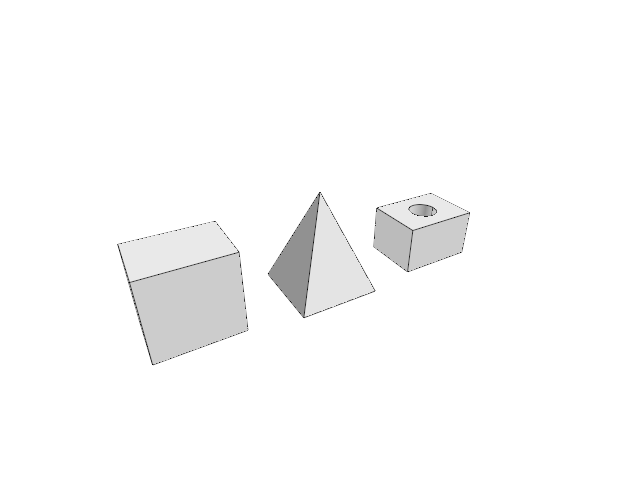

# 14.5.2 · Build original capsules with shared dimensions

**Chapter 14 · Coordinates and geometry tools · Section 14.5 · Tori, circles and conics** · [Contents](contents.md)

**Typing: 23–45 minutes.** [Estimate](typing-load.md).

Reuse the cylinder’s existing center, radius and signed-height questions. Require a height larger than the diameter, draw the two cap junctions, and build the kernel capsule around its local central axis. Transform that original mesh through the same checked frame.

## Type

Continue from [Build original tori with checked radii](75-reuse-current-round-solid-builders.md). [Save or recover your work](recovery.md).

### 1. `src/round_capsule.rs`

Type the whole original solid builder using the existing frame and question helpers.

Create the file and type:

```rust
--8<-- "journey/code/75aa-build-original-capsules-with-shared-dimensions-typed-round_capsule.rs"
```

<details>
<summary>Supplied validation fixture</summary>

Copy this supplied authoring fixture once. Continue with the browser build below; the course does not require running native tests.

### 2. `src/round_capsule.rs`

Supply only the unchanged original representation and topology fixture.

<details>
<summary>Locate the existing block</summary>

```text
use crate::primitive_shape as shape;
use crate::primitive_shape::{ MESH_ONLY, Part, Shape};
use crate::round_cylinder as cylinder;
use session_rust::{Geometry, Line, Point, Primitives};
use std::rc::Rc;

pub static SHAPE: Shape = Shape {
    name: "Capsule",
    options: MESH_ONLY,
    upfront: false,
    ask: cylinder::ask,
    read,
    outline,
    build,
};

/// The cylinder's radius and height, taller than the two caps.
fn read(frame: &shape::Frame, answers: &[shape::Answer], option: &str) -> Result<Part, String> {
    let part = cylinder::read(frame, answers, option)?;

    if let [radius, height] = part.sizes[..]
        && height.abs() <= 2.0 * radius
    {
        return Err("The height must exceed the diameter".into());
    }

    Ok(part)
}

/// The base ring, then the rings where the caps begin and four sides.
fn outline(part: &Part) -> Vec<Vec<Point>> {
    let [radius, height] = part.sizes[..] else {
        return part
            .sizes
            .first()
            .map_or_else(Vec::new, |radius| vec![part.frame.ring(*radius, 0.0)]);
    };
    let (frame, height) = part.frame.upright(height);
    let (low, high) = (radius, height - radius);
    let mut wires = vec![frame.ring(radius, low), frame.ring(radius, high)];

    for (u, v) in [(1.0, 0.0), (0.0, 1.0), (-1.0, 0.0), (0.0, -1.0)] {
        wires.push(vec![
            frame.at(0.0, 0.0, 0.0),
            frame.at(u * radius, v * radius, low),
            frame.at(u * radius, v * radius, high),
            frame.at(0.0, 0.0, height),
        ]);
    }

    wires
}

/// The kernel capsule on the axis, its caps ending at the base and the height.
fn build(part: &Part, _option: &str) -> Result<Geometry, String> {
    let [radius, height] = part.sizes[..] else {
        return Err("Capsule needs a radius and a height".into());
    };
    let (frame, height) = part.frame.upright(height);
    let axis = Line::from_points(
        &Point::new(0.0, 0.0, radius),
        &Point::new(0.0, 0.0, height - radius),
    );
    let mut mesh = Primitives::capsule_mesh(&axis, radius);
    mesh.transform(&frame.to_xform());
    mesh.name = "capsule".into();
    Ok(Geometry::Mesh(Rc::new(mesh)))
}
```

</details>

After that block, append this supplied code:

```text
--8<-- "journey/code/75aa-build-original-capsules-with-shared-dimensions-typed-round_capsule-fixtures.rs" skip=2191
```

</details>

### 3. `src/lib.rs`

Register this shared original solid builder.

<details>
<summary>Locate the existing block</summary>

```rust

pub mod round_torus;
```

</details>

After that block, type:

```rust
--8<-- "journey/code/75a-retain-mesh-only-round-families-02.rs" skip=22
```

## Run and check

Run this from `session_viewer` to select the fixed dependency versions and install supplied binary assets. It updates Cargo.lock and preserves the previous lock. It does not write implementation code:

```sh
npm --prefix ../session_tests run course -- dependencies 14.5.2
```

In your project:

```sh
cd workspace/journey
REGEN_PROTO=0 cargo build --lib --locked --target wasm32-unknown-unknown -j1
REGEN_PROTO=0 CARGO_BUILD_JOBS=1 trunk serve --port 8780
```

Open `http://127.0.0.1:8780/`. Keep an existing Trunk server running; saving rebuilds it.

The capsule builder shares one dimension contract across preview and source preparation.

### Recorded visual result

**Previous native render — current verification pending.**



*This recorded image predates a source or checker change. Rebuild this checkpoint before using it as current evidence; browser controls require separate acceptance.*

This reference image is shared with [14.4.18 · Build original cylinders with signed height](74za-build-original-cylinders-with-signed-height.md). It does not demonstrate a new feature by itself.

<details>
<summary>Code explanation and diagram</summary>


existing questions → checked local frame → exact kernel solid.


Why must capsule height exceed its diameter?

The two hemispherical caps need a positive central span. Reuse the existing dimensions but reject overlapping caps before building.

Study estimate, including typing and experiments: 0.5–1 hours.

</details>

<details>
<summary>Optional experiment</summary>

Trace heights above and equal to twice the radius. Check where the two cap centers lie before transforming the source mesh.

</details>

<details>
<summary>Check and save your work</summary>

Restore experimental edits, then run from `session_viewer`:

```sh
npm --prefix ../session_tests run course -- check 14.5.2
npm --prefix ../session_tests run course -- save 14.5.2
```

Source comparison leaves your project untouched. [Save and recovery instructions](recovery.md).

</details>

<details>
<summary>Viewer coverage and verification</summary>

This original mesh builder is preparatory until the existing round command registry connects it. The earlier solid drawing stays unchanged.


[Full validation scope](release.md).

</details>
