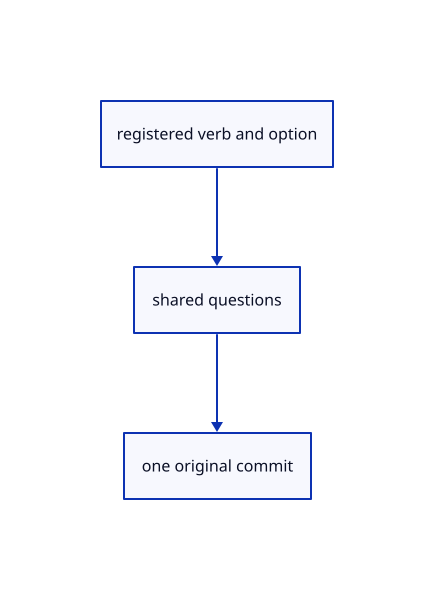

# 14.5.4 · Register current round names and choices

**Chapter 14 · Coordinates and geometry tools · Section 14.5 · Tori, circles and conics** · [Contents](contents.md)

**Typing: 9–17 minutes.** [Estimate](typing-load.md).

Connect each current name to its maintained definition and available representation. The shared input owner already handles defaults, cursor previews, cancellation and atomic invalid input.

## Type

Continue from [Mesh original quad-sphere patches](75a-retain-mesh-only-round-families.md). [Save or recover your work](recovery.md).

### 1. `src/primitive_registry.rs`

Expose every current round verb and only its supported representation choices.

<details>
<summary>Locate the existing block</summary>

```rust
    ("Dodecahedron Brep",&crate::primitive_dodecahedron::SHAPE,0),
    ("Dodecahedron Mesh",&crate::primitive_dodecahedron::SHAPE,1),
    ("bo",&crate::primitive_box::SHAPE,0),
];
```

</details>

Edit the existing block to match this code; keep unchanged lines:

```rust
--8<-- "journey/code/75b-register-current-round-names-and-choices-01.rs"
```

## Run and check

Run this from `session_viewer` to select the fixed dependency versions and install supplied binary assets. It updates Cargo.lock and preserves the previous lock. It does not write implementation code:

```sh
npm --prefix ../session_tests run course -- dependencies 14.5.4
```

In your project:

```sh
cd workspace/journey
REGEN_PROTO=0 cargo build --lib --locked --target wasm32-unknown-unknown -j1
REGEN_PROTO=0 CARGO_BUILD_JOBS=1 trunk serve --port 8780
```

Open `http://127.0.0.1:8780/`. Keep an existing Trunk server running; saving rebuilds it.


### Recorded visual result

**Previous native render — current verification pending.**

Original Box, Pyramid and Block With Hole remain visible.


*This recorded image predates a source or checker change. Rebuild this checkpoint before using it as current evidence; browser controls require separate acceptance.*

This reference image is shared with [14.4.17 · Exercise current solid input and original persistence](74p-exercise-current-solid-input-and-original-persistence.md). It does not demonstrate a new feature by itself.

<details>
<summary>Code explanation and diagram</summary>


registered verb and option → shared questions → one original commit.



What happens after an invalid torus minor radius?

The accepted center and major radius remain. Correct the minor radius or cancel; no scene object or history transaction is created by the error.

Study estimate, including typing and experiments: 0.5–1 hours.

</details>

<details>
<summary>Optional experiment</summary>

Type Torus, w0,0,0, 2, 3, then0.5. Compare Cylinder Mesh with default Cylinder. Try Capsule Brep and Quad Sphere Brep and verify both fail before replacing another active tool.

</details>

<details>
<summary>Check and save your work</summary>

Restore experimental edits, then run from `session_viewer`:

```sh
npm --prefix ../session_tests run course -- check 14.5.4
npm --prefix ../session_tests run course -- save 14.5.4
```

Source comparison leaves your project untouched. [Save and recovery instructions](recovery.md).

</details>

<details>
<summary>Viewer coverage and verification</summary>


The preceding solid browser contract remains authored and unrun. The final round contract adds current representations, invalid torus input, correction, cancellation, Undo/Redo and the six round families. Actual browser execution remains required.

[Full validation scope](release.md).

To reproduce the scripted acceptance of the reference checkpoint, run from `session_viewer` with the [course bundle server](release.md#reproduce) running on port 8781:

```sh
npm --prefix ../session_tests run course -- capture 14.5.4
```

This uses the verified reference bundle; it does not check or change your typed project.

</details>
