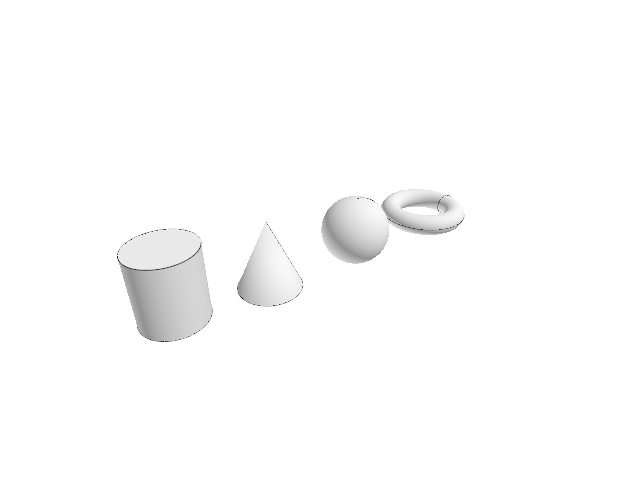
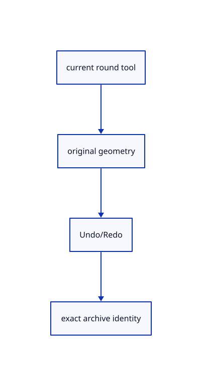

# 14.5.5 · Exercise round originals and one transaction

**Chapter 14 · Coordinates and geometry tools · Section 14.5 · Tori, circles and conics** · [Contents](contents.md)

**Typing: 0–0 minutes.** [Estimate](typing-load.md).

Check current original source geometry, signed frames, temporary outlines and archive identity through the same Editor routes used by the learner.

## Type

Continue from [Register current round names and choices](75b-register-current-round-names-and-choices.md). [Save or recover your work](recovery.md).

<details>
<summary>Supplied validation fixture</summary>

Copy this supplied authoring fixture once. Continue with the browser build below; the course does not require running native tests.

### 1. `src/round_tests.rs`

Copy integrated current round representation, frame, preview, invalid-input, history and archive identity fixtures.

Copy this supplied file:

```text
--8<-- "journey/code/75c-exercise-round-originals-and-one-transaction-01.rs"
```

</details>

<details>
<summary>Supplied validation fixture</summary>

Copy this supplied authoring fixture once. Continue with the browser build below; the course does not require running native tests.

### 2. `src/lib.rs`

Register the maintained round component.

<details>
<summary>Locate the existing block</summary>

```text

pub mod round_quad_sphere;
```

</details>

After that block, append this supplied code:

```text
--8<-- "journey/code/75c-exercise-round-originals-and-one-transaction-02.rs" skip=28
```

</details>

## Run and check

Run this from `session_viewer` to select the fixed dependency versions and install supplied binary assets. It updates Cargo.lock and preserves the previous lock. It does not write implementation code:

```sh
npm --prefix ../session_tests run course -- dependencies 14.5.5
```

In your project:

```sh
cd workspace/journey
REGEN_PROTO=0 cargo build --lib --locked --target wasm32-unknown-unknown -j1
REGEN_PROTO=0 CARGO_BUILD_JOBS=1 trunk serve --port 8780
```

Open `http://127.0.0.1:8780/`. Keep an existing Trunk server running; saving rebuilds it.

An original Cylinder, Cone, Sphere and Torus display on white. Capsule and Quad Sphere create original meshes. Invalid dimensions keep accepted answers and Redo; completion is one transaction.

### Recorded visual result

**Previous native render — current verification pending.**

Original Cylinder, Cone, Sphere and Torus display from current maintained round commands.



*This recorded image predates a source or checker change. Rebuild this checkpoint before using it as current evidence; browser controls require separate acceptance.*

<details>
<summary>Code explanation and diagram</summary>


current round tool → original geometry → Undo/Redo → exact archive identity.



Does Undo remove only the tessellated display?

No. Completion adds one original object in one transaction. Undo removes that object; Redo restores it without rebuilding the tool answers.

Study estimate, including typing and experiments: 0.5–1 hours.

</details>

<details>
<summary>Optional experiment</summary>

Type Close, CPlane XY, Cylinder w-2,0,0 0.45 1, Cone w-0.7,0,0 0.45 1, Sphere w0.7,0,0.5 0.5, Torus w2,0,0.5 0.5 0.15, View Isometric and Fit. Then create Capsule and Quad Sphere, inspect their Mesh output, Undo/Redo, Save and reopen.

</details>

<details>
<summary>Check and save your work</summary>

Restore experimental edits, then run from `session_viewer`:

```sh
npm --prefix ../session_tests run course -- check 14.5.5
npm --prefix ../session_tests run course -- save 14.5.5
```

Source comparison leaves your project untouched. [Save and recovery instructions](recovery.md).

</details>

<details>
<summary>Viewer coverage and verification</summary>

Copy current maintained Cylinder, Cone, Sphere, Torus, Capsule and Quad Sphere definitions, original builders, temporary outlines and native fixtures. Reuse the preceding question, frame and history adapters. Cylinder and Cone accept a nonzero signed height. Torus requires 0 < minor radius < major radius. Capsule requires total height magnitude greater than its diameter. Capsule and Quad Sphere offer Mesh only; the other four default to Brep and also offer Mesh. Preserve original BRep or Mesh on Save/Open; previews remain temporary.

Earlier checks remain. Six copied round-family native fixtures and three integrated cases verify current original representations, signed/tilted frames, incomplete previews, invalid dimensions, one Undo transaction, preserved Redo on failure and original source GUIDs on archive reopening.

The preceding solid browser contract remains authored and unrun. The final round contract adds current representations, invalid torus input, correction, cancellation, Undo/Redo and the six round families. Actual browser execution remains required.

[Full validation scope](release.md).

To reproduce the scripted acceptance of the reference checkpoint, run from `session_viewer` with the [course bundle server](release.md#reproduce) running on port 8781:

```sh
npm --prefix ../session_tests run course -- capture 14.5.5
```

This uses the verified reference bundle; it does not check or change your typed project.

</details>
