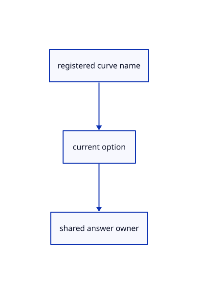

# 14.6.2 · Expose exact curve choices in the existing registry

**Chapter 14 · Coordinates and geometry tools · Section 14.6 · Parabolas and exact curve editing** · [Contents](contents.md)

**Typing: 4–8 minutes.** [Estimate](typing-load.md).

Register current multiword names and the Arc Center and3 Points options. The shared question owner already validates dimensions and preserves accepted answers after failure.

## Type

Continue from [Read original parabola inputs in a checked frame](76-copy-exact-planar-curve-definitions.md). [Save or recover your work](recovery.md).

### 1. `src/primitive_registry.rs`

Register all current exact planar curve names and supported Arc options.

<details>
<summary>Locate the existing block</summary>

```rust
    ("Quad Sphere",&crate::round_quad_sphere::SHAPE,0),
    ("Quad Sphere Mesh",&crate::round_quad_sphere::SHAPE,0),
    ("bo",&crate::primitive_box::SHAPE,0),
];
```

</details>

Edit the existing block to match this code; keep unchanged lines:

```rust
--8<-- "journey/code/76a-expose-exact-curve-choices-in-the-existing-registry-01.rs"
```

## Run and check

Run this from `session_viewer` to select the fixed dependency versions and install supplied binary assets. It updates Cargo.lock and preserves the previous lock. It does not write implementation code:

```sh
npm --prefix ../session_tests run course -- dependencies 14.6.2
```

In your project:

```sh
cd workspace/journey
REGEN_PROTO=0 cargo build --lib --locked --target wasm32-unknown-unknown -j1
REGEN_PROTO=0 CARGO_BUILD_JOBS=1 trunk serve --port 8780
```

Open `http://127.0.0.1:8780/`. Keep an existing Trunk server running; saving rebuilds it.


### Recorded visual result

**Previous native render — current verification pending.**

Original Cylinder, Cone, Sphere and Torus remain visible.


*This recorded image predates a source or checker change. Rebuild this checkpoint before using it as current evidence; browser controls require separate acceptance.*

This reference image is shared with [14.5.5 · Exercise round originals and one transaction](75c-exercise-round-originals-and-one-transaction.md). It does not demonstrate a new feature by itself.

<details>
<summary>Code explanation and diagram</summary>


registered curve name → current option → shared answer owner.



How does a three point arc choose its side?

The curve runs from the first point through the third point to the second point. Collinear points cannot determine a circle and are refused.

Study estimate, including typing and experiments: 0.5–1 hours.

</details>

<details>
<summary>Optional experiment</summary>

Try Nurbs Curve Arc Center0,0,0 1 90, then its3 Points form0,0,0 2,0,0 1,1,0. Try360 degrees and correct the same unfinished arc to270.

</details>

<details>
<summary>Check and save your work</summary>

Restore experimental edits, then run from `session_viewer`:

```sh
npm --prefix ../session_tests run course -- check 14.6.2
npm --prefix ../session_tests run course -- save 14.6.2
```

Source comparison leaves your project untouched. [Save and recovery instructions](recovery.md).

</details>

<details>
<summary>Viewer coverage and verification</summary>


The preceding round contract remains authored and unrun. The final curve contract adds exact arc validation and correction, original rational controls, Undo/Redo, closed XZ input and five displayed curve families. Actual browser execution remains required.

[Full validation scope](release.md).

To reproduce the scripted acceptance of the reference checkpoint, run from `session_viewer` with the [course bundle server](release.md#reproduce) running on port 8781:

```sh
npm --prefix ../session_tests run course -- capture 14.6.2
```

This uses the verified reference bundle; it does not check or change your typed project.

</details>
